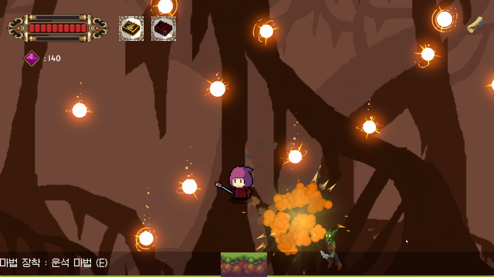

# The Last Mage 기술 문서

> **마법책을 바꿔 가며 마법으로 싸우는 2D 액션 플랫포머 (개인 프로젝트)**

<!-- 작성 상태: 개요·목차 초안. [확인 필요]는 본인이 채울 곳입니다. 다 채우면 이 주석과 아래 "작성 안내" 인용문은 지워 주세요. -->

| 항목 | 내용 |
|---|---|
| 장르 | 2D 액션 플랫포머 (플랫폼 이동보다 전투와 마법 활용이 중심) |
| 개발 기간 | [확인 필요] |
| 개발 인원 | 1인 (개인 프로젝트) |
| 개발 환경 | Unity [확인 필요: 정확한 버전], C#, [확인 필요: IDE·주요 패키지] |
| 주요 기술 | [확인 필요: 코드 확인 후 작성] |
| 링크 | GitHub: [확인 필요] · 시연 영상: [확인 필요] |

<!-- 대표 이미지: images/에 넣은 뒤 아래 줄의 주석을 풀고 파일 이름을 맞춰 주세요. -->
<!--  -->

---

## 1. 프로젝트 개요

### 1.1 무엇을 만들었나 (What)

**The Last Mage**는 플레이어가 **마법책을 바꿔 가며 마법을 사용해** 싸우는 2D 액션 플랫포머입니다.
플랫폼 이동보다 **전투와 마법 활용**에 중심을 두었습니다.

주요 기능은 다음과 같습니다.

- **마법책 교체와 마법 사용**
- **일반 몬스터·보스의 상태 관리**
- **보스 등장 시네마틱 연출과 다이얼로그**
- **2회차 진행 시 전용 텍스트 연출**

### 1.2 왜, 무엇에 집중했나 (Why)

[확인 필요: 이 프로젝트에서 해결하려던 문제나 목표. 예) 왜 마법책 "교체"를 핵심으로 삼았는지, 왜 상태 관리 구조가 필요했는지]

### 1.3 핵심 플레이 루프

[확인 필요: 플레이어가 한 판 동안 반복하는 흐름]

### 1.4 조작법

[확인 필요: 이동·공격·마법 사용·마법책 교체 키]

### 1.5 이 문서에서 다루는 내용

이 문서는 아래 세 가지를 중심으로 설명합니다. (기술적으로 강조할 후보이며, 코드를 확인한 뒤 확정합니다.)

1. 마법책 교체 시스템 (3장)
2. 적·보스 상태 관리 (4장)
3. 코루틴 기반 연출 — 보스 등장 시네마틱·다이얼로그, 2회차 텍스트 연출 (5장)

---

## 2. 전체 구조

> 작성 안내: 실제 코드를 확인한 뒤 작성합니다. 아키텍처 다이어그램(mermaid) 1개 이상, 핵심 클래스의 역할, 왜 그렇게 나눴는지를 적습니다.

### 2.1 아키텍처

[확인 필요: 코드 확인 후 작성]

### 2.2 클래스 역할

[확인 필요: 코드 확인 후 작성]

---

## 3. 시스템 ① 마법책 교체와 마법 사용

### 3.1 개요

[확인 필요: 마법책 종류와 각 마법책의 차이, 교체 방법]

### 3.2 구조

[확인 필요: 코드 확인 후 작성]

### 3.3 핵심 기능

[확인 필요: 핵심 코드(20~50줄)와 본인의 설명]

### 3.4 고민과 선택

[확인 필요: 대안 2개 이상과 선택 이유]

---

## 4. 시스템 ② 적·보스 상태 관리

### 4.1 개요

[확인 필요: 일반 몬스터와 보스가 가지는 상태 종류]

### 4.2 구조

[확인 필요: 코드 확인 후 작성]

### 4.3 핵심 기능

[확인 필요: 핵심 코드와 본인의 설명]

### 4.4 고민과 선택

[확인 필요: 대안 2개 이상과 선택 이유]

---

## 5. 시스템 ③ 연출 — 보스 시네마틱·다이얼로그·2회차 텍스트

### 5.1 개요

보스가 등장할 때 시네마틱 연출과 다이얼로그가 나오고, 2회차로 진행하면 전용 텍스트 연출이 나옵니다.

[확인 필요: 연출이 진행되는 순서, 2회차를 판별하는 방법]

### 5.2 구조

[확인 필요: 코드 확인 후 작성]

### 5.3 핵심 기능

[확인 필요: 코루틴 기반 연출 코드와 본인의 설명]

### 5.4 고민과 선택

[확인 필요: 대안 2개 이상과 선택 이유]

---

## 6. 트러블슈팅

> 작성 안내: 실제로 겪은 문제를 문제 → 원인 → 해결 → 결과 순서로 적습니다.

[확인 필요]

---

## 7. 결과 및 회고

### 7.1 결과

[확인 필요: 완성 범위, 가능하면 측정값]

### 7.2 아쉬운 점과 개선 계획

[확인 필요]

### 7.3 배운 점

[확인 필요]
