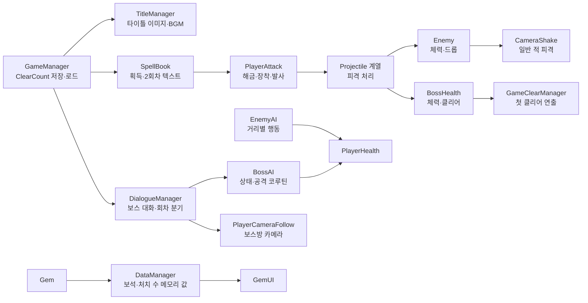
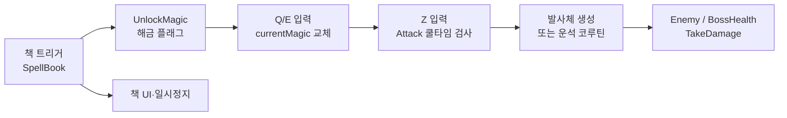
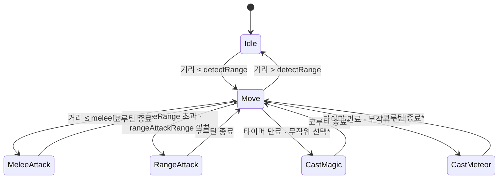

# The Last Mage 기술 문서

> 마법책을 찾아 전투 방식을 넓히고, 한 번의 클리어가 다음 플레이의 이야기 맥락을 바꾸는 2D 액션 플랫포머

| 항목 | 내용 |
|---|---|
| 장르 | 2D 액션 플랫포머 (다회차 서사 연출 포함) |
| 개발 형태 | 1인 개인 프로젝트 |
| 개발 환경 | Unity 6000.3.15f1, C# (`ProjectSettings/ProjectVersion.txt`) |
| 개발 기간 | 기존 기술 문서: 2026.06.24~07.06. Git 기록: 06.24 첫 커밋, 07.09 마지막 커밋. 실제 제작·마감 기간은 **[본인 확인 필요]** |
| 담당·제작 방식 | 1인 프로젝트. AI를 활용한 구체적 코드·문서·리소스 범위는 **[본인 확인 필요]** |
| 링크 | GitHub / 시연 영상: **[본인 추가]** |

**[대표 이미지 위치]** 스테이지에서 플레이어·마법책·적이 함께 보이는 실제 게임 화면을 촬영해 배치합니다. 기존 PDF의 코드 캡처는 구현 확인용 참고 자료로만 쓰고, 이미지 파일을 확보하기 전에는 Markdown 경로를 넣지 않습니다.

---

## 목차

1. [프로젝트 개요](#1-프로젝트-개요)
2. [전체 구조](#2-전체-구조)
3. [핵심 시스템](#3-핵심-시스템)
4. [트러블슈팅](#4-트러블슈팅)
5. [결과와 회고](#5-결과와-회고)
6. [검증 범위와 확인된 문제](#6-검증-범위와-확인된-문제)

---

## 1. 프로젝트 개요

### 1.1 어떤 게임인가

**The Last Mage**는 스테이지를 탐색하며 마법책을 모아 공격 방식을 넓히고, 스테이지 끝에서 보스 마법사와 마주하는 2D 액션 플랫포머입니다. 이 게임에서 가장 중요하게 다룬 것은 **한 번의 클리어가 다음 플레이의 이야기를 다르게 보이게 만드는 것**입니다. 처음 플레이할 때는 의뢰를 받고 보스를 쓰러뜨리는 흐름으로 진행되지만, 클리어한 뒤 다시 시작하면 타이틀 화면과 배경음, 마법책의 문장, 보스와의 대화 끝에 나오는 버튼이 달라지고 결말도 바뀝니다.

기획 단계에서 세운 핵심 경험은 두 가지였습니다(「기획서 초안」 1.1~1.2).

- **성장감** — 탐색 중 발견한 마법책으로 공격 방식이 늘어나는 경험
- **발견감** — 같은 세계를 다시 볼 때 같은 텍스트의 의미가 달라지는 경험

최종 게임은 이 두 경험을 한 스테이지 안에 담았습니다. 기본 마법으로 시작해 두 권의 마법책을 얻으면 관통 마법과 운석 마법을 Q/E로 바꿔 쓸 수 있고, 첫 보스를 쓰러뜨리면 저장된 클리어 횟수에 따라 다음 플레이의 타이틀·마법책·보스 대화 말미의 연출이 달라집니다.

### 1.2 한 판의 흐름

1. 타이틀에서 시작해 의뢰서 UI가 뜨는 스테이지로 들어갑니다.
2. 이동·점프로 스테이지를 지나며 몬스터와 싸우고 보석을 모읍니다.
3. 두 권의 마법책을 얻으면 Q/E로 마법을 바꿔 쓸 수 있습니다.
4. 보스방에 들어서면 보스와의 대화가 시작됩니다.
5. 대화 이후의 전개는 클리어 기록에 따라 갈립니다.
   - **첫 플레이:** 보스전 → 처치 후 왕국군의 화살 연출 → 타이틀 복귀
   - **다음 플레이:** 보스전 대신 왕국군과 운석이 등장하는 자동 연출 → 엔딩 책 UI → 타이틀 복귀

스테이지와 보스방은 별도 씬이 아니라 `Scenes_Stage_01` 한 씬 안에 있습니다(`EditorBuildSettings.asset`, `TitleManager.FadeAndLoadRoutine`, `DialogueManager.OnClickBattleStart`, `GameClearManager.EndingSequence`).

### 1.3 기획에서 줄어든 범위

최초 기획에는 상점 NPC에서 보석을 소비해 성장하는 업그레이드와, 2회차에 보스와 동맹을 맺은 뒤 왕국군과 실시간으로 싸우는 전투가 있었습니다. 최종 게임에서 보석은 수집되고 화면에 표시되지만 소비되지 않으며, 2회차의 왕국군은 엔딩 연출에만 등장합니다. 선택지와 동맹 전투는 현재 코드와 빌드 씬에서 찾을 수 없습니다.

v0.2 업데이트 기획서에서는 두 항목이 빠진 이유를 일정·구현 범위 문제로 회고했습니다(「업데이트 기획서 v0.2」 1.3). 결과적으로 이 프로젝트는 짧은 기간 안에 **전투, 보스 조우, 두 번째 플레이의 서사 변화**를 하나로 잇는 데 무게가 실렸습니다. 각 항목을 포기한 정확한 시점과, 이 우선순위가 개발 당시 본인의 판단이었는지는 **[본인 확인 필요]**.

### 1.4 이 문서에서 다루는 내용

1. **마법책과 스킬 전환** — 탐색으로 얻은 책이 공격 선택지를 늘리는 구조 (3.1)
2. **일반 몬스터와 보스 AI** — 거리 조건과 상태 enum·코루틴으로 만든 전투 (3.2)
3. **다회차 스토리 분기** — 클리어 횟수 하나로 타이틀부터 엔딩까지 바꾸는 구조 (3.3)

각 시스템 안에 그 구조에 대한 고민과 선택을 함께 적었고, 4장에는 트러블슈팅, 5장에는 결과와 회고를 정리했습니다.

> **소스 상태 안내.** Git에 남은 마지막 커밋과 지금 로컬에 있는 Unity 프로젝트 파일은 `BossAI.Update`의 조건 한 줄이 다릅니다. 로컬 파일은 이 줄에서 C# 컴파일 오류가 나고, 마지막 커밋의 같은 조건은 올바릅니다. 이 문서의 동작 설명은 코드가 의도하는 흐름이며, 현재 소스로 직접 빌드해 플레이한 결과가 아닙니다. 문서의 근거와 이 차이는 [6장](#6-검증-범위와-확인된-문제)에 자세히 정리했습니다.

---

## 2. 전체 구조

이 그림에서 볼 것: `GameManager`가 가진 **클리어 횟수**가 타이틀·마법책·보스 대화로 퍼져 나가 회차별 차이를 만들고, 전투는 플레이어의 발사체가 적과 보스에 피해를 주는 흐름으로 이어집니다.



플레이어 쪽은 이동과 공격을 나눴습니다. `PlayerController.Update/FixedUpdate`가 이동·점프를, `PlayerAttack.Update/Attack`이 공격 입력과 쿨타임을 처리합니다. 적 쪽은 두 방식이 섞여 있습니다. `EnemyAI.Update`는 별도 상태 enum 없이 거리 조건만으로 순찰·추적·공격을 고르고, `BossAI`는 상태 enum과 공격 코루틴을 씁니다. 보스가 쓰러지면 `BossHealth.Die`에서 클리어 횟수 증가와 첫 클리어 연출이 함께 호출됩니다.

`GameManager` 프리팹은 타이틀과 스테이지 양쪽 씬에 배치되어 있습니다. `DontDestroyOnLoad`는 주석 처리되어 있어, 씬이 바뀔 때마다 새 인스턴스가 `PlayerPrefs`의 값을 다시 읽습니다(`GameManager.Awake/LoadGameData`, 씬 YAML).

| 기술 요소 | 이 게임에서의 쓰임 | 경계·한계 |
|---|---|---|
| `PlayerPrefs` | `ClearCount` 정수 하나를 저장하고 회차 분기 조건으로 읽음 | 보석·해금 상태·HP를 저장한 근거 없음 |
| 물리 트리거 + enum | 마법책 접촉 시 `MagicType` 해금, Q/E로 장착 전환 | 새 마법을 추가하려면 `switch`·UI·프리팹을 함께 수정 |
| 보스 상태 enum + 코루틴 | 거리별 근접·원거리 공격, 시전 타이밍 분리 | 현재 로컬 파일의 특수 공격 조건은 컴파일 오류 (6.2) |
| 코루틴 + UI | 대사 타이핑, 책 글리치, 두 엔딩 연출 | `DialogueManager`에 카메라·음향·스폰·엔딩 책임이 몰림 |
| `CameraShake` | 일반 적 피격 시 랜덤 오프셋 | 중첩 호출과 카메라 추적 사이의 간섭을 제어하지 않음 |

---

## 3. 핵심 시스템

세 시스템은 1장의 핵심 경험과 하나씩 연결됩니다. 3.1은 **성장감**, 3.3은 **발견감**을 만들고, 3.2는 그 사이를 채우는 전투를 맡습니다.

아래 코드는 흐름을 설명하는 데 필요한 메서드 일부를 발췌한 것이며, 생략한 앞뒤 로직은 본문에 메서드명으로 적었습니다. 각 절 끝의 **고민과 선택**은 문서를 정리하며 현재 구조를 대안과 비교한 내용입니다. 개발 당시에 실제로 같은 비교를 했는지는 따로 표시했습니다.

### 3.1 마법책과 스킬 전환 — 탐색한 만큼 공격 방법이 늘어나도록

스테이지를 탐색한 보상이 단순한 수치 증가가 아니라 **새로운 공격 방식**이 되도록 했습니다. 처음에는 기본 발사체만 쓸 수 있고, 스테이지에 놓인 두 권의 책을 찾으면 적을 꿰뚫는 관통탄과 넓은 범위에 쏟아지는 운석을 고를 수 있게 됩니다. 책을 주우면 게임이 잠시 멈추고 책 UI가 열리며, 책을 닫은 뒤 Q/E로 새 마법을 장착해 Z로 발사합니다. 실제 플레이에서 각 마법이 얼마나 유용하게 쓰였는지는 **[본인 확인 필요]**.

#### 책을 얻고, 고르고, 쏘기까지

이 흐름은 세 부분으로 나뉩니다. `SpellBook`은 책을 획득하는 트리거와 책 UI, 2회차 텍스트를 다룹니다. `PlayerAttack`은 어떤 마법이 해금되었는지, 지금 무엇을 장착했는지, 마법별 쿨타임이 얼마나 남았는지를 들고 있다가 발사합니다. 발사된 뒤의 이동과 충돌은 `Projectile`, `PenetrateProjectile`, `MeteorProjectile`이 각자 처리합니다. 스테이지에 놓인 두 `SpellBook`에는 각각 관통(`bookMagicType: 1`)과 운석(`2`)이 연결되어 있습니다(`Scenes_Stage_01.unity`).



1. 플레이어가 책에 닿으면 `SpellBook.OnTriggerEnter2D`가 `Player` 태그와 `PlayerAttack`을 확인한 뒤 `UnlockMagic(bookMagicType)`을 호출합니다. 이어서 책 UI를 열고 `Time.timeScale = 0`으로 게임을 멈춥니다. 획득한 책은 콜라이더와 스프라이트를 꺼서 같은 씬에서 다시 줍지 않게 합니다.
2. `UnlockMagic`은 `hasPenetrate` 또는 `hasMeteor`만 `true`로 바꿉니다. 여기서 **해금과 장착은 별개**입니다. 책을 얻었다고 `currentMagic`이 자동으로 바뀌지는 않습니다.
3. 책을 닫으면 `SpellBook.OnClickCloseBook`이 시간을 되돌립니다. 이후 `PlayerAttack.Update`에서 해금된 마법에 한해 Q/E로 장착할 수 있고, 같은 키를 한 번 더 누르면 `Basic`으로 돌아가며, 다른 마법 키를 누르면 그 마법으로 바뀝니다.
4. Z를 누르면 `PlayerAttack.Attack`이 호출됩니다. 선택된 마법의 타이머가 0 이하일 때만 발사하고 그 타이머를 다시 채웁니다. 세 타이머는 장착 여부와 관계없이 매 프레임 줄어듭니다.

| 마법 | 발사와 쿨타임 | 충돌·피격 처리 |
|---|---|---|
| 기본 `Basic` | `Shoot`가 `firePoint`에서 프리팹 1개 생성. 기본 쿨타임 0.5초 | `Projectile.Start`가 오른쪽 방향 속도를 주고, `OnTriggerEnter2D`가 적·보스에 피해를 준 뒤 자신을 파괴 |
| 관통 `Penetrate` | `ShootPenetrate`가 프리팹 1개 생성. 기본 쿨타임 5초 | `PenetrateProjectile`은 피해 후 자신을 파괴하지 않아 다음 충돌도 처리. 3초 수명 제한 |
| 운석 `Meteor` | `DropMeteors`가 플레이어 주변 X ±10, 위쪽 Y 7~9에서 기본 15개를 0.08초 간격 생성. 기본 쿨타임 10초 | `MeteorProjectile`은 충돌 시 적·보스에 피해를 주고 파괴. 이동 속도는 스크립트에서 지정하지 않음 |

쿨타임과 운석 수는 `PlayerAttack`의 기본값이고, 스테이지 플레이어에 직렬화된 값도 0.5/5/10초, 15개로 같습니다. `UpdateSkillUI`는 관통·운석의 남은 시간을 각 쿨타임으로 나눠 스킬 아이콘의 가림 비율을 갱신하므로, 남은 쿨타임이 아이콘에 표시됩니다. 세 발사체 모두 `Enemy.TakeDamage`와 `BossHealth.TakeDamage`를 호출하고, 이펙트 프리팹이 연결되어 있으면 생성합니다. 기본·관통 발사체는 플레이어 태그와의 충돌을 무시하지만, 운석 스크립트에는 같은 조기 반환이 없습니다. 특정 충돌체에 맞았을 때 화면에서 어떻게 보이는지는 플레이로 확인해야 합니다.

#### 코드로 보기: 해금과 발사를 나눈 지점

```csharp
// SpellBook.OnTriggerEnter2D, 48~62행 발췌
private void OnTriggerEnter2D(Collider2D collision)
{
    if (collision.CompareTag("Player"))
    {
        PlayerAttack attackScript = collision.GetComponent<PlayerAttack>();
        if (attackScript != null )
        {
            attackScript.UnlockMagic(bookMagicType);
        }
        if (myBookUI != null)
        {
            myBookUI.SetActive(true);
            Time.timeScale = 0f;
            // 이하 책 텍스트·획득 처리 생략
```

책은 **해금까지만** 처리합니다. 실제로 어떤 마법이 나갈지는 아래 `Attack`에서 장착된 마법의 타이머를 보고 결정되며, 마법마다 발사 방식이 갈립니다. 발사체는 생성된 뒤 각자의 `OnTriggerEnter2D`에서 맞은 대상을 판정합니다.

```csharp
// PlayerAttack.Attack의 관통·운석 분기 발췌
case MagicType.Penetrate:
    if (penetrateTimer <= 0f)
    {
        ShootPenetrate();
        penetrateTimer = penetrateCoolTime;
        if (anim != null) anim.SetTrigger("Attack");
    }
    break;
case MagicType.Meteor:
    if (meteorTimer <= 0f)
    {
        ShootMeteor();
        meteorTimer = meteorCoolTime;
        if (anim != null) anim.SetTrigger("Attack");
    }
    break;
```

#### 이 구조로 얻은 것과 남은 과제

책마다 인스펙터에서 `MagicType`을 지정하고 발사체 로직을 파일별로 나눴기 때문에, 두 마법이 어떻게 다르게 동작하는지 코드와 씬에서 따라가기 쉽습니다. 반면 새 마법을 하나 추가하려면 enum, 해금 플래그, 입력·발사 분기, 타이머·UI, 발사체 스크립트를 함께 고쳐야 하고, 세 발사체의 피해·이펙트 처리도 비슷한 코드가 반복됩니다.

해금 플래그는 `PlayerAttack` 인스턴스에만 있으므로 씬에 다시 들어오면 초기화됩니다. `UnlockMagic`에 남아 있는 “영구 해금” 로그 문구와는 실제 동작이 다릅니다.

**[화면 자료 위치]** 책 획득 UI 한 장과, Q/E 전환 후 기본·관통·운석 발사 모습을 비교하는 짧은 GIF를 넣습니다. 실제 파일을 확보한 뒤 삽입합니다.

#### 고민과 선택 ① 마법별로 독립된 발사체 (문서 작성 시점의 분석)

| | 독립 발사체 3종 (현재) | 공통 기반 클래스 + 마법별 차이 |
|---|---|---|
| 장점 | 관통탄의 ‘맞혀도 파괴하지 않음’처럼 마법마다 다른 동작이 각 파일에 바로 드러남 | 피해·이펙트 같은 공통 규칙을 한 곳에서 고칠 수 있음 |
| 단점 | 이동·피해·이펙트 판정이 중복되어, 공통 수정 시 한 파일을 빠뜨릴 수 있음 | 공통 규칙과 마법별 차이의 경계를 먼저 정해야 함 |

기존 기술 문서 PDF(7~9쪽)에는 독립 투사체와 상속 구조를 비교한 내용이 있습니다. 다만 개발 당시 실제로 두 방식을 놓고 고른 것인지, 일정 때문에 단순한 방식을 택한 것인지는 코드와 Git만으로 알 수 없어 **[본인 확인 필요]**로 남깁니다.

현재 방식은 마법이 세 가지뿐인 규모에서 각 동작을 명확하게 보여 주는 대신, 공통 처리의 중복을 감수한 구조입니다. 상속을 도입한다고 모든 중복이 저절로 사라지지는 않으므로, 마법이 더 늘어나거나 같은 수정이 반복될 때 **공통 피격 처리부터 추출**하고 마법별 차이를 어디까지 나눌지 정하는 것이 다음 단계입니다.

### 3.2 일반 몬스터와 보스 AI — 거리에 따라 달라지는 압박

전투의 긴장감은 적이 플레이어와의 거리에 따라 다르게 반응하는 데서 나오도록 구성했습니다. 일반 몬스터는 멀리 있을 때는 순찰하다가 플레이어가 가까워지면 쫓아와 공격하고, 보스는 거리에 따라 근접 공격과 원거리 공격을 고르고 공격마다 대기 시간을 둡니다. 두 AI는 구현 방식도 다릅니다. 일반 몬스터는 매 프레임 거리만 비교하는 단순한 구조이고, 보스는 상태 enum과 코루틴으로 공격의 시간 순서를 관리합니다.

보스의 특수 공격 조건은 현재 로컬 파일에서 컴파일 오류가 나는 부분이므로(6.2), 실제 패턴 수와 체감 난도는 오류를 해소한 빌드에서 **[본인 확인 필요]**.

#### 일반 몬스터: 상태를 저장하지 않고 거리로 고르는 행동

`EnemyAI.Update`는 상태를 따로 저장하지 않고, 매 프레임 플레이어와의 거리를 비교해 행동을 고릅니다. 공격 거리 안이면 멈춘 뒤 쿨타임마다 `AttackPlayer`로 즉시 피해를 주고, 감지 거리 안이면 추적합니다. 그 밖에서는 발 앞으로 Raycast를 쏴 낭떠러지와 벽을 확인하며 순찰합니다. 체력·피격 섬광·사망과 드롭은 `Enemy`가 따로 처리합니다.

#### 보스: 상태 enum과 코루틴으로 나눈 공격 타이밍

`BossAI`는 `BossState` enum, `currentState`, `isAttacking`, `magicTimer`를 함께 사용해 지금 무엇을 하는 중인지 관리합니다. 체력과 사망은 `BossHealth`가 처리하고, 보스 대화가 끝나면 `DialogueManager.EndCinematic`이 외부에서 보스 상태를 `Move`로 바꿔 전투를 시작합니다. 스테이지의 보스에는 `BossAI`와 공격 프리팹이 연결되어 있습니다(`Scenes_Stage_01.unity`).

씬에 저장된 거리 설정은 근접 3.5, 원거리 7, 감지 40이고 특수 공격 쿨타임은 6초입니다. 이 값은 `BossAI` 스크립트의 일부 기본값과 다르기 때문에, 전이 조건은 씬 값을 기준으로 읽어야 합니다.

| 현재 상태 | 진입·전이 조건 | 실제 제어 위치 |
|---|---|---|
| `Idle` | 초기값. 플레이어가 `detectRange` 안에 오면 `Move` | `UpdateIdle` |
| `Move` | 거리 ≤ `meleeRange`면 근접, 아니고 ≤ `rangeAttackRange`면 원거리, 아니고 ≤ `detectRange`면 접근. 범위 밖이면 `Idle` | `UpdateMove` |
| `MeleeAttack`·`RangeAttack` | 코루틴 시작 시 진입, 대기·피해/발사·후딜레이 후 `Move` | 각 공격 코루틴 |
| `CastMagic`·`CastMeteor` | 타이머가 찼고 공격 중이 아닐 때 무작위 선택하도록 작성 | `Update`와 각 시전 코루틴. 현재 로컬 파일은 이 조건에서 컴파일 오류 (6.2) |
| `Dead` | enum과 `Update` 검사에는 있으나 `BossHealth.Die`가 이 값으로 전이하지 않음 | 실제 사망 처리는 `BossAI.enabled = false` |



별표(\*) 경로는 **마지막 커밋의 `!isAttacking` 조건을 기준으로 한, 코드상 의도된 전이**입니다. 현재 로컬 파일은 이 조건에서 컴파일 오류가 나므로, 실행해서 확인한 전이로 보지 않습니다. `Dead`는 실제로 이 상태로 넘어가는 경로가 없어 그림에서 뺐습니다.

#### 코드로 보기: 거리 판단과 공격 코루틴

```csharp
// BossAI.UpdateMove 발췌
if (isAttacking) return;
float dist = Vector2.Distance(transform.position, player.position);
LookAtPlayer();
if (dist <= meleeRange)
{
    StartCoroutine(MeleeAttackRoutine());
}
else if (dist <= rangeAttackRange)
{
    StartCoroutine(RangeAttackRoutine());
}
else if (dist <= detectRange)
{
    transform.position = Vector2.MoveTowards(
        transform.position,
        new Vector2(player.position.x, transform.position.y),
        moveSpeed * Time.deltaTime);
}
```

거리 조건을 근접부터 검사하므로, 범위가 겹치면 근접 공격이 우선합니다. 근접 코루틴은 0.5초를 기다린 뒤 **그 시점에도** 플레이어가 사거리 안에 있는지 다시 확인하고 피해를 줍니다. 그 0.5초 사이에 사거리를 벗어나면 피해를 받지 않습니다. 원거리 코루틴은 0.6초 뒤 투사체를 생성합니다. 두 코루틴 모두 시작할 때 `isAttacking = true`와 공격 상태를 설정하고, 끝날 때 `false`와 `Move`로 되돌립니다(`MeleeAttackRoutine`, `RangeAttackRoutine`). `UpdateMove`가 공격 중에는 바로 반환하고 `Update`의 공격 상태 분기에서도 별도 이동을 하지 않기 때문에, 공격이 겹쳐 실행되는 것을 줄이는 구조입니다.

```csharp
// BossAI.RangeAttackRoutine, 223~238행 발췌
IEnumerator RangeAttackRoutine()
{
    isAttacking = true;
    currentState = BossState.RangeAttack; // 상태 고정 (버그 방지)
    if (anim != null) anim.SetBool("isRunning", false);

    Debug.Log("패턴 1: 원거리 유령탄 발사!");
    if (anim != null) anim.SetTrigger("RangeAttack");

    // 지팡이를 휘두르고 유령이 날아가는 모션 타이밍까지 잠깐 대기
    yield return new WaitForSeconds(0.6f);

    // 총알 생성
    if (projectilePrefab != null && firePoint != null)
    {
        Instantiate(projectilePrefab, firePoint.position, transform.rotation);
    }
    // 이하 후딜레이와 Move 복귀 구간 생략
```

발췌한 부분 뒤에서는 1.4초를 더 기다린 다음 `isAttacking = false`, `currentState = Move`를 실행합니다. 대기 시간을 코루틴 안에 두었기 때문에 “모션 → 투사체 → 후딜레이” 순서를 한 메서드 안에서 읽을 수 있습니다. 특수 공격 타이머는 `Move`, `RangeAttack`, `MeleeAttack` 상태에서만 늘어나고, 다 차면 두 시전 코루틴 중 하나를 고르도록 작성되어 있습니다(`BossAI.Update`). 보스가 쓰러질 때는 `BossHealth.Die`가 `isDead`로 사망 처리가 중복되는 것을 막고, AI 컴포넌트·물리·충돌체를 끈 뒤 클리어 연출을 호출합니다.

#### 이 구조로 얻은 것과 남은 과제

일반 몬스터는 거리 조건 몇 개로 움직이기 때문에 행동을 빠르게 파악할 수 있고, 보스는 enum과 코루틴으로 공격 중 대기 시간과 현재 상태를 코드에서 구분해 둘 수 있습니다.

다만 보스 AI는 상태 패턴이라기보다 **enum 기반 분기형 제어기**에 가깝습니다. 상태별 객체나 전이를 한곳에서 처리하는 함수가 없고, `UpdateMove`, 각 코루틴, `DialogueManager`, `BossHealth`가 보스의 상태나 활성화 여부를 각자 바꿉니다. 그래서 새 패턴이 늘어나면 전이 조건과 함께 카메라·체력바 조건까지 같이 점검해야 합니다.

**[화면 자료 위치]** 일반 적의 순찰→추적, 보스의 근접·원거리 공격을 짧은 GIF로 보여 줍니다. 특수 공격은 컴파일 오류를 수정하고 플레이로 확인한 뒤에만 촬영합니다.

#### 고민과 선택 ② enum·코루틴 보스 vs 상태별 클래스 (문서 작성 시점의 분석)

| | enum + 코루틴 (현재) | 상태별 클래스(상태 패턴) |
|---|---|---|
| 장점 | 거리 판단과 공격의 시간 순서를 한 파일에서 따라갈 수 있음 | 상태마다 진입·갱신·종료 책임이 분리되어 패턴 추가가 쉬움 |
| 단점 | 상태를 바꾸는 곳이 코루틴·외부 클래스로 흩어지고, 클래스가 커짐 | 패턴이 적은 규모에서는 파일과 연결 구조가 늘어남 |

기존 기술 문서 PDF에는 `BossAI`를 상태 패턴으로 바꾸는 개선안이 적혀 있습니다. 이것은 **제안**이며 현재 적용된 기술이 아닙니다. 현재 구조를 개발 당시 대안과 비교해 고른 것인지는 **[본인 확인 필요]**.

보스 패턴이 근접·원거리 공격과 특수 공격 두 종류 정도인 지금은 한 파일에서 흐름을 읽을 수 있다는 점이 장점입니다. 바꾸는 순서는 먼저 현재 로컬 파일의 컴파일 오류를 정리하고 전이를 검증한 뒤, 패턴이 더 늘어날 때 상태별 책임 분리를 검토하는 것이 맞다고 봅니다.

### 3.3 다회차 스토리 분기 — 같은 장면이 다른 의미로 읽히도록

이 게임의 발견감은 **두 번째 플레이**에서 완성됩니다. 첫 플레이의 결과를 기억해 두었다가, 같은 스테이지와 같은 마법책 문장을 다시 볼 때 다른 맥락이 드러나도록 하는 것이 기획 의도였습니다. 다시 시작한 플레이어는 폐허가 된 타이틀 화면, 바뀐 배경음, 붉은 글자로 바뀐 마법책 문장을 차례로 만나고, 보스와의 대화 끝에서는 `*공격` 버튼이 `* ...`으로 일그러진 뒤 첫 플레이와 다른 결말로 이어집니다.

구현은 별도 저장 파일이나 분기형 대사 데이터가 아니라 **클리어 횟수 정수 하나**로 0회와 1회 이상을 나누는 방식입니다. 2회차 이후에 추가로 달라지는 내용은 코드에서 찾을 수 없습니다.

#### 클리어 횟수를 저장하고 읽는 방법

타이틀과 스테이지에 배치된 `GameManager` 프리팹은 `Awake/LoadGameData`에서 `PlayerPrefs.GetInt("ClearCount", 0)`을 읽습니다. `DontDestroyOnLoad`가 주석 처리되어 있으므로 씬마다 새 인스턴스가 값을 다시 읽는 구조입니다. 첫 보스의 HP가 0이 되면 `BossHealth.Die`가 `AddClearCount`를 호출해 값을 늘리고 저장합니다. `GameManager.Update`에 있는 숫자 9(증가)·숫자 0(초기화) 입력은 테스트용이므로 일반적인 클리어 흐름과는 구분합니다.

#### 클리어 횟수 하나로 달라지는 장면들

| 요소 | `ClearCount == 0` | `ClearCount >= 1` | 근거 |
|---|---|---|---|
| 타이틀 | 기본 배경·BGM | 폐허 배경·별도 BGM | `TitleManager.Start` |
| 스테이지 BGM | 던전 BGM 1 | 던전 BGM 2 | `StageIntroManager.OnTriggerEnter2D` |
| 마법책 본문 | 원래 문장 | 책 1은 붉은 글자 문장으로 교체, 책 2는 붉은 문장 추가 | `SpellBook.GlitchTextRoutine` |
| 보스 대사 | 같은 `bossDialogues` 배열 | 같은 배열 | `DialogueManager.TypeLine` |
| 대사 뒤 버튼 | `*공격` | `*공격`에서 `* ...`으로 글리치 | `DialogueManager.NextLine/GlitchButtonText` |
| 버튼 클릭 뒤 | 보스전 → 사망 시 `ClearCount` 증가 → 왕국군 화살 엔딩 | 보스전 없이 왕국군·운석 자동 연출 → 엔딩 책 UI | `OnClickBattleStart`, `BossHealth.Die`, 두 엔딩 코루틴 |

표에서 보듯 **보스 대사 자체는 두 회차가 같습니다.** 같은 대사를 두고 그 앞뒤의 타이틀·책 문장·버튼이 달라지면서 의미가 다르게 읽히도록 한 구성입니다.

#### 보스방 진입부터 결말까지

보스방 입구에 닿으면 `DialogueManager.OnTriggerEnter2D`가 `hasStarted`로 중복 시작을 막은 뒤 `StartCinematic`을 호출합니다. 여기서 BGM을 페이드아웃하고, `PlayerCameraFollow.StartBossMode`로 카메라를 보스방 중앙으로 옮긴 뒤, 플레이어의 속도를 0으로 만들고 `PlayerController`를 끕니다. **이때 공격 스크립트 `PlayerAttack`과 보스 AI는 끄지 않고, `Time.timeScale`도 0으로 바꾸지 않습니다.** 이 점은 4.2의 입력 중첩 문제와 연결됩니다. 대사는 `TypeLine`이 `WaitForSecondsRealtime`로 한 글자씩 출력하고, 스페이스를 누르면 `NextLine`이 다음 대사를 시작하며, 마지막 줄 뒤에 버튼을 켭니다.

전체 순서는 `StartCinematic` → `TypeLine` 반복 → `NextLine`의 버튼 활성화 → (2회차라면) `GlitchButtonText` 시작 → 버튼 클릭입니다. 버튼을 누르면 첫 회차는 `EndCinematic` 후 전투로, 이후 회차는 `SecretEndingRoutine`으로 갈라집니다. 첫 회차에서만 `BossHealth.Die` → `GameClearManager.TriggerGameClear` → `EndingSequence`가 이어집니다. 이후 회차 연출은 시간 배율을 1로 되돌리고 카메라 추적을 끈 뒤, 왕국군 생성 → 카메라 이동 → 운석 생성 → 엔딩 책 페이드를 순서대로 수행합니다. `GlitchButtonText`가 끝나기를 기다린 뒤 버튼 클릭을 허용하는 코드는 없습니다.

#### 코드로 보기: 저장과 분기

```csharp
// GameManager.LoadGameData / AddClearCount 발췌
public void LoadGameData()
{
    clearCount = PlayerPrefs.GetInt("ClearCount", 0);
    Debug.Log("현재 클리어 횟수: " + clearCount);
}
public void AddClearCount()
{
    clearCount++;
    PlayerPrefs.SetInt("ClearCount", clearCount);
    PlayerPrefs.Save();
    Debug.Log("게임 클리어! 누적 클리어 횟수: " + clearCount);
}
```

`AddClearCount`는 보스가 실제로 쓰러지는 **첫 회차 경로**에서만 호출되고, 이후 회차의 `SecretEndingRoutine`에는 같은 호출이 없습니다. 저장되는 값은 `ClearCount` 하나이며, 보석·마법 해금·HP는 이 메서드와 관계가 없습니다.

```csharp
// DialogueManager.OnClickBattleStart 발췌
if (GameManager.instance.clearCount == 0)
{
    if (bossBattleBGM != null)
        BGMManager.instance.PlayBGM(bossBattleBGM);
    Time.timeScale = 1f;
    EndCinematic();
}
else
{
    StartCoroutine(SecretEndingRoutine());
}
```

이 분기는 플레이어가 고르는 선택지 두 개가 아니라, **같은 버튼을 눌렀을 때 회차에 따라 결과가 갈리는 구조**입니다. 이후 회차의 `SecretEndingRoutine`은 왕국군과 운석을 생성해 화면을 바꾸지만, 플레이어·보스의 동맹 전투나 적 웨이브 판정은 없습니다. 첫 회차의 `GameClearManager.EndingSequence` 역시 왕국군·화살·페이드를 순서대로 재생하는 연출입니다.

#### 이 구조로 얻은 것과 남은 과제

정수 하나로 타이틀부터 엔딩까지 연결했기 때문에, 적은 저장 데이터로도 다시 찾아온 플레이어에게 여러 장면의 차이를 보여 줄 수 있었습니다.

반면 분기 조건과 연출 순서가 `TitleManager`, `SpellBook`, `StageIntroManager`, `DialogueManager`에 흩어져 있고, 특히 `DialogueManager`는 대사·입력·카메라·BGM·스폰·엔딩 UI까지 맡고 있습니다. 대사 중 스페이스 처리, 버튼 글리치, 엔딩 코루틴 사이에 “앞 단계가 끝났는지 확인하고 입력을 잠그는” 약속이 없어 중복 실행 위험이 있습니다(4.2).

**[화면 자료 위치]** 1·2회차 타이틀을 나란히 놓고, 같은 마법책의 글자 변화와 보스 버튼 글리치 → 각 결말을 별도 GIF로 보여 줍니다. 촬영 전에는 이미지 링크를 넣지 않습니다.

#### 고민과 선택 ③ `PlayerPrefs` 정수 vs JSON 파일 (문서 작성 시점의 분석)

| | `PlayerPrefs` 정수 하나 (현재) | JSON 등 직렬화 파일 |
|---|---|---|
| 장점 | `ClearCount` 하나를 `GetInt/SetInt`로 간단히 읽고 저장 | 보석·해금 등 여러 상태를 한 구조로 저장하고 버전을 관리할 수 있음 |
| 단점 | 복합 상태와 저장 버전 관리가 없음 | 저장 경로·직렬화 모델·버전 정책을 따로 설계해야 함 |

기존 기술 문서 PDF(7~9쪽)에는 `PlayerPrefs`와 JSON을 비교한 내용이 있습니다. 현재 코드가 `PlayerPrefs`를 쓰는 것은 확인되지만, 개발 당시 실제로 대안을 비교해 고른 것인지와 AI가 비교·구현에 어느 정도 관여했는지는 **[본인 확인 필요]**.

회차 분기에 필요한 정보가 “한 번이라도 클리어했는가”뿐이라면 정수 하나로 충분합니다. 저장할 대상이 늘어나면 — 예를 들어 상점과 보석 소비가 들어가거나 마법 해금을 회차 간에 유지하려면 — JSON 같은 직렬화 모델과 저장 경로·버전 정책을 검토해야 합니다.

기존 PDF의 일부 설명은 현재 코드와 맞지 않아 이 문서에서 고쳐 적었습니다.

- PDF에는 “클리어 횟수 및 획득 재화 저장”이라고 되어 있지만, `PlayerPrefs`에 기록하는 것은 `ClearCount`뿐입니다. 보석은 `DataManager.gemScore`의 메모리 값입니다.
- JSON 자체가 보안을 보장한다거나, `PlayerPrefs`가 모든 플랫폼에서 같은 저장 위치를 제공한다는 PDF의 표현은 채택하지 않았습니다.
- `ScriptableObject`는 설정 데이터를 담는 후보는 될 수 있지만, 그 자체를 클리어 횟수 저장 구현으로 볼 수는 없습니다.

---

## 4. 트러블슈팅

이 장에서는 Git 기록으로 **수정까지 확인되는 사례**와, 플레이어 피드백으로 드러났지만 **아직 해결하지 못한 문제**를 나눠 정리합니다. 문서를 정리하며 현재 소스에서 새로 찾은 결함은 [6장](#6-검증-범위와-확인된-문제)에 따로 적었습니다.

### 4.1 카메라 추적 오류 수정 (Git 기록으로 확인된 사례)

**기록된 상황.** 2026.06.25 커밋 `e60d60bf`의 메시지는 “cameraFollow 추가, 그러나 오류 해결 실패”이고, 바로 다음 커밋 `6b8c9b2c`의 메시지는 “cameraFollow 오류 해결”입니다. 카메라 추적 기능을 추가한 직후 문제가 있었고, 다음 커밋에서 이를 해결했다고 기록한 것입니다.

**바뀐 코드.** 두 커밋 사이에서 `PlayerCameraFollow.LateUpdate`가 바뀐 부분은 `Vector3.Lerp`의 시작점입니다. `target.position`(플레이어 위치)이었던 시작점이 `transform.position`(현재 카메라 위치)으로 바뀌었습니다.

**수정의 의미.** 이 변경으로 보간이 매 프레임 **플레이어 위치가 아니라 현재 카메라 위치**에서 시작합니다. 카메라가 목표 오프셋을 향해 부드럽게 따라가도록 하는 코드상의 수정이며, 현재 코드도 카메라 위치를 시작점으로 쓰고 있습니다.

**확인되지 않은 것.** 당시 화면에서 어떤 증상이 보였는지, 원인을 어떻게 찾았는지, 수정 후 실제 플레이로 무엇을 확인했는지는 Git에 남아 있지 않아 **[본인 확인 필요]**. 이 문서는 커밋 메시지의 “해결” 기록과 코드 변경만 근거로 삼으며, 재현 시험을 했다고 주장하지 않습니다.

### 4.2 보스 대화 중 공격하면 연출이 겹치는 문제 (미해결)

**드러난 문제.** v0.2 기획서의 플레이어 피드백에는 “보스전에서 대사 안넘기고 공격하면 이상하게 중첩되는 오류가 있음”이라는 관찰이 있습니다(1.4). v0.2에서는 이 항목을 디버깅 부족으로 분류했습니다.

**코드에서 보이는 가능성.** 현재 코드에는 중첩이 생길 수 있는 경로가 여러 곳 있습니다.

- `DialogueManager.StartCinematic`은 `PlayerController`만 끄기 때문에, 대화 중에도 `PlayerAttack.Update`의 Z 입력이 계속 들어갑니다.
- `DialogueManager.Update`에는 버튼 활성 여부를 계산하는 `isButtonActive`가 있지만, 실제 조건에는 쓰이지 않습니다.
- 2회차의 `OnClickBattleStart`는 `SecretEndingRoutine`을 시작하면서 `isDialogueActive`를 끄지 않아, 스페이스 입력이 `NextLine`을 다시 호출할 수 있습니다.

이것은 코드에서 확인되는 **중첩 가능 경로**이며, 피드백에서 말한 현상의 단일 원인이나 실제 재현 순서로 확정한 것은 아닙니다.

**현재 상태.** 현재 소스에서 이 문제를 고친 기록은 찾지 못했습니다. 재현 화면, 입력 순서, 본인이 시도한 수정은 **[본인 확인 필요]**. 개선 방향은 5.4에 적었습니다.

---

## 5. 결과와 회고

### 5.1 기획한 게임과 완성된 게임

최초 기획의 두 축이었던 성장감과 발견감 가운데, **발견감은 회차별 연출 장치로 구현**되었고 **성장감은 한 스테이지 안으로 범위가 줄었습니다.** 마법책으로 공격 방식이 늘어나는 흐름은 들어갔지만, 보석을 써서 강해지는 상점 성장은 빠졌고 마법 해금도 회차 간에 이어지지 않습니다. 2회차의 결말은 동맹 전투 대신 자동 연출로 바뀌었습니다.

아래 표의 “최종 게임에 들어간 것”은 코드와 씬 연결을 기준으로 정리했습니다.

| 최초 기획의 경험 | 최종 게임에 들어간 것 | 결과와 남은 간극 |
|---|---|---|
| 탐색하며 전투 방식 발견 | 마법책 두 개로 관통·운석 해금, Q/E 전환, 개별 쿨타임 | 한 스테이지 안에서 공격 방법이 늘어나는 흐름은 갖춤. 마법 해금은 회차 간 저장되지 않음 |
| 같은 세계의 의미를 다시 발견 | `ClearCount`에 따라 타이틀·BGM·책 문장·보스 버튼·엔딩 변경 | 같은 대사와 스테이지를 다른 맥락으로 보게 하는 장치를 구성. 실제 플레이어의 해석 효과는 확인 필요 |
| 보스전의 도전과 타격 피드백 | 거리별 공격 코루틴, 일반 적 피격 섬광·흔들림, 첫 회차 클리어 연출 | 현재 로컬 파일은 보스 조건의 컴파일 오류로 플레이 확인 불가. 마지막 커밋에서는 해당 조건이 올바름 (6.2) |
| 보석 수집 → 상점 성장 | 수집·드롭·UI 표시 | 소비처가 없어 수집이 전투 성장으로 이어지지 않음 |
| 2회차 동맹·왕국군 전투 | 왕국군·운석 자동 엔딩 연출 | 선택·동맹 AI·왕국군 웨이브 전투는 미구현 |

### 5.2 성과

v0.2 기획서의 당시 회고(1.2)에서는 다음을 잘 작동한 부분으로 꼽았습니다.

- 1회차와 2회차에 같은 텍스트(의뢰서·마법책 대사)를 보여 주면서도, 첫 플레이의 경험에 따라 의미가 다시 읽히는 **중의적 서사 연출**
- 텍스트 설명 없이 **타이틀 화면과 BGM 변화만으로** 다른 전개를 예고한 연출
- 타격 파티클, 피격 섬광, 화면 흔들림 같은 **기본 타격 피드백**
- 보스와의 대화를 자동으로 출력하는 **대화 UI**

플레이어 피드백(1.4)에서도 짧은 기간 안에 연출·이펙트·진행 구조를 살린 점, 다이얼로그 연출, 다회차에 따라 컷신이 달라지는 점이 긍정적으로 언급되었습니다. 코드 기준으로 보면, 3.3에서 설명한 것처럼 정수 하나의 클리어 기록이 네 개 클래스의 연출 분기로 이어져 위 회고의 서사 연출을 뒷받침합니다.

이상은 **v0.2에 기록된 당시 회고와 피드백**이며, 이후의 추가 평가나 본인의 설명은 **[본인 확인 필요]**.

### 5.3 부족했던 부분

v0.2 회고(1.3)는 부족했던 점을 세 가지로 정리했습니다.

1. **보석의 소비처가 없음.** 상점 NPC와 UI가 일정 부족으로 취소되면서 보석을 모을 동기가 약해졌고, 핵심 루프에서 성장 요소가 부족해졌습니다.
2. **2회차 결말이 급작스러움.** 2회차에 왕국군과 싸우는 전투를 기획했지만, 다중 적 스폰 로직과 공격 에셋을 기간 안에 만들기 어렵다고 판단해 엔딩 연출로 바로 넘어가도록 줄였습니다. 회고에서는 이것이 결말에서 약간의 허탈감을 준다고 적었습니다.
3. **플랫포머 요소가 부족함.** 스토리와 연출 흐름에 집중한 만큼 레벨 디자인과 일반 몬스터 전투 같은 플랫포머 요소를 충분히 채우지 못했습니다.

플레이어 피드백에서는 여기에 두 가지가 더해졌습니다. 하나는 몬스터가 죽을 때 사망 애니메이션과 아이템 드롭이 있었으면 좋겠다는 보상 관련 의견이고, 다른 하나는 4.2의 대화 중 공격 중첩 문제입니다. 다만 현재 `Enemy.Die`에는 사망 애니메이션과 선택적 드롭이 있고 스테이지 적에도 드롭 프리팹이 연결되어 있으므로, 피드백 당시 빌드나 기대와 어떤 차이가 있었는지는 **[본인 확인 필요]**.

문서를 정리하며 코드에서 확인한 구조적 한계도 있습니다. 회차 연출이 `DialogueManager`에 몰려 있는 점(3.3), 보스 상태를 바꾸는 곳이 흩어져 있는 점(3.2), 발사체의 피격 처리가 반복되는 점(3.1)입니다.

### 5.4 개선 계획

v0.2 기획서는 다음 버전의 목표를 **“플랫포머 요소 극대화”**로 잡고, 보석을 소비하는 상점 성장, 2회차 보스전 2페이즈 ‘왕국군 진격전’(3개 웨이브), 보스가 플레이어를 돕는 지원 FSM 등을 계획했습니다. 이 계획이 이후 진행되었는지는 **[본인 확인 필요]**.

현재 소스를 기준으로 하면 다음 순서로 손보는 것이 적절하다고 봅니다.

1. 현재 로컬 파일의 컴파일 차이를 정리하고 Git의 마지막 커밋과 대조합니다(6.2).
2. 보스 대화 중 이동·공격·대사 진행·버튼 입력을 함께 제어해 입력 중첩 경로를 막습니다(4.2).
3. 보석의 소비처를 만들거나, 수집의 목적을 다시 정의합니다.

이후 `DialogueManager`에서 엔딩 연출을, `BossAI`에서 공격 패턴을 분리하고, 반복되는 발사체 피격 처리를 공통화할 수 있습니다. 실제 플레이 테스트 결과, 성능 수치, 완료한 리팩터링 결과는 이 문서에서 주장하지 않습니다.

### 5.5 배운 점

**[본인 작성 필요]** 아래 질문을 바탕으로 직접 작성해 주세요.

- 마법책과 다회차 분기를 이 게임의 중심으로 택한 개인적인 동기는 무엇이었나요?
- 개발 중 가장 어려웠던 판단은 무엇이었고, 본인이 어떤 시도를 했나요?
- AI를 어느 범위에서 활용했고, 그 코드를 이해하거나 수정하면서 알게 된 것은 무엇인가요?
- 플레이어 피드백을 받은 뒤 무엇을 바꾸었거나 바꾸려 했나요?
- 이 프로젝트에서 배운 점과, 다음 프로젝트에서 다르게 하고 싶은 것은 무엇인가요?

GitHub·영상 링크와 실제 마감일도 함께 채워 주세요. 대표 이미지·GIF는 파일이 준비된 뒤 추가합니다. 추천 장면은 **마법책 획득 → Q/E 전환 → 발사체 차이**, **보스 진입 대화 → 첫 플레이 전투**, **같은 장면의 다음 플레이 버튼 글리치 → 엔딩 연출**입니다.

---

## 6. 검증 범위와 확인된 문제

### 6.1 이 문서의 근거와 검증 범위

이 문서는 Unity 프로젝트의 `Assets/01.Scripts` C# 코드, `Assets/00.Scenes`의 빌드 대상 씬, 연결된 프리팹·설정을 구현의 근거로 삼았습니다. 그 밖의 자료는 다음 용도로 사용했습니다.

| 자료 | 사용한 용도 |
|---|---|
| 「기획서 초안」 | 최초 기획 목표 |
| 기존 기술 문서 PDF | 당시의 구현 설명과 고민과 선택 기록 |
| 「업데이트 기획서 v0.2」 | 당시 회고, 플레이어 피드백, 개선 계획 |
| Unity 프로젝트 Git 기록 | 개발 기간, 트러블슈팅 근거, 마지막 커밋과의 비교 |

문서에서 “구현”은 코드와 씬 연결을 뜻하며, 실제 빌드에서의 플레이 결과나 성능 측정을 뜻하지 않습니다. Unity 전체 프로젝트를 실제로 빌드하거나 플레이해 시험하지는 않았으므로, 진행 흐름은 코드가 의도하는 흐름으로 읽어야 합니다. 또한 이 문서의 구현 설명은 코드가 어떻게 동작하는지를 다룬 것이며, 각 코드를 누가 작성했는지(AI 활용 범위 포함)는 **[본인 확인 필요]**.

### 6.2 현재 로컬 파일과 마지막 Git 커밋의 차이

지금 로컬에 있는 `BossAI.Update`의 조건은 `magicTimer >= magicCooldown && isAttacking = false && ...`입니다. 이 조건을 작은 C# 구문 검증에 넣으면 **CS0131** 오류가 발생합니다. 반면 2026.06.30 커밋 `0c676ea0`부터 마지막 커밋 `22f441de`까지 Git에 기록된 조건은 `&& !isAttacking &&`이고, 같은 구문 검증을 통과합니다.

따라서 이 문제는 **현재 로컬 파일의 컴파일 차단 문제**로 기록하며, 마감 당시 게임에서 보스 특수 공격이 작동하지 않았다는 증거로 사용하지 않습니다. 로컬 파일이 언제, 왜 마지막 커밋과 달라졌는지는 **[본인 확인 필요]**.

### 6.3 정적 점검에서 찾은 수정 후보

별도 정적 점검에서 `BossHealth.Die`의 `DataManager.killCount++`가 두 번 실행되는 것을 확인했습니다. 이것은 해결한 경험이 아니라 현재 소스의 수정 후보입니다.

본문에서 다룬 나머지 코드상 위험도 함께 모아 둡니다. 모두 수정 기록이 없는 현재 상태입니다.

- 대화 중 공격 입력·대사 진행·버튼 클릭이 겹칠 수 있는 경로 (4.2)
- `GlitchButtonText` 완료 전에도 버튼 클릭이 허용됨 (3.3)
- `BossState.Dead`로 전이하는 경로가 없음 (3.2)
- 운석 발사체에 플레이어 태그 충돌 조기 반환이 없음 (3.1)
- `CameraShake`의 중첩 호출과 카메라 추적 간섭을 제어하지 않음 (2장)
