# The Last Mage 기술 문서

> **마법책을 찾아 전투 방식을 넓히고, 한 번의 클리어가 다음 플레이의 이야기를 바꾸는 2D 액션 플랫포머**


| 항목 | 내용 |
|---|---|
| 장르 | 2D 액션 플랫포머 · 다회차 서사 연출 |
| 개발 기간 | 2주 (2026.06.24 ~ 2026.07.06) |
| 개발 인원 | 1인 (개인 프로젝트) |
| 담당 | 기획, Unity 개발, 연출 |
| 개발 환경 | Unity 6000.3.15f1 · C#  |
| 주요 기술 | 마법책 해금 · Q/E 마법 전환 · 마법별 독립 발사체 · 거리 기반 몬스터 AI · enum + 코루틴 보스 AI · `PlayerPrefs` 클리어 횟수 기반 다회차 분기 |
| 링크 | GitHub: (확인 필요) · 시연 영상: https://youtu.be/PN3ytIBvCoc |

---

## 목차

1. [프로젝트 개요](#1-프로젝트-개요)
2. [전체 시스템 구조](#2-전체-시스템-구조)
3. [마법책과 스킬 전환](#3-마법책과-스킬-전환)
4. [일반 몬스터와 보스 AI](#4-일반-몬스터와-보스-ai)
5. [다회차 스토리 분기](#5-다회차-스토리-분기)
6. [트러블슈팅](#6-트러블슈팅)
7. [결과 및 회고](#7-결과-및-회고)

---

## 1. 프로젝트 개요

### 1.1 프로젝트 소개

**What — 무엇을 만들었나**

The Last Mage는 스테이지를 탐색하며 마법책을 모아 공격 방식을 넓히고, 스테이지 끝에서 보스 마법사와 마주하는 2D 액션 플랫포머입니다. 기본 마법으로 시작해 두 권의 마법책을 얻으면 **관통 마법**과 **운석 마법**을 Q/E로 바꿔 쓸 수 있습니다. 처음 플레이할 때는 의뢰를 받고 보스를 쓰러뜨리는 흐름이지만, 한 번 클리어한 뒤 다시 시작하면 **타이틀 화면 · 배경음 · 마법책의 문장 · 보스와의 대화 끝 버튼이 달라지고, 결말도 바뀝니다.**

**Why — 게임 기획 의도**

기획 단계에서 세운 핵심 경험은 두 가지였습니다.

- **성장감** — 탐색 중 발견한 마법책으로 공격 방식이 늘어나는 경험
- **발견감** — 같은 세계를 다시 볼 때 같은 텍스트의 의미가 달라지는 경험

특히 중요하게 다룬 것은 발견감입니다. 첫 플레이에서는 평범한 의뢰와 보스전으로 보이던 장면이, 두 번째 플레이에서는 같은 대사와 같은 마법책 문장인데도 다른 의미로 읽히도록 만들고 싶었습니다. 

**Why — 개발자로서의 목표**

2주 안에 전투 · 보스 조우 · 두 번째 플레이의 서사 변화를 하나로 잇는 완성된 게임을 만드는 것이 목표였습니다. 그 과정에서 **적은 저장 데이터 하나로 여러 장면의 연출을 바꾸는 구조**와, 코루틴으로 대사 · 연출 · 보스 공격의 시간 순서를 다루는 방법을 직접 경험해 보고 싶었습니다. 

이 문서는 **마법책과 스킬 전환, 일반 몬스터와 보스 AI, 다회차 스토리 분기** 세 가지를 중심으로 다룹니다.

### 1.2 핵심 플레이 루프

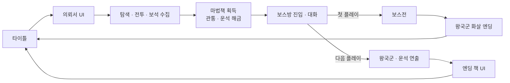

_스테이지와 보스방은 별도 씬이 아니라 `Scenes_Stage_01` 한 씬 안에 있습니다. 보스 대화가 끝난 뒤의 전개만 클리어 기록에 따라 갈립니다._

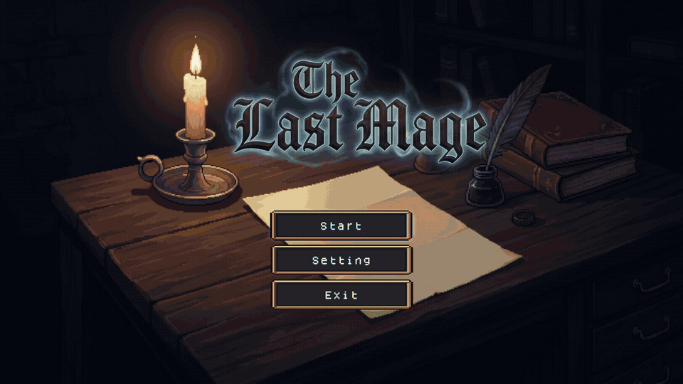

### 1.3 콘텐츠 구성

**마법 3종**

| 마법 | 해금 | 발사 방식 | 쿨타임 | 특징 |
|---|---|---|---|---|
| 기본 `Basic` | 처음부터 | `firePoint`에서 발사체 1개 | 0.5초 | 맞으면 사라짐 |
| 관통 `Penetrate` | 마법책 1 | 발사체 1개 | 5초 | 맞아도 사라지지 않고 계속 관통 (3초 뒤 소멸) |
| 운석 `Meteor` | 마법책 2 | 플레이어 주변 위쪽에서 운석 15개를 0.08초 간격으로 떨어뜨림 | 10초 | 넓은 범위 공격 |

**적**

| 적 | 행동 |
|---|---|
| 일반 몬스터 | 멀리 있으면 순찰, 가까워지면 추적, 공격 거리 안이면 멈춰서 공격 |
| 보스 마법사 | 거리에 따라 근접 공격 · 원거리 유령탄, 6초마다 특수 공격(마법 · 운석) |

**회차별 차이** — 자세한 내용은 [§5.3](#53-클리어-횟수-하나로-달라지는-장면들)

| | 첫 플레이 | 다음 플레이 |
|---|---|---|
| 타이틀 | 기본 배경 · BGM | 폐허 배경 · 다른 BGM |
| 마법책 | 원래 문장 | 붉은 글자 문장 |
| 보스 대화 끝 버튼 | `*공격` | `*공격` → `* ...`로 일그러짐 |
| 결말 | 보스전 → 왕국군 화살 엔딩 | 보스전 없이 왕국군 · 운석 연출 → 엔딩 책 |

### 1.4 기술 핵심 요약

| 핵심 | 무엇을 했나 | 자세히 |
|---|---|---|
| 해금과 장착 분리 | 마법책은 해금 플래그만 켜고, 어떤 마법을 쓸지는 Q/E 입력으로 따로 정함 | [§3.2](#32-책을-얻고-고르고-쏘기까지) |
| 마법별 독립 발사체 | 기본 · 관통 · 운석이 각자의 스크립트에서 이동 · 충돌을 처리 | [§3.5](#35-고민과-선택--마법별-발사체를-어떻게-나눌-것인가) |
| 거리 기반 몬스터 AI | 상태를 저장하지 않고 매 프레임 거리만 비교해 순찰 · 추적 · 공격 선택 | [§4.2](#42-일반-몬스터--거리로-고르는-행동) |
| enum + 코루틴 보스 AI | `BossState`로 현재 행동을 표시하고, 공격의 "모션 → 발사 → 후딜레이"를 코루틴 하나에 담음 | [§4.3](#43-보스--상태-enum과-공격-코루틴) |
| 클리어 횟수 기반 다회차 분기 | `PlayerPrefs`의 정수 `ClearCount` 하나로 타이틀부터 엔딩까지 연출을 바꿈 | [§5](#5-다회차-스토리-분기) |

### 1.5 구현 범위

| 기획 항목 | 구현 | 비고 |
|---|---|---|
| 이동 · 점프 · 기본 공격 | ✅ | |
| 마법책 해금 · Q/E 전환 · 마법별 쿨타임 | ✅ | 관통 · 운석, 쿨타임 아이콘 표시 |
| 일반 몬스터 순찰 · 추적 · 공격 | ✅ | 피격 섬광 · 화면 흔들림 · 드롭 |
| 보스 근접 · 원거리 · 특수 공격 | ✅ | (확인 필요: 특수 공격이 실제로 나오는지 — [§4.3](#43-보스--상태-enum과-공격-코루틴) 참고) |
| 보스 대화 · 대사 타이핑 연출 | ✅ | |
| 클리어 횟수 저장 · 회차별 연출 변화 | ✅ | 타이틀 · BGM · 책 문장 · 버튼 · 엔딩 |
| 보석 수집 · 화면 표시 | ✅ | |
| 보석을 쓰는 상점 성장 | ❌ | 일정 부족으로 제외 |
| 2회차 보스와 동맹 · 왕국군 전투 | ➖ 연출로 대체 | 왕국군은 엔딩 연출에만 등장 |
| 마법 해금 · 보석의 회차 간 저장 | ❌ | 저장하는 값은 `ClearCount` 하나 |

### 1.7 AI 활용 범위와 내 역할


| 구분 | 내용                                            |
|---|-----------------------------------------------|
| 내가 정한 것 | 게임 방향(마법책 성장 · 다회차 서사), 회차별로 바뀔 장면, 마법 3종의 역할 |
| AI가 작성 · 도움 준 것 | 보스 AI 코루틴 구조, 대사 타이핑 코드, 이미지 리소스              |
| 내가 확인하고 고친 것 | 쿨타임 · 운석 개수 수치, 카메라 추적 오류 수정                  |

---

## 2. 전체 시스템 구조

### 2.1 시스템 관계

이 그림에서 볼 것은 **`GameManager`가 가진 클리어 횟수가 타이틀 · 마법책 · 보스 대화로 퍼져 나가 회차별 차이를 만들고**, 전투는 플레이어의 발사체가 적과 보스에 피해를 주는 흐름으로 이어진다는 점입니다.

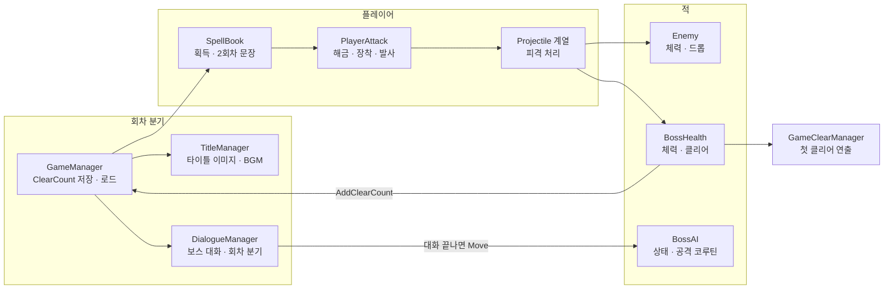

_`GameManager` 프리팹은 타이틀과 스테이지 씬에 하나씩 놓여 있습니다. `DontDestroyOnLoad`는 쓰지 않고, 씬이 바뀔 때마다 새 인스턴스가 `PlayerPrefs`에서 값을 다시 읽습니다._

### 2.2 클래스 역할

| 클래스 | 하는 일 | 하지 않는 일 |
|---|---|---|
| `GameManager` | `ClearCount`를 `PlayerPrefs`에서 읽고, 클리어 시 1 올려 저장 | 회차별 연출을 직접 바꾸지 않음 (각 클래스가 값을 읽어 판단) |
| `TitleManager` | 클리어 횟수에 따라 타이틀 배경 · BGM 선택, 씬 전환 | |
| `SpellBook` | 플레이어가 닿으면 마법 해금 요청, 책 UI 표시 · 일시정지, 2회차 문장 글리치 | 어떤 마법을 쓸지 정하지 않음 |
| `PlayerController` | 이동 · 점프 | 공격하지 않음 |
| `PlayerAttack` | 해금 상태 · 장착 마법 · 마법별 쿨타임 관리, 발사 | 발사 뒤의 이동 · 충돌을 처리하지 않음 |
| `Projectile` · `PenetrateProjectile` · `MeteorProjectile` | 각 마법의 이동 · 충돌 · 피해 | |
| `EnemyAI` / `Enemy` | 거리에 따른 순찰 · 추적 · 공격 / 체력 · 피격 섬광 · 사망 · 드롭 | |
| `BossAI` / `BossHealth` | 거리별 공격 · 특수 공격 선택 / 체력 · 사망 · 클리어 처리 | |
| `DialogueManager` | 보스방 진입 연출, 대사 출력, 버튼, 회차별 결말 연출 | — (카메라 · BGM · 스폰 · 엔딩까지 맡고 있음 → [§7.2](#72-설계-회고)) |
| `GameClearManager` | 첫 클리어 엔딩(왕국군 · 화살 · 페이드) | |

---

## 3. 마법책과 스킬 전환

### 3.1 개요

탐색의 보상이 단순한 수치 증가가 아니라 **새로운 공격 방식**이 되도록 했습니다. 처음에는 기본 발사체만 쓸 수 있고, 스테이지에 놓인 두 권의 책을 찾으면 적을 꿰뚫는 관통탄과 넓은 범위에 쏟아지는 운석을 고를 수 있게 됩니다. 책을 주우면 게임이 잠시 멈추고 책 UI가 열리며, 책을 닫은 뒤 Q/E로 새 마법을 장착해 Z로 발사합니다.

관통은 일렬로 선 적을 한 번에, 운석은 넓은 범위의 적을 한 번에 처리하는 용도로 생각했습니다. (확인 필요: 실제로 플레이에서 각 마법을 언제 쓰게 되는지)

### 3.2 책을 얻고, 고르고, 쏘기까지

이 흐름은 세 부분으로 나뉩니다. `SpellBook`은 책을 얻는 순간을, `PlayerAttack`은 해금 · 장착 · 쿨타임을, 발사체 스크립트는 발사된 뒤의 이동과 충돌을 맡습니다. 스테이지의 두 `SpellBook`에는 인스펙터에서 각각 관통(`bookMagicType: 1`)과 운석(`2`)을 지정해 두었습니다.

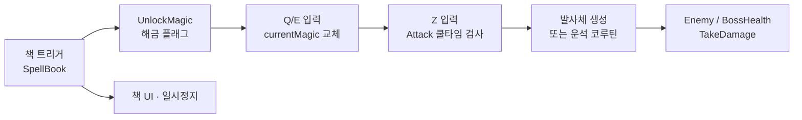

1. **책에 닿으면 해금만 합니다.** `SpellBook.OnTriggerEnter2D`가 `Player` 태그를 확인하고 `UnlockMagic(bookMagicType)`을 호출합니다. 이어서 책 UI를 열고 `Time.timeScale = 0`으로 게임을 멈춥니다. 획득한 책은 콜라이더와 스프라이트를 꺼서 다시 줍지 않게 합니다.
2. **해금과 장착은 별개입니다.** `UnlockMagic`은 `hasPenetrate` 또는 `hasMeteor`만 `true`로 바꿉니다. 책을 얻었다고 `currentMagic`이 자동으로 바뀌지는 않습니다.
3. **Q/E로 장착합니다.** 책을 닫으면 `OnClickCloseBook`이 시간을 되돌립니다. 이후 해금된 마법만 Q/E로 장착할 수 있고, 같은 키를 다시 누르면 `Basic`으로 돌아갑니다.
4. **Z로 발사합니다.** `PlayerAttack.Attack`은 선택된 마법의 타이머가 0 이하일 때만 발사하고 타이머를 다시 채웁니다. 세 타이머는 장착 여부와 관계없이 매 프레임 줄어듭니다.

`UpdateSkillUI`는 관통 · 운석의 남은 시간을 각 쿨타임으로 나눠 스킬 아이콘의 가림 비율을 갱신합니다. 그래서 남은 쿨타임이 아이콘에 표시됩니다.

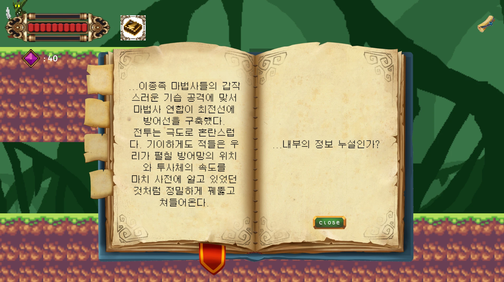

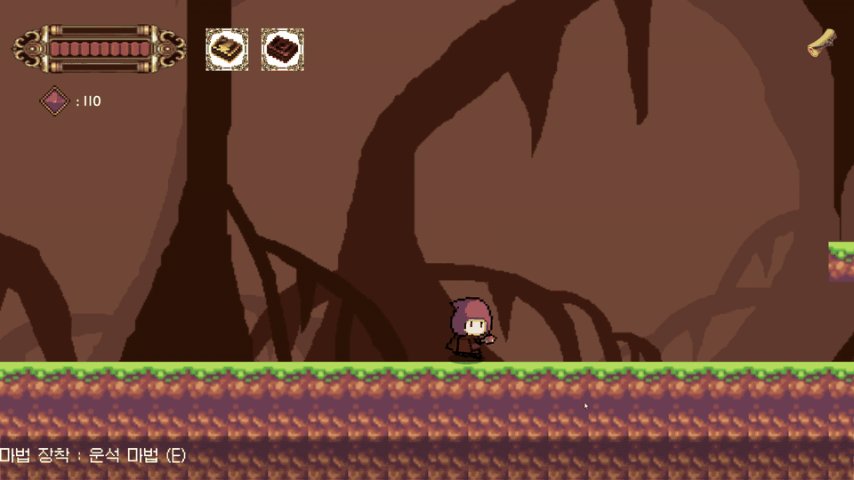

### 3.3 마법별 발사와 충돌

| 마법 | 발사 (`PlayerAttack`) | 충돌 · 피해 (발사체 스크립트) |
|---|---|---|
| 기본 | `Shoot`가 `firePoint`에서 프리팹 1개 생성 | `Projectile`이 오른쪽 방향 속도를 주고, 적 · 보스에 피해를 준 뒤 자신을 파괴 |
| 관통 | `ShootPenetrate`가 프리팹 1개 생성 | `PenetrateProjectile`은 피해를 준 뒤에도 **파괴하지 않아** 다음 적도 맞힘. 3초 뒤 소멸 |
| 운석 | `DropMeteors`가 플레이어 주변 X ±10, 위쪽 Y 7~9에서 15개를 0.08초 간격으로 생성 | `MeteorProjectile`이 적 · 보스에 피해를 주고 파괴 |

세 발사체 모두 `Enemy.TakeDamage`와 `BossHealth.TakeDamage`를 호출하고, 이펙트 프리팹이 연결되어 있으면 생성합니다. 쿨타임(0.5 / 5 / 10초)과 운석 수(15개)는 스테이지 플레이어의 인스펙터 값입니다.

### 3.4 핵심 코드 · 해금과 발사를 나눈 지점

```csharp
// SpellBook.OnTriggerEnter2D (48~62행 발췌)
private void OnTriggerEnter2D(Collider2D collision)
{
    if (collision.CompareTag("Player"))
    {
        PlayerAttack attackScript = collision.GetComponent<PlayerAttack>();
        if (attackScript != null)
        {
            attackScript.UnlockMagic(bookMagicType); // 해금만 요청
        }
        if (myBookUI != null)
        {
            myBookUI.SetActive(true);
            Time.timeScale = 0f;                     // 책을 읽는 동안 게임 정지
            // 이하 책 문장 · 획득 처리 생략
```

```csharp
// PlayerAttack.Attack — 관통 · 운석 분기 발췌
case MagicType.Penetrate:
    if (penetrateTimer <= 0f)
    {
        ShootPenetrate();
        penetrateTimer = penetrateCoolTime;
        if (anim != null) anim.SetTrigger("Attack");
    }
    break;
case MagicType.Meteor:
    if (meteorTimer <= 0f)
    {
        ShootMeteor();
        meteorTimer = meteorCoolTime;
        if (anim != null) anim.SetTrigger("Attack");
    }
    break;
```

1. **책은 "쓸 수 있다"까지만 정합니다.** 책은 `PlayerAttack`에 해금을 요청할 뿐, 무엇을 쏠지는 모릅니다.
2. **무엇을 쏠지는 장착된 마법이 정합니다.** `Attack`은 `currentMagic`에 따라 분기하고, 그 마법의 타이머만 검사합니다.
3. **마법마다 타이머가 따로 있습니다.** 운석을 쓴 직후에도 기본 마법은 바로 쓸 수 있습니다.

### 3.5 고민과 선택 ① 마법별 발사체를 어떻게 나눌 것인가

> **결정 대상** 기본 · 관통 · 운석의 이동 · 충돌 · 피해 처리를 각자의 스크립트로 만들지, 공통 기반 클래스를 두고 차이만 나눌지.

| | [A] 공통 기반 클래스 + 마법별 차이 | [B] 마법별 독립 발사체 3종 ✓ |
|---|---|---|
| 방식 | 피해 · 이펙트를 기반 클래스에 두고, 관통 · 운석은 상속해 다른 부분만 덮어씀 | `Projectile` · `PenetrateProjectile` · `MeteorProjectile`이 각자 이동 · 충돌을 처리 |
| 장점 | 피해 · 이펙트 같은 공통 규칙을 한 곳에서 고칠 수 있음 | "맞아도 사라지지 않음"처럼 마법마다 다른 동작이 각 파일에 바로 보임 |
| 단점 | 공통 규칙과 마법별 차이의 경계를 먼저 정해야 함 | 피해 · 이펙트 처리가 세 파일에 반복되어, 공통 수정 시 하나를 빠뜨릴 수 있음 |

**[최종 결정]** [B]. 마법이 세 가지뿐이고 마법마다 충돌 후 동작이 확실히 달라서, 각 동작이 한 파일에서 바로 보이는 쪽을 택했습니다. 

**[감수한 대가]** 새 마법을 하나 추가하려면 enum, 해금 플래그, 입력 · 발사 분기, 타이머 · UI, 발사체 스크립트를 함께 고쳐야 합니다. 실제로 기본 · 관통 발사체에는 플레이어와의 충돌을 무시하는 코드가 있지만, 운석 스크립트에는 같은 코드가 빠져 있습니다. 마법이 더 늘어나면 **공통 피격 처리부터 기반 클래스로 옮기는 것**이 다음 단계입니다.

---

## 4. 일반 몬스터와 보스 AI

### 4.1 개요

전투의 긴장감은 **적이 플레이어와의 거리에 따라 다르게 반응하는 것**에서 나오도록 했습니다. 일반 몬스터는 멀리 있으면 순찰하다가 가까워지면 쫓아와 공격하고, 보스는 거리에 따라 근접 공격과 원거리 공격을 고르고 공격마다 대기 시간을 둡니다.

두 AI는 구현 방식이 다릅니다. 일반 몬스터는 행동이 단순해 **매 프레임 거리만 비교**하고, 보스는 공격 하나에 "모션 → 피해 · 발사 → 후딜레이" 순서가 있어 **상태 enum과 코루틴**으로 관리했습니다. 

### 4.2 일반 몬스터 · 거리로 고르는 행동

`EnemyAI.Update`는 상태를 따로 저장하지 않고, 매 프레임 플레이어와의 거리를 비교해 행동을 고릅니다.

| 거리 | 행동 |
|---|---|
| 공격 거리 안 | 멈춘 뒤 쿨타임마다 `AttackPlayer`로 피해 |
| 감지 거리 안 | 플레이어 쪽으로 추적 |
| 그 밖 | 발 앞으로 Raycast를 쏴 낭떠러지와 벽을 확인하며 순찰 |

체력 · 피격 섬광 · 사망 애니메이션 · 드롭은 `Enemy`가 따로 처리합니다. 피격 시 `CameraShake`로 화면을 흔듭니다.

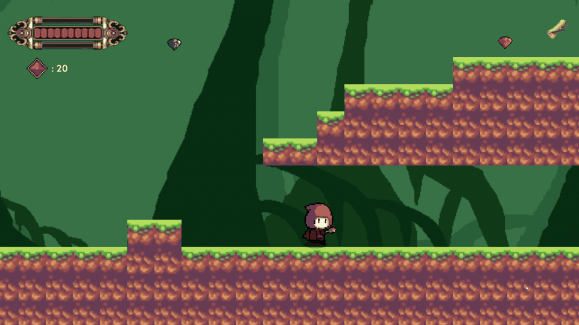

### 4.3 보스 · 상태 enum과 공격 코루틴

`BossAI`는 `BossState` enum과 `isAttacking`, `magicTimer`로 지금 무엇을 하는 중인지 관리합니다. 보스 대화가 끝나면 `DialogueManager.EndCinematic`이 보스 상태를 `Move`로 바꿔 전투가 시작됩니다. 보스 씬의 설정값은 근접 3.5, 원거리 7, 감지 40, 특수 공격 쿨타임 6초입니다.

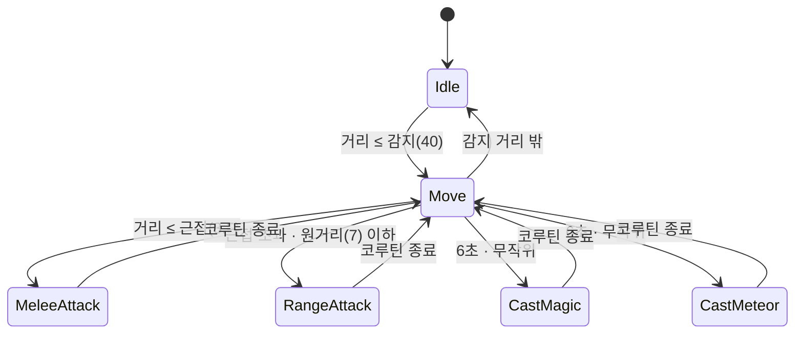

| 상태 | 들어가는 조건 | 처리하는 곳 |
|---|---|---|
| `Idle` | 시작 상태. 플레이어가 감지 거리 안에 오면 `Move` | `UpdateIdle` |
| `Move` | 거리에 따라 근접 → 원거리 → 접근 순으로 검사 | `UpdateMove` |
| `MeleeAttack` · `RangeAttack` | 코루틴 시작 시 진입, 끝나면 `Move` | 각 공격 코루틴 |
| `CastMagic` · `CastMeteor` | 특수 공격 타이머가 차고 공격 중이 아닐 때 둘 중 하나를 무작위로 | `Update` · 각 시전 코루틴 |

(확인 필요: 지금 PC의 `BossAI.Update` 특수 공격 조건이 `isAttacking = false`로 되어 있어 컴파일 오류가 납니다. Git 마지막 커밋에는 `!isAttacking`으로 올바르게 되어 있습니다. 고친 뒤 특수 공격이 실제로 나오는지 확인해 주세요. 확인 후 이 괄호는 지워 주세요.)

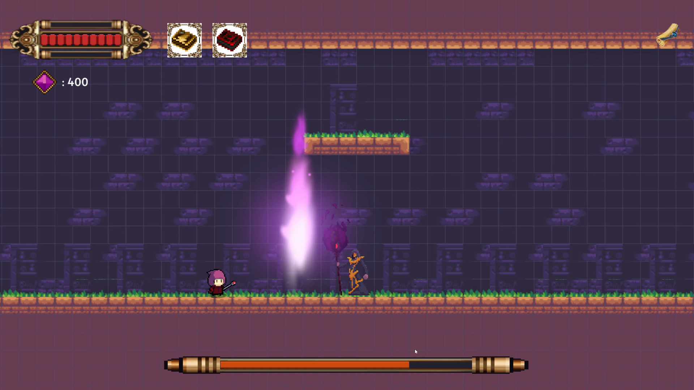

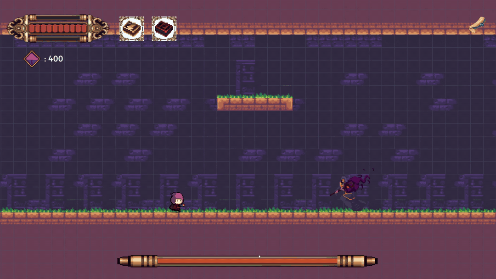

### 4.4 핵심 코드 · 거리 판단과 공격 코루틴

```csharp
// BossAI.UpdateMove 발췌
if (isAttacking) return;                 // 공격 중에는 새 행동을 고르지 않음
float dist = Vector2.Distance(transform.position, player.position);
LookAtPlayer();
if (dist <= meleeRange)
{
    StartCoroutine(MeleeAttackRoutine());
}
else if (dist <= rangeAttackRange)
{
    StartCoroutine(RangeAttackRoutine());
}
else if (dist <= detectRange)
{
    transform.position = Vector2.MoveTowards(
        transform.position,
        new Vector2(player.position.x, transform.position.y),
        moveSpeed * Time.deltaTime);
}
```

```csharp
// BossAI.RangeAttackRoutine (223~238행 발췌)
IEnumerator RangeAttackRoutine()
{
    isAttacking = true;
    currentState = BossState.RangeAttack; // 상태 고정 (버그 방지)
    if (anim != null) anim.SetBool("isRunning", false);
    if (anim != null) anim.SetTrigger("RangeAttack");

    // 지팡이를 휘두르고 유령이 날아가는 모션 타이밍까지 잠깐 대기
    yield return new WaitForSeconds(0.6f);

    if (projectilePrefab != null && firePoint != null)
    {
        Instantiate(projectilePrefab, firePoint.position, transform.rotation);
    }
    // 이하 1.4초 후딜레이 → isAttacking = false, currentState = Move
```

1. **가까운 공격부터 검사합니다.** 범위가 겹치면 근접 공격이 우선합니다.
2. **공격 중에는 다음 행동을 고르지 않습니다.** 코루틴이 시작할 때 `isAttacking = true`, 끝날 때 `false`와 `Move`로 되돌립니다. `UpdateMove`가 맨 앞에서 `isAttacking`을 보고 바로 빠져나가므로, 공격이 겹쳐 실행되지 않습니다.
3. **공격의 시간 순서가 한 메서드 안에 있습니다.** 원거리 공격은 0.6초 모션 → 발사 → 1.4초 후딜레이 순서입니다. 근접 공격은 0.5초를 기다린 뒤 **그 시점에도** 플레이어가 사거리 안에 있는지 다시 확인하고 피해를 줍니다. 그래서 그 사이에 피하면 피해를 받지 않습니다.

보스가 쓰러지면 `BossHealth.Die`가 `isDead`로 사망 처리가 중복되는 것을 막고, AI · 물리 · 충돌체를 끈 뒤 클리어 횟수 증가와 첫 클리어 연출을 호출합니다.

### 4.5 고민과 선택 ② 보스 AI를 어떻게 구성할 것인가

> **결정 대상** 보스의 행동 전환과 공격 타이밍을 enum + 코루틴으로 한 파일에 둘지, 상태마다 클래스를 나누는 상태 패턴으로 만들지.

| | [A] 상태별 클래스 (상태 패턴) | [B] enum + 코루틴 ✓ |
|---|---|---|
| 방식 | 상태마다 진입 · 갱신 · 종료를 가진 클래스를 만들고 전환을 한 곳에서 처리 | `BossState` enum과 `switch`, 공격은 코루틴 |
| 장점 | 상태마다 책임이 나뉘어 패턴 추가가 쉬움 | 거리 판단과 공격의 시간 순서를 한 파일에서 따라갈 수 있음 |
| 단점 | 패턴이 적은 규모에서는 파일과 연결 구조가 늘어남 | 상태를 바꾸는 곳이 코루틴 · 외부 클래스로 흩어지고, 클래스가 커짐 |

**[최종 결정]** [B]. 보스 패턴이 근접 · 원거리 · 특수 공격 두 종류로 많지 않아, 한 파일에서 흐름을 읽을 수 있는 쪽이 낫다고 판단했습니다. (확인 필요: 당시 실제로 상태 패턴을 고려했는지)

**[감수한 대가]** 지금 구조는 상태 패턴이라기보다 **enum으로 분기하는 제어기**에 가깝습니다. `UpdateMove`, 각 코루틴, `DialogueManager`, `BossHealth`가 각자 보스의 상태나 활성화 여부를 바꿉니다. 예를 들어 `BossState.Dead`는 enum에는 있지만, 실제 사망은 `BossAI.enabled = false`로 처리되어 이 상태로 넘어가는 경로가 없습니다. 패턴이 더 늘어나면 상태별 클래스로 나누는 것을 검토할 계획입니다.

---

## 5. 다회차 스토리 분기

### 5.1 개요

이 게임의 발견감은 **두 번째 플레이**에서 완성됩니다. 다시 시작한 플레이어는 폐허가 된 타이틀 화면, 바뀐 배경음, 붉은 글자로 바뀐 마법책 문장을 차례로 만나고, 보스와의 대화 끝에서는 `*공격` 버튼이 `* ...`으로 일그러진 뒤 첫 플레이와 다른 결말로 이어집니다.

구현은 별도의 분기형 대사 데이터가 아니라 **클리어 횟수 정수 하나**로 "0회"와 "1회 이상"을 나누는 방식입니다. 각 클래스가 이 값을 읽고 스스로 연출을 바꿉니다.

### 5.2 클리어 횟수를 저장하고 읽는 방법

| 시점 | 처리 | 위치 |
|---|---|---|
| 씬 시작 | `PlayerPrefs.GetInt("ClearCount", 0)`으로 읽기 | `GameManager.Awake` → `LoadGameData` |
| 보스 처치 | 1 올리고 `PlayerPrefs.Save()` | `BossHealth.Die` → `GameManager.AddClearCount` |
| 테스트 | 숫자 `9` 증가, `0` 초기화 | `GameManager.Update` (개발용) |

```csharp
// GameManager.LoadGameData / AddClearCount 발췌
public void LoadGameData()
{
    clearCount = PlayerPrefs.GetInt("ClearCount", 0);
}
public void AddClearCount()
{
    clearCount++;
    PlayerPrefs.SetInt("ClearCount", clearCount);
    PlayerPrefs.Save();
}
```

`AddClearCount`는 보스를 실제로 쓰러뜨리는 **첫 플레이 경로**에서만 호출됩니다. 다음 플레이의 결말(`SecretEndingRoutine`)에는 이 호출이 없습니다.

### 5.3 클리어 횟수 하나로 달라지는 장면들

| 요소 | `ClearCount == 0` | `ClearCount >= 1` | 처리하는 곳 |
|---|---|---|---|
| 타이틀 | 기본 배경 · BGM | 폐허 배경 · 다른 BGM | `TitleManager.Start` |
| 스테이지 BGM | 던전 BGM 1 | 던전 BGM 2 | `StageIntroManager.OnTriggerEnter2D` |
| 마법책 문장 | 원래 문장 | 책 1은 붉은 문장으로 교체, 책 2는 붉은 문장 추가 | `SpellBook.GlitchTextRoutine` |
| 보스 대사 | 같은 대사 | **같은 대사** | `DialogueManager.TypeLine` |
| 대사 뒤 버튼 | `*공격` | `*공격` → `* ...`로 글리치 | `DialogueManager.GlitchButtonText` |
| 버튼을 누르면 | 보스전 → 처치 → 왕국군 화살 엔딩 | 보스전 없이 왕국군 · 운석 연출 → 엔딩 책 | `OnClickBattleStart` |

**보스 대사 자체는 두 회차가 같습니다.** 같은 대사를 두고 그 앞뒤의 타이틀 · 책 문장 · 버튼이 달라지면서, 첫 플레이에서는 평범했던 대사가 다른 의미로 읽히도록 구성했습니다.

| **첫 플레이** (`ClearCount == 0`) | **다음 플레이** (`ClearCount >= 1`) |
|---|---|
| 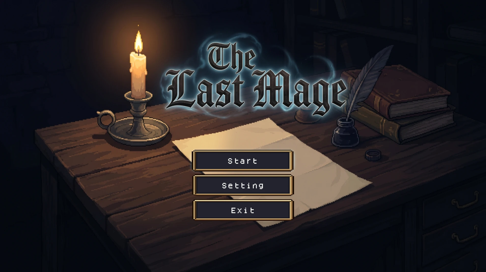 | 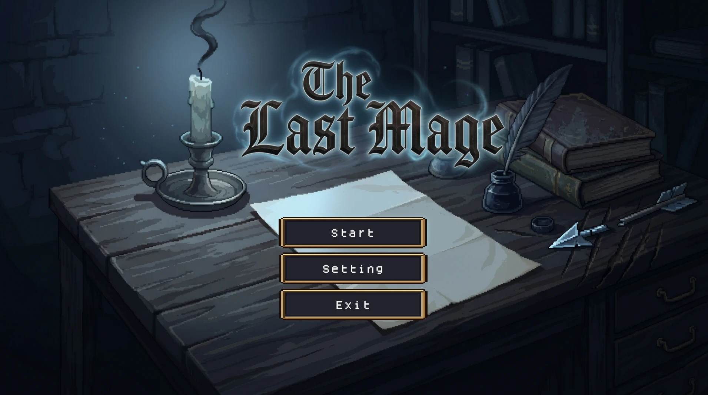 |

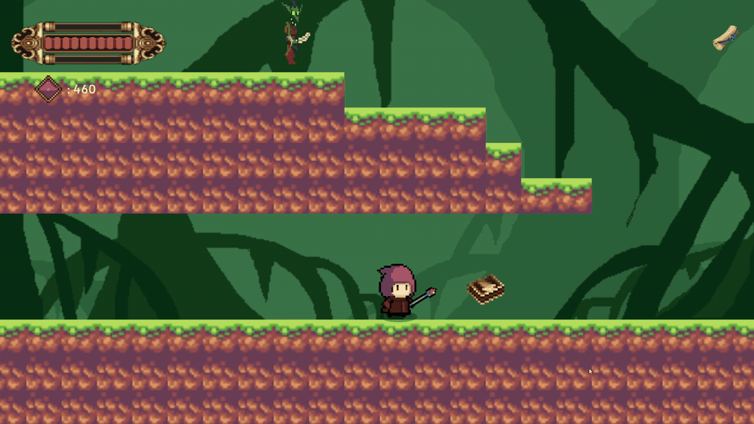

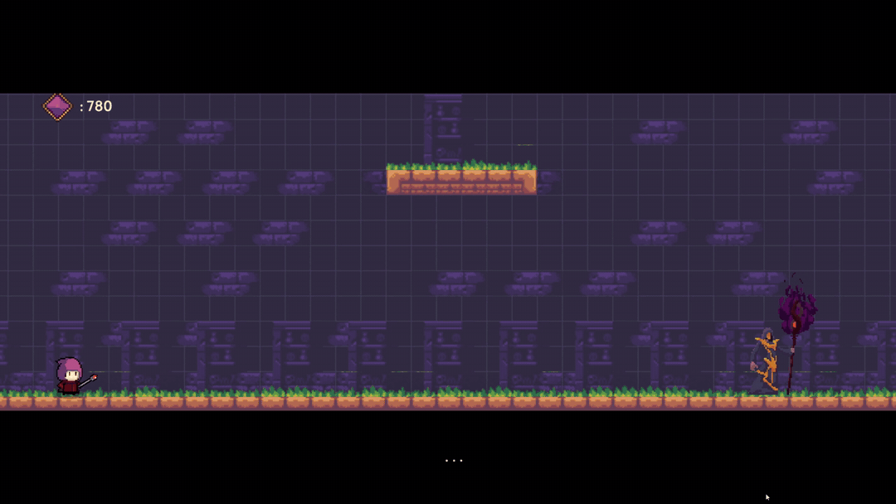

### 5.4 보스방 진입부터 결말까지

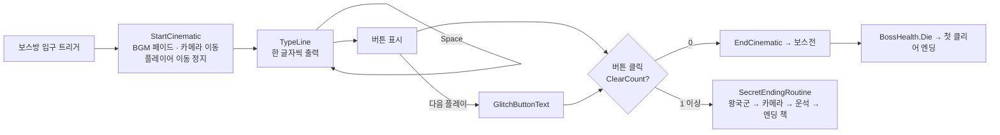

1. **보스방에 들어가면 연출이 시작됩니다.** `DialogueManager.OnTriggerEnter2D`가 `hasStarted`로 중복 시작을 막은 뒤 `StartCinematic`을 호출합니다. BGM을 페이드아웃하고, 카메라를 보스방 중앙으로 옮기고, 플레이어의 이동(`PlayerController`)을 끕니다.
2. **대사는 한 글자씩 출력됩니다.** `TypeLine`이 `WaitForSecondsRealtime`으로 글자를 출력하고, `Space`를 누르면 다음 줄로 넘어갑니다. 마지막 줄 뒤에 버튼이 나타납니다.
3. **같은 버튼이 회차에 따라 다른 결과를 냅니다.**

```csharp
// DialogueManager.OnClickBattleStart 발췌
if (GameManager.instance.clearCount == 0)
{
    if (bossBattleBGM != null)
        BGMManager.instance.PlayBGM(bossBattleBGM);
    Time.timeScale = 1f;
    EndCinematic();                       // 첫 플레이: 보스전 시작
}
else
{
    StartCoroutine(SecretEndingRoutine()); // 다음 플레이: 바로 결말 연출
}
```

플레이어가 고르는 선택지 두 개가 아니라, **같은 버튼을 눌렀을 때 회차에 따라 결과가 갈리는 구조**입니다. 플레이어에게 선택권을 주지 않고 같은 행동이 다른 결과로 이어지게 한 것이 의도였습니다. (확인 필요: 이 의도가 맞는지, 아니면 일정 때문에 선택지를 뺀 것인지)

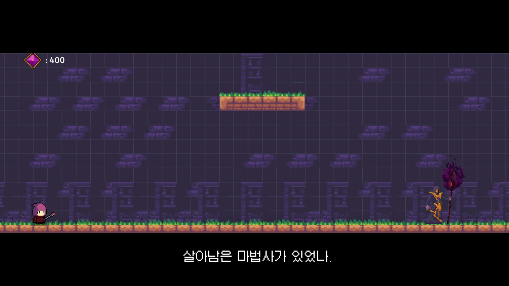

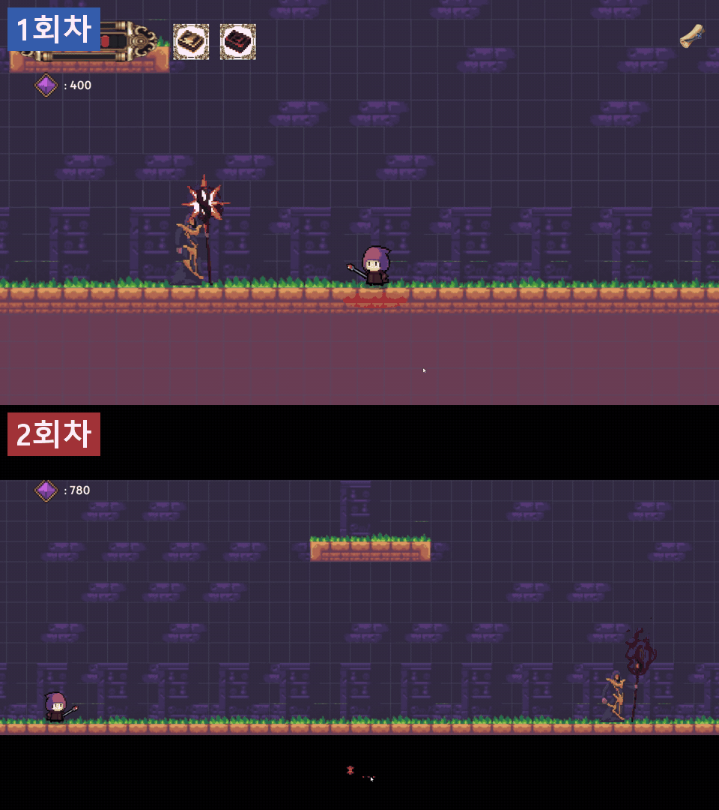

### 5.5 고민과 선택 ③ 클리어 기록을 어떻게 저장할 것인가

> **결정 대상** 회차 분기에 필요한 클리어 기록을 `PlayerPrefs`의 정수 하나로 저장할지, JSON 같은 저장 파일을 만들지.

| | [A] JSON 등 저장 파일 | [B] `PlayerPrefs` 정수 하나 ✓ |
|---|---|---|
| 방식 | 저장 데이터 클래스를 만들어 파일로 직렬화 | `GetInt` / `SetInt("ClearCount")` |
| 장점 | 보석 · 해금 등 여러 상태를 한 구조로 저장하고 버전을 관리할 수 있음 | 코드 몇 줄로 읽고 저장할 수 있음 |
| 단점 | 저장 경로 · 데이터 구조 · 버전 정책을 따로 설계해야 함 | 여러 값을 묶어 저장하거나 버전을 관리하기 어려움 |

**[최종 결정]** [B]. 회차 분기에 필요한 정보는 "한 번이라도 클리어했는가"뿐이라 정수 하나로 충분했습니다. (확인 필요: 당시 실제로 JSON과 비교했는지)

**[감수한 대가]** 보석 · 마법 해금은 저장되지 않아 다음 플레이에서 처음부터 다시 모아야 합니다. 상점에서 보석을 쓰거나 해금을 회차 간에 유지하려면 저장 파일 구조로 바꿔야 합니다.

---

## 6. 트러블슈팅

| # | 문제 | 원인 | 해결 |
|---|---|---|---|
| 1 | 카메라 추적이 제대로 되지 않음 (확인 필요: 실제 증상) | `Lerp`의 시작점이 카메라가 아니라 플레이어 위치였음 | 시작점을 `transform.position`(카메라 현재 위치)으로 바꿈 |
| 2 | 보스 대화 중 공격하면 연출이 이상하게 겹침 | 대화 중에도 공격 입력이 막히지 않음 (추정) | **미해결** — 개선 계획 [§7.3](#73-아쉬운-점과-개선-계획) |

### 6.1 카메라 추적 오류

**증상** 카메라 추적 기능을 추가한 직후 오류가 있었습니다(06/25 커밋 "cameraFollow 추가, 그러나 오류 해결 실패"). (확인 필요: 화면에서 어떻게 보였는지 — 예) 카메라가 플레이어에 딱 붙어 떨림, 따라오지 않음)

**원인** `PlayerCameraFollow.LateUpdate`에서 `Vector3.Lerp`의 시작점이 `target.position`(플레이어 위치)이었습니다. 매 프레임 플레이어 위치에서 목표 위치 쪽으로 보간하므로, 카메라의 이전 위치와 상관없는 값이 나왔습니다.

**해결** 시작점을 `transform.position`(카메라의 현재 위치)으로 바꿨습니다(다음 커밋 "cameraFollow 오류 해결").

```csharp
// Before — 플레이어 위치에서 보간 시작
transform.position = Vector3.Lerp(target.position, desiredPosition, smoothSpeed);

// After — 카메라 현재 위치에서 보간 시작
transform.position = Vector3.Lerp(transform.position, desiredPosition, smoothSpeed);
```

(확인 필요: 위 Before/After 코드는 바뀐 부분을 설명하기 위해 정리한 것입니다. 실제 변수 이름 `desiredPosition` · `smoothSpeed`가 다르면 고쳐 주세요.)

**결과** 카메라가 현재 위치에서 목표 위치로 매 프레임 조금씩 다가가며 부드럽게 따라갑니다.

**배운 점** `Lerp(a, b, t)`를 매 프레임 부르며 따라가게 하려면, `a`가 **매 프레임 갱신되는 현재 값**이어야 합니다. (확인 필요)

### 6.2 보스 대화 중 공격하면 연출이 겹치는 문제 (미해결)

**증상** 플레이어 피드백에서 "보스전에서 대사를 안 넘기고 공격하면 이상하게 중첩되는 오류가 있다"는 의견을 받았습니다. (확인 필요: 직접 재현해 본 화면과 입력 순서)

**원인 후보** 코드에서 겹칠 수 있는 경로를 세 곳 찾았습니다.

| 경로 | 내용 |
|---|---|
| 공격 입력이 막히지 않음 | `StartCinematic`이 `PlayerController`(이동)만 끄고, `PlayerAttack`은 끄지 않음. 대화 중에도 Z가 들어감 |
| 버튼 상태를 쓰지 않음 | `DialogueManager.Update`에 `isButtonActive`를 계산하지만 조건에 쓰지 않음 |
| 결말 연출 중에도 대사 진행 | 다음 플레이에서 `SecretEndingRoutine`을 시작할 때 `isDialogueActive`를 끄지 않아, `Space`가 `NextLine`을 다시 부를 수 있음 |

**해결 계획** 대화가 시작되면 이동 · 공격 · 대사 진행 · 버튼 입력을 함께 잠그고, 한 단계가 끝나야 다음 단계 입력을 받도록 바꿀 계획입니다. (확인 필요: 이미 시도한 수정이 있는지)

---

## 7. 결과 및 회고

### 7.1 구현 결과

2주 안에 **탐색 → 마법책 획득 → 보스 대화 → 결말**로 이어지는 한 스테이지를 완성했고, 클리어 기록에 따라 타이틀부터 엔딩까지 다섯 곳의 연출이 바뀌는 다회차 구조를 넣었습니다.

#### 목표 vs 구현

| 목표 (§1.1) | 구현 결과 | 어디서 |
|---|---|---|
| 탐색하며 전투 방식 발견 (성장감) | 마법책 2권으로 관통 · 운석 해금, Q/E 전환, 마법별 쿨타임 | §3 |
| 같은 세계를 다시 보며 의미 발견 (발견감) | `ClearCount`로 타이틀 · BGM · 책 문장 · 버튼 · 결말 변경 | §5 |
| 보스전의 도전과 타격감 | 거리별 공격 코루틴, 피격 섬광 · 화면 흔들림, 첫 클리어 연출 | §4 |
| 보석 수집 → 상점 성장 | **미완성** — 수집 · 표시만 있고 쓸 곳이 없음 | §1.6 |
| 2회차 보스와 동맹 · 왕국군 전투 | **연출로 대체** — 왕국군 · 운석 자동 엔딩 | §5.4 |

플레이어 피드백에서는 짧은 기간 안에 연출 · 이펙트 · 진행 구조를 살린 점, 다이얼로그 연출, 회차에 따라 컷신이 달라지는 점이 좋게 언급되었습니다.

### 7.2 설계 회고

#### 잘 된 점 · 정수 하나로 여러 장면을 바꿨다

`ClearCount` 하나를 각 클래스가 읽어 스스로 연출을 바꾸게 했기 때문에, 저장 데이터를 늘리지 않고도 다시 찾아온 플레이어에게 여러 장면의 차이를 보여 줄 수 있었습니다. 같은 대사를 두고 앞뒤 장면만 바꾸는 방식이라 대사 데이터도 하나로 충분했습니다.

#### 아쉬운 점 · 한 클래스에 일이 몰린 곳

| 문제 | 근거 | 영향 |
|---|---|---|
| `DialogueManager`에 책임 집중 | 대사 · 입력 · 카메라 · BGM · 왕국군 스폰 · 엔딩 UI까지 담당 | 대화 흐름을 고칠 때 엔딩 연출까지 함께 영향을 받음. 입력 잠금 규칙이 없어 §6.2 문제로 이어짐 |
| 보스 상태를 바꾸는 곳이 흩어짐 | `UpdateMove` · 코루틴 · `DialogueManager` · `BossHealth`가 각자 변경 | 새 패턴을 넣을 때 전환 조건을 여러 파일에서 확인해야 함 |
| 발사체 피격 처리 반복 | 세 발사체가 같은 `TakeDamage` · 이펙트 코드를 가짐 | 운석에만 플레이어 충돌 무시 코드가 빠져 있음 |
| 회차 분기 조건이 흩어짐 | `TitleManager` · `SpellBook` · `StageIntroManager` · `DialogueManager`가 각자 `clearCount` 검사 | 회차를 3단계로 늘리면 네 파일을 모두 고쳐야 함 |

### 7.3 아쉬운 점과 개선 계획

| # | 아쉬운 점 | 원인 구분 | 개선 계획 |
|---|---|---|---|
| 1 | 보석을 쓸 곳이 없어 모을 동기가 약함 | 기획 · 일정 | 상점 NPC를 넣어 보석으로 성장하게 하거나, 수집의 목적을 다시 정함 |
| 2 | 2회차 결말이 급작스러움 | 일정 | 다중 적 스폰 · 공격 에셋을 기간 안에 만들기 어려워 연출로 대체함. 2회차 보스전 2페이즈 "왕국군 진격전"(3웨이브) 계획 (확인 필요: 진행 여부) |
| 3 | 플랫포머 요소(레벨 디자인 · 몬스터 전투)가 부족함 | 기획 | 스토리 · 연출에 집중한 만큼 부족했던 부분. 다음 버전 목표를 "플랫포머 요소 극대화"로 잡음 |
| 4 | 보스 대화 중 공격 입력 중첩 | 구현 | 대화 중 이동 · 공격 · 대사 · 버튼 입력을 함께 잠금 (§6.2) |
| 5 | 보스 처치 시 처치 수가 2 오름 | 구현 | `BossHealth.Die`의 `DataManager.killCount++` 중복 호출 제거 |
| 6 | 버튼 글리치가 끝나기 전에도 클릭 가능 | 구현 | 글리치 코루틴이 끝난 뒤 버튼을 활성화 |
| 7 | `DialogueManager` 책임 집중 | 구조 | 엔딩 연출을 별도 클래스로 분리 |

플레이어 피드백에서 "몬스터가 죽을 때 사망 애니메이션과 아이템 드롭이 있으면 좋겠다"는 의견도 있었습니다. (확인 필요: 지금 `Enemy.Die`에는 사망 애니메이션과 드롭이 있는데, 피드백 뒤에 추가한 것인지)

### 7.4 배운 점

**1. 같은 내용도 앞뒤 맥락을 바꾸면 다르게 읽힌다**

보스 대사를 바꾸지 않고 타이틀 · 책 문장 · 버튼만 바꿨는데도, 다음 플레이에서 같은 대사가 다른 의미로 읽혔습니다. 연출은 새 내용을 많이 만드는 것보다 **무엇을 그대로 두고 무엇을 바꿀지 고르는 것**이 중요하다는 것을 배웠습니다. (확인 필요)

**2. 연출이 많아질수록 입력을 언제 받을지 정해야 한다**

대사 · 버튼 글리치 · 엔딩 코루틴이 이어지는데, "앞 단계가 끝났는지 확인하고 입력을 잠그는" 규칙이 없어 겹침 문제가 생겼습니다. 코루틴으로 시간 순서를 만들 때는 **그 사이에 들어오는 입력을 어떻게 막을지**도 함께 설계해야 한다는 것을 배웠습니다. (확인 필요)

**3. 범위를 줄일 때 핵심 경험을 기준으로 골랐다**

상점과 동맹 전투를 빼면서도 마법책 성장과 회차별 연출은 지켰습니다. 2주 안에 다 만들 수 없을 때 **기획의 핵심 경험 두 가지를 기준으로 남길 것을 정했다**는 점이 이번 프로젝트에서 가장 큰 판단이었습니다. (확인 필요: 실제로 이런 기준으로 골랐는지, 다음 프로젝트에서 다르게 하고 싶은 것)
