# The Last Mage 기술 문서

> **마법책을 찾아 전투 방식을 넓히고, 한 번의 클리어가 다음 플레이의 이야기를 바꾸는 2D 액션 플랫포머**

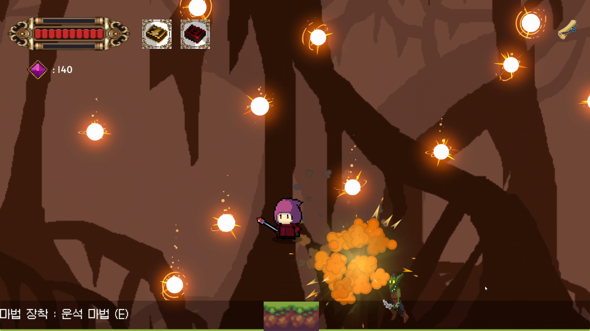

| 항목 | 내용 |
|---|---|
| 장르 | 2D 액션 플랫포머 · 다회차 서사 연출 |
| 개발 기간 | 2주 (2026.06.24 ~ 2026.07.06) |
| 개발 인원 | 1인 (개인 프로젝트) |
| 담당 | 기획, Unity 개발, 연출 |
| 개발 환경 | Unity 6000.3.15f1 · C#  |
| 주요 기술 | 마법책 해금 · Q/E 마법 전환 · 마법별 독립 발사체 · 거리 기반 몬스터 AI · enum + 코루틴 보스 AI · `PlayerPrefs` 클리어 횟수 기반 다회차 분기 |
| 링크 | [GitHub](https://github.com/KooHoo-Dev/3rd-2D-Project-ebsongg1) · [시연 영상](https://youtu.be/PN3ytIBvCoc) · [쇼츠](https://youtube.com/shorts/ItFXu3OJLfg) |

---

## 목차

1. [프로젝트 개요](#1-프로젝트-개요)
2. [플레이](#2-플레이)
3. [마법책과 스킬 전환](#3-마법책과-스킬-전환)
4. [일반 몬스터와 보스 AI](#4-일반-몬스터와-보스-ai)
5. [다회차 스토리 분기](#5-다회차-스토리-분기)
6. [만들며 생긴 문제](#6-만들며-생긴-문제)
7. [AI와 일한 방식](#7-ai와-일한-방식)
8. [결과와 돌아보기](#8-결과와-돌아보기)

---

## 1. 프로젝트 개요

The Last Mage는 스테이지를 탐색하며 마법책을 모아 공격 방식을 넓히고, 스테이지 끝에서 보스 마법사와 마주하는 2D 액션 플랫포머입니다. 기본 마법으로 시작해 두 권의 마법책을 얻으면 **관통 마법**과 **운석 마법**을 Q/E로 바꿔 쓸 수 있습니다. 처음 플레이할 때는 의뢰를 받고 보스를 쓰러뜨리는 흐름이지만, 한 번 클리어한 뒤 다시 시작하면 **타이틀 화면 · 보스와의 대화 등이 달라지고, 결말도 바뀝니다.**

평소 2회차에서 무언가 달라지는 게임을 좋아해서, 직접 그런 게임을 만들어 보고 싶었습니다. 그래서 기획 단계에서 두 가지 경험을 목표로 세웠습니다. 탐색 중 발견한 마법책으로 공격 방식이 늘어나는 **성장감**, 그리고 같은 세계를 다시 볼 때 동일한 텍스트의 의미가 달라지는 **발견감**입니다.

특히 중요하게 다룬 것은 발견감입니다. 첫 플레이에서는 평범한 의뢰와 보스전으로 보이던 장면이, 두 번째 플레이에서는 같은 대사와 마법책 문장인데도 다른 의미로 읽히도록 만들고 싶었습니다. 

2주 안에 전투 · 보스 조우 · 두 번째 플레이의 서사 변화를 하나로 잇는 완성된 게임을 만드는 것이 목표였습니다. 그 과정에서 **적은 저장 데이터 하나로 여러 장면의 연출을 바꾸는 구조**와, 코루틴으로 대사 · 연출 · 보스 공격의 시간 순서를 다루는 방법을 직접 경험해 보고 싶었습니다. 

---

## 2. 플레이

### 2.1 한 판의 흐름

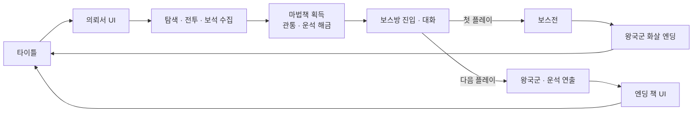

_스테이지와 보스방은 별도 씬이 아니라 `Scenes_Stage_01` 한 씬 안에 있습니다. 보스 대화가 끝난 뒤의 전개만 클리어 기록에 따라 갈립니다._

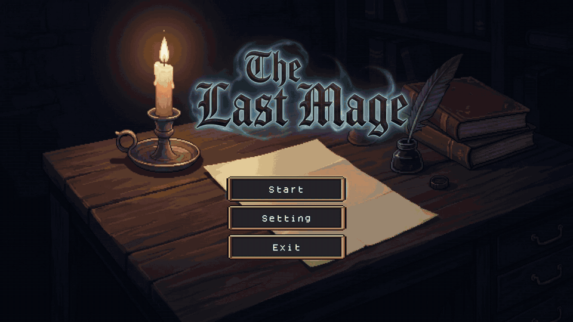

### 2.2 조작법

| 장면 | 입력 | 동작 |
|---|---|---|
| 탐색 · 보스전 | ← · → (A · D) | 좌우 이동 |
| 탐색 · 보스전 | Space | 점프 |
| 탐색 · 보스전 | Z | 장착한 마법 발사 |
| 탐색 · 보스전 | Q | 관통 마법 장착, 다시 누르면 기본 마법 (마법책 1을 얻은 뒤) |
| 탐색 · 보스전 | E | 운석 마법 장착, 다시 누르면 기본 마법 (마법책 2를 얻은 뒤) |
| 마법책 UI | 마우스 클릭 | `close` 버튼으로 책 닫기 (책이 열려 있는 동안 게임 정지) |
| 보스 대화 | Space | 다음 대사 |
| 보스 대화 | 마우스 클릭 | 대화 끝 `*공격` 버튼 |
| 공통 | ESC | 메뉴 (일시정지) |

---

## 3. 마법책과 스킬 전환

### 3.1 탐색의 보상은 새 공격 방식

탐색의 보상이 단순한 수치 증가가 아니라 **새로운 공격 방식**이 되도록 했습니다. 처음에는 기본 발사체만 쓸 수 있고, 스테이지에 놓인 두 권의 책을 찾으면 적을 꿰뚫는 관통탄과 넓은 범위에 쏟아지는 운석을 고를 수 있게 됩니다. 책을 주우면 게임이 잠시 멈추고 책 UI가 열리며, 책을 닫은 뒤 Q/E로 새 마법을 장착해 Z로 발사합니다. 같은 키를 다시 누르면 기본 마법으로 돌아갑니다.
### 3.2 책을 얻고, 고르고, 쏘기까지

이 흐름은 세 부분으로 나뉩니다. `SpellBook`은 책을 얻는 순간을, `PlayerAttack`은 해금 · 장착 · 쿨타임을, 발사체 스크립트는 발사된 뒤의 이동과 충돌을 맡습니다. 스테이지의 두 `SpellBook`에는 인스펙터에서 각각 관통(`bookMagicType: 1`)과 운석(`2`)을 지정해 두었습니다.

**다른 곳에서 마법을 줄 때**

```csharp
// 마법을 "쓸 수 있게"만 한다. 장착은 바꾸지 않음 (장착은 플레이어의 Q/E 입력)
playerAttack.UnlockMagic(PlayerAttack.MagicType.Penetrate); // 또는 MagicType.Meteor
```

책 말고 다른 곳(상점 · 보상 등)에서 마법을 줄 때도 이 한 줄만 부르면 됩니다.

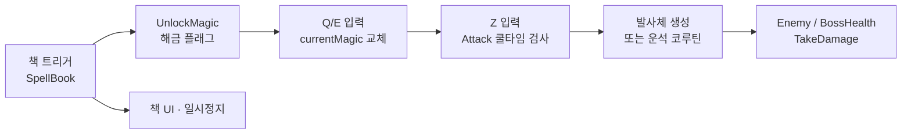

`UpdateSkillUI`는 관통 · 운석의 남은 시간을 각 쿨타임으로 나눠 스킬 아이콘의 가림 비율을 갱신합니다. 그래서 남은 쿨타임이 아이콘에 표시됩니다.

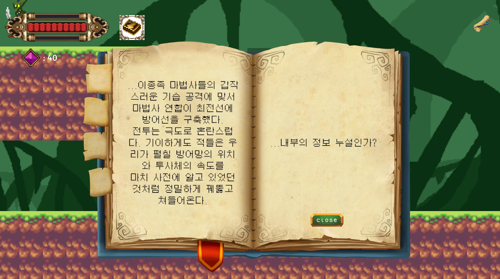

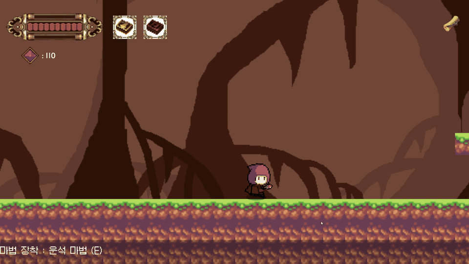

### 3.3 마법별 발사와 충돌

| 마법 | 발사 (`PlayerAttack`) | 충돌 · 피해 (발사체 스크립트) |
|---|---|---|
| 기본 | `Shoot`가 `firePoint`에서 프리팹 1개 생성 | `Projectile`이 오른쪽 방향 속도를 주고, 적 · 보스에 피해를 준 뒤 자신을 파괴 |
| 관통 | `ShootPenetrate`가 프리팹 1개 생성 | `PenetrateProjectile`은 피해를 준 뒤에도 **파괴하지 않아** 다음 적도 맞힘. 3초 뒤 소멸 |
| 운석 | `DropMeteors`가 플레이어 주변 X ±10, 위쪽 Y 7~9에서 15개를 0.08초 간격으로 생성 | `MeteorProjectile`이 적 · 보스에 피해를 주고 파괴 |

세 발사체 모두 `Enemy.TakeDamage`와 `BossHealth.TakeDamage`를 호출하고, 이펙트 프리팹이 연결되어 있으면 생성합니다. 쿨타임(0.5 / 5 / 10초)과 운석 수(15개)는 스테이지 플레이어의 인스펙터 값입니다.

### 3.4 해금과 발사를 나눈 지점

```csharp
// SpellBook.OnTriggerEnter2D (48~62행 발췌)
private void OnTriggerEnter2D(Collider2D collision)
{
    if (collision.CompareTag("Player"))
    {
        PlayerAttack attackScript = collision.GetComponent<PlayerAttack>();
        if (attackScript != null)
        {
            attackScript.UnlockMagic(bookMagicType); // 해금만 요청
        }
        if (myBookUI != null)
        {
            myBookUI.SetActive(true);
            Time.timeScale = 0f;                     // 책을 읽는 동안 게임 정지
            // 이하 책 문장 · 획득 처리 생략
```

```csharp
// PlayerAttack.Attack — 관통 · 운석 분기 발췌
case MagicType.Penetrate:
    if (penetrateTimer <= 0f)
    {
        ShootPenetrate();
        penetrateTimer = penetrateCoolTime;
        if (anim != null) anim.SetTrigger("Attack");
    }
    break;
case MagicType.Meteor:
    if (meteorTimer <= 0f)
    {
        ShootMeteor();
        meteorTimer = meteorCoolTime;
        if (anim != null) anim.SetTrigger("Attack");
    }
    break;
```

- **책은 "쓸 수 있다"까지만 정합니다.** 책은 마법을 풀어 달라고 요청할 뿐, 무엇을 쏠지는 모릅니다.
- **Z를 누르면 지금 장착한 마법이 나갑니다.** 이때 그 마법의 대기 시간만 확인합니다.
- **마법마다 대기 시간이 따로 흐릅니다.** 운석을 쓴 직후에도 기본 마법은 바로 쓸 수 있습니다.

### 3.5 마법별 발사체를 어떻게 나눌까?

기본 · 관통 · 운석의 이동 · 충돌 · 피해 처리를 각자의 스크립트로 만들지, 공통 기반 클래스를 두고 차이만 나눌지 정해야 했습니다.

| | [A] 공통 기반 클래스 + 마법별 차이 | [B] 마법별 독립 발사체 3종 ✓ |
|---|---|---|
| 방식 | 피해 · 이펙트를 기반 클래스에 두고, 관통 · 운석은 상속해 다른 부분만 덮어씀 | `Projectile` · `PenetrateProjectile` · `MeteorProjectile`이 각자 이동 · 충돌을 처리 |
| 장점 | 피해 · 이펙트 같은 공통 규칙을 한 곳에서 고칠 수 있음 | "맞아도 사라지지 않음"처럼 마법마다 다른 동작이 각 파일에 바로 보임 |
| 단점 | 공통 규칙과 마법별 차이의 경계를 먼저 정해야 함 | 피해 · 이펙트 처리가 세 파일에 반복되어, 공통 수정 시 하나를 빠뜨릴 수 있음 |

**마법별로 독립된 발사체 세 개([B])를 골랐습니다.** 마법이 세 가지뿐이고 마법마다 충돌 후 동작이 확실히 달라서, 각 동작이 한 파일에서 바로 보이는 쪽을 택했습니다. 대신 새 마법을 하나 추가하려면 enum, 해금 플래그, 입력 · 발사 분기, 타이머 · UI, 발사체 스크립트를 함께 고쳐야 합니다. 실제로 기본 · 관통 발사체에는 플레이어와의 충돌을 무시하는 코드가 있지만, 운석 스크립트에는 같은 코드가 빠져 있습니다. 마법이 더 늘어나면 **공통 피격 처리부터 기반 클래스로 옮기는 것**이 다음 단계입니다.

---

## 4. 일반 몬스터와 보스 AI

### 4.1 거리에 따라 달라지는 적의 반응

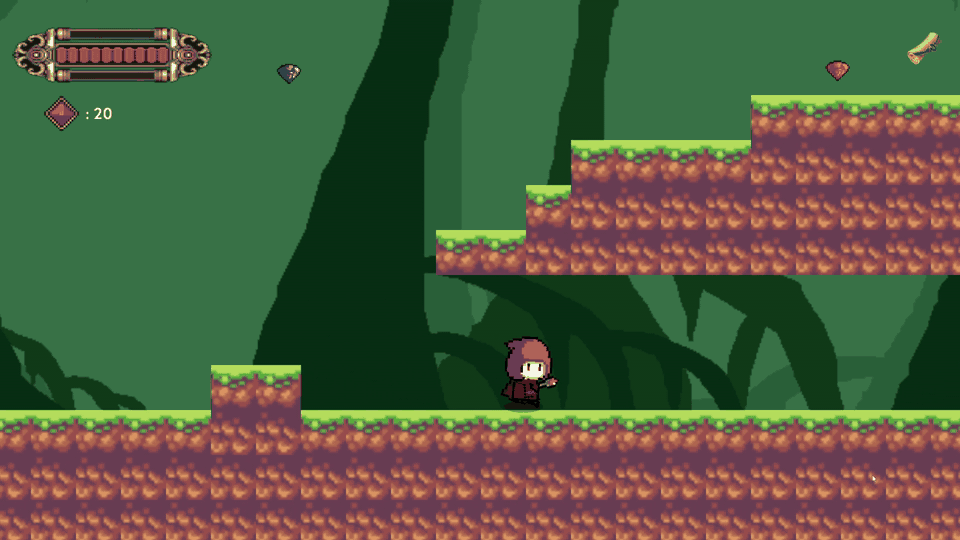

전투의 긴장감은 **적이 플레이어와의 거리에 따라 다르게 반응하는 것**에서 나오도록 했습니다. 일반 몬스터는 멀리 있으면 순찰하다가 가까워지면 쫓아와 공격하고, 보스는 거리에 따라 근접 공격과 원거리 공격을 고르고 공격마다 대기 시간을 둡니다.

두 AI는 구현 방식이 다릅니다. 일반 몬스터는 행동이 단순해 **매 프레임 거리만 비교**하고, 보스는 공격 하나에 "모션 → 피해 · 발사 → 후딜레이" 순서가 있어 **상태 enum과 코루틴**으로 관리했습니다. 

### 4.2 일반 몬스터 · 거리로 고르는 행동

`EnemyAI.Update`는 상태를 따로 저장하지 않고, 매 프레임 플레이어와의 거리를 비교해 행동을 고릅니다.

| 거리 | 행동 |
|---|---|
| 공격 거리 안 | 멈춘 뒤 쿨타임마다 `AttackPlayer`로 피해 |
| 감지 거리 안 | 플레이어 쪽으로 추적 |
| 그 밖 | 발 앞으로 Raycast를 쏴 낭떠러지와 벽을 확인하며 순찰 |

체력 · 피격 섬광 · 사망 애니메이션 · 드롭은 `Enemy`가 따로 처리합니다. 피격 시 `CameraShake`로 화면을 흔듭니다.

### 4.3 보스 · 상태 enum과 공격 코루틴

`BossAI`는 `BossState` enum과 `isAttacking`, `magicTimer`로 지금 무엇을 하는 중인지 관리합니다. 보스 대화가 끝나면 `DialogueManager.EndCinematic`이 보스 상태를 `Move`로 바꿔 전투가 시작됩니다. 보스 씬의 설정값은 근접 3.5, 원거리 7, 감지 40, 특수 공격 쿨타임 6초입니다.

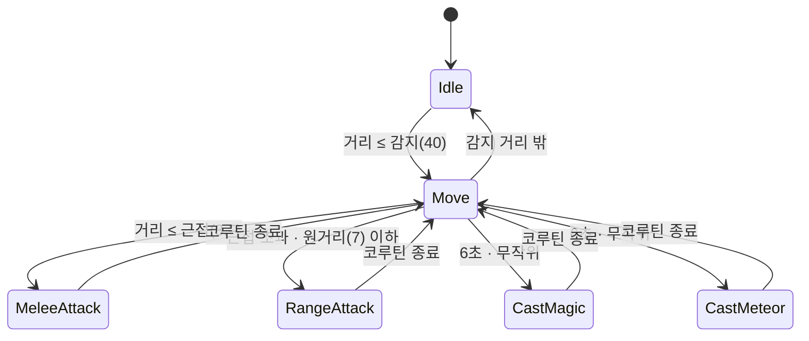

| 상태 | 들어가는 조건 | 처리하는 곳 |
|---|---|---|
| `Idle` | 시작 상태. 플레이어가 감지 거리 안에 오면 `Move` | `UpdateIdle` |
| `Move` | 거리에 따라 근접 → 원거리 → 접근 순으로 검사 | `UpdateMove` |
| `MeleeAttack` · `RangeAttack` | 코루틴 시작 시 진입, 끝나면 `Move` | 각 공격 코루틴 |
| `CastMagic` · `CastMeteor` | 특수 공격 타이머가 차고 공격 중이 아닐 때 둘 중 하나를 무작위로 | `Update` · 각 시전 코루틴 |

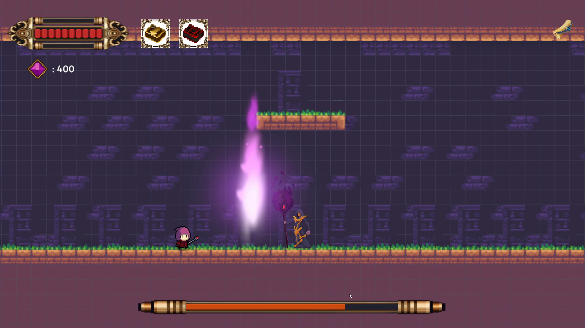

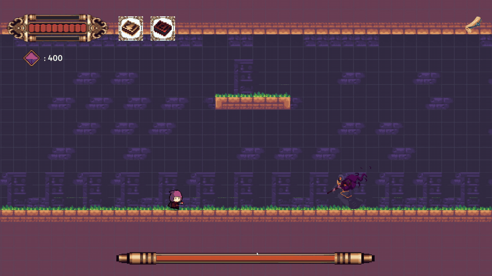

### 4.4 거리 판단과 공격 코루틴

```csharp
// BossAI.UpdateMove 발췌
if (isAttacking) return;                 // 공격 중에는 새 행동을 고르지 않음
float dist = Vector2.Distance(transform.position, player.position);
LookAtPlayer();
if (dist <= meleeRange)
{
    StartCoroutine(MeleeAttackRoutine());
}
else if (dist <= rangeAttackRange)
{
    StartCoroutine(RangeAttackRoutine());
}
else if (dist <= detectRange)
{
    transform.position = Vector2.MoveTowards(
        transform.position,
        new Vector2(player.position.x, transform.position.y),
        moveSpeed * Time.deltaTime);
}
```

```csharp
// BossAI.RangeAttackRoutine (223~238행 발췌)
IEnumerator RangeAttackRoutine()
{
    isAttacking = true;
    currentState = BossState.RangeAttack; // 상태 고정 (버그 방지)
    if (anim != null) anim.SetBool("isRunning", false);
    if (anim != null) anim.SetTrigger("RangeAttack");

    // 지팡이를 휘두르고 유령이 날아가는 모션 타이밍까지 잠깐 대기
    yield return new WaitForSeconds(0.6f);

    if (projectilePrefab != null && firePoint != null)
    {
        Instantiate(projectilePrefab, firePoint.position, transform.rotation);
    }
    // 이하 1.4초 후딜레이 → isAttacking = false, currentState = Move
```

- **가까운 공격부터 검사합니다.** 범위가 겹치면 근접 공격이 우선합니다.
- **공격 중에는 다음 행동을 고르지 않습니다.** 코루틴이 시작할 때 `isAttacking = true`, 끝날 때 `false`와 `Move`로 되돌립니다. `UpdateMove`가 맨 앞에서 `isAttacking`을 보고 바로 빠져나가므로, 공격이 겹쳐 실행되지 않습니다.
- **공격의 시간 순서가 한 메서드 안에 있습니다.** 원거리 공격은 0.6초 모션 → 발사 → 1.4초 후딜레이 순서입니다. 근접 공격은 0.5초를 기다린 뒤 **그 시점에도** 플레이어가 사거리 안에 있는지 다시 확인하고 피해를 줍니다. 그래서 그 사이에 피하면 피해를 받지 않습니다.

보스가 쓰러지면 `BossHealth.Die`가 `isDead`로 사망 처리가 중복되는 것을 막고, AI · 물리 · 충돌체를 끈 뒤 클리어 횟수 증가와 첫 클리어 연출을 호출합니다.

### 4.5 보스 AI를 어떻게 구성할까?

보스의 행동 전환과 공격 타이밍을 enum + 코루틴으로 한 파일에 둘지, 상태마다 클래스를 나누는 상태 패턴으로 만들지 정해야 했습니다.

일반 몬스터는 매 프레임 거리만 비교해도 충분했습니다(§4.2). 그런데 보스는 공격 하나에 "모션 → 피해 · 발사 → 후딜레이"라는 시간 순서가 있어서, 같은 방식이면 모션이 끝나기 전에 다음 공격이 또 시작될 수 있었습니다. 그래서 처음부터 **공격하는 동안에는 다음 행동을 고르지 않게 막고** 시작했습니다.

**AI가 제안한 enum + 코루틴 구조를 그대로 썼습니다.** 보스 패턴이 근접 · 원거리 · 특수 공격 두 종류로 많지 않았기 때문입니다. `isAttacking` 하나로 공격이 겹치지 않게 막는 방식이라, 코드를 처음부터 끝까지 따라가며 설명할 수 있었습니다. **이때 상태 패턴과는 비교하지 않았습니다.**

문서를 정리하면서, 상태 패턴으로 만들었다면 무엇이 달랐을지 비교해 보았습니다.

| | [A] 상태별 클래스 (상태 패턴) | [B] enum + 코루틴 (선택) |
|---|---|---|
| 방식 | 상태마다 진입 · 갱신 · 종료를 가진 클래스를 만들고 전환을 한 곳에서 처리 | `BossState` enum과 `switch`, 공격은 코루틴 |
| 장점 | 상태마다 책임이 나뉘어 패턴 추가가 쉬움 | 거리 판단과 공격의 시간 순서를 한 파일에서 따라갈 수 있음 |
| 단점 | 패턴이 적은 규모에서는 파일과 연결 구조가 늘어남 | 상태를 바꾸는 곳이 코루틴 · 외부 클래스로 흩어지고, 클래스가 커짐 |

패턴이 이 정도인 규모에서는 [B]로 충분했습니다. 대신 지금 구조는 상태 패턴이라기보다 **enum으로 분기하는 제어기**에 가깝습니다. `UpdateMove`, 각 코루틴, `DialogueManager`, `BossHealth`가 각자 보스의 상태나 활성화 여부를 바꿉니다. 예를 들어 `BossState.Dead`는 enum에는 있지만, 실제 사망은 `BossAI.enabled = false`로 처리되어 이 상태로 넘어가는 경로가 없습니다.

---

## 5. 다회차 스토리 분기

### 5.1 두 번째 플레이에서 완성되는 발견감

이 게임의 발견감은 **두 번째 플레이**에서 완성됩니다. 다시 시작한 플레이어는 폐허가 된 타이틀 화면, 바뀐 배경음, 붉은 글자로 바뀐 마법책 문장을 차례로 만나고, 보스와의 대화 끝에서는 `*공격` 버튼이 `* ...`으로 일그러진 뒤 첫 플레이와 다른 결말로 이어집니다.

구현은 별도의 분기형 대사 데이터가 아니라 **클리어 횟수 정수 하나**로 "0회"와 "1회 이상"을 나누는 방식입니다. 각 클래스가 이 값을 읽고 스스로 연출을 바꿉니다.

### 5.2 클리어 횟수를 저장하고 읽는 방법

**클리어 횟수 읽고 쓰기**

```csharp
if (GameManager.instance.clearCount >= 1) { /* 다음 플레이 연출 */ } // 읽기: 각 클래스가 직접 검사
GameManager.instance.AddClearCount();                              // 쓰기: 1 올리고 바로 저장 (보스 처치 때만)
```

| 시점 | 처리 | 위치 |
|---|---|---|
| 씬 시작 | `PlayerPrefs.GetInt("ClearCount", 0)`으로 읽기 | `GameManager.Awake` → `LoadGameData` |
| 보스 처치 | 1 올리고 `PlayerPrefs.Save()` | `BossHealth.Die` → `GameManager.AddClearCount` |
| 테스트 | 숫자 `9` 증가, `0` 초기화 | `GameManager.Update` (개발용) |

```csharp
// GameManager.LoadGameData / AddClearCount 발췌
public void LoadGameData()
{
    clearCount = PlayerPrefs.GetInt("ClearCount", 0);
}
public void AddClearCount()
{
    clearCount++;
    PlayerPrefs.SetInt("ClearCount", clearCount);
    PlayerPrefs.Save();
}
```

`AddClearCount`는 보스를 실제로 쓰러뜨리는 **첫 플레이 경로**에서만 호출됩니다. 다음 플레이의 결말(`SecretEndingRoutine`)에는 이 호출이 없습니다.

`GameManager` 프리팹은 타이틀과 스테이지 씬에 하나씩 놓여 있습니다. `DontDestroyOnLoad`는 쓰지 않고, 씬이 바뀔 때마다 새 인스턴스가 `PlayerPrefs`에서 값을 다시 읽습니다.

### 5.3 클리어 횟수 하나로 달라지는 장면들

| 요소 | `ClearCount == 0` | `ClearCount >= 1` | 처리하는 곳 |
|---|---|---|---|
| 타이틀 | 기본 배경 · BGM | 폐허 배경 · 다른 BGM | `TitleManager.Start` |
| 스테이지 BGM | 던전 BGM 1 | 던전 BGM 2 | `StageIntroManager.OnTriggerEnter2D` |
| 마법책 문장 | 원래 문장 | 책 1은 붉은 문장으로 교체, 책 2는 붉은 문장 추가 | `SpellBook.GlitchTextRoutine` |
| 보스 대사 | 같은 대사 | **같은 대사** | `DialogueManager.TypeLine` |
| 대사 뒤 버튼 | `*공격` | `*공격` → `* ...`로 글리치 | `DialogueManager.GlitchButtonText` |
| 버튼을 누르면 | 보스전 → 처치 → 왕국군 화살 엔딩 | 보스전 없이 왕국군 · 운석 연출 → 엔딩 책 | `OnClickBattleStart` |

**보스 대사 자체는 두 회차가 같습니다.** 같은 대사를 두고 그 앞뒤의 타이틀 · 책 문장 · 버튼이 달라지면서, 첫 플레이에서는 평범했던 대사가 다른 의미로 읽히도록 구성했습니다.

| **첫 플레이** (`ClearCount == 0`) | **다음 플레이** (`ClearCount >= 1`) |
|---|---|
| 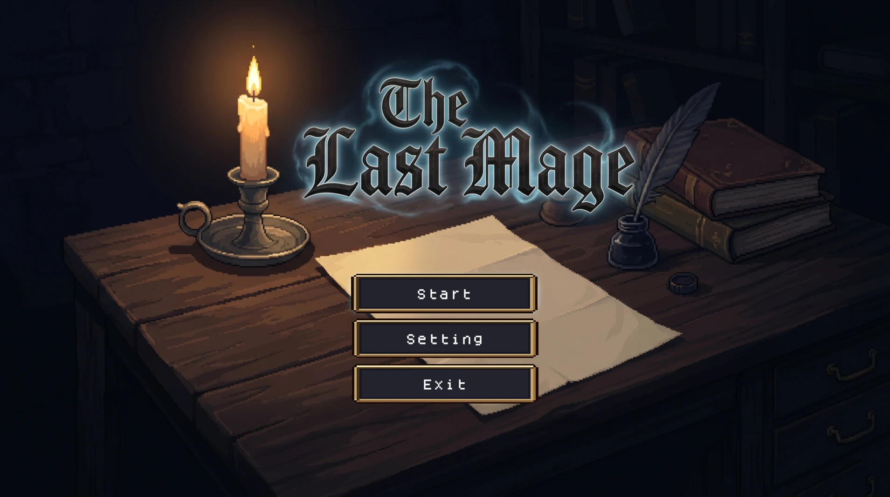 | 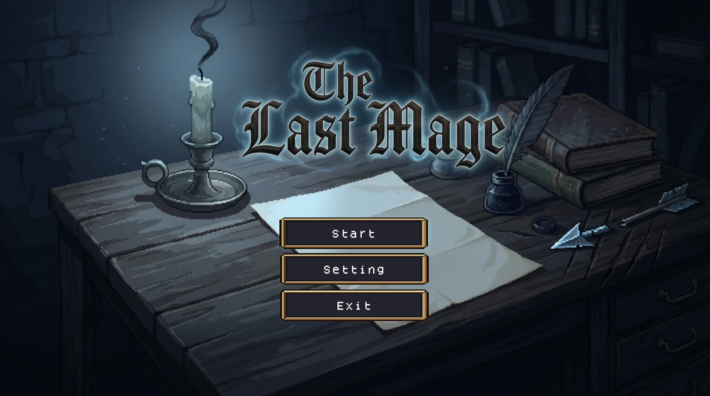 |

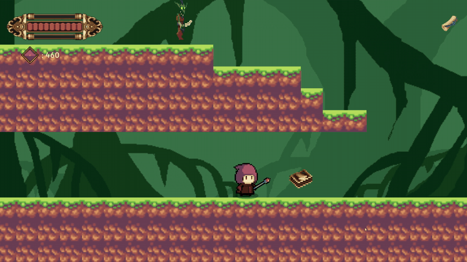

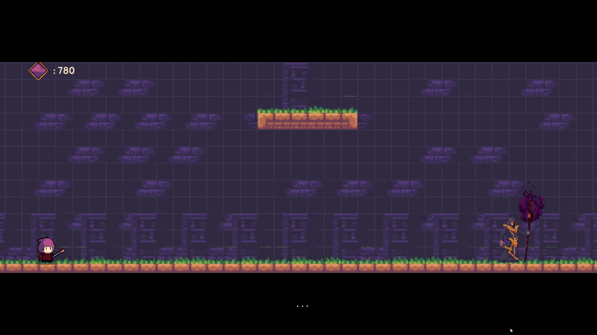

### 5.4 보스방 진입부터 결말까지

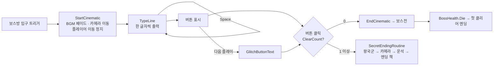

- **보스방에 들어가면 연출이 시작됩니다.** `DialogueManager.OnTriggerEnter2D`가 `hasStarted`로 중복 시작을 막은 뒤 `StartCinematic`을 호출합니다. BGM을 페이드아웃하고, 카메라를 보스방 중앙으로 옮기고, 플레이어의 이동(`PlayerController`)을 끕니다.
- **대사는 한 글자씩 출력됩니다.** `TypeLine`이 `WaitForSecondsRealtime`으로 글자를 출력하고, `Space`를 누르면 다음 줄로 넘어갑니다. 마지막 줄 뒤에 버튼이 나타납니다.
- **같은 버튼이 회차에 따라 다른 결과를 냅니다.**

```csharp
// DialogueManager.OnClickBattleStart 발췌
if (GameManager.instance.clearCount == 0)
{
    if (bossBattleBGM != null)
        BGMManager.instance.PlayBGM(bossBattleBGM);
    Time.timeScale = 1f;
    EndCinematic();                       // 첫 플레이: 보스전 시작
}
else
{
    StartCoroutine(SecretEndingRoutine()); // 다음 플레이: 바로 결말 연출
}
```

플레이어가 고르는 선택지 두 개가 아니라, **같은 버튼을 눌렀을 때 회차에 따라 결과가 갈리는 구조**입니다. 왜 이렇게 했는지는 [§5.5](#55-2회차의-차이를-어디에-둘까)에 적었습니다.

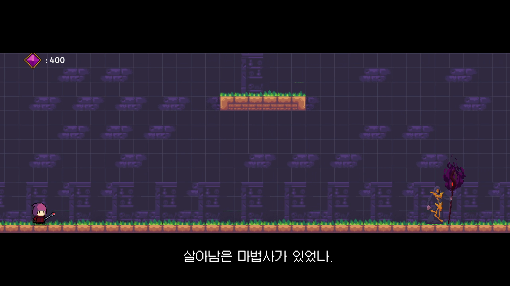

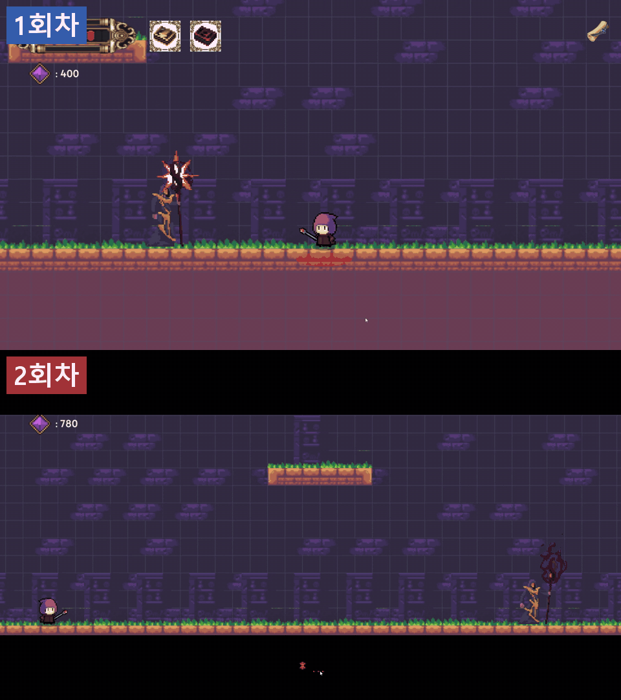

### 5.5 2회차의 차이를 어디에 둘까?

같은 대사가 끝난 뒤, 2회차의 달라짐을 무엇으로 보여 줄지 정해야 했습니다.

| | [A] 대화 끝에 선택지 두 개 | [B] 같은 버튼의 글자가 바뀜 ✓ |
|---|---|---|
| 방식 | `*공격` 외에 다른 선택지를 함께 보여 줌 | 1회차와 같은 `*공격` 버튼이 눈앞에서 `*ㄱ..` → `* ...`로 일그러짐 |
| 플레이어가 겪는 것 | 결말을 직접 고름 | 고를 수 없는 채로, 익숙한 버튼이 달라지는 것을 봄 |
| 비용 | 선택지 UI · 선택지마다 결말을 더 만들어야 함 | 글자를 바꾸는 코루틴 하나(`GlitchButtonText`) · 회차 검사 |
| 단점 | 하고 싶었던 "글자가 바뀌는 연출"이 들어갈 자리가 없음 | 플레이어에게 선택권이 없음 |

**같은 버튼의 글자가 바뀌는 쪽([B])을 골랐습니다.** 선택지를 넣으려다가, **선택지 글자가 바뀌는 연출**이 더 극적일 것 같아서 그쪽으로 정했습니다. 대사도 버튼도 1회차와 똑같이 흘러가 같은 장면이 되풀이되는 것처럼 보이다가, 마지막에 그 버튼이 일그러지면서 **사실은 같지 않았다는 것이 드러나는 반전**을 주고 싶었습니다.

---

## 6. 만들며 생긴 문제

### 6.1 카메라가 플레이어에 붙어 버린 문제

카메라 추적 기능을 추가했을 때 카메라가 플레이어에 딱 붙어 움직여서 부드럽게 따라오지 않았습니다. 더 곤란했던 것은 플레이어가 늘 화면 한가운데에 오면서 **화면 아래쪽에 땅 밑 빈 공간이 크게 보인 것**입니다. 처음에는 원인을 찾지 못했습니다.

원인은 `PlayerCameraFollow.LateUpdate`에서 `Vector3.Lerp`의 시작점이 `target.position`(플레이어 위치)이었던 것입니다. 매 프레임 **플레이어 위치에서** 목표 위치 쪽으로 조금만 옮긴 값을 쓰므로, 카메라가 어디에 있었는지와 상관없이 늘 플레이어 근처로 정해졌습니다. 그래서 따라오는 움직임 없이 플레이어에 붙어 있었습니다. 카메라를 플레이어보다 3만큼 위에 두려고 했지만, 매 프레임 그 거리의 일부만 올라간 자리로 다시 정해져서 카메라가 거의 플레이어 높이에 머물렀습니다.

그래서 시작점을 `transform.position`(카메라의 현재 위치)으로 바꿨습니다.

```csharp
// Before — 플레이어 위치에서 보간 시작
Vector3 smoothedPosition = Vector3.Lerp(target.position, desirePosition, smoothSpeed * Time.deltaTime);

// After — 카메라 현재 위치에서 보간 시작
Vector3 smoothedPosition = Vector3.Lerp(transform.position, desirePosition, smoothSpeed * Time.deltaTime);
```

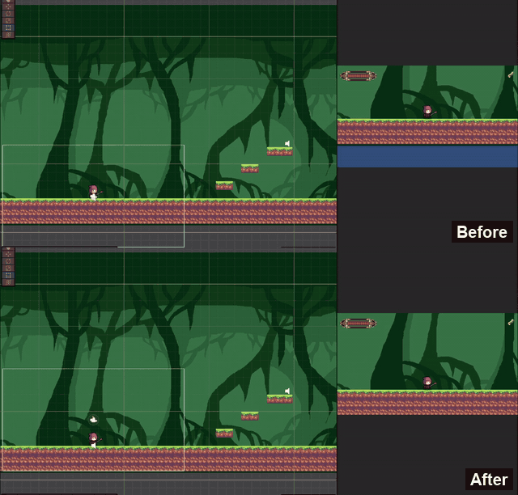

이제 카메라가 현재 위치에서 목표 위치로 매 프레임 조금씩 다가가며 부드럽게 따라갑니다. 이 일로, `Lerp`를 매 프레임 불러 "따라가는" 움직임을 만들려면 시작점이 **매 프레임 바뀌는 자기 자신의 현재 위치**여야 한다는 것을 배웠습니다. 시작점을 따라갈 대상으로 두면 따라가는 것이 아니라 대상에 붙어 버립니다.

### 6.2 쓰러진 몬스터에게 맞는 문제

몬스터에 바짝 붙어서 처치하면, 몬스터가 쓰러지는 중인데도 플레이어가 한 대 맞았습니다. 개발할 때도 어렴풋이 알고는 있었지만 크게 신경 쓰지 않았는데, 시연 영상을 준비하며 다시 플레이해 보니 **붙어서 잡으면 꼭 한 대씩 맞는다**는 것을 확실히 알게 되었습니다.

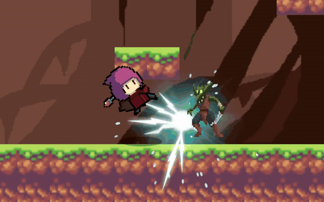

원인은 몬스터 하나에 붙은 두 스크립트였습니다. `Enemy`는 체력 · 사망을, `EnemyAI`는 이동 · 공격을 맡는데, `Enemy.Die`는 콜라이더와 **자기 자신(`Enemy`)만** 끄고 오브젝트는 2초 뒤에 지웁니다(`Destroy(gameObject, 2f)`). 그 2초 동안에도 `EnemyAI.Update`는 계속 돌면서 거리를 비교하고, 플레이어가 공격 거리(1.2) 안에 있으면 `AttackPlayer`를 부릅니다. 일반 몬스터는 상태를 저장하지 않고 거리만 보기 때문에(§4.2), **`EnemyAI`에는 "죽었다"는 것을 알 방법이 없었습니다.**

그래서 사망할 때 같은 오브젝트의 `EnemyAI`도 끄도록 고쳤습니다.

```csharp
// Enemy.Die 발췌
GetComponent<Collider2D>().enabled = false;
this.enabled = false; // Enemy 정지

// 추가: 쓰러진 뒤에도 EnemyAI가 공격하지 않게 끄기
EnemyAI ai = GetComponent<EnemyAI>();
if (ai != null) ai.enabled = false;
```

새 빌드에서는 몬스터에 붙어서 처치해도 더 이상 맞지 않습니다. 이 일로, 한 오브젝트의 기능을 여러 스크립트로 나누면 "죽음"처럼 모두가 알아야 하는 상태 변화는 **한 곳에서 빠짐없이 전해야** 한다는 것을 배웠습니다. 지금은 `Die`가 직접 끄지만, 스크립트가 늘어나면 사망 이벤트 하나를 모두가 받는 쪽이 빠뜨릴 위험이 적습니다.

### 6.3 보스 대화 중 공격하면 연출이 겹치는 문제 (미해결)

보스 대화 중에 대사를 넘기지 않고 공격하면 연출이 이상하게 겹치는 오류가 있다는 것을 알고 있었습니다. 하지만 기간 안에 고치지 못했습니다. 문서를 정리하면서 코드에서 겹칠 수 있는 경로를 세 곳 찾았습니다.

| 경로 | 내용 |
|---|---|
| 공격 입력이 막히지 않음 | `StartCinematic`이 `PlayerController`(이동)만 끄고, `PlayerAttack`은 끄지 않음. 대화 중에도 Z가 들어감 |
| 버튼 상태를 쓰지 않음 | `DialogueManager.Update`에 `isButtonActive`를 계산하지만 조건에 쓰지 않음 |
| 결말 연출 중에도 대사 진행 | 다음 플레이에서 `SecretEndingRoutine`을 시작할 때 `isDialogueActive`를 끄지 않아, `Space`가 `NextLine`을 다시 부를 수 있음 |

대화가 시작되면 이동 · 공격 · 대사 진행 · 버튼 입력을 함께 잠그고, 한 단계가 끝나야 다음 단계 입력을 받도록 바꿀 계획입니다.

---

## 7. AI와 일한 방식

<!-- 예시(Claude 작성, 2026-11-19) — 예전 §1.7 표를 옮기고 수강생 답변(잘 된 것 · 안 된 것)을 더했습니다. 내 말로 고친 뒤 이 줄을 지우세요 -->
| 구분 | 내용 |
|---|---|
| 내가 정한 것 | 게임 방향(마법책 성장 · 다회차 서사), 회차별로 바뀔 장면, 마법 3종의 역할 |
| AI에게 맡긴 것 | 보스 AI 구조 — `BossState` enum으로 지금 하는 일을 표시하고, 공격마다 코루틴 하나에 시간 순서를 담는 방식([§4.5](#45-보스-ai를-어떻게-구성할까)), 대사 타이핑 코드, 이미지 리소스 |
| 확인하고 고친 것 | 직접 플레이하며 쿨타임 · 운석 개수 수치, 보스의 공격 모션 대기 시간과 근접 공격이 맞는 타이밍을 고치고, 카메라 추적 오류를 수정함 |
| 잘 된 것 | 2주 안에 혼자 할 수 있다고 생각한 범위를 넘어서까지 만들 수 있었음 |
| 안 된 것 | 후반으로 갈수록 시간이 급해져, 코드를 거의 그대로 맡기게 됨 |

---

## 8. 결과와 돌아보기

### 8.1 구현 결과

2주 안에 **탐색 → 마법책 획득 → 보스 대화 → 결말**로 이어지는 한 스테이지를 완성했고, 클리어 기록에 따라 타이틀부터 엔딩까지 다섯 곳의 연출이 바뀌는 다회차 구조를 넣었습니다.

#### 목표 vs 구현

| 목표 (§1) | 구현 결과 | 어디서 |
|---|---|---|
| 탐색하며 전투 방식 발견 (성장감) | 마법책 2권으로 관통 · 운석 해금, Q/E 전환, 마법별 쿨타임 | §3 |
| 같은 세계를 다시 보며 의미 발견 (발견감) | `ClearCount`로 타이틀 · BGM · 책 문장 · 버튼 · 결말 변경 | §5 |
| 보스전의 도전과 타격감 | 거리별 공격 코루틴, 피격 섬광 · 화면 흔들림, 첫 클리어 연출 | §4 |
| 보석 수집 → 상점 성장 | **미완성** — 수집 · 표시만 있고 쓸 곳이 없음 | §8.2 |
| 2회차 보스와 동맹 · 왕국군 전투 | **연출로 대체** — 왕국군 · 운석 자동 엔딩 | §5.4 |


 

### 8.2 아쉬운 점과 개선 계획

| # | 아쉬운 점 | 원인 구분 | 개선 계획 |
|---|---|---|---|
| 1 | 보석을 쓸 곳이 없어 모을 동기가 약함 | 기획 · 일정 | 상점 NPC를 넣어 보석으로 성장하게 하거나, 수집의 목적을 다시 정함 |
| 2 | 2회차 결말이 급작스러움 | 일정 | 다중 적 스폰 · 공격 에셋을 기간 안에 만들기 어려워 연출로 대체함. 2회차에 왕국군과 싸우는 보스전 2페이즈를 넣어 결말까지 자연스럽게 이어지게 하고 싶음 |
| 3 | 플랫포머 요소(레벨 디자인 · 몬스터 전투)가 부족함 | 기획 · 일정 | 스토리 · 연출에 집중한 만큼 부족했던 부분. 다음 버전 목표를 "플랫포머 요소 극대화"로 잡음 |
| 4 | 버튼 글리치가 끝나기 전에도 클릭 가능 | 구현 | 글리치 코루틴이 끝난 뒤 버튼을 활성화 |
| 5 | `DialogueManager`에 대사 · 입력 · 카메라 · BGM · 왕국군 스폰 · 엔딩 UI까지 몰림. 입력 잠금 규칙이 없어 대화 중 연출이 겹침(§6.3) | 구조 | 엔딩 연출을 별도 클래스로 분리 |
| 6 | 클리어한 뒤 2회차를 시작해도 1회차 보석이 그대로 남음 | 구현 | 처치 수는 클리어 때 0으로 되돌리지만 보석 점수(`DataManager.gemScore`)는 게임 오버 화면에서만 되돌림. 클리어 경로에서도 함께 초기화 |

### 8.3 배운 점

**연출이 많아질수록 입력을 언제 받을지 정해야 한다.**\
대사 · 버튼 글리치 · 엔딩 코루틴이 이어지는데, "앞 단계가 끝났는지 확인하고 입력을 잠그는" 규칙이 없어 겹침 문제가 생겼습니다(§6.3). 코루틴으로 시간 순서를 만들 때는 **그 사이에 들어오는 입력을 어떻게 막을지**도 함께 설계해야 한다는 것을 배웠습니다.

**범위를 줄일 때 핵심 경험을 기준으로 골랐다.**\
상점과 동맹 전투를 빼면서도 마법책 성장과 회차별 연출은 지켰습니다. 2주 안에 다 만들 수 없을 때 **기획의 핵심 경험 두 가지를 기준으로 남길 것을 정했다**는 점이 이번 프로젝트에서 가장 큰 판단이었습니다.

**한 곳에 둘 것인가, 나눌 것인가.**\
이 프로젝트의 선택들은 결국 같은 질문으로 모입니다.

| 어디서 | 고른 쪽 | 그 대가로 생긴 일 |
|---|---|---|
| §3.5 발사체 | 공통 클래스 없이 마법별로 따로 | 운석 발사체에만 플레이어 충돌 무시 코드가 빠짐 |
| §4.5 보스 AI | 상태 패턴 대신 enum + 코루틴 한 파일 | 보스 상태를 바꾸는 곳이 네 군데로 흩어짐 |
| §5.5 회차 분기 | 저장 값 하나를 각 클래스가 직접 검사 | 회차를 검사하는 클래스가 4개 |
| §6.2 몬스터 사망 | `Enemy` · `EnemyAI`로 나눴지만 사망은 한쪽만 앎 | 쓰러진 몬스터가 공격함 |

나누든 한 파일에 모으든, 2주짜리 작은 프로젝트에서는 네 가지 선택 모두 당장 만들기 빠르고 읽기도 쉬웠습니다. 그런데 문제가 생긴 모습은 모두 동일했습니다. **같은 일을 하는 코드가 여러 곳에 흩어져 있어서, 한 곳을 고치면 다른 곳을 빠뜨리기 쉬웠습니다.** 

그래서 다음에는 처음부터 구조를 크게 잡기보다, 같은 일을 하는 코드를 한 번 더 쓰려는 순간을 신호로 삼아 한 곳으로 모으려고 합니다.
