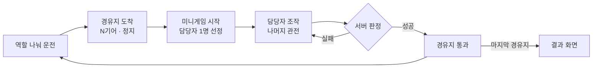
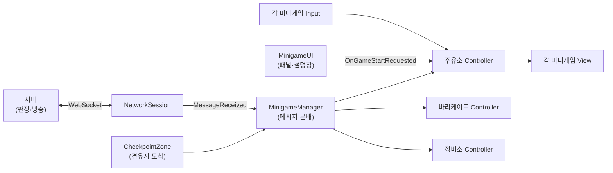
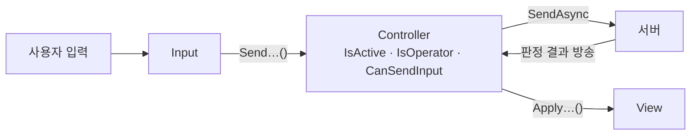
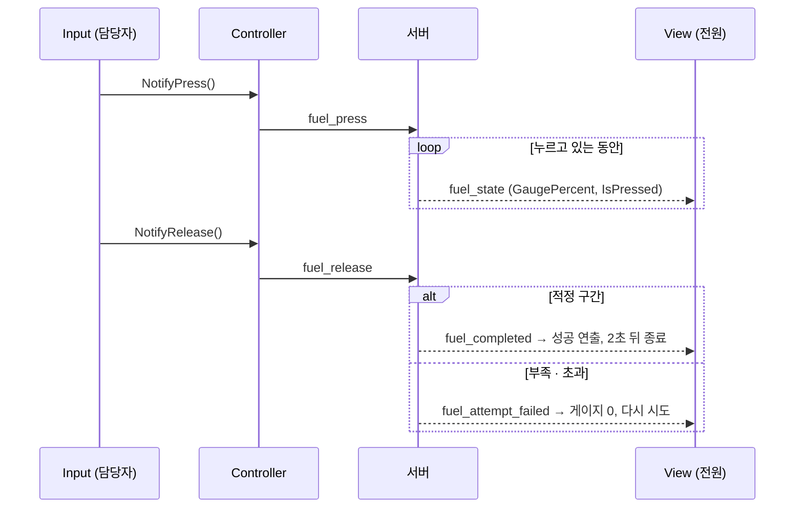
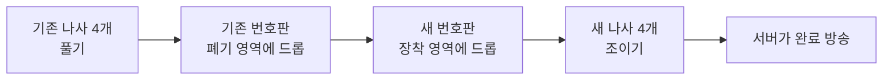
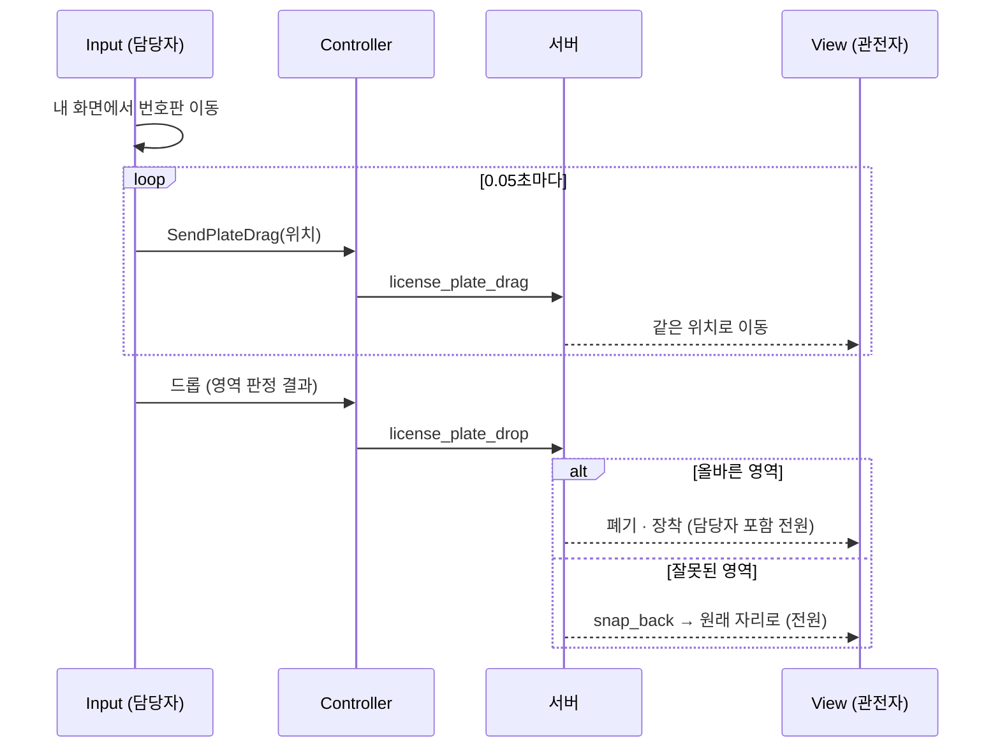

# 누가 이딴 차로 도망을 가! — 협동 운전 게임 기술 문서

> **팀 프로젝트 · 경유지 미니게임 3종(주유소 · 바리케이드 · 정비소)과 게임 UI 클라이언트 담당**

> 📷 **이미지 자리** `images/cover.png` — 차량 운전 화면과 미니게임 패널이 함께 보이는 대표 화면

| 항목 | 내용                                                                                                               |
|---|--------------------------------------------------------------------------------------------------------------------|
| 장르 | 2D 온라인 협동 운전 게임                                                                                           |
| 개발 기간 | 2주 (2026.08.26 ~ 2026.09.10)                                                                                      |
| 개발 인원 | 4명 (팀 프로젝트)                                                                                                  |
| 내 역할 | 경유지 미니게임 3종의 클라이언트(UI · 연출 · 서버 연동 코드 적용), 타이머 · 결과 화면 · 타이틀 · 로비 · HUD UI     |
| 개발 환경 | Unity 6000.3.15f1 · C# · UniTask · DOTween · Newtonsoft.Json · TextMeshPro · WebSocket 서버 (확인 필요: 서버 종류) |
| 주요 기술 | Input · Controller · View 3분할 · 서버 판정 / 클라이언트 표시 · 담당자 · 관전자 동기화 · 번호판 드래그 좌표 동기화 |
| 링크 | GitHub: (확인 필요: 공개 가능한 주소) · 시연 영상: (확인 필요)                                                     |

---

## 목차

1. [프로젝트 개요](#1-프로젝트-개요)
2. [담당 파트 구조](#2-담당-파트-구조)
3. [Input · Controller · View 역할 분리](#3-input--controller--view-역할-분리)
4. [주유소 · 서버가 계산한 게이지 표시](#4-주유소--서버가-계산한-게이지-표시)
5. [바리케이드 · 서버 판정 결과만 표시](#5-바리케이드--서버-판정-결과만-표시)
6. [정비소 · 단계별 상호작용과 번호판 드래그 동기화](#6-정비소--단계별-상호작용과-번호판-드래그-동기화)
7. [협업 · 지시서와 실제 구현의 차이](#7-협업--지시서와-실제-구현의-차이)
8. [트러블슈팅](#8-트러블슈팅)
9. [결과 및 회고](#9-결과-및-회고)

---

## 1. 프로젝트 개요

### 1.1 프로젝트 소개

**What — 무엇을 만들었나**

플레이어들이 **기어, 액셀 · 브레이크, 내비게이션, 핸들** 같은 차량 조작을 하나씩 나눠 맡아 함께 운전하는 2D 온라인 협동 게임입니다. 경유지에 도착하면 **미니게임**을 통과해야 다음으로 갈 수 있습니다.

이 문서는 게임 전체 중 **제가 맡은 경유지 미니게임 3종의 클라이언트 구현**을 중심으로 다룹니다. 미니게임마다 서버가 **담당자 1명**을 정하고, 담당자만 조작하며 나머지 플레이어는 같은 화면을 **관전**합니다.

**Why — 무엇에 집중했나**

미니게임은 처음에 혼자 화면 안에서 판정까지 하는 **로컬 버전**으로 만들었습니다. 그 뒤 서버와 연동하면서 가장 중요해진 것은 **담당자와 관전자의 화면이 같은 진행을 보여야 한다**는 점이었습니다.

판정을 각 클라이언트가 하면 화면마다 결과가 달라질 수 있습니다. 예를 들어 바리케이드의 정답 순서를 클라이언트마다 따로 만들면, 담당자와 관전자의 정답이 서로 다르게 됩니다. 그래서 **판정은 서버가 하고, 클라이언트는 입력을 보내고 결과만 그리는 구조**로 바꿨습니다. 이 원칙은 팀장의 지시서에서 정한 것이고, 저는 그 원칙에 맞게 제 미니게임을 다시 나누는 작업을 했습니다. 

**Why — 개발자로서의 목표**

처음 해 보는 **온라인 협업 프로젝트**에서, 서버 담당이 정한 규약에 맞춰 클라이언트를 붙이는 경험을 하는 것이 목표였습니다.

이 문서는 **Input · Controller · View 역할 분리, 서버 판정 결과의 표시, 번호판 드래그 동기화** 세 가지를 중심으로 다룹니다.

### 1.2 핵심 플레이 루프



_운전은 모두가 함께하고, 미니게임은 한 명이 맡습니다. 실패해도 미니게임은 끝나지 않고 다시 시도합니다._

> 📷 **이미지 자리** `images/loop.gif` — 경유지에 멈춰 미니게임 패널이 올라오고, 성공 후 다시 출발하는 장면

### 1.3 팀 구성과 내 역할

| 담당 | 역할 |
|---|---|
| **나** | 미니게임 3종의 UI · 연출, 지시서를 바탕으로 한 서버 연동 코드 적용, 미니게임 패널(`MinigameUI`), 타이머 UI, 결과 화면, 타이틀 · 로비 · HUD UI, 튜토리얼 패널 |
| 팀장 | 서버 통신 지시서 작성 (확인 필요: 그 밖의 담당) |
| 팀원 | `NetworkSession` · 서버 메시지 분배(`MinigameManager`) 정비 · 경유지 판정(`CheckpointZone`), 주유소 · 바리케이드 · 번호판 동기화 수정 (확인 필요: 담당자 이름) |
| 팀원 | 레벨 디자인, 미니게임 효과음 (확인 필요: 담당자 이름) |

**파일별 커밋 기록** (팀 레포 git 기준)

> 이 표는 **누가 커밋했는지**를 나타냅니다. **누가 설계했는지**를 뜻하지 않습니다(설계 출처는 1.4).

| 영역 | 클래스 | 커밋 기록 |
|---|---|---|
| 주유소 | `GasStationMinigameInput` · `Controller` · `View` | 처음 작성과 서버 스크립트(08/27)는 본인. 실제 `NetworkSession` 연결(08/28)은 팀원 |
| 바리케이드 | `BarricadeMinigameInput` · `Controller` · `View` | 본인 작성, 서버 동기화 수정(09/01)은 팀원 |
| 정비소 | `RepairShopMinigameInput` · `Controller` · `View` | 본인 작성, 번호판 동기화 수정(09/05)은 팀원 |
| 공통 | `MinigameUI` (패널 · 설명창) | 본인 · 팀원 공동 |
| 공통 | `MinigameManager` (서버 메시지 분배) | 처음 작성은 본인(08/27), 이후 대부분 팀원이 수정 |
| UI | `TimerController` · `TimerView` | 본인 단독 |
| UI | `ResultUI` · `TitleManager` | 본인 · 팀원 공동 |
| 팀원 작성 | `NetworkSession`, `CheckpointZone`, 메시지 클래스(`MinigameProtocol`), 효과음 호출 | 이 문서에서는 내 코드와 연결되는 부분만 설명 |

### 1.4 설계와 구현의 출처

| 구분 | 내용 | 출처 |
|---|---|---|
| **지시서에 있던 것** | 서버 메시지 규약, 서버가 판정하고 클라이언트는 입력만 보내는 원칙, Input · Controller · View 3분할, 입력 전 세 조건 확인(`IsActive` · `IsOperator` · `CanSendInput`), 중복 입력 방지(`IsPressedLocally`), 과부하 2초 잠금을 View가 맡는 분담, 번호판 드래그 권한(`CanDrag…`) · 0.05초 전송 간격 · `anchoredPosition` 좌표 · 고정 장착 슬롯(`plateSlot`). 바리케이드 · 정비소는 Controller · Input 예시 코드까지 포함 | 팀장의 서버 통신 지시서 |
| **Gemini로 만들어 적용한 것** | 위 지시서를 Gemini에 전달해 만든 Controller · Input · View의 서버 연동 코드 | 지시서 → Gemini → 본인이 프로젝트에 적용 |
| **내가 만든 UI · 연출** | 미니게임 패널, 주유 노즐 · 버튼, 퓨즈 점등 · 과부하 깜빡임, 번호판 복귀 · 결과 문구 애니메이션, 설명창, 타이머 · 결과 화면 · 타이틀 · 로비 | 본인 (확인 필요: 이 영역에도 AI를 활용했는지) |
| **팀원이 바꾼 것** | `NetworkSession` 연결, 메시지 분배 정비, 번호판 동기화 수정, 효과음 | 팀원 (7장) |

> 2~6장의 그림과 동작 설명은 개발 당시의 설계 문서가 아니라, **기술 문서를 쓰면서 코드와 지시서를 다시 읽고 정리한 것**입니다.

### 1.5 내가 맡은 미니게임

| 미니게임 | 규칙 | 서버가 판정하는 것 |
|---|---|---|
| **주유소** | 버튼을 누르고 있다가 게이지가 적정 구간에 왔을 때 떼는 타이밍 게임 | 게이지 값, 성공 · 실패 |
| **바리케이드** | 전기 퓨즈 3개를 정해진 순서대로 클릭하는 게임 | 정답 순서, 클릭마다 정답 · 오답, 완료 |
| **정비소** | 기존 번호판 나사 4개를 풀고 번호판을 버린 뒤, 새 번호판을 붙이고 나사 4개를 조이는 게임 | 단계 진행, 완료 |

미니게임 셋은 일부러 **조작 방식이 모두 다르게** 구성됐습니다. 누르고 떼기, 순서대로 클릭, 드래그 앤 드롭입니다. 그래서 담당자가 바뀔 때마다 다른 손맛을 느끼게 됩니다.

> 📷 **이미지 자리** `images/minigames.png` — 주유소 · 바리케이드 · 정비소 패널 세 장을 나란히

### 1.6 기술 핵심 요약

| 핵심 | 무엇을 했나 | 자세히 |
|---|---|---|
| Input · Controller · View 3분할 | 입력 받기 · 서버 통신 · 화면 연출을 나눠, UI 작업과 서버 연동이 서로 덜 부딪히게 함 | [§3](#3-input--controller--view-역할-분리) |
| 서버 판정 · 결과만 표시 | 입력 직후에는 화면을 바꾸지 않고, 서버 결과 메시지로만 바꿔 담당자 · 관전자 화면을 맞춤 | [§3.3](#33-서버가-판정하고-클라이언트는-결과만-그린다) |
| 서버 값 그대로 게이지 표시 | 주유 게이지를 클라이언트가 계산하지 않고 서버 값만 그림 | [§4](#4-주유소--서버가-계산한-게이지-표시) |
| 단계별 조작 권한 | 서버가 승인한 단계 상태로 다음 조작(드래그 · 나사) 가능 여부를 정함 | [§6.1](#61-단계-진행) |
| 번호판 드래그 동기화 | 0.05초 간격 `anchoredPosition` 전송, 관전자만 적용, 고정 슬롯 장착 | [§6.2](#62-번호판-드래그-동기화) |

### 1.7 구현 범위

| 기획 항목 | 구현 | 비고 |
|---|---|---|
| 미니게임 3종 로컬 버전 | ✅ | 08/26~08/31, 처음에는 클라이언트가 판정 |
| 미니게임 3종 서버 연동 | ✅ | 담당자 조작 · 관전자 동기화 |
| 미니게임 설명창 · 패널 연출 | ✅ | `MinigameUI` |
| 타이머 · 결과 화면 | ✅ | 시간 초과 신호, 성공 · 실패 결과, 재시도 · 나가기 |
| 타이틀 · 로비 · HUD | ✅ | 09/03~09/06 |
| 튜토리얼 패널 | ➖ 꺼 둠 | 09/09에 추가했다가 같은 날 끔 (확인 필요: 이유) |
| 주유 게이지 로컬 선반영 | ➖ 사용 안 함 | 지시서의 선택지였지만 서버 값만 반영 (§4.4) |

---

## 2. 담당 파트 구조

### 2.1 전체 구조

이 그림에서 볼 것은 **미니게임 Controller가 WebSocket을 직접 다루지 않고, `MinigameManager`가 나눠 준 메시지 객체만 받는다**는 점입니다.



_그림을 단순하게 하려고 Input · View는 주유소에만 연결해 그렸습니다. 바리케이드 · 정비소도 같은 방식입니다. `NetworkSession` · `CheckpointZone`은 팀원이 작성했습니다._

### 2.2 미니게임 한 판의 흐름

1. **방장(host)** 화면에서 차량이 경유지 구역 안에 **완전히** 들어오고, **기어가 N이며 정지 속도 이하**가 되면 `CheckpointZone`이 미니게임 시작을 요청합니다. (팀원 작성)
2. 서버가 `minigame_started`(종류, 담당자 ID)를 방 전원에게 보냅니다.
3. `MinigameManager`가 종류에 맞는 Controller의 `HandleMiniGameStarted()`를 부르고, `MinigameUI`가 패널을 띄웁니다.
4. 각 Controller는 **내 ID와 담당자 ID를 비교**해 담당자인지 관전자인지 정합니다.
5. 패널이 다 나오면 `MinigameUI`가 **1초 뒤** `OnGameStartRequested`를 보내고, 각 Controller가 **다시 1초 뒤** 담당자만 입력을 받습니다(§7 #4).
6. 담당자의 입력은 서버로 가고, 서버가 판정해 방송한 결과를 **담당자와 관전자 모두** 같은 방식으로 화면에 반영합니다.
7. 완료 메시지를 받으면 2초 동안 결과를 보여 준 뒤 상태를 초기화하고 패널을 닫습니다. 경유지 완료 처리는 **방장만** 합니다.

### 2.3 서버 메시지와 받는 메서드

| 서버 메시지 | 받는 Controller 메서드 |
|---|---|
| `minigame_started` | 종류에 맞는 Controller의 `HandleMiniGameStarted()` |
| `fuel_state` · `fuel_attempt_failed` · `fuel_completed` | 주유소 `HandleFuelState()` · `HandleFuelAttemptFailed()` · `HandleFuelCompleted()` |
| `barricade_progress` · `barricade_attempt_failed` · `barricade_completed` | 바리케이드 `HandleBarricadeProgress()` · `HandleBarricadeAttemptFailed()` · `HandleBarricadeCompleted()` |
| `license_plate_drag` · `…_snap_back` · `…_old_screw_removed` · `…_old_plate_discarded` · `…_new_plate_attached` · `…_new_screw_fastened` · `…_completed` | 정비소의 같은 이름 `Handle…()` 메서드 |
| `game_aborted` | 진행 중인 미니게임의 `HandleGameAborted()` |

JSON을 메시지 객체로 바꾸는 일은 `MinigameManager`에서 끝납니다. 그래서 미니게임 Controller는 JSON이나 WebSocket을 직접 다루지 않고 메시지 객체만 받습니다(지시서의 요구사항).

---

## 3. Input · Controller · View 역할 분리

### 3.1 세 클래스의 책임

| 클래스 | 하는 일 | 하지 않는 일 |
|---|---|---|
| **Input** | 버튼 · 드래그 같은 사용자 입력을 받아 Controller에 알림 | 서버 전송, 정답 · 성공 판정 |
| **Controller** | 담당자 여부 · 진행 상태를 들고, 입력을 서버로 보내고, 서버 메시지를 받아 View에 전달 | 정답 · 성공 판정 (서버가 함) |
| **View** | Controller가 시킨 대로 화면 · 연출만 바꿈 | 서버 통신, 진행 판정 |



정비소에는 이 표와 다른 점이 두 가지 있습니다.

- **드롭 영역 판정**: 정비소 Input(`RepairShopMinigameInput.OnEndDrag`)은 번호판을 놓은 곳이 `TrashZone` · `DropZone` 태그인지 **직접 판정**해 결과(`IsValidDrop`)를 넘깁니다. 폐기 · 장착은 서버 결과를 받은 뒤에 반영됩니다(§6.2).
- **나사 버튼**: Input을 거치지 않고, 버튼 `OnClick`에 Controller의 `RequestRemoveOldScrew(int)` · `RequestFastenNewScrew(int)`가 **직접 연결**돼 있습니다.

### 3.2 고민과 선택 ① 로컬 미니게임을 어떻게 서버에 붙일 것인가

> **결정 대상** 화면 안에서 판정까지 하던 로컬 미니게임을, 서버 판정 구조로 어떻게 바꿀지.

| | [A] 기존 View에 통신 코드를 덧붙이기 | [B] Input · Controller · View로 나누기 ✓ |
|---|---|---|
| 방식 | 로컬 판정 코드를 지우고 그 자리에서 서버 송수신 | 입력 · 통신 · 화면을 세 클래스로 분리 |
| 장점 | 파일이 적고 빨리 바꿀 수 있음 | 서버 연동을 고칠 때 UI 연출을 건드리지 않음. 담당자 · 관전자가 같은 View 메서드로 화면을 바꿈 |
| 단점 | View에 연출 · 통신 · 상태가 섞여, 팀원이 통신을 고칠 때 내 연출과 충돌하기 쉬움 | 클래스가 세 배로 늘어남 |

**[최종 결정]** [B]. 분할 방식 자체는 지시서에서 정해졌습니다. 실제로 서버 연동은 팀원이 여러 번 수정했는데, 수정이 주로 Controller와 `MinigameManager`에 모여 제 View 연출은 거의 그대로 유지됐습니다. 

**[감수한 대가]** 미니게임 하나에 파일이 셋이라, 처음에는 어떤 일을 어느 클래스에서 해야 하는지 헷갈렸습니다. 정비소처럼 드롭 판정이 Input에 남는 예외도 생겼습니다. 

### 3.3 서버가 판정하고, 클라이언트는 결과만 그린다

세 미니게임 모두 **입력을 보낸 직후에는 화면을 바꾸지 않고, 서버의 결과 메시지를 받은 뒤에 바꿉니다.** 그래서 담당자 화면과 관전자 화면이 같은 메시지로 같은 상태가 됩니다. (예외: 정비소 번호판을 담당자가 끄는 동안에는 담당자 화면에서 바로 움직입니다 → §6.2)

### 3.4 입력을 보낼 수 있는지 세 가지로 확인

Controller의 모든 전송 메서드는 같은 세 조건을 먼저 확인합니다(지시서에 있던 방식).

```csharp
// GasStationMinigameController
public void SendFuelPress()
{
    if (!IsActive || !IsOperator || !CanSendInput) return;

    session.SendAsync(new TypeOnly { Type = "fuel_press" }).Forget();
}
```

| 조건 | 의미 | 바뀌는 때 |
|---|---|---|
| `IsActive` | 이 미니게임이 진행 중인가 | 시작 메시지에서 true, 완료 · 중단 · 초기화에서 false |
| `IsOperator` | 내가 담당자인가 | 시작 메시지의 담당자 ID와 내 ID를 비교 |
| `CanSendInput` | 지금 입력을 받아도 되는가 | 패널이 나온 뒤 약 2초 지나 담당자만 true, 완료 · 중단 시 false |

세 조건이 따로 있는 이유를 문서를 쓰며 정리하면 이렇습니다. `IsActive`는 끝난 미니게임에 늦게 들어온 입력을, `IsOperator`는 관전자의 입력을, `CanSendInput`은 패널이 다 나오기 전의 입력을 막습니다. 셋 중 하나라도 빠지면 서버가 받지 않아야 할 입력이 갑니다. View에서도 담당자만 버튼을 누를 수 있게 하지만, **Controller에서 한 번 더 막아** 화면 설정이 잘못돼도 입력이 나가지 않게 합니다. 

---

## 4. 주유소 · 서버가 계산한 게이지 표시

### 4.1 동작

담당자가 버튼을 누르면 `fuel_press`, 떼면 `fuel_release`만 보냅니다. 클라이언트는 서버가 보내는 `fuel_state`(게이지 %, 눌림 여부)를 받아 그대로 표시하며, 게이지를 직접 계산하지 않습니다. 팀장의 설계 문서에 따르면 서버는 버튼을 누른 서버 시각부터 경과 시간으로 게이지를 계산하고, 성공 · 실패도 판정합니다(서버 코드는 직접 확인하지 않음).



### 4.2 핵심 코드 · 서버 값을 그대로 화면에

```csharp
// GasStationMinigameView
public void ApplyFuelState(float gaugePercent, bool isPressed)
{
    // 서버에서 오는 게이지 퍼센트(0~100)를 fillAmount(0~1) 비율로 변환
    gaugeFill.fillAmount = Mathf.Clamp01(gaugePercent / 100f);

    if (isPressed && isCurrentlyPressed == false)
    {
        isCurrentlyPressed = true;
        // 노즐을 앞으로, 버튼을 살짝 작게 (DOTween)
        ...
    }
    else if (isPressed == false && isCurrentlyPressed)
    {
        isCurrentlyPressed = false;
        RetractNozzleButton();
    }
}
```

1. **게이지는 서버가 보낸 값만 그립니다.** 담당자도 관전자와 같은 값을 봅니다.
2. **노즐 · 버튼 연출은 눌림 상태가 바뀌는 순간에만 한 번 실행합니다.** `fuel_state`가 계속 와도 연출이 반복되지 않게 `isCurrentlyPressed`로 직전 상태를 기억합니다.

> 📷 **이미지 자리** `images/gas_station.gif` — 버튼을 누르는 동안 노즐이 나오고 게이지가 차는 장면

### 4.3 중복 입력 막기

```csharp
// GasStationMinigameInput
public void NotifyPress()
{
    if (IsPressedLocally) return;
    IsPressedLocally = true;
    controller.SendFuelPress();
}

private void OnDisable() { NotifyCancel(); }   // 꺼질 때 눌려 있었다면 release로 처리
```

- 같은 누르기가 두 번 가지 않게 `IsPressedLocally`로 막습니다.
- 패널이 닫히며 버튼이 꺼질 때 눌린 상태였다면 떼기로 처리합니다. 서버 쪽에 "계속 누르고 있음" 상태가 남지 않게 하기 위해서입니다.

### 4.4 고민과 선택 ② 게이지를 담당자 화면에서 먼저 올릴 것인가

> **결정 대상** 담당자가 버튼을 누른 순간, 서버 값을 기다릴지, 내 화면에서 먼저 게이지를 올리고 서버 값으로 맞출지.

| | [A] 로컬에서 먼저 올리고 서버 값으로 보정 | [B] 서버 값만 반영 ✓ |
|---|---|---|
| 장점 | 담당자 화면의 반응이 즉각적 | 담당자 · 관전자가 항상 같은 값을 봄. 구현이 단순 |
| 단점 | 보정할 때 게이지가 튈 수 있고, 구현이 복잡 | 통신 지연만큼 게이지가 늦게 반응 |

**[최종 결정]** [B]. 지시서에 두 방법이 모두 있었고, 단순한 방법을 그대로 따랐습니다. 테스트 환경에서는 지연이 크게 느껴지지 않아 바꾸지 않았습니다. 

**[감수한 대가]** 타이밍 게임이라 지연이 큰 환경에서는 "놓은 순간"과 서버가 판정한 순간이 어긋날 수 있습니다. 실제 서비스 환경에서 테스트하지는 못했습니다. 

---

## 5. 바리케이드 · 서버 판정 결과만 표시

### 5.1 동작

담당자가 퓨즈를 클릭하면 퓨즈 번호(0~2)만 보냅니다. 클라이언트 코드에는 정답 순서가 없습니다. 정답 순서와 현재 단계는 서버만 갖고 있고 어떤 메시지에도 넣지 않습니다.

| 서버 메시지 | 화면 |
|---|---|
| `barricade_progress` (퓨즈 번호) | 그 퓨즈를 노랗게 켜고 오른쪽 회로선을 서서히 표시 |
| `barricade_attempt_failed` | 퓨즈 · 회로를 모두 끄고 빨간 과부하 깜빡임, 2초 동안 버튼 잠금 뒤 담당자만 다시 켬 |
| `barricade_completed` | 버튼을 잠그고 "미션 성공!" 표시 |

> 📷 **이미지 자리** `images/barricade.gif` — 퓨즈가 순서대로 켜지다가 틀려서 빨갛게 깜빡이는 장면

### 5.2 핵심 코드 · 과부하 2초 잠금은 View가

```csharp
// BarricadeMinigameView
private IEnumerator OverloadRoutine()
{
    SetButtonsInteractable(false); // 과부하 중 버튼 잠금
    ShowOverloadEffect();

    yield return new WaitForSeconds(2.0f);

    HideOverloadEffect();
    SetButtonsInteractable(currentIsOperator); // 담당자만 다시 활성화
}
```

1. **잠금과 깜빡임을 한 코루틴에서 처리합니다.** 잠금 시간과 연출 시간이 항상 같게 맞춰집니다.
2. **잠금이 풀릴 때 담당자만 다시 켭니다.** 관전자 화면의 버튼은 계속 잠겨 있습니다.

잠금을 Controller 타이머가 아니라 View가 맡는 분담은 지시서에서 정했고, 깜빡임 연출은 제가 만들었습니다.

### 5.3 고민과 선택 ③ 정답 순서를 누가 가질 것인가

> **결정 대상** 퓨즈의 정답 순서를 클라이언트가 만들지, 서버만 가질지.

| | [A] 클라이언트가 순서를 만들고 판정 (로컬 버전) | [B] 서버만 순서를 가짐 ✓ |
|---|---|---|
| 방식 | View에서 정답 순서를 섞고 클릭마다 직접 판정 | 클릭한 퓨즈 번호만 보내고, 결과 메시지로 화면 변경 |
| 장점 | 통신 없이 바로 반응 | 모든 화면의 정답이 같음. 클라이언트에서 정답을 알아낼 수 없음 |
| 단점 | 클라이언트마다 정답이 달라짐. 관전자 화면과 진행이 어긋남 | 클릭할 때마다 서버 응답을 기다림 |

**[최종 결정]** [B]. 로컬 버전에서는 클라이언트마다 정답 순서를 따로 섞었기 때문에, 그대로 온라인에 올리면 담당자와 관전자가 서로 다른 퍼즐을 보게 됩니다. 지시서에 따라 View에서 순서 생성 · 셔플 · 판정 코드를 지우고, 결과를 그리는 코드만 남겼습니다. 

---

## 6. 정비소 · 단계별 상호작용과 번호판 드래그 동기화

### 6.1 단계 진행



_단계마다 서버 승인 메시지를 받아야 Controller의 상태가 바뀌고, 그 상태가 다음 단계의 조작 가능 여부를 정합니다._

```csharp
// RepairShopMinigameController — 드래그 권한
public bool CanDragOldPlate()
{
    return IsActive && IsOperator && CanSendInput && oldScrewsRemoved == 4 && isOldPlateDiscarded == false;
}

public bool CanDragNewPlate()
{
    return IsActive && IsOperator && CanSendInput && isOldPlateDiscarded && isNewPlateAttached == false;
}
```

| 상태 값 | 바뀌는 때 |
|---|---|
| `oldScrewsRemoved` | `…_old_screw_removed`를 받을 때마다 1 증가 (4가 되면 폐기 영역 표시) |
| `isOldPlateDiscarded` | `…_old_plate_discarded`를 받으면 true |
| `isNewPlateAttached` | `…_new_plate_attached`를 받으면 true (그때부터 새 나사를 조일 수 있음) |

새 나사를 4개 다 조였는지는 클라이언트가 세지 않고, 서버가 완료 메시지로 알려 줍니다.

> 📷 **이미지 자리** `images/repair_shop.gif` — 나사를 풀고 번호판을 버린 뒤 새 번호판을 붙이는 장면

### 6.2 번호판 드래그 동기화



```csharp
// RepairShopMinigameInput
public void OnDrag(PointerEventData eventData)
{
    if (!isDragging) return;

    rectTransform.anchoredPosition += eventData.delta / canvas.scaleFactor;

    if (Time.unscaledTime < nextDragSendTime) return; // 0.05초 간격으로 서버에 드래그 좌표 전송

    controller.SendPlateDrag(isOldPlate, rectTransform.anchoredPosition);
    nextDragSendTime = Time.unscaledTime + DragSendInterval;
}
```

1. **좌표는 화면 픽셀이 아니라 `anchoredPosition`(부모 UI 기준 위치)으로 보냅니다.** 화면 해상도가 달라도 모든 클라이언트에서 같은 자리에 보입니다.
2. **매 프레임이 아니라 0.05초(초당 최대 20번)마다 보냅니다.** 드래그 시작과 드롭 직전에도 한 번씩 보냅니다.
3. **담당자는 서버가 돌려준 위치를 무시합니다.** 이미 자기 화면에서 움직이고 있기 때문입니다.

```csharp
// RepairShopMinigameController
public void HandlePlateDrag(LicensePlateDragMessage message)
{
    if (!IsActive || IsOperator || message == null) return;   // 담당자는 무시

    view.ApplyPlateDrag(message.IsOldPlate, new Vector2(message.AnchoredX, message.AnchoredY));
}
```

- 드롭 영역 판정은 담당자 화면에서 하고(태그 `TrashZone` · `DropZone`), 폐기 · 장착 · 원위치 복귀는 **서버 결과를 받은 뒤에** 모든 화면에서 같이 실행됩니다.
- 새 번호판은 드롭한 위치가 아니라 View에 미리 둔 **고정 장착 슬롯(`plateSlot`)**으로 옮깁니다. 그래서 관전자 화면에서도 정확히 같은 자리에 붙습니다.

### 6.3 고민과 선택 ④ 담당자도 서버가 돌려준 위치를 적용할 것인가

> **결정 대상** 서버가 방송한 번호판 위치를 담당자 화면에도 적용할지.

| | [A] 담당자 포함 전원 적용 (지시서) | [B] 관전자만 적용 ✓ (09/05 수정) |
|---|---|---|
| 장점 | 모든 화면이 서버 값 하나만 따름 | 담당자 화면이 마우스를 바로 따라감 |
| 단점 | 담당자 화면에서 번호판이 마우스보다 늦게 따라오거나, 0.05초 전 위치로 되돌아가 떨림 | 담당자와 관전자 위치가 아주 잠깐 다를 수 있음 |

**[최종 결정]** [B]. 이 수정은 팀원(chan)이 09/05 "Sync LicensePlate" 커밋에서 했습니다. 같은 커밋에서 드롭을 보내기 전에 드래그 권한(`CanDrag…`)을 확인하는 코드도 추가됐습니다. 담당자 화면에서 번호판이 튀는 문제가 있었던 것으로 보입니다. (확인 필요: 실제로 어떤 증상이었는지, 수정 과정에 참여했는지)

**[감수한 대가]** 관전자 화면은 0.05초마다 위치가 **보간 없이** 바뀌므로, 부드럽게 움직이지 않고 끊겨 보일 수 있습니다. 

---

## 7. 협업 · 지시서와 실제 구현의 차이

### 7.1 작업 순서

| 기간 | 한 일 | 근거 |
|---|---|---|
| 08/24~08/31 | 미니게임 3종 UI · 로컬 버전 스크립트, 설명창 | 본인 커밋 (`GasStationMinigame Script`, `Barricade Minigame UI`, `RepairShopMinigame scripts` 등) |
| 08/27~08/28 | 주유소 서버 스크립트 첫 작성 → 팀원이 `NetworkSession`에 연결 | 본인 `server script`(08/27), 팀원 `fuel_minigame server connection`(08/28) |
| 08/31~09/01 | 지시서를 바탕으로 바리케이드 · 정비소 서버 연동 | 본인 `Add script`(08/31), `change script (server connect)`(09/01) |
| 09/01~09/09 | 타이머 · 결과 화면 · 타이틀 · 로비 · HUD · 튜토리얼 패널 | 본인 커밋 |

미니게임을 먼저 로컬(UI · 판정 포함)로 만들고, 지시서를 받은 뒤 서버 연동 구조로 바꿨습니다. 지시서에서 처음에 이해하기 어려웠던 부분은 "판정을 하지 않는 클라이언트"라는 개념이었고, 팀장과는 메시지 이름과 담당자 · 관전자 처리 방식을 맞췄습니다. (확인 필요)

### 7.2 AI(Gemini) 활용 방식

지시서와 기존 로컬 코드를 Gemini에 주고, 지시서 구조에 맞춘 Controller · Input · View 코드를 받았습니다. 받은 코드는 프로젝트에 넣고 Inspector 연결 · 기존 연출과의 연결을 맞췄습니다. 코드를 이해하기 위해 메시지가 오는 순서대로 메서드를 따라가 읽었습니다. (확인 필요: 무엇을 주고 무엇을 받았는지, 직접 고친 곳이 있는지)

### 7.3 지시서와 다른 부분

| # | 항목 | 지시서 | 실제 구현 | 누가 · 언제 |
|---|---|---|---|---|
| 1 | 서버 메시지 수신 위치 (주유소) | `RoomClient.Handle()`에 분기 추가 | `MinigameManager`가 `NetworkSession.MessageReceived`를 구독해 분기 | 팀원, 08/28 (`fuel_minigame server connection`) |
| 2 | 서버로 보내는 방법 (주유소) | `RoomClient`에 전용 송신 메서드 추가 | Controller가 `session.SendAsync()`를 직접 호출 | 팀원, 08/28 |
| 3 | 클래스 이름 (주유소) | `FuelMiniGame…` | `GasStationMinigame…` | 본인, 08/26 (`Script Rename`) — 지시서 전에 정한 이름 유지 (확인 필요) |
| 4 | 입력 허용 시점 (바리케이드 · 정비소) | 시작 메시지를 받자마자 `CanSendInput = IsOperator` | 세 미니게임 모두 `OnGameStartRequested` 신호(패널 등장 1초 뒤)를 받고 다시 1초 뒤 허용 | 본인, 08/31 (`Minigame UI Script`) |
| 5 | 번호판 위치 수신 | 담당자 포함 전원 적용 | 관전자만 적용 | 팀원, 09/05 (`Sync LicensePlate`) |
| 6 | 번호판 드롭 전송 | 확인 없이 전송 | 드래그 권한(`CanDrag…`) 확인 뒤 전송 | 팀원, 09/05 (`Sync LicensePlate`) |
| 7 | 주유 게이지 반응성 | 로컬 선반영 + 서버 보정도 선택지 | 서버 값만 반영 | §4.4 |
| 8 | 효과음 | 지시서에 없음 | 성공 · 실패 · 클릭 · 드릴 소리 | 팀원, 09/04~09/07 (SFX 커밋) |

**#4를 바꾼 이유**: 시작 메시지를 받자마자 입력을 허용하면, 패널이 아직 올라오는 중이거나 설명을 읽기 전에 담당자가 조작할 수 있습니다. 그래서 패널 연출이 끝나고 약 2초 뒤부터 입력을 받도록 맞췄습니다. (확인 필요)

---

## 8. 트러블슈팅

| # | 문제 | 원인 | 해결 |
|---|---|---|---|
| 1 | 병합한 미니게임 작업이 develop에서 사라짐 | PR #33 병합 직후 되돌리기(Revert) PR #34가 병합됨 | 되돌려진 변경을 다시 커밋해 복구 |
| 2 | 담당자 화면에서 번호판이 튐 (확인 필요) | 담당자도 서버가 돌려준 0.05초 전 위치를 적용 | 담당자는 서버 위치 무시 (팀원 수정, §6.3) |
| 3 | 패널이 나오기 전에 조작 가능 (확인 필요) | 시작 메시지 즉시 입력 허용 | 패널 등장 후 약 2초 뒤 허용 (§7.3 #4) |

### 8.1 병합한 작업이 develop에서 사라진 문제

**증상** 09/01 오전에 정비소 서버 연동(`change repairshop script (server connect)`)을 끝내고 `feat/Minigame-UI` 브랜치를 PR #33으로 병합했습니다. 그런데 병합 5분 뒤 PR #34(`Revert "Feat/minigame UI"`)가 병합되면서, 제 미니게임 변경이 develop에서 사라졌습니다.

**원인** 되돌리기 PR이 바로 이어서 병합됐습니다. 되돌린 변경에는 정비소 Controller의 서버 연동 코드(약 200줄)와 바리케이드 · 주유소 View 수정, 씬 · 이미지 파일 이동이 포함돼 있었습니다. 되돌린 이유는 다른 작업과의 충돌이나 씬 파일 문제였던 것으로 보입니다. (확인 필요: 실제 이유)

**해결** 되돌려진 지 약 15분 뒤, 사라진 스크립트 변경을 다시 커밋했습니다(`Fix : 작업 내용 복구`, 09/01 13:49). 복구 커밋은 Revert에서 지워진 정비소 · 바리케이드 · 주유소 스크립트 5개를 되살렸습니다.

**결과** 이후 팀원의 번호판 동기화 작업(09/05)이 복구된 코드 위에서 이어졌습니다. (확인 필요: 씬 · 이미지 파일도 다시 맞췄는지)

**배운 점** 팀 레포에서는 내 브랜치가 병합됐다고 끝이 아니라, **develop에 실제로 남아 있는지 확인**해야 합니다. 씬 파일처럼 여러 명이 함께 고치는 파일은 병합 전에 미리 알리는 것이 필요했습니다. (확인 필요)

---

## 9. 결과 및 회고

### 9.1 결과

미니게임 3종을 로컬 버전에서 서버 판정 구조로 바꿔, **담당자가 조작하고 나머지가 같은 화면을 관전하는** 온라인 미니게임을 완성했습니다. 이후 타이머 · 결과 화면 · 타이틀 · 로비 UI까지 맡아 게임의 시작부터 끝까지 이어지는 화면을 만들었습니다.

> 📷 **이미지 자리** `images/result.png` — 결과 화면 (소요 시간, 재시도 · 나가기 버튼)

#### 목표 vs 구현

| 목표 (§1.1) | 구현 결과 | 어디서 |
|---|---|---|
| 담당자 · 관전자 화면 일치 | 서버 결과 메시지로만 화면 변경, 번호판 위치 동기화 | §3.3, §6.2 |
| 서버 규약에 맞춘 클라이언트 | 지시서의 메시지 · 3분할 구조로 3종 모두 연동 | §2.3, §3 |
| UI · 연출 직접 구현 | 노즐 · 퓨즈 · 번호판 연출, 설명창, 결과 화면 | §4~6 |

### 9.2 아쉬운 점과 개선 계획

| # | 아쉬운 점 | 원인 구분 | 개선 계획 |
|---|---|---|---|
| 1 | 관전자 화면의 번호판이 끊겨 보일 수 있음 | 구현 | 받은 위치로 바로 옮기지 않고 0.05초 동안 보간 이동 |
| 2 | 주유 게이지가 통신 지연만큼 늦게 반응 | 구현 | 담당자 화면만 로컬 선반영 후 서버 값으로 보정 |
| 3 | 서버 연동 코드를 AI로 만들어, 처음엔 동작 이유를 바로 설명하지 못함 | 과정 | 받은 코드를 메시지 흐름 순서로 읽고 그림으로 정리한 뒤 적용 (이 문서의 2~6장) (확인 필요) |
| 4 | 병합 직후 작업이 되돌려짐 | 협업 | 씬 · 공용 파일을 고칠 때 미리 알리고, 병합 후 develop 확인 |
| 5 | 튜토리얼 패널을 넣었다가 끔 | 일정 | (확인 필요: 끈 이유와 다시 켤 계획) |

### 9.3 배운 점

**1. "판정하지 않는 클라이언트"가 화면을 맞추는 가장 단순한 방법이다**

> 반복된 기록: 바리케이드 정답 순서를 서버로 이동(§5.3) · 주유 게이지를 서버 값으로만 표시(§4.4) · 번호판 폐기 · 장착을 서버 결과 뒤에 반영(§6.2)

로컬 버전에서는 클라이언트가 판정까지 했기 때문에 온라인에서는 화면마다 결과가 달라질 수 있었습니다. 판정을 서버로 옮기고 클라이언트는 결과만 그리게 하자, 담당자와 관전자 화면이 같은 메시지로 맞춰졌습니다.

**2. 화면을 나눠 두면 다른 사람의 수정이 내 작업을 덜 건드린다**

> 반복된 기록: 팀원의 주유소 연결(08/28) · 바리케이드 동기화(09/01) · 번호판 동기화(09/05)

서버 연동은 팀원이 여러 번 고쳤지만 수정이 주로 Controller와 `MinigameManager`에 모였고, 제가 만든 View 연출은 거의 그대로 남았습니다. 역할을 나눈 구조가 협업에서 충돌을 줄인다는 것을 체감했습니다. 

**3. AI가 만든 코드도 설명할 수 있어야 내 코드다**

지시서를 Gemini에 전달해 받은 코드는 동작했지만, 팀원이 구조를 바꾸거나 문제가 생겼을 때 어디를 봐야 하는지 알려면 결국 직접 읽어야 했습니다. 
