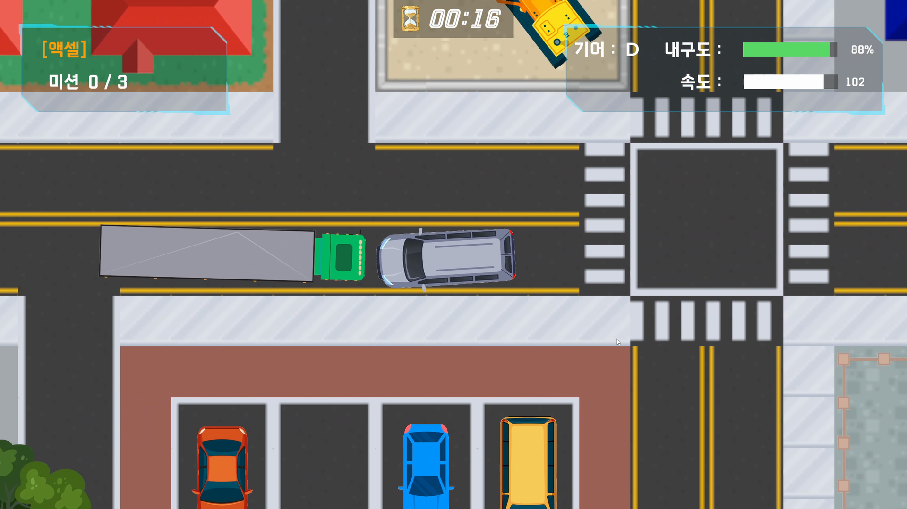
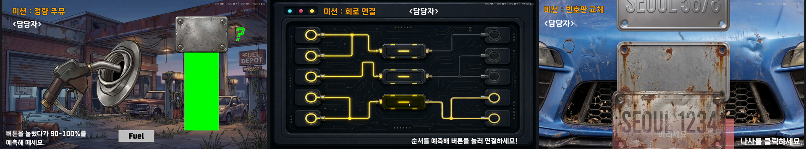
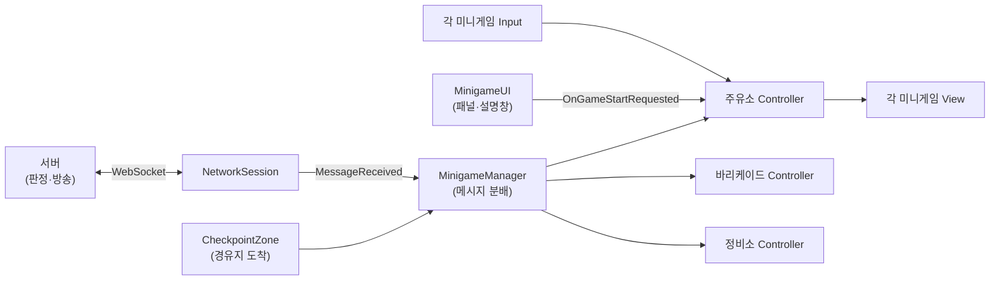
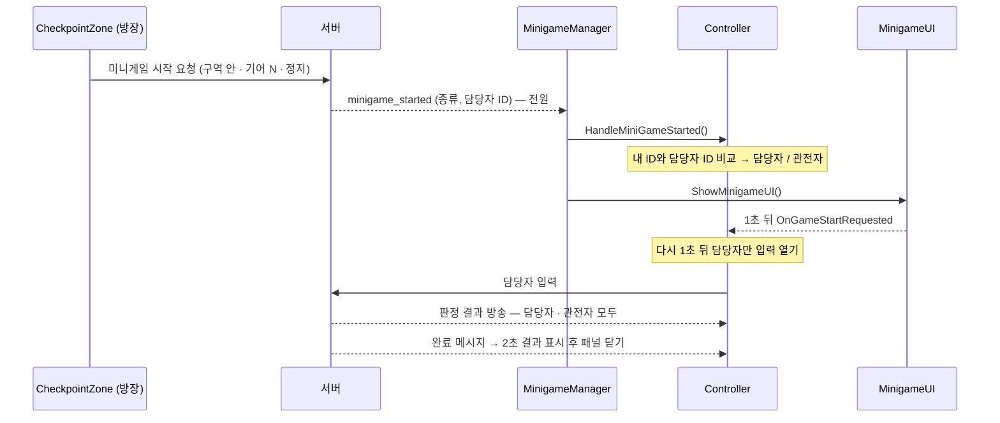
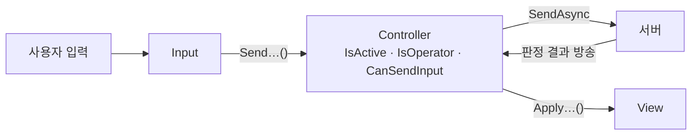
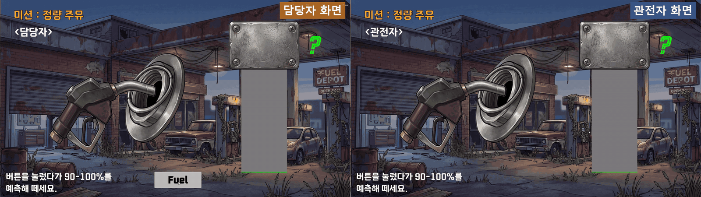
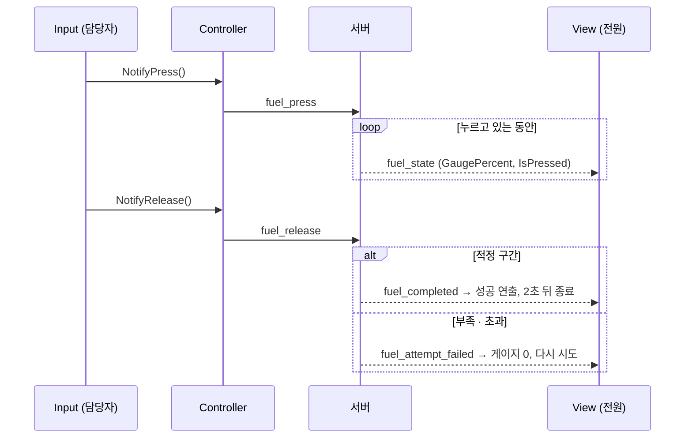
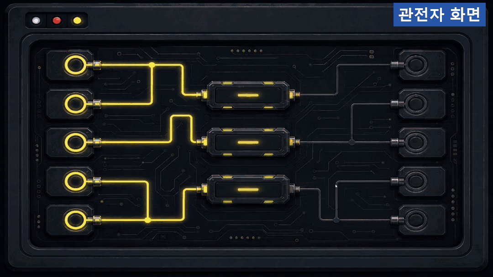
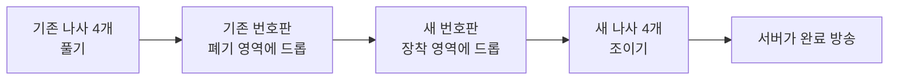
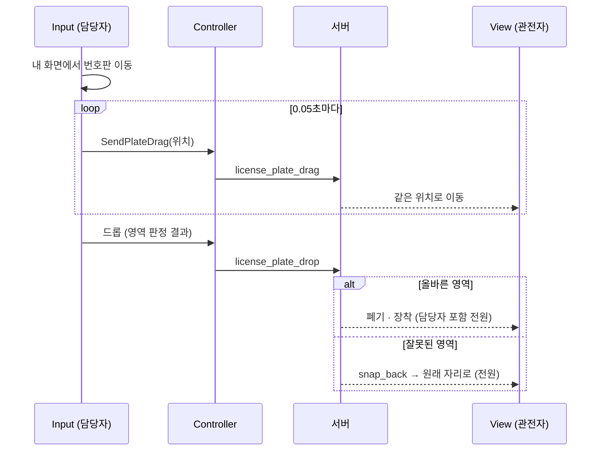

# 누가 이딴 차로 도망을 가! — 협동 운전 게임 기술 문서

> **팀 프로젝트 · 경유지 미니게임 3종(주유소 · 바리케이드 · 정비소)과 게임 UI 클라이언트 담당**



| 항목 | 내용 |
|---|---|
| 장르 | 2D 온라인 협동 운전 게임 |
| 개발 기간 | 2주 (2026.08.26 ~ 2026.09.10) |
| 개발 인원 | 4명 (팀 프로젝트) |
| 내 역할 | 경유지 미니게임 3종의 클라이언트(UI · 연출 · 서버 연동 코드 적용), 타이머 · 결과 화면 · 타이틀 · 로비 · HUD UI |
| 개발 환경 | Unity 6000.3.15f1 · C# · UniTask · DOTween · Newtonsoft.Json · TextMeshPro · WebSocket |
| 주요 기술 | Input · Controller · View 3분할 · 서버 판정 / 클라이언트 표시 · 담당자 · 관전자 동기화 · 번호판 드래그 좌표 동기화 |
| 링크 | [GitHub](https://github.com/KooHoo-Dev/3rd-TeamProject-CY) · [시연 영상](https://youtu.be/fnubGqbx0IQ) · [쇼츠](https://youtube.com/shorts/Skf6Uw4gG7s) |

---

## 목차

1. [프로젝트 개요](#1-프로젝트-개요)
2. [담당 파트 구조](#2-담당-파트-구조)
3. [미니게임 : 공통](#3-미니게임--공통)
4. [미니게임 : 주유소](#4-미니게임--주유소)
5. [미니게임 : 바리케이드](#5-미니게임--바리케이드)
6. [미니게임 : 정비소](#6-미니게임--정비소)
7. [AI와 일한 방식](#7-ai와-일한-방식)
8. [돌아보기](#8-돌아보기)

---

## 1. 프로젝트 개요

### 1.1 프로젝트 소개

플레이어들이 **기어, 액셀,  브레이크·내비게이션, 핸들**을 하나씩 나눠 맡아 차 한 대를 함께 운전하는 2D 온라인 협동 게임입니다. 경유지에 도착하면 **미니게임**을 통과해야 다음 경유지로 갈 수 있습니다.

이 게임은 제가 낸 아이디어에서 시작했습니다. 《토리의 모험》에서 **한 캐릭터를 여러 명이 나눠 조작하는 방식**을 보고, 그 조작을 **차의 기능(기어 · 액셀 · 브레이크 · 핸들)으로 바꿔** 보자고 제안했습니다. 세부 기획은 제가 맡지 않았고, 그렇게 정리된 팀 기획서의 목표는 각자 맡은 조작의 타이밍이 어긋나며 생기는 혼란 속에서 소통을 거듭해 **점점 손발을 맞춰 가는 협동의 재미**를 플레이어가 느끼는 것이었습니다.

이 문서는 그중 제가 맡은 **경유지 미니게임 3종의 클라이언트 구현**을 다룹니다. 미니게임마다 서버가 **담당자 1명**을 정하고, 담당자만 조작하며 나머지 플레이어는 같은 화면을 **관전**합니다.

미니게임은 한 명이 조작하고 나머지가 그 화면을 지켜보는 구간이라, 이때도 협동이 끊기지 않으려면 지켜보는 사람이 담당자와 **같은 진행을 보며 함께 반응할 수 있어야** 했습니다.

처음에는 화면 안에서 판정까지 하는 **로컬 버전**으로 만들었습니다. 서버와 연동하면서 가장 중요해진 것은 **담당자와 관전자의 화면이 같은 진행을 보여야 한다**는 점이었습니다.

판정을 각 클라이언트가 하면 화면마다 결과가 달라질 수 있습니다. 예를 들어 바리케이드의 정답 순서를 클라이언트마다 따로 만들면, 담당자와 관전자가 서로 다른 퍼즐을 보게 됩니다. 그래서 **판정은 서버가 하고, 클라이언트는 입력을 보내고 결과만 그리는 구조**로 바꿨습니다. 이 원칙은 팀의 서버 통신 지시서에서 정한 것이고, 저는 그 원칙에 맞게 제 미니게임을 다시 나눴습니다.

처음 해 보는 **팀 프로젝트**였습니다. 혼자 만들 때는 처음부터 끝까지 제가 정하고 만들었지만, 이번에는 역할을 나눠 맡고 **제가 만든 부분이 팀원들이 만든 작업물과 하나의 게임으로 이어지는 경험**을 해 보고 싶었습니다.

### 1.2 팀과 내 역할

4명이 UI · 미니게임, 서버, 차량, 맵을 하나씩 나눠 맡았습니다.

| 담당 | 주 책임 | 맡은 시스템 |
|---|---|---|
| **나** | **UI · 미니게임** | 미니게임 대상자 선정 및 공통 시스템, 각 미니게임 구현 |
| 팀장 | 서버 · 네트워크 | 네트워크 연동, 방 생성 및 대기실 구현 |
| 팀원 | 차량 · 게임플레이 코어 | 차량 조작, 충돌 시스템, 내비게이션 시스템 등 |
| 팀원 | 맵 · 콘텐츠 | 레벨 디자인, 오브젝트 배치, 에셋 탐색 및 적용 등 |

**담당 범위**

| 구분 | 내용 |
|---|---|
| 메인 | 경유지 미니게임 3종(주유소 · 바리케이드 · 정비소)의 UI · 연출과 클라이언트 코드 |
| 서브 | 미니게임 패널 · 설명창(`MinigameUI`), 타이머, 결과 화면, 타이틀 · 로비 · HUD UI |

**직접 작성하지 않은 것**

- 서버 메시지 규약과 "서버가 판정하고 클라이언트는 입력만 보낸다"는 원칙, Input · Controller · View 분할은 **서버 통신 지시서**에서 정해졌습니다. 
- `NetworkSession`(WebSocket 연결), 경유지 판정(`CheckpointZone`)은 팀원이 작성했습니다. 서버 메시지 분배(`MinigameManager`)는 처음에 제가 만들었고, 이후 대부분 팀원이 정비했습니다.

**내가 맡은 미니게임**

| 미니게임 | 규칙 | 서버가 판정하는 것 |
|---|---|---|
| **주유소** | 버튼을 누르고 있다가 게이지가 적정 구간에 왔을 때 떼는 타이밍 게임 | 게이지 값, 성공 · 실패 |
| **바리케이드** | 전기 퓨즈 3개를 정해진 순서대로 클릭하는 게임 | 정답 순서, 클릭마다 정답 · 오답, 완료 |
| **정비소** | 기존 번호판 나사 4개를 풀고 번호판을 버린 뒤, 새 번호판을 붙이고 나사 4개를 조이는 게임 | 단계 진행, 완료 |

세 미니게임은 일부러 **조작 방식이 모두 다르게** 구성했습니다. 누르고 떼기, 순서대로 클릭, 드래그 앤 드롭입니다. 담당자가 바뀔 때마다 다른 손맛을 느낄 수 있습니다.



---

## 2. 담당 파트 구조

### 2.1 전체 구조

이 그림에서 볼 것은 **미니게임 Controller가 WebSocket을 직접 다루지 않고, `MinigameManager`가 나눠 준 메시지 객체만 받는다**는 점입니다.



_그림을 단순하게 하려고 Input · View는 주유소에만 연결해 그렸습니다. 바리케이드 · 정비소도 같은 방식입니다._

### 2.2 미니게임 한 판의 흐름



이 그림에서 볼 것은 **담당자와 관전자가 같은 시작 메시지와 같은 결과 메시지를 받아 화면을 바꾼다**는 점입니다. 입력이 열리기까지의 2초는 §3.3에서 다룹니다.

_경유지 완료 처리는 방장만 합니다._

---

## 3. 미니게임 : 공통

### 3.1 세 클래스의 책임

| 클래스 | 하는 일 | 하지 않는 일 |
|---|---|---|
| **Input** | 버튼 · 드래그 같은 사용자 입력을 받아 Controller에 알림 | 서버 전송, 정답 · 성공 판정 |
| **Controller** | 담당자 여부 · 진행 상태를 들고, 입력을 서버로 보내고, 서버 메시지를 받아 View에 전달 | 정답 · 성공 판정 (서버가 함) |
| **View** | Controller가 시킨 대로 화면 · 연출만 바꿈 | 서버 통신, 진행 판정 |



이 그림에서 볼 것은 **입력이 화면을 직접 바꾸지 않고, 서버를 한 바퀴 돌아 View에 도착한다**는 점입니다.

세 미니게임 모두 **입력을 보낸 직후에는 화면을 바꾸지 않고, 서버의 결과 메시지를 받은 뒤에 바꿉니다.** 그래서 담당자 화면과 관전자 화면이 같은 메시지로 같은 상태가 됩니다.

정비소에는 이 표와 다른 점이 세 가지 있습니다.

- **드롭 영역 판정**: 정비소 Input(`RepairShopMinigameInput.OnEndDrag`)은 번호판을 놓은 곳이 `TrashZone` · `DropZone` 태그인지 **직접 판정**해 결과(`IsValidDrop`)를 넘깁니다. 폐기 · 장착은 서버 결과를 받은 뒤에 반영됩니다(§6.2).
- **나사 버튼**: Input을 거치지 않고, 버튼 `OnClick`에 Controller의 `RequestRemoveOldScrew(int)` · `RequestFastenNewScrew(int)`가 **직접 연결**돼 있습니다.
- **번호판 끌기**: 담당자가 번호판을 끄는 동안에는 서버 결과를 기다리지 않고 담당자 화면에서 바로 움직입니다(§6.2).

### 3.2 로컬 미니게임을 서버에 붙이는 방법

미니게임은 먼저 화면 안에서 판정까지 하는 로컬 버전으로 만들었고, 지시서를 받은 뒤 서버 연동 구조로 바꿨습니다. 지시서에서 처음 이해하기 어려웠던 것은 **"판정을 하지 않는 클라이언트"**라는 개념이었고, 서버 담당자와는 메시지 이름과 담당자 · 관전자 처리 방식을 맞췄습니다.

화면 안에서 판정까지 하던 로컬 미니게임을, 서버 판정 구조로 어떻게 바꿀지 정해야 했습니다.

| | [A] 기존 View에 통신 코드를 덧붙이기 | [B] Input · Controller · View로 나누기 ✓ |
|---|---|---|
| 방식 | 로컬 판정 코드를 지우고 그 자리에서 서버 송수신 | 입력 · 통신 · 화면을 세 클래스로 분리 |
| 장점 | 파일이 적고 빨리 바꿀 수 있음 | 서버 연동을 고칠 때 UI 연출을 건드리지 않음. 담당자 · 관전자가 같은 View 메서드로 화면을 바꿈 |
| 단점 | View에 연출 · 통신 · 상태가 섞여, 팀원이 통신을 고칠 때 내 연출과 충돌하기 쉬움 | 클래스가 세 배로 늘어남 |

**Input · Controller · View로 나누는 방식([B])을 적용했습니다.** 분할 방식은 지시서에서 정해졌고, 저는 지시서를 Gemini에 전달해 받은 Controller · Input · View 코드를 제 미니게임에 맞춰 적용했습니다. 실제로 서버 연동은 팀원이 여러 번 수정했는데, 수정이 주로 Controller와 `MinigameManager`에 모여 제가 만든 View 연출은 거의 그대로 남았습니다. 대신 미니게임 하나에 파일이 셋이라, 처음에는 어떤 일을 어느 클래스에서 해야 하는지 헷갈렸습니다. 정비소처럼 드롭 판정이 Input에 남는 예외도 생겼습니다.

MVC(Model · View · Controller)를 공부하다가, 이 구조가 MVC에서 **Model 자리에 Input을 넣은 3분할**이라는 것을 알게 되었습니다. Model이 맡던 판정 규칙은 서버가, 진행 상태는 Controller가 갖기 때문에 클라이언트에는 Model을 따로 두지 않고, 대신 입력을 받는 일을 Input으로 떼어 냈습니다.

### 3.3 입력을 보내기 전 세 가지 확인

Controller의 모든 전송 메서드는 같은 세 조건을 먼저 확인합니다. 지시서에 있던 방식입니다.

```csharp
// GasStationMinigameController
public void SendFuelPress()
{
    if (!IsActive || !IsOperator || !CanSendInput) return;

    session.SendAsync(new TypeOnly { Type = "fuel_press" }).Forget();
}
```

| 조건 | 의미 | 바뀌는 때 |
|---|---|---|
| `IsActive` | 이 미니게임이 진행 중인가 | 시작 메시지에서 true, 완료 · 중단 · 초기화에서 false |
| `IsOperator` | 내가 담당자인가 | 시작 메시지의 담당자 ID와 내 ID를 비교 |
| `CanSendInput` | 지금 입력을 받아도 되는가 | 패널이 나온 뒤 약 2초 지나 담당자만 true, 완료 · 중단 시 false |

세 조건은 막는 입력이 각각 다릅니다. `IsActive`는 끝난 미니게임에 늦게 들어온 입력을, `IsOperator`는 관전자의 입력을, `CanSendInput`은 패널이 다 나오기 전의 입력을 막습니다. 하나라도 빠지면 서버가 받지 않아야 할 입력이 나갑니다. View에서도 담당자만 버튼을 누를 수 있게 하지만, **Controller에서 한 번 더 막아** 화면 설정이 잘못돼도 입력이 나가지 않게 했습니다.

---

## 4. 미니게임 : 주유소

### 4.1 철판으로 가린 게이지 위쪽

주유소는 제가 처음 구상한 미니게임입니다. 버튼을 누르고 있으면 게이지가 차오르고, 적정 구간에서 손을 떼면 성공합니다.

| 항목 | 값 |
|---|---|
| 적정 구간 | 90~100% |
| 철판이 가리는 범위 | 게이지 아래에서 약 70% 지점부터 위쪽 끝까지 |
| 실패하면 | 게이지가 0으로 돌아가고 바로 다시 시도 |
| 관전자 화면 | 담당자와 같은 철판이 있음 |



게이지가 끝까지 다 보이면 적정 구간에 왔을 때 떼기만 하면 되어서 너무 쉬울 것 같았습니다. 난이도를 올리는 방법으로 세 가지를 생각했습니다.

| | 적정 구간 폭 좁히기 | 게이지 속도 올리기 | 게이지 위쪽을 철판으로 가리기 ✓ |
|---|---|---|---|
| 플레이어가 겪는 것 | 맞춰야 하는 구간이 작아짐 | 게이지가 빨리 차서 떼는 순간이 짧아짐 | 철판에 가려진 뒤에는 그 전까지 차오르던 속도를 보고 감으로 떼야 함 |
| 아쉬운 점 | 너무 좁히면 지나치게 어려워짐 | 너무 빨리 끝나고, 주유처럼 느껴지지 않음 | 처음 하는 사람은 감을 잡기 전까지 실패가 잦음 |

<!-- '주유처럼 느껴지지 않음'은 그때 실제로 생각했던 이유일 때만 남기세요 -->
**게이지 위쪽을 철판으로 가리는 방법을 골랐습니다.** 구간 폭과 속도는 따로 쓰지 않고, 너무 어렵거나 너무 빨리 끝나지 않는 범위에서 철판과 함께 조절했습니다. 값은 팀원들과 직접 테스트해 보며 정했습니다. 철판 때문에 처음에는 실패가 잦지만, 이는 감을 잡아 가는 과정으로 의도한 것입니다. 실패해도 게이지가 0으로 돌아가 바로 다시 시도할 수 있습니다.

### 4.2 누르면 서버가 계산하고, 화면은 그대로 그린다

담당자가 버튼을 누르면 `fuel_press`, 떼면 `fuel_release`만 보냅니다. 클라이언트는 서버가 보내는 `fuel_state`(게이지 %, 눌림 여부)를 받아 그대로 표시하며, 게이지를 직접 계산하지 않습니다. 설계 문서에 따르면 서버는 버튼을 누른 서버 시각부터 경과 시간으로 게이지를 계산하고, 성공 · 실패도 판정합니다.



```csharp
// GasStationMinigameView
public void ApplyFuelState(float gaugePercent, bool isPressed)
{
    // 서버에서 오는 게이지 퍼센트(0~100)를 fillAmount(0~1) 비율로 변환
    gaugeFill.fillAmount = Mathf.Clamp01(gaugePercent / 100f);

    if (isPressed && isCurrentlyPressed == false)
    {
        isCurrentlyPressed = true;
        // 노즐을 앞으로, 버튼을 살짝 작게 (DOTween)
        ...
    }
    else if (isPressed == false && isCurrentlyPressed)
    {
        isCurrentlyPressed = false;
        RetractNozzleButton();
    }
}
```

1. **게이지는 서버가 보낸 값만 그립니다.** 담당자도 관전자와 같은 값을 봅니다.
2. **노즐 · 버튼 연출은 눌림 상태가 바뀌는 순간에만 한 번 실행합니다.** `fuel_state`가 계속 들어와도 연출이 반복되지 않도록 `isCurrentlyPressed`로 직전 상태를 기억합니다.

입력 쪽에서는 같은 누르기가 두 번 가지 않도록 `IsPressedLocally`로 막습니다. 패널이 닫히며 버튼이 꺼질 때 눌린 상태였다면 떼기로 처리합니다. 서버에 "계속 누르고 있음" 상태가 남지 않게 하기 위해서입니다.

```csharp
// GasStationMinigameInput
public void NotifyPress()
{
    if (IsPressedLocally) return;
    IsPressedLocally = true;
    controller.SendFuelPress();
}

private void OnDisable() { NotifyCancel(); }   // 꺼질 때 눌려 있었다면 release로 처리
```

### 4.3 게이지를 담당자 화면에서 먼저 올릴까

담당자가 버튼을 누른 순간, 서버 값을 기다릴지, 내 화면에서 먼저 게이지를 올리고 서버 값으로 맞출지 정해야 했습니다.

| | [A] 로컬에서 먼저 올리고 서버 값으로 보정 | [B] 서버 값만 반영 ✓ |
|---|---|---|
| 장점 | 담당자 화면의 반응이 즉각적 | 담당자 · 관전자가 항상 같은 값을 봄. 구현이 단순 |
| 단점 | 보정할 때 게이지가 튈 수 있고, 구현이 복잡 | 통신 지연만큼 게이지가 늦게 반응 |

**서버 값만 반영하는 쪽([B])을 골랐습니다.** 지시서에 두 방법이 모두 있었고, 단순한 쪽을 택했습니다. 테스트 환경에서는 지연이 크게 느껴지지 않아 바꾸지 않았습니다. 다만 타이밍 게임이라, 지연이 큰 환경에서는 "손을 뗀 순간"과 서버가 판정한 순간이 어긋날 수 있습니다. 실제 서비스 환경에서는 테스트하지 못했습니다.

---

## 5. 미니게임 : 바리케이드

### 5.1 회로 돌리기 대신 퓨즈 순서 맞추기

| 항목 | 내용 |
|---|---|
| 규칙 | 전기 퓨즈 3개를 정해진 순서대로 클릭 |
| 정답 순서 | 서버가 정함 (§5.3) |
| 틀리면 | 퓨즈 · 회로가 모두 꺼지고 빨간 과부하 깜빡임, 2초 동안 버튼 잠금 뒤 처음부터 다시 |
| 관전자 화면 | 담당자와 같은 진행이 보임 |



기획서의 바리케이드는 《Among Us》의 임무 「전환된 에너지 받기」에서 따온 것으로, 회로 조각을 눌러 방향을 돌려 전원부터 출력까지 잇는 방식이었습니다. 그런데 이 방식은 버튼을 몇 번 눌러 돌리기만 하면 바로 끝나서 너무 쉬웠습니다.

| | 기획서안: 회로 조각 돌리기 | 바꾼 안: 퓨즈 순서 맞추기 ✓ |
|---|---|---|
| 플레이어가 하는 것 | 조각을 눌러 방향을 돌려 회로를 이음 | 퓨즈 3개를 정해진 순서대로 누름 |
| 난이도 | 몇 번 누르면 바로 끝나 너무 쉬움 | 순서를 찾아야 하고, 틀리면 2초 잠금 뒤 처음부터 |

**퓨즈를 정해진 순서대로 누르는 방식으로 바꿨습니다.** 순서를 틀렸을 때 퓨즈 · 회로가 모두 꺼지고 2초 동안 버튼이 잠기는 벌칙도 추가했습니다. 그래서 한 번 틀리면 처음부터 다시 순서를 찾아야 합니다.

### 5.2 퓨즈 번호만 보내고 결과를 그리기

담당자가 퓨즈를 클릭하면 퓨즈 번호(0~2)만 보냅니다. 정답 순서는 서버만 갖고 있습니다(§5.3).

| 서버 메시지 | 화면 |
|---|---|
| `barricade_progress` (퓨즈 번호) | 그 퓨즈를 노랗게 켜고 오른쪽 회로선을 서서히 표시 |
| `barricade_attempt_failed` | 퓨즈 · 회로를 모두 끄고 빨간 과부하 깜빡임, 2초 동안 버튼 잠금 뒤 담당자만 다시 켬 |
| `barricade_completed` | 버튼을 잠그고 "미션 성공!" 표시 |

틀렸을 때의 과부하 2초 잠금은 View가 맡습니다.

```csharp
// BarricadeMinigameView
private IEnumerator OverloadRoutine()
{
    SetButtonsInteractable(false); // 과부하 중 버튼 잠금
    ShowOverloadEffect();

    yield return new WaitForSeconds(2.0f);

    HideOverloadEffect();
    SetButtonsInteractable(currentIsOperator); // 담당자만 다시 활성화
}
```

1. **잠금과 깜빡임을 한 코루틴에서 처리합니다.** 그래서 잠금 시간과 연출 시간이 항상 같습니다.
2. **잠금이 풀릴 때 담당자만 다시 켭니다.** 관전자 화면의 버튼은 계속 잠겨 있습니다.

잠금을 Controller 타이머가 아니라 View가 맡는 분담은 지시서에서 정했고, 깜빡임 연출은 제가 만들었습니다.

### 5.3 정답 순서를 서버로 옮기기

로컬 버전에서는 정답 순서를 클라이언트가 만들었기 때문에, 서버와 연동하면서 정답 순서를 어디에 둘지 다시 정해야 했습니다.

| | [A] 클라이언트가 순서를 만들고 판정 (로컬 버전) | [B] 서버만 순서를 가짐 ✓ |
|---|---|---|
| 방식 | View에서 정답 순서를 섞고 클릭마다 직접 판정 | 클릭한 퓨즈 번호만 보내고, 결과 메시지로 화면 변경 |
| 장점 | 통신 없이 바로 반응 | 모든 화면의 정답이 같음. 클라이언트에서 정답을 알아낼 수 없음 |
| 단점 | 클라이언트마다 정답이 달라짐. 관전자 화면과 진행이 어긋남 | 클릭할 때마다 서버 응답을 기다림 |

**그래서 정답 순서는 서버만 갖게 했습니다.** 로컬 버전에서는 클라이언트마다 정답 순서를 따로 섞었기 때문에, 그대로 온라인에 올리면 담당자와 관전자가 서로 다른 퍼즐을 보게 됩니다. 지시서에 따라 View에서 순서 생성 · 셔플 · 판정 코드를 지우고, 결과를 그리는 코드만 남겼습니다.

---

## 6. 미니게임 : 정비소

정비소의 화면 · 입력과 단계별 진행, 번호판 드래그 좌표를 보내는 부분은 제가 만들었습니다. 서버와 연동한 뒤 번호판 동기화는 팀원이 한 번 더 정비했는데, 담당자가 서버가 돌려준 위치를 무시하게 한 처리와 드롭 결과를 넘기는 방식, 메시지 분배(`MinigameManager`) 쪽이 그때 바뀌었습니다.

### 6.1 나사 풀기부터 조이기까지



_단계마다 서버 승인 메시지를 받아야 Controller의 상태가 바뀌고, 그 상태가 다음 단계의 조작 가능 여부를 정합니다._

```csharp
// RepairShopMinigameController — 드래그 권한
public bool CanDragOldPlate()
{
    return IsActive && IsOperator && CanSendInput && oldScrewsRemoved == 4 && isOldPlateDiscarded == false;
}

public bool CanDragNewPlate()
{
    return IsActive && IsOperator && CanSendInput && isOldPlateDiscarded && isNewPlateAttached == false;
}
```

| 상태 값 | 바뀌는 때 |
|---|---|
| `oldScrewsRemoved` | `…_old_screw_removed`를 받을 때마다 1 증가 (4가 되면 폐기 영역 표시) |
| `isOldPlateDiscarded` | `…_old_plate_discarded`를 받으면 true |
| `isNewPlateAttached` | `…_new_plate_attached`를 받으면 true (그때부터 새 나사를 조일 수 있음) |

새 나사를 4개 다 조였는지는 클라이언트가 세지 않고, 서버가 완료 메시지로 알려 줍니다.


### 6.2 번호판 드래그 동기화



```csharp
// RepairShopMinigameInput
public void OnDrag(PointerEventData eventData)
{
    if (!isDragging) return;

    rectTransform.anchoredPosition += eventData.delta / canvas.scaleFactor;

    if (Time.unscaledTime < nextDragSendTime) return; // 0.05초 간격으로 서버에 드래그 좌표 전송

    controller.SendPlateDrag(isOldPlate, rectTransform.anchoredPosition);
    nextDragSendTime = Time.unscaledTime + DragSendInterval;
}
```

1. **좌표는 화면 픽셀이 아니라 `anchoredPosition`(부모 UI 기준 위치)으로 보냅니다.** 해상도가 달라도 모든 클라이언트에서 같은 자리에 보입니다.
2. **매 프레임이 아니라 0.05초(초당 최대 20번)마다 보냅니다.** 드래그를 시작할 때와 드롭 직전에도 한 번씩 보냅니다.
3. **담당자는 서버가 돌려준 위치를 무시합니다.** 이미 자기 화면에서 움직이고 있기 때문입니다. 이 처리는 팀원이 수정한 것입니다.

- 드롭 영역 판정은 담당자 화면에서 하고(태그 `TrashZone` · `DropZone`), 폐기 · 장착 · 원위치 복귀는 **서버 결과를 받은 뒤에** 모든 화면에서 함께 실행됩니다.
- 새 번호판은 드롭한 위치가 아니라 View에 미리 둔 **고정 장착 슬롯(`plateSlot`)**으로 옮깁니다. 그래서 관전자 화면에서도 정확히 같은 자리에 붙습니다.
- 관전자 화면은 0.05초마다 위치가 **보간 없이** 바뀌므로, 부드럽지 않고 끊겨 보일 수 있습니다.

---

## 7. AI와 일한 방식

서버 연동 코드와 미니게임 이미지 일부를 AI에게 맡겼습니다. 받은 것은 그대로 쓰지 않고 제 미니게임에 맞춰 고쳤습니다.

| 구분 | 내용 |
|---|---|
| 맡긴 것 | 서버 통신 지시서를 Gemini에 전달해 Controller · Input · View 코드를 받음(§3.2) · 바리케이드 회로 이미지와 정비소 에셋 이미지를 AI로 생성 |
| 직접 판단한 것 | 받은 코드를 미니게임 3종에 맞춰 적용(§3.2) · 회로 이미지에서 불이 들어오는 부분을 누끼 따서 조각마다 따로 붙여, 퓨즈를 누를 때마다 회로선이 켜지게 함(§5.2) · 과부하 깜빡임 연출(§5.2) |
| 확인한 방법 | 직접 실행해 테스트 |
| 잘 된 것 | 자료를 구하기 어려웠던 회로 · 정비소 이미지를 AI로 만들 수 있었음 |
| 안 된 것 | 처음에는 받은 코드가 왜 그렇게 동작하는지 바로 설명하지 못함 |

---

## 8. 돌아보기

**처음 하는 사람의 눈으로 미니게임을 봐야 한다**

주유소는 게이지를 물음표 표시 어디에 맞추면 좋을지 모르겠다는 의견이, 바리케이드는 어떻게 맞추는 건지 헤맸다는 의견이 있었습니다. 설명은 적어 두었고 담당자에게는 미니게임 전에 설명 패널이 뜨지만, 처음 하는 사람 입장에서는 헷갈릴 수 있었습니다. 바리케이드는 정답 순서가 매번 랜덤이라 원래 직접 찾아가야 하는 게임이기도 했습니다. 다음에는 설명을 읽지 않아도 화면만 보고 무엇을 해야 할지 알 수 있는지, 처음 해 보는 사람에게 먼저 플레이시켜 보며 확인하겠습니다.

**타이밍 게임은 통신 지연까지 함께 설계해야 했다**

주유소는 게이지를 서버 값으로만 그리게 해서, 담당자와 관전자가 늘 같은 값을 봅니다(§4.3). 그런데 손을 떼는 순간이 곧 판정인 게임이라, 지연이 크면 "뗀 순간"과 서버가 판정한 순간이 어긋날 수 있습니다. 테스트 환경에서는 지연이 거의 없어 알아채지 못했고, 실제 서비스 환경에서는 확인하지 못했습니다. 다음에는 일부러 지연을 넣은 환경에서 테스트해 보고, 필요하면 손을 뗀 시각을 함께 보내 서버가 그 시각으로 판정하는 방법을 검토하겠습니다.
