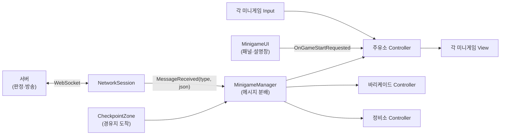
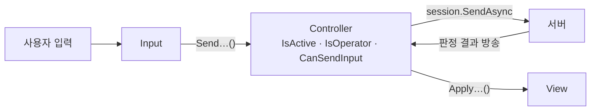
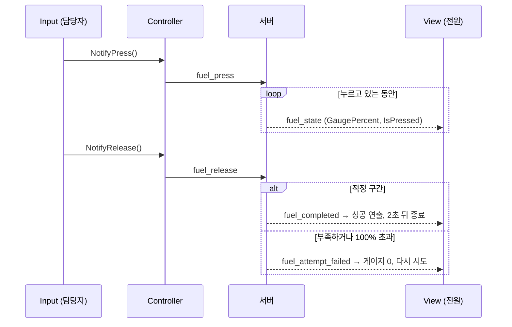
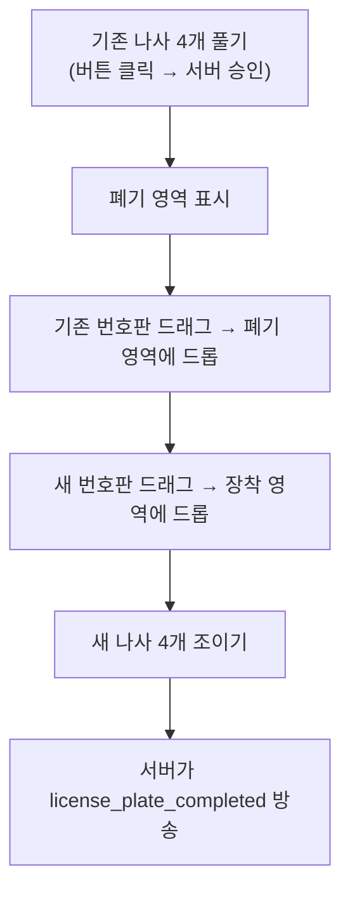
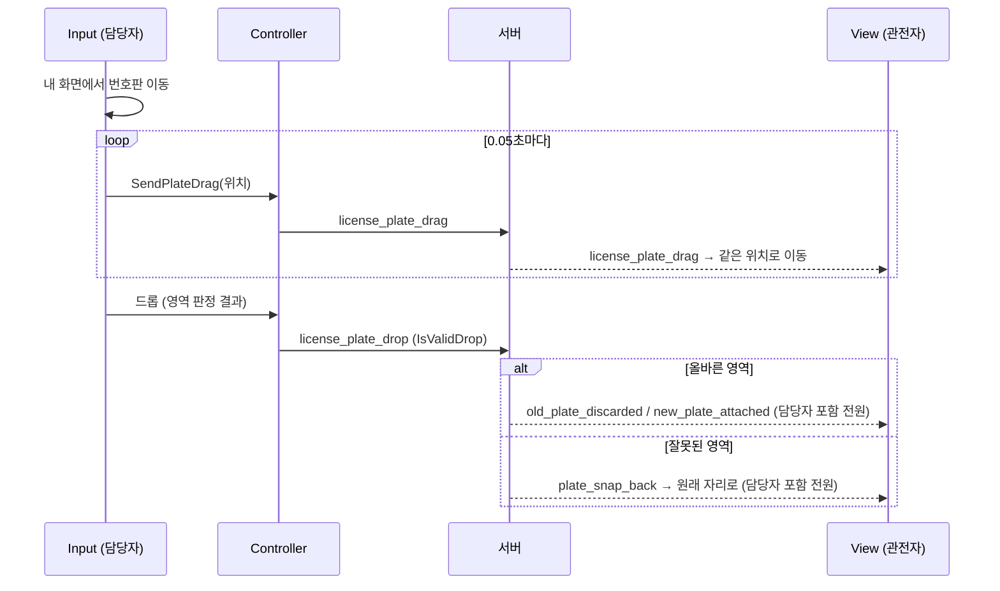

# 누가 이딴 차로 도망을 가! — 협동 운전 게임 기술 문서

> **팀 프로젝트 · 경유지 미니게임 3종(주유소·바리케이드·정비소) 클라이언트 담당**

<!-- 작성 상태: 코드·지시서 분석 반영 초안.
     [확인 필요] = 사실 확인이 필요한 곳 / [본인 작성 필요] = 본인의 의도·경험을 직접 써야 하는 곳.
     다 채우면 이 주석과 "작성 안내" 인용문은 지워 주세요. -->

| 항목 | 내용                                                                                                                      |
|---|---------------------------------------------------------------------------------------------------------------------------|
| 장르 | 2D 협동 운전 게임                                                                                                         |
| 개발 기간 | 2026.08.26 ~ 2026.09.10                                                                                                   |
| 개발 인원 | 4명 (팀 프로젝트)                                                                                                         |
| 내 역할 | 주유소·바리케이드·정비소 미니게임 3종의 클라이언트 구현 (UI·연출 구현, 지시서 기반 서버 연동 코드를 Gemini로 생성해 적용) |
| 개발 환경 | Unity 6000.3.15f1, C#, UniTask, DOTween, Newtonsoft.Json, TextMeshPro, WebSocket 서버 [확인 필요: 서버 종류]              |
| 링크 | GitHub: [확인 필요: 공개 가능한 주소] · 시연 영상: [확인 필요]                                                            |

<!-- 대표 이미지: images/에 넣은 뒤 아래 줄의 주석을 풀고 파일 이름을 맞춰 주세요. -->
<!--  -->

---

## 1. 프로젝트 개요

### 1.1 무엇을 만들었나 (What)

플레이어들이 **기어, 액셀·브레이크, 내비게이션, 핸들** 등 차량 조작 역할을 나눠 맡아 함께 운전하고,
**경유지에서 미니게임**을 수행하는 2D 협동 게임입니다.

이 문서는 게임 전체 중 **제가 맡은 경유지 미니게임 3종의 클라이언트 구현**을 다룹니다.
미니게임마다 서버가 **담당자 1명**을 정하고, 담당자만 조작하며 나머지 플레이어는 같은 화면을 **관전**합니다.

### 1.2 왜, 무엇에 집중했나 (Why)

[본인 작성 필요: 미니게임을 구현하면서 해결하려던 문제나 목표.
 질문) 처음에 로컬로 만든 미니게임을 서버와 연동하면서 가장 신경 쓴 점은 무엇이었나요?
 예) "담당자와 관전자 화면이 같은 진행을 보여야 했다", "판정을 클라이언트가 하면 화면마다 결과가 달라질 수 있었다"]

### 1.3 팀 구성과 내 역할

| 담당          | 역할 |
|---------------|---|
| **나**        | 미니게임 3종의 UI·연출 구현, 지시서를 Gemini에 전달해 생성한 클라이언트 코드(Input·Controller·View) 적용, 미니게임 설명 패널(`MinigameUI`) 일부 |
| 팀원 A (팀장) | 서버 통신 지시서 작성 [확인 필요: 그 밖의 담당] |
| 팀원 B        | 서버 메시지 수신·분배(`MinigameManager`), 경유지 도착 판정(`CheckpointZone`), 네트워크 세션(`NetworkSession`) [확인 필요: 담당자] |
| 팀원 C        | 효과음(`SoundManager` 호출 추가) [확인 필요: 담당자] |

**내가 커밋한 범위** (팀 레포의 git 기록 기준)

> 아래 표는 **누가 커밋했는지**를 나타낸 것이고, **누가 설계했는지**를 뜻하지 않습니다.
> 서버 연동 부분(Controller·Input의 통신 코드)은 팀장의 지시서에 구조와 예시 코드가 있었고, 저는 그 지시서를 Gemini에 전달해 코드를 생성하고 적용했습니다(→ 1.4).

| 영역 | 클래스 | 비고 |
|---|---|---|
| 주유소 | `GasStationMinigameInput` · `Controller` · `View` | 서버 연동 일부는 팀원이 함께 수정 |
| 바리케이드 | `BarricadeMinigameInput` · `Controller` · `View` | |
| 정비소 | `RepairShopMinigameInput` · `Controller` · `View` | 번호판 동기화 일부는 팀원이 함께 수정 |
| 공통 | `MinigameUI` (패널 슬라이드·설명 패널) | 팀원과 공동 작성 |
| 팀원 작성 | `MinigameManager` (서버 메시지 분배), `CheckpointZone`, 메시지 클래스(`MinigameProtocol`) | 이 문서에서는 내 코드와 연결되는 부분만 설명 |
| 팀원 추가 | 세 미니게임의 효과음 호출(`SoundManager`) | |

[확인 필요: 위 구분이 실제 역할 분담과 맞는지]

### 1.4 설계와 구현의 출처

이 문서에서는 **누가 무엇을 정했는지**를 나눠서 적습니다.

| 구분 | 내용 | 출처 |
|---|---|---|
| **지시서에 있던 것** | 서버 메시지 규약, 서버가 판정하고 클라이언트는 입력만 보내는 원칙, Input·Controller·View 3분할, 입력 전 세 조건 확인(`IsActive`·`IsOperator`·`CanSendInput`), 중복 입력 방지(`IsPressedLocally`), 과부하 2초 잠금을 View가 맡는 분담, 번호판 드래그 단계 권한(`CanDrag…`)·0.05초 전송 간격·`anchoredPosition` 좌표·고정 장착 슬롯(`plateSlot`). 바리케이드·정비소는 Controller·Input 예시 코드까지 포함 | 팀장의 서버 통신 지시서 |
| **Gemini로 생성해 적용한 것** | 위 지시서를 Gemini에 전달해 만든 Controller·Input·View의 서버 연동 코드 | 지시서 → Gemini → 본인이 프로젝트에 적용 |
| **내가 담당한 UI·연출** | 미니게임 패널 UI 구성, View의 화면 연출(주유 노즐·버튼, 바리케이드 퓨즈 점등·과부하 깜빡임, 번호판 복귀·결과 문구 애니메이션), 설명 패널 | 본인 [확인 필요: 이 영역에도 AI를 활용했는지] |
| **팀원이 작성·변경한 것** | `MinigameManager`(메시지 분배), `CheckpointZone`(경유지 도착 판정), `NetworkSession`, 효과음 호출, 주유소·정비소 동기화 코드 일부 수정 | 팀원 |
| 지시서와 다르게 구현된 부분 (7장) | 8건 | [본인 작성 필요: 누가 바꿨는지] |
| AI 결과물에서 직접 고치거나 검토한 부분 | | [본인 작성 필요] |

> 2~6장의 다이어그램과 동작 설명은 개발 당시의 설계 문서가 아니라, **기술 문서를 쓰면서 코드와 지시서를 다시 읽고 정리한 것**입니다.

### 1.5 내가 맡은 미니게임

| 미니게임 | 규칙 | 서버가 판정하는 것 (지시서 기준) |
|---|---|---|
| **주유소** | 버튼을 누르고 있다가 게이지가 적정 구간에 도달하면 손을 떼는 타이밍 게임 | 게이지 값, 성공·실패 |
| **바리케이드** | 전기 퓨즈 3개를 정해진 순서대로 클릭하는 게임 | 정답 순서, 클릭마다 정답·오답, 완료 |
| **정비소** | 기존 번호판 나사 4개를 풀고 번호판을 버린 뒤, 새 번호판을 붙이고 나사 4개를 조이는 게임 | 단계 진행, 완료 |

> 이 문서의 코드는 팀 레포에서 제가 커밋한 미니게임 코드 중 **핵심만 줄여 옮긴 것**입니다. `...`와 한 줄 주석은 생략한 곳을 뜻합니다.

### 1.6 이 문서에서 다루는 내용

1. 미니게임 3종의 구조와 서버 메시지 흐름 (2장)
2. Input·Controller·View 역할 분리 (3장)
3. 주유소: 서버가 계산한 게이지 표시 (4장)
4. 바리케이드: 서버 판정 결과만 표시 (5장)
5. 정비소: 단계별 상호작용과 번호판 드래그 동기화 (6장)
6. 지시서와 실제 구현의 차이 (7장)

---

## 2. 담당 파트 구조

### 2.1 전체 구조



> 그림을 단순하게 하려고 Input·View는 주유소 하나에만 연결해 그렸습니다. 바리케이드·정비소도 같은 방식입니다.
> `NetworkSession`, `CheckpointZone`, `MinigameManager`는 팀원이 작성했고, 미니게임 Controller·Input·View와 `MinigameUI` 일부가 제 담당입니다.

### 2.2 미니게임 한 판의 흐름

1. **방장(host) 클라이언트**에서, 차량이 경유지 구역 안에 **완전히** 들어오고 **기어가 N(중립)이며 정지 속도 이하**가 되면 `CheckpointZone`이 `MissionReady` 이벤트를 보냅니다. 그러면 `MinigameManager`가 서버에 `minigame_start_request`를 보냅니다. (`CheckpointZone`·`MinigameManager`는 팀원 작성)
2. 서버가 `minigame_started`(미니게임 종류, 담당자 ID)를 방 전원에게 보냅니다.
3. `MinigameManager`가 종류에 맞는 Controller의 `HandleMiniGameStarted()`를 부르고, `MinigameUI`가 패널을 띄웁니다.
4. 각 Controller는 **내 ID와 담당자 ID를 비교**해 담당자인지 관전자인지 정합니다.
5. 패널이 다 나오면 `MinigameUI`가 **1초 기다린 뒤** `OnGameStartRequested`를 보내고, 각 Controller가 **다시 1초 기다린 뒤** 담당자만 입력을 보낼 수 있게 합니다. 패널이 다 나온 뒤 약 2초입니다.
   같은 신호에 맞춰 담당자 화면에는 설명창이 뜨지만, 설명창의 [게임 시작] 버튼(`OnGameStartButtonClicked`)은 **클릭음을 내고 설명창을 닫기만** 합니다. 입력 허용과는 관계가 없습니다.
6. 담당자의 입력은 서버로 가고, 서버가 판정해 방송한 결과를 **담당자와 관전자 모두** 같은 방식으로 화면에 반영합니다.
7. 완료 메시지를 받으면 2초 동안 결과를 보여 준 뒤 상태를 초기화하고 `MinigameEnded`로 패널을 닫습니다.

### 2.3 `MinigameManager`의 메시지 분배 (팀원 작성 · 내 코드와 연결되는 부분)

`MinigameManager`는 `NetworkSession.MessageReceived`를 구독해 메시지 `type`에 따라 알맞은 Controller의 메서드를 부릅니다.
JSON을 메시지 객체로 바꾸는 일까지 여기서 끝내므로, 미니게임 Controller는 JSON이나 WebSocket을 직접 다루지 않고 메시지 객체만 받습니다.
(Controller가 원본 JSON·WebSocket을 다루지 않는다는 것은 주유 지시서에 있던 요구사항입니다.)

| 서버 메시지 | 받는 Controller 메서드 |
|---|---|
| `minigame_started` | 종류에 맞는 Controller의 `HandleMiniGameStarted()` |
| `fuel_state` · `fuel_attempt_failed` · `fuel_completed` | 주유소 `HandleFuelState()` · `HandleFuelAttemptFailed()` · `HandleFuelCompleted()` |
| `barricade_progress` · `barricade_attempt_failed` · `barricade_completed` | 바리케이드 `HandleBarricadeProgress()` · `HandleBarricadeAttemptFailed()` · `HandleBarricadeCompleted()` |
| `license_plate_drag` · `…_plate_snap_back` · `…_old_screw_removed` · `…_old_plate_discarded` · `…_new_plate_attached` · `…_new_screw_fastened` · `…_completed` | 정비소의 같은 이름 `Handle…()` 메서드 |
| `game_aborted` | 현재 실행 중인 미니게임(`CurrentMiniGameType`)의 `HandleGameAborted()` |

완료 메시지(`…_completed`)를 받으면 **방장(host)만** 경유지 미션을 완료 처리합니다.

---

## 3. Input · Controller · View 역할 분리

### 3.1 세 클래스의 책임

세 미니게임 모두 같은 3분할 구조입니다. (분할 방식은 지시서에서 정해졌습니다.)

| 클래스 | 하는 일 | 하지 않는 일 |
|---|---|---|
| **Input** | 버튼·드래그 같은 사용자 입력을 받아 Controller에 알림 | 서버 전송, 정답·성공 판정 |
| **Controller** | 담당자 여부·진행 상태를 들고 있다가 입력을 서버로 보내고, 서버 메시지를 받아 View에 전달 | 정답·성공 판정(서버가 함) |
| **View** | Controller가 시킨 대로 화면·연출만 바꿈 | 서버 통신, 진행 판정 |

정비소에는 이 표와 다른 점이 두 가지 있습니다.

- **드롭 영역 판정**: 정비소 Input(`RepairShopMinigameInput.OnEndDrag`)은 번호판을 놓은 곳이 `TrashZone`·`DropZone` 태그인지 **직접 판정**해 결과(`IsValidDrop`)를 Controller에 넘깁니다. 폐기·장착 여부는 서버 결과를 받은 뒤에 반영됩니다(→ 6.2).
- **나사 버튼**: 나사 버튼은 Input을 거치지 않고, 버튼 `OnClick`에 Controller의 `RequestRemoveOldScrew(int)` / `RequestFastenNewScrew(int)`가 **직접 연결**돼 있습니다. 정비소 Input은 번호판 드래그만 맡습니다.



### 3.2 입력을 보낼 수 있는지 세 가지로 확인

Controller의 모든 전송 메서드는 같은 세 조건을 먼저 확인합니다. (이 세 조건과 확인 코드의 형태는 지시서에 제시돼 있던 것입니다.)

```csharp
// GasStationMinigameController
public void SendFuelPress()
{
    if (!IsActive || !IsOperator || !CanSendInput) return;

    session.SendAsync(new TypeOnly { Type = "fuel_press" }).Forget();
}
```

| 조건 | 의미 | 바뀌는 때 |
|---|---|---|
| `IsActive` | 이 미니게임이 진행 중인가 | 시작 메시지에서 true, 완료·중단·초기화에서 false |
| `IsOperator` | 내가 담당자인가 | 시작 메시지의 담당자 ID와 내 ID를 비교 |
| `CanSendInput` | 지금 입력을 받아도 되는가 | `OnGameStartRequested` 신호 1초 뒤 담당자만 true(패널이 나온 뒤 약 2초), 완료·중단 시 false |

관전자는 `IsOperator`가 false라서 버튼을 눌러도 아무것도 보내지 않습니다. View에서도 담당자만 버튼을 보이거나 누를 수 있게 합니다.

[본인 작성 필요: 이 세 조건은 지시서에 있던 것입니다. 개발 당시 직접 판단한 것이 아니라면, 문서를 쓰며 이해한 내용(왜 세 조건이 필요한지)을 "사후 정리"로 구분해 적어 주세요.]

### 3.3 서버가 판정하고, 클라이언트는 결과만 그린다

서버가 판정하고 클라이언트는 결과만 표시한다는 원칙은 **지시서에서 정한 것**입니다.
세 미니게임 모두 **입력을 보낸 직후에는 화면을 바꾸지 않고, 서버의 결과 메시지를 받은 뒤에 바꿉니다.**
그래서 담당자 화면과 관전자 화면이 같은 메시지로 같은 상태가 됩니다.
(예외: 정비소 번호판을 담당자가 끄는 동안에는 담당자 화면에서 바로 움직입니다 → 6장)

---

## 4. 주유소 — 서버가 계산한 게이지 표시

### 4.1 동작

담당자가 버튼을 누르면 `fuel_press`, 떼면 `fuel_release`만 보냅니다. 클라이언트는 서버가 보내는 `fuel_state`(게이지 %, 눌림 여부)를 받아 그대로 표시하며, 게이지를 직접 계산하지 않습니다.

팀장의 **서버 통신 설계 문서에 따르면**, 서버는 버튼을 누른 서버 시각부터의 경과 시간으로 게이지를 계산해 `fuel_state`를 방송하고, 성공·실패도 서버가 판정합니다.
(서버 코드는 직접 확인하지 않았습니다. 이 문단의 서버 동작은 설계 문서 기준입니다.)



### 4.2 핵심 코드: 서버 값을 그대로 화면에

```csharp
// GasStationMinigameView
public void ApplyFuelState(float gaugePercent, bool isPressed)
{
    // 서버에서 오는 게이지 퍼센트(0~100)를 fillAmount(0~1) 비율로 변환
    gaugeFill.fillAmount = Mathf.Clamp01(gaugePercent / 100f);

    if (isPressed && isCurrentlyPressed == false)
    {
        isCurrentlyPressed = true;
        // 노즐을 앞으로, 버튼을 살짝 작게 (DOTween)
        ...
    }
    else if (isPressed == false && isCurrentlyPressed)
    {
        isCurrentlyPressed = false;
        RetractNozzleButton();
    }
}
```

- 게이지는 클라이언트가 직접 올리지 않고 **서버가 보낸 값만** 그립니다. 담당자도 관전자와 같은 값을 봅니다.
- 노즐·버튼 연출은 `isPressed`가 **바뀌는 순간에만** 한 번 실행합니다. `fuel_state`가 계속 와도 연출이 반복되지 않습니다.

### 4.3 중복 입력 막기

`IsPressedLocally`로 누르기·떼기가 두 번 보내지지 않게 하는 방식은 지시서의 예시 코드에 있던 것입니다.

```csharp
// GasStationMinigameInput
public void NotifyPress()
{
    if (IsPressedLocally) return;
    IsPressedLocally = true;
    controller.SendFuelPress();
}

private void OnDisable() { NotifyCancel(); }   // 꺼질 때 눌려 있었다면 release로 처리
```

### 4.4 고민과 선택

[본인 작성 필요: 지시서에는 "담당자는 입력 직후 로컬 게이지를 먼저 올리고 서버 값으로 보정"하는 방법도 선택지로 있었습니다.
 실제 구현은 서버 값만 반영하는 방법입니다. 개발 당시 이 방법이 어떻게 정해졌는지(지시서의 단순한 방법을 그대로 따랐는지 등), 직접 테스트해 본 느낌(지연이 느껴졌는지 등)을 사실대로 적어 주세요.]

---

## 5. 바리케이드 — 서버 판정 결과만 표시

### 5.1 동작

담당자가 퓨즈를 클릭하면 퓨즈 번호(0~2)만 보냅니다. 클라이언트 코드에는 정답 순서가 없습니다. 지시서에 따르면 정답 순서와 현재 단계는 서버만 저장하고 어떤 메시지에도 넣지 않습니다.

| 서버 메시지 | 화면 |
|---|---|
| `barricade_progress` (퓨즈 번호) | 그 퓨즈를 노랗게 켜고 오른쪽 회로선을 서서히 표시 |
| `barricade_attempt_failed` | 퓨즈·회로를 모두 끄고 빨간 과부하 깜빡임, 2초 동안 버튼 잠금 뒤 담당자만 다시 켬 |
| `barricade_completed` | 버튼을 잠그고 "미션 성공!" 표시 |

### 5.2 핵심 코드: 과부하 2초 잠금은 View가

과부하 동안 버튼 잠금을 Controller 타이머가 아니라 View가 맡는 분담은 지시서에서 정한 것입니다. 과부하 깜빡임 같은 화면 연출은 제가 맡은 UI·연출 영역입니다.

```csharp
// BarricadeMinigameView
private IEnumerator OverloadRoutine()
{
    SetButtonsInteractable(false); // 과부하 중 버튼 잠금
    ShowOverloadEffect();

    yield return new WaitForSeconds(2.0f);

    HideOverloadEffect();
    SetButtonsInteractable(currentIsOperator); // 담당자만 다시 활성화
}
```

### 5.3 고민과 선택

[본인 작성 필요: 바리케이드 지시서에는 "현재 View에서 정답 순서 생성·셔플과 로컬 판정 코드를 제거한다"는 내용이 있습니다. 즉 서버 연동 전에는 정답 순서를 클라이언트가 만들고 판정하는 로컬 버전이었습니다.
 서버 판정으로 바꾸면서 무엇이 달라졌는지, 로컬 판정을 그대로 두면 어떤 문제가 생겼을지 본인의 말로 적어 주세요.]

---

## 6. 정비소 — 단계별 상호작용과 번호판 드래그 동기화

### 6.1 단계 진행



단계마다 서버 승인 메시지를 받아야 Controller의 상태가 바뀌고, 그 상태가 **다음 단계의 조작 가능 여부**를 정합니다.
(아래 드래그 권한 코드와 6.2의 전송 간격·좌표·고정 장착 슬롯 방식은 번호판 지시서에 있던 것입니다.)

```csharp
// RepairShopMinigameController — 드래그 권한
public bool CanDragOldPlate()
{
    return IsActive && IsOperator && CanSendInput && oldScrewsRemoved == 4 && isOldPlateDiscarded == false;
}

public bool CanDragNewPlate()
{
    return IsActive && IsOperator && CanSendInput && isOldPlateDiscarded && isNewPlateAttached == false;
}
```

| 상태 값 | 바뀌는 때 |
|---|---|
| `oldScrewsRemoved` | `license_plate_old_screw_removed`를 받을 때마다 1 증가 (4가 되면 폐기 영역 표시) |
| `isOldPlateDiscarded` | `license_plate_old_plate_discarded`를 받으면 true |
| `isNewPlateAttached` | `license_plate_new_plate_attached`를 받으면 true (그때부터 새 나사를 조일 수 있음) |

새 나사를 4개 다 조였는지는 클라이언트가 세지 않고, 서버가 완료 메시지로 알려 줍니다.

### 6.2 번호판 드래그 동기화



```csharp
// RepairShopMinigameInput
public void OnDrag(PointerEventData eventData)
{
    if (!isDragging) return;

    rectTransform.anchoredPosition += eventData.delta / canvas.scaleFactor;

    if (Time.unscaledTime < nextDragSendTime) return; // 0.05초 간격으로 서버에 드래그 좌표 전송

    controller.SendPlateDrag(isOldPlate, rectTransform.anchoredPosition);
    nextDragSendTime = Time.unscaledTime + DragSendInterval;
}
```

- 좌표는 화면 픽셀이 아니라 **`anchoredPosition`**(부모 UI 기준 위치)으로 보냅니다. 모든 클라이언트의 UI가 같은 기준이어야 같은 위치에 보입니다.
- 위치는 매 프레임이 아니라 **0.05초(초당 최대 20번)**마다 보내고, 드래그 시작과 드롭 직전에도 한 번씩 보냅니다.
- 담당자는 자기 화면에서 이미 번호판을 움직이고 있으므로, 서버가 돌려준 위치 메시지는 **관전자만** 적용합니다.

```csharp
// RepairShopMinigameController
public void HandlePlateDrag(LicensePlateDragMessage message)
{
    if (!IsActive || IsOperator || message == null) return;   // 담당자는 무시

    view.ApplyPlateDrag(message.IsOldPlate, new Vector2(message.AnchoredX, message.AnchoredY));
}
```

- 드롭 영역 판정은 담당자 화면에서 합니다(태그 `TrashZone` / `DropZone`). 폐기·장착·원위치 복귀는 **서버 결과를 받은 뒤에** 모든 화면에서 같이 실행됩니다.
- 새 번호판은 드롭한 위치가 아니라 View에 미리 둔 **고정 장착 슬롯(`plateSlot`)**으로 옮깁니다. 그래서 관전자 화면에서도 같은 자리에 붙습니다.

### 6.3 고민과 선택

[본인 작성 필요: 질문)
 - 지시서는 담당자도 서버에서 돌아온 위치를 적용하라고 되어 있었지만, 실제 코드는 담당자가 무시합니다. 누가, 어떤 이유로 이렇게 바뀌었는지 알고 있나요? (모르면 그대로 "확인하지 못함"으로 두세요)
 - 0.05초 간격, 보간 없이 위치를 바로 적용하는 방식을 테스트했을 때 관전자 화면은 어땠나요?]

---

## 7. 지시서와 실제 구현의 차이

팀장의 지시서와 실제 코드를 비교했을 때 다른 부분입니다. **누가, 왜 바꿨는지**는 본인이 확인해 적어 주세요.

| # | 항목 | 지시서 | 실제 구현 | 누가·왜 |
|---|---|---|---|---|
| 1 | 서버 메시지 수신·분기 위치 (주유소) | `RoomClient.Handle()`에 분기 추가 | `MinigameManager`가 `NetworkSession.MessageReceived`를 구독해 분기 | 팀원 작성 구조 [확인 필요] |
| 2 | 서버로 보내는 방법 (주유소) | `RoomClient`에 미니게임 전용 public 송신 메서드 추가 | Controller가 `session.SendAsync()`를 직접 호출 | [본인 작성 필요] |
| 3 | 클래스 이름 (주유소) | `FuelMiniGame…` | `GasStationMinigame…` | [본인 작성 필요] |
| 4 | 입력을 허용하는 시점 (바리케이드·정비소) | 시작 메시지를 받자마자 `CanSendInput = IsOperator`. 정비소 지시서는 `OnGameStartRequested`·`StartGameRoutine`을 쓰지 않는다고 명시 | 세 미니게임 모두 `MinigameUI`의 `OnGameStartRequested` 신호(패널이 다 나오고 1초 뒤)를 받은 뒤 다시 1초 지나서 허용. 설명창의 [게임 시작] 버튼과는 관계없음 | [본인 작성 필요] |
| 5 | 번호판 드래그 위치 수신 | 담당자를 포함해 전원 적용 | 관전자만 적용, 담당자는 무시 | [본인 작성 필요] |
| 6 | 번호판 드롭 전송 | 확인 없이 전송 | 드래그 권한(`CanDrag…`)을 확인한 뒤 전송 | [본인 작성 필요] |
| 7 | 주유 게이지 반응성 | 로컬 선반영 + 서버 보정도 선택지로 제시 | 서버 값만 반영 (지시서의 단순한 방법) | [본인 작성 필요] |
| 8 | 효과음 | 지시서에 없음 | 성공·실패·클릭·드릴 소리 등 `SoundManager` 호출 | 팀원(사운드 담당) 추가 [확인 필요] |

---

## 8. 협업

### 8.1 서버 통신 지시서 기반 구현

[본인 작성 필요: 질문)
 - 커밋 기록(미니게임 UI·스크립트 2026.08.24~08.31, "server connect" 2026.09.01)과 지시서의 "현재 로컬 판정 코드를 제거한다"는 문장을 보면, 미니게임을 먼저 로컬(UI·판정 포함)로 만들고 지시서를 받은 뒤 서버 연동 구조로 바꾼 것으로 보입니다. 이 과정이 맞나요?
 - 지시서를 받았을 때 이해하기 어려웠던 부분과, 팀장과 맞춘 부분은 무엇인가요?]

### 8.2 AI(Gemini) 활용 방식

[본인 작성 필요: 질문)
 - Gemini에게 무엇을 주고(지시서? 기존 코드?) 무엇을 받았나요?
 - 받은 코드를 그대로 쓰지 않고 고친 곳이 있나요? 7장의 차이 중 본인이 고친 것이 있나요?
 - AI가 만든 코드를 이해하고 검증하기 위해 무엇을 했나요?]

---

## 9. 트러블슈팅

> 작성 안내: 실제로 겪은 문제를 문제 → 원인 → 해결 → 결과 순서로 적습니다.

[본인 작성 필요: 질문)
 - 서버 연동 중 담당자와 관전자 화면이 어긋난 적이 있나요?
 - git 기록에 "작업 내용 복구"(2026.09.01) 커밋이 있습니다. 무슨 일이 있었나요?]

---

## 10. 결과 및 회고

### 10.1 결과

[확인 필요: 완성 범위, 시연 여부, 플레이테스트 결과]

### 10.2 아쉬운 점과 개선 계획

[본인 작성 필요]

### 10.3 배운 점

[본인 작성 필요]
