# AETHER SHIFT 프로젝트 문서

> **마법 시설에서 생기는 이상현상을 처리하며 7일을 버티는 1인칭 3D 판타지 생존 게임**

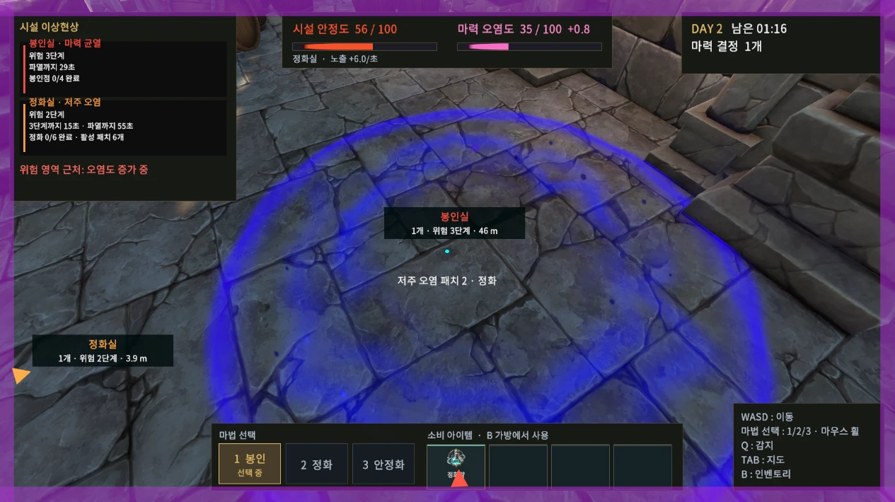

| 항목 | 내용 |
|---|---|
| 장르 | 1인칭 3D 판타지 생존 · 이상현상 대응 |
| 개발 기간 | 2주 (2026.10.21 ~ 2026.11.03) |
| 개발 인원 | 1인 (개인 프로젝트) |
| 담당 | 기획, 플레이 검증 · 수치 조정 (C# 구현은 Codex 활용) |
| 개발 환경 | Unity 6 (6000.3.15f1) · URP 17.3 · C#  · Rider |
| AI 활용 | 기획 · 판단 · 플레이 검증은 직접, C# 코드 작성은 Codex (6장) |
| 링크 | [GitHub](https://github.com/KooHoo-Dev/3rd_3D_1-3D-Project-ebsongg1) · [시연 영상](https://youtu.be/BsUoh9fcSFY) · [쇼츠](https://youtube.com/shorts/uJ-7VZIiDtA) |

---

## 목차

1. [개요](#1-개요)
2. [플레이](#2-플레이)
3. [하루 진행: 근무가 끝나도 끝나지 않는 하루](#3-하루-진행-근무가-끝나도-끝나지-않는-하루)
4. [이상현상: 세 종류를 하나의 규칙으로](#4-이상현상-세-종류를-하나의-규칙으로)
5. [마법: 감지하고, 종류에 맞게 해결하기](#5-마법-감지하고-종류에-맞게-해결하기)
6. [AI와 일한 방식](#6-ai와-일한-방식)
7. [회고](#7-회고)

---

## 1. 개요

AETHER SHIFT는 플레이어가 마법 시설의 근무자가 되어 **7일 동안** 시설을 지키는 1인칭 3D 게임입니다. 하루 근무 시간은 **180초**이고, 그동안 시설 곳곳에 **이상현상 3종**이 생깁니다. 플레이어는 이상현상을 감지하고, 종류에 맞는 마법(봉인·정화·안정화)으로 처리해야 합니다. 방치하면 이상현상이 성장하며 **시설 안정도**를 깎고, 가까이 있으면 플레이어의 **마력 오염도**가 오릅니다. 안정도가 0이 되거나 오염도가 100이 되면 그날은 실패하고, 같은 날을 처음부터 다시 합니다. 처리한 이상현상마다 **마력 조각**을 받고, 하루를 버티면 그 조각으로 **강화**와 **보급품**을 삽니다.

플레이어가 **쏟아지는 이상현상 사이에서 무엇부터 막을지 자연스럽게 판단하며 하루를 버텨 내는 긴장감**을 느끼기를 바랐습니다.
공간이 한정되어 있기 때문에 **같은 공간에서도 플레이할 때마다 다른 경험이 나오게 하는 것**이 가장 중요했습니다. 이를 위해 이상현상이 나오는 종류와 위치를 매번 무작위로 정하고, 날이 지날수록 나오는 종류·동시 개수·생성 속도가 늘어나도록 했습니다. 난이도가 올라가는 동안 플레이어가 **이상현상별 처리 요령을 익혀 가는 것**도 의도했습니다. 예를 들어 어떤 현상을 먼저 처리할지, 오염 범위를 어떻게 피할지 같은 판단입니다.

개인적인 목표는 지난 프로젝트에서 써 보지 않은 **랜덤 요소와 강화 시스템**을 넣어 보는 것이었습니다. 하루 단위로 결과를 정산하고, 그 결과로 다음 날을 준비하는 성장 구조를 만들고 싶었습니다. 이 프로젝트에서는 C# 코드 대부분을 Codex에 맡겼습니다. 그래서 **기획을 AI가 구현할 수 있는 규칙으로 정리하고, 결과를 플레이로 검증해 수정을 요청하는 과정**도 함께 경험해 보는 것이 목표였습니다(6장). 처음 기획에서는 이상현상을 일부러 키워 더 큰 보상을 노리는 **전략적인 선택**까지 의도했습니다. 하지만 플레이 테스트에서 테스터들이 생긴 것부터 빠르게 치우는 모습을 보고, **빠르게 처리하며 버티는 생존** 쪽으로 방향을 바꿨습니다(4.5).

이 문서는 **하루 진행, 이상현상, 마법** 세 가지를 중심으로 다룹니다.

---

## 2. 플레이

### 2.1 한 판의 흐름

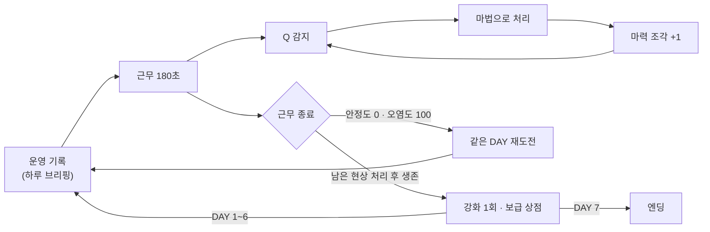

_하루 안에서는 감지 → 처리 → 보상이 반복되고, 하루가 끝나면 강화·보급으로 다음 날을 준비합니다. 근무 시간이 끝나도 남은 이상현상을 모두 처리해야 그날이 끝납니다(3.5)._

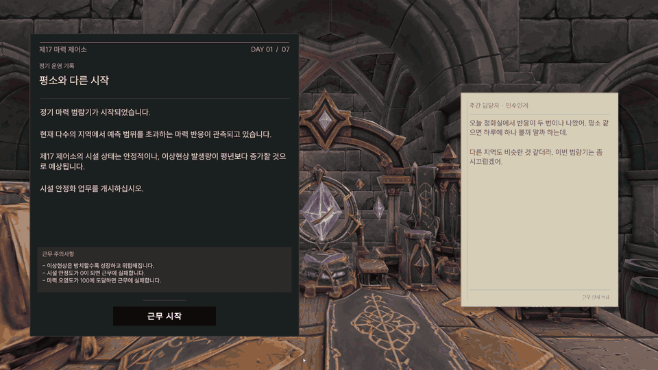

### 2.2 이상현상 세 가지

| 마력 균열 | 저주 오염 | 마력 장치 폭주 |
|---|---|---|
| 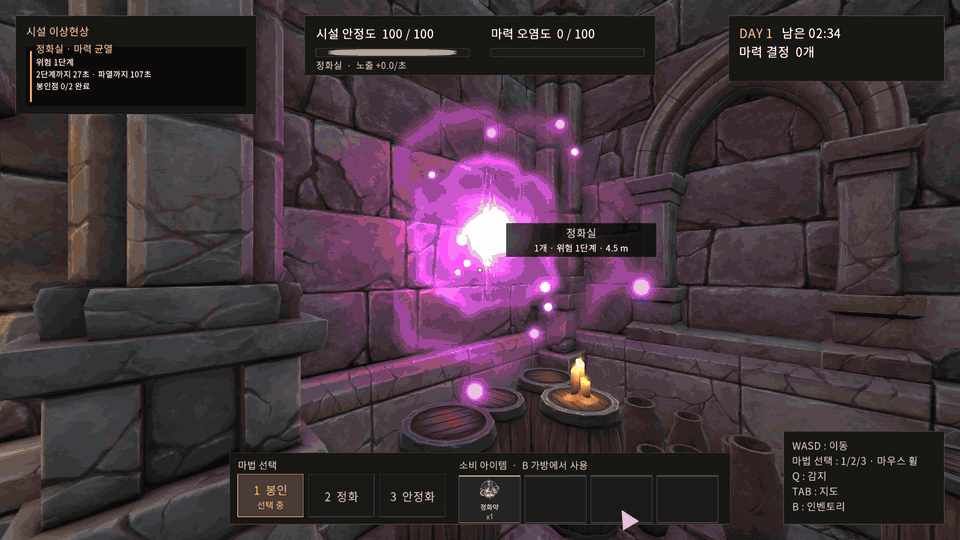 | 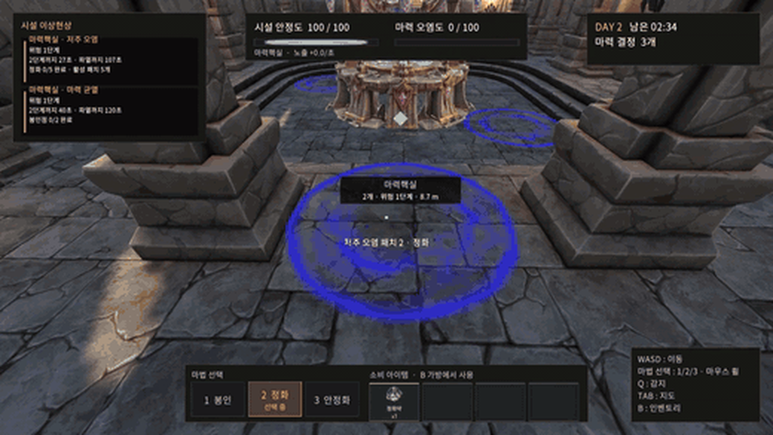 | 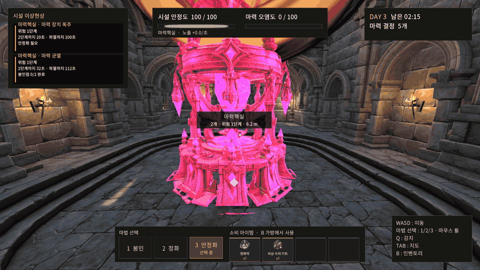 |

| 이상현상 | 생기는 곳 | 대응 마법 | 처리 방법 | 방치하면 |
|---|---|---|---|---|
| 마력 균열 | 벽 | 봉인 (1) | 봉인점 2~4개를 정해진 순서로 2초 안에 클릭 | 40초·80초에 단계 상승, 120초에 파열 |
| 저주 오염 | 바닥 | 정화 (2) | 바닥 패치를 하나씩 누르고 있어 정화. 누른 채로 다음 패치로 이어 갈 수 있음 (5.4) | 패치가 퍼지고 단계 상승, 120초에 파열 |
| 마력 장치 폭주 | 시설의 장치 | 안정화 (3) | 장치를 오래 누르고 있어 안정화. 중간에 놓아도 진행도 유지 (5.4) | 원형 방출·추적 마력탄으로 공격, 120초에 파열 |

- 2단계·3단계에서는 시설 안정도가 초당 0.5·1씩 줄고, 파열하면 한 번에 20이 줄어듭니다.
- 마력 균열은 2단계부터 주변에 있으면 오염도가 초당 3(3단계 6)씩 오르고, 저주 오염은 1단계부터 패치 위에 있으면 초당 1(2단계 3, 3단계 6)씩 오릅니다.

### 2.3 날마다 달라지는 구성

| DAY | 나오는 이상현상 | 동시 최대 | 생성 간격 | 특별 마력 균열 |
|---|---|---|---|---|
| 1 | 균열 | 1 | 14초 | — |
| 2 | 균열 · 오염 | 2 | 13초 | — |
| 3 | 균열 · 오염 · 장치 | 2 | 12초 | — |
| 4 | 〃 | 2 | 11초 | — |
| 5 | 〃 | 2 | 10초 | 75초에 2단계로 등장 |
| 6 | 〃 | 3 | 9초 | 90초에 2단계로 등장 |
| 7 | 〃 | 3 | 8초 | 100초에 3단계로 등장 |

_DAY 1은 균열 하나만 나오는 튜토리얼에 가깝고, DAY 3부터 세 종류가 모두 나옵니다. DAY 5부터는 처음부터 단계가 높은 균열이 정해진 시간에 나옵니다._

### 2.4 조작

| 입력 | 동작                                          |
|---|-----------------------------------------------|
| `W` `A` `S` `D` · 마우스 | 이동 · 시점                                   |
| `1` `2` `3` · 마우스 휠 | 마법 선택: 봉인 / 정화 / 안정화               |
| 마우스 왼쪽 | 시전 (봉인은 클릭, 정화·안정화는 누르고 있기) |
| `Q` (누르고 있기) | 마력 균열의 봉인점 감지                       |
| `E` | 아이템 줍기                                   |
| `B` / `Tab` / `Esc` | 인벤토리 / 시설 지도 / 일시정지               |

---

## 3. 하루 진행: 근무가 끝나도 끝나지 않는 하루

하루가 어떻게 시작되고 끝나는지가 "하루를 버텨 낸다"는 경험의 뼈대입니다. 특히 근무 시간이 끝나는 순간을 어떻게 처리하느냐에 따라 마지막까지 긴장이 이어지는지가 갈렸습니다(3.5).

### 3.1 하루가 흘러가는 순서

하루는 **준비 → 근무 → (정리) → 성공 · 실패** 순서로 진행됩니다. 하루의 흐름을 바꾸는 것은 시간 종료, 시설 실패, UI 버튼 세 가지입니다.

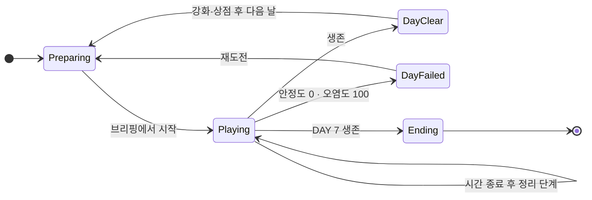

_정리 단계는 별도 상태가 아니라 `Playing` 안의 `IsCleaningUp` 표시입니다. 정리 중에도 위험 계산은 계속되므로 실패할 수 있습니다._

### 3.2 상태와 명령 나누기

하루의 상태는 두 클래스가 나눠 맡습니다. `DaySession`은 현재 DAY · 상태 · 남은 시간 · 난수 시드를 들고 **무엇이 참인지**만 정하고, `DayFlowManager`는 그 상태를 보고 스포너 · 마법 입력 · 일시정지 · 사운드에 **무엇을 시킬지** 정합니다.

`DaySession`은 Unity 오브젝트를 몰라서, 상태가 어떻게 바뀌는지만 따로 읽을 수 있습니다. 예를 들어 DAY 7에서 `CompleteDay`를 부르면 `DayClear`가 아니라 `Ending`이 되는 규칙이 이 클래스 한 곳에 있습니다.

```csharp
// Day/DaySession.cs — 상태 전이 일부
public void CompleteDay(int finalDay)
{
    State = CurrentDay >= finalDay ? DayState.Ending : DayState.DayClear;
    IsCleaningUp = false;
    RemainingSeconds = 0f;
}

public void MoveToNextDay(int finalDay, Func<int> createFallbackSeed)
{
    CurrentDay = Math.Min(CurrentDay + 1, finalDay);
    DayRandomSeed = plannedNextDayNumber == CurrentDay
        ? plannedNextDayRandomSeed : createFallbackSeed();
    ClearNextDayPlan();
    State = DayState.Preparing;
}
```

### 3.3 근무 시간 흐름

```csharp
// Day/DayFlowManager.cs — LateUpdate 일부
if (state != DayState.Playing || Time.timeScale <= 0f) return;
if (wardStatus != null && wardStatus.HasFailed)
{
    OnDayFailed(wardStatus.FailureReason);
    return;
}

if (remainingSeconds > 0f)
{
    session.AdvanceTime(Time.deltaTime);
    if (anomalySpawner != null)
        anomalySpawner.SetSpawnWindowOpen(remainingSeconds > Mathf.Max(0f, spawnStopBeforeEndSeconds));
}

if (remainingSeconds <= 0f)
{
    // 생성을 멈추고, 남은 이상현상이 있으면 정리 단계로 (3.5)
    // ...
    if (HasSurvivedDay()) CompleteDay();
    else if (wardStatus == null || !wardStatus.HasFailed)
        OnDayFailed("근무 종료 시 생존 조건을 만족하지 못했습니다.");
}
```

- **일시정지 중에는 시간이 흐르지 않습니다.** `Time.timeScale`이 0이면(상점 · 브리핑 · 메뉴) 바로 빠져나갑니다.
- **끝나기 20초 전부터 새 이상현상이 생기지 않습니다.** `spawnStopBeforeEndSeconds`(씬 값 20)보다 남은 시간이 적으면 생성 창을 닫습니다. 끝나기 직전에 생긴 현상 때문에 처리할 시간 없이 정리 단계로 넘어가는 것을 막기 위해서입니다.
- **남은 현상이 없으면 생존 여부를 판정합니다.** 안정도가 0보다 크고 오염도가 100 미만이면 성공입니다.

### 3.4 재도전과 같은 날 같은 난수

실패하면 그날 **시작 상태**로 돌아갑니다. 하루 준비가 끝나는 순간 `DayRetryCheckpoint.Capture`가 다음을 저장합니다.

| 저장 대상 | 방법 |
|---|---|
| 인벤토리 (아이템 · 조각) | `PlayerInventory.CaptureDayState` |
| 바닥에 놓인 아이템 | 씬의 `ItemPickup`마다 주웠는지 · 켜져 있는지 |
| 강화 단계 · 상점 상태 | `IDayRetryCheckpointParticipant`를 구현한 컴포넌트가 스스로 저장 (`DayFlowManager`도 구현) |

재도전 때는 **하루 시드를 바꾸지 않습니다.** 스포너는 이 시드로 만든 `System.Random`으로 종류와 위치를 뽑기 때문에, 같은 날을 다시 하면 같은 순서로 이상현상이 나옵니다(난수를 쓰는 횟수가 같을 때). 실패한 날을 다시 할 때 운이 아니라 **대처 방법을 바꿔서** 넘을 수 있게 하려는 것입니다.

```csharp
// Day/DayRetryCheckpoint.cs — 참여 컴포넌트가 무엇을 저장할지 스스로 정함
public interface IDayRetryCheckpointParticipant
{
    object CaptureDayRetryState();
    void RestoreDayRetryState(object state);
}
```

### 3.5 근무가 끝났을 때 남은 이상현상을 어떻게 할까

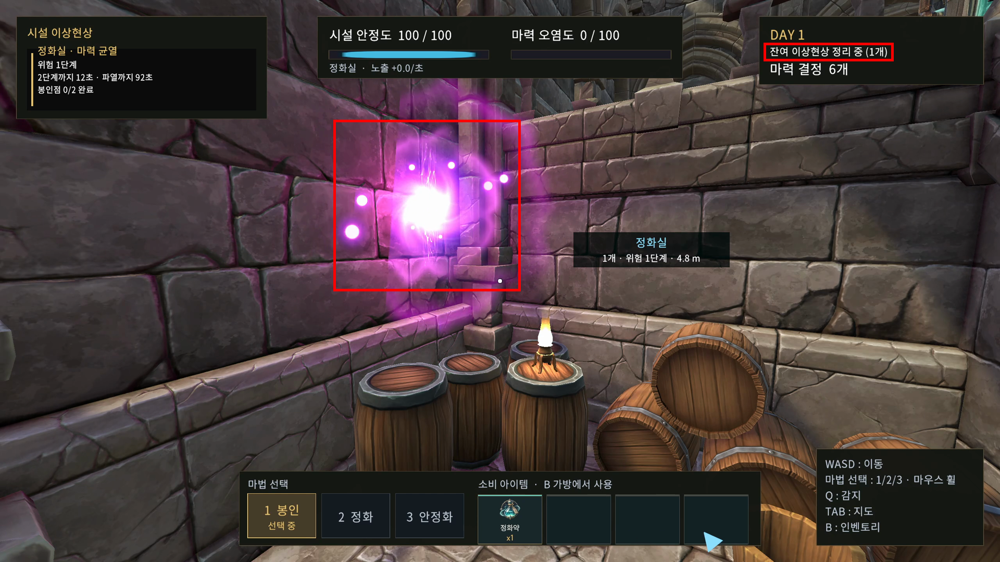

> **결정 대상** 180초가 끝나는 순간 아직 처리하지 않은 이상현상이 남아 있다면, 그대로 하루를 끝낼지, 남은 것을 처리하게 할지.

| | [A] 시간이 끝나면 모두 제거 | [B] 정리 단계에서 남은 것을 처리 ✓ |
|---|---|---|
| 방식 | `dayScene.ClearAllAnomalies()`로 남은 현상을 지우고 바로 판정 | 남은 현상이 0이 될 때까지 대기. 그동안 위험 계산은 계속됨 |
| 장점 | 하루 길이가 항상 같음 | 끝까지 처리해야 하므로 마지막 순간에도 긴장이 유지됨 |
| 단점 | 끝나기 직전에는 방치해도 손해가 없음 | 하루 길이가 늘어날 수 있음. 정리 중 보상 처리 규칙이 따로 필요 |

```csharp
// Before — 시간이 끝나면 남은 이상현상을 그냥 지움
dayScene.ClearAllAnomalies();

// After — 남은 이상현상이 있으면 정리 단계로 들어가 기다림
int activeCount = anomalySpawner != null ? anomalySpawner.ActiveAnomalyCount : 0;
if (activeCount > 0)
{
    if (!session.IsCleaningUp)
    {
        anomalyRewards.FreezeRewardsForCleanup(anomalySpawner.ActiveAnomalies);
        session.BeginCleanup();
    }
    return;
}
```

[B]를 골랐습니다. [A]에는 두 가지 문제가 있었습니다. 먼저 근무 시간이 끝나 가면 이상현상을 처리할 이유가 없었습니다. 끝나기 직전에 생긴 현상은 방치해도 사라졌기 때문입니다. 또 테스트해 보니, 이상현상을 처리하는 중인데도 시간이 다 되면 중간에 뚝 끊기는 느낌이 강했습니다. "시설을 지킨다"는 기획에 맞게, 시간이 끝나도 남은 위험은 끝까지 처리하고 하루를 마치도록 바꿨습니다. 대신 정리 단계가 생기면서 "정리 중에도 보상을 줄 것인가", "정리 중 실패하면 어떻게 할 것인가" 같은 규칙이 추가로 필요해졌습니다. 보상은 정리 단계에 들어가는 순간의 값으로 고정했습니다(`FreezeRewardsForCleanup`). 생성 중지(20초 전)와 함께 쓰면 정리 단계가 너무 길어지지 않습니다.

---

## 4. 이상현상: 세 종류를 하나의 규칙으로

이상현상은 "무엇부터 막을지 판단하는" 경험의 재료입니다. 종류가 달라도 같은 규칙으로 성장하고 위험해져야, 플레이어가 여러 현상을 한눈에 비교하며 우선순위를 정할 수 있습니다.

### 4.1 시설 입장에서는 같은 일

세 이상현상은 처리 방법이 모두 다르지만, **시설 입장에서 보면 같은 일**을 합니다. 시간이 지나면 성장하고, 성장하면 안정도를 깎고, 결국 처리되거나 파열합니다. 그래서 이 공통 동작을 하나의 계약(`AnomalyBehaviour`)으로 묶고, 처리 방법만 종류마다 다르게 만들었습니다.

### 4.2 세 이상현상의 공통 계약

이 그림에서 볼 것은 **스포너 · `WardStatus` · 보상 컨트롤러가 세 종류를 구분하지 않고 `AnomalyBehaviour`만 본다**는 점입니다.

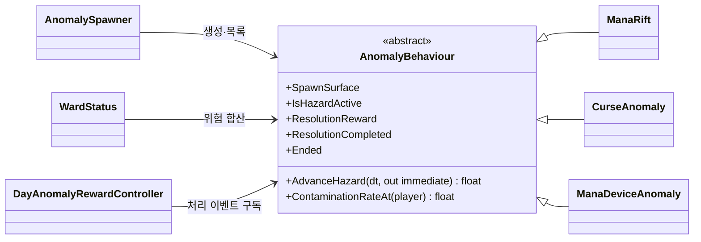

스포너는 `SpawnSurface`(벽 · 바닥 · 장치)만 보고 생성 위치를 고르고, `WardStatus`는 `AdvanceHazard`로 피해를, 보상 컨트롤러는 `ResolutionCompleted` 이벤트로 처리 여부를 받습니다. 어떤 종류인지는 묻지 않습니다.

### 4.3 지속 피해와 파열 피해 나누기

```csharp
// Facility/WardStatus.cs — LateUpdate 일부
float persistentStabilityLoss = 0f;
float immediateStabilityLoss = 0f;
foreach (AnomalyBehaviour anomaly in anomalies)
{
    persistentStabilityLoss += anomaly.AdvanceHazard(
        Time.deltaTime,
        out float anomalyImmediateStabilityLoss);
    immediateStabilityLoss += anomalyImmediateStabilityLoss;

    if (!anomaly.IsHazardActive) continue;
    HighestStage = Mathf.Max(HighestStage, anomaly.DangerStage);
    HasOverloadedAnomaly |= anomaly.HasOverloaded;
}

stability = Mathf.Clamp(
    stability
        - persistentStabilityLoss * persistentStabilityDamageMultiplier
        - immediateStabilityLoss, 0f, 100f);
// ...
if (player.isActiveAndEnabled)
    player.Advance(Time.deltaTime, anomalies);
if (stability <= 0f || player.Value >= 100f)
    Fail(stability <= 0f ? "시설 안정도 0" : "마력 오염도 100");
```

- **모든 이상현상에 이번 프레임의 피해를 물어봅니다.** 반환값은 지속 피해(단계별 초당 손실), `out` 값은 파열 피해입니다.
- **두 피해를 나눈 이유는 강화 때문입니다.** "시설 방호" 강화는 지속 피해만 5·10·15% 줄이고, 파열 피해는 줄이지 않습니다(`persistentStabilityDamageMultiplier`). 파열은 방치한 결과라 강화로 막을 수 없게 한 것입니다.
- **안정도를 깎은 뒤 오염도도 같은 목록으로 계산하고**, 둘 중 하나가 한계에 닿으면 실패합니다.

각 이상현상의 `AdvanceHazard`는 **단계 경계를 넘은 시간만큼만** 손실을 나눠 계산합니다. 예를 들어 한 프레임 사이에 1단계에서 2단계로 넘어가면, 2단계에 들어선 이후의 시간에만 2단계 손실을 적용합니다(`ManaRift.AdvanceHazard`).

### 4.4 종류를 먼저 뽑고 위치는 나중에

```csharp
// Anomalies/Common/AnomalySpawner.cs — TrySpawnNextAnomaly 일부
// 가능한 지점 수와 무관하게 종류를 먼저 뽑고, 그 종류의 지점을 나중에 뽑습니다.
var groups = new List<SpawnGroup>();
foreach (AnomalyBehaviour prefab in prefabs)
{
    if (!IsValidPrefab(prefab)) continue;
    int weight = activeDayProfile != null ? activeDayProfile.GetSpawnWeight(prefab) : 1;
    if (weight <= 0) continue;

    List<AnomalySpawnPoint> points = GetUsableSpawnPoints(availableSpawnPoints, prefab);
    if (points.Count == 0) continue;

    SpawnKind kind = GetSpawnKind(prefab);
    SpawnGroup group = groups.Find(candidate => candidate.Kind == kind);
    if (group == null)
    {
        group = new SpawnGroup(kind, weight);
        groups.Add(group);
    }
    group.Options.Add(new SpawnOption(prefab, points));
}
// ... (쓸 수 있는 지점이 하나도 없으면 경고 후 종료)
int totalWeight = 0;
foreach (SpawnGroup group in groups) totalWeight += group.Weight;
int draw = NextRandom(totalWeight);
SpawnGroup selectedGroup = groups[0];
foreach (SpawnGroup group in groups)
{
    if (draw < group.Weight) { selectedGroup = group; break; }
    draw -= group.Weight;
}

SpawnOption selectedOption = selectedGroup.Options[NextRandom(selectedGroup.Options.Count)];
AnomalySpawnPoint selectedPoint = SelectPoint(selectedOption.Points, availableSpawnPoints);
return TrySpawnAt(selectedPoint, selectedOption.Prefab);
```

- **지금 생길 수 있는 종류만 후보에 넣습니다.** 그날 허용되지 않았거나(가중치 0), 비어 있는 맞는 지점이 없는 종류는 뺍니다.
- **가중치로 종류를 먼저 뽑습니다.** 위치를 먼저 뽑으면 벽 지점이 많을 때 균열만 자주 나오는 식으로 치우칩니다. 종류를 먼저 뽑으면 지점 수와 상관없이 가중치대로 나옵니다.
그리고 **그 종류가 쓸 수 있는 지점 중에서 위치를 고릅니다.** 이미 다른 현상이 있는 지점은 `AnomalySpawnPoint`가 걸러 줍니다.
- **난수는 하루 시드로 만든 `System.Random`을 씁니다**(`NextRandom`). 그래서 재도전 때 같은 순서가 나옵니다(3.4).

**특별 마력 균열 (DAY 5~7)** 은 정해진 시간이 되면 일반 생성보다 먼저 시도됩니다(`TrySpawnDueSpecialRift`). 이미 동시 최대 개수가 차 있으면 **기존 현상을 지우지 않고 자리가 날 때까지 기다립니다.** 생성 창이 닫힐 때까지 자리가 나지 않으면 그날은 나오지 않습니다.

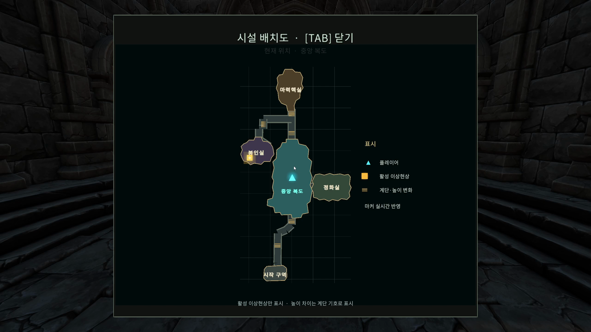

### 4.5 처리 보상을 단계별로 줄까

> **결정 대상** 이상현상을 처리했을 때, 성장한 정도(단계)에 따라 보상을 더 줄지, 항상 같은 보상을 줄지.

초기 기획서에서는 이 게임의 핵심을 "무엇부터 막을 것인가"라는 **전략 판단**으로 잡았습니다. 이상현상을 바로 처리해 안전하게 갈지, 다른 현상을 먼저 처리하는 동안 **일부러 키워서 더 많은 보상**을 노릴지 플레이어가 고르게 하려는 것이었습니다. 그래서 처리 보상을 단계만큼(1 · 2 · 3개) 주도록 설계했습니다.

그런데 테스터들에게 플레이를 맡겨 보니, 다들 **생긴 것부터 빠르게 치우고 싶어 했습니다.** 하루가 180초로 짧고 시설도 한정된 공간이라, 현상을 키워 가며 계산할 여유가 없었습니다. 결국 전략이라 할 만한 선택 없이 보이는 대로 처리하게 됐습니다. 그래서 게임의 방향을 "단계를 전략적으로 키우기"에서 **"빠르게 처리하며 버티는 생존"** 으로 바꾸고, 보상 규칙도 그에 맞춰 다시 정했습니다.

| | [A] 단계만큼 보상 (초기 기획)                                                                        | [B] 항상 1개 ✓ |
|---|------------------------------------------------------------------------------------------------------|---|
| 의도 | 키울지, 바로 처리할지 고르는 위험 · 보상 선택                                                        | 빨리 처리할수록 유리한 생존 플레이 |
| 장점 | 위험한 현상을 처리한 보상이 큼                                                                       | 빨리 처리해도 손해가 없음. 강화 가격(4·7·10)을 계획하기 쉬움 |
| 단점 | 키울 여유가 없어 의도한 선택이 생기지 않음. 생존 방향에서는 **방치할수록 이득**이 되어 목표와 어긋남 | 높은 단계를 처리해도 보상이 같아 성취감이 줄 수 있음 |

[B]를 골랐습니다. 플레이 테스트에서 의도한 전략 선택은 나오지 않았고, 플레이어가 원한 것은 빠르게 치우는 것이었습니다. 방향을 생존으로 바꾸고 나니 [A]는 오히려 방치를 이득으로 만드는 규칙이 됐습니다. 그래서 보상을 1개로 고정했습니다(`AnomalyBehaviour.ResolutionReward`). 그 대가로 초기 기획의 "키워서 더 큰 보상을 노린다"는 위험 · 보상 선택이 빠졌습니다. 또 고정 보상에서는 "어려운 현상을 처리했다"는 보상이 따로 없습니다. 이 부분은 강화 효과(오염 저항 · 시설 방호)로 높은 단계를 버티기 쉬워지는 것으로 대신하고 있습니다.

---

## 5. 마법: 감지하고, 종류에 맞게 해결하기


### 5.1 마법마다 다른 조작

| 마법 | 대상 | 조작 | 실제 설정 |
|---|---|---|---|
| 봉인 | 균열의 봉인점 | 클릭. Q로 감지한 **첫 봉인점**부터 순서대로 | 단계에 따라 2·3·4개, 연쇄 전체 2초 |
| 정화 | 저주 패치 | 누르고 있기. 누른 채 다음 패치로 이어 갈 수 있음 | 5.4 참고 |
| 안정화 | 폭주한 장치 | 누르고 있기. 놓아도 진행도 유지 | 5.4 참고 |

마법마다 조작을 다르게 한 이유는 **이상현상마다 대처 방식이 다르게 느껴지게 하기 위해서**입니다. 봉인은 빠르고 정확한 클릭, 정화는 이동하며 쓸어 담기, 안정화는 공격을 피하며 버티기입니다.

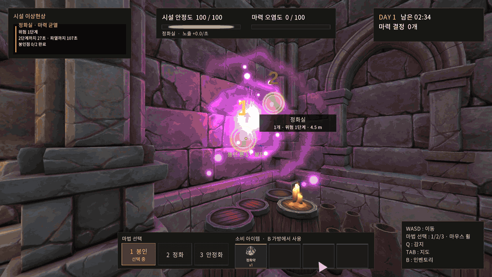

### 5.2 입력과 판정 나누기

`MagicCaster`는 어떤 마법을 골랐는지, 무엇을 조준하는지, 버튼을 눌렀는지만 봅니다. 성공·실패 판정은 대상 쪽의 `MagicTarget`이 맡습니다. 그래서 **같은 정화 마법이라도 대상마다 시전 시간과 규칙을 Inspector에서 다르게** 줄 수 있습니다. 저주 패치는 짧게 이어서 정화하고, 장치는 오래 누르되 진행도를 유지하는 식입니다(5.4). 봉인처럼 순서가 있는 경우는 균열(`ManaRift`)이 자기 봉인점들의 순서와 제한 시간을 관리합니다.

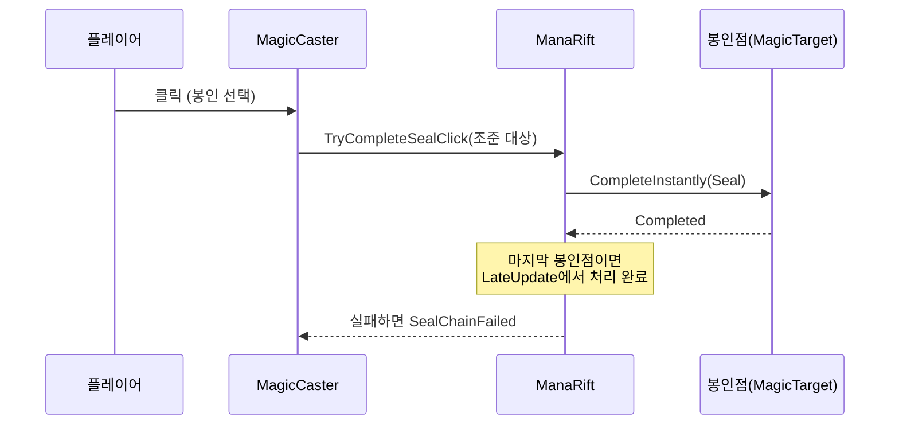

### 5.3 연쇄 봉인 판정

```csharp
// Anomalies/ManaRift/ManaRift.cs — TryCompleteSealClick
public bool TryCompleteSealClick(MagicTarget target)
{
    if (!IsHazardActive) return false;
    if (sealStep == 0)
    {
        MagicTarget first = ExpectedSealPoint;
        // Q 홀드 감지로 발견한 첫 번째 점만 봉인을 시작할 수 있습니다.
        if (target != first || first == null || !first.IsDetected) return false;
        if (!first.CompleteInstantly(MagicType.Seal)) return false;
        if (this == null || isResolved || hasRuptured) return true;
        sealStep = 1;
        sealChainDeadline = Time.time + SealChainTimeout;
        showingSealFailure = false;
        RefreshSealPointVisuals();
        return true;
    }

    if (!IsSealChainInProgress) return false;
    MagicTarget expected = ExpectedSealPoint;
    if (Time.time > sealChainDeadline || target != expected || expected == null
        || !expected.CompleteInstantly(MagicType.Seal))
    {
        FailSealChain();
        return false;
    }

    sealStep++;
    if (sealStep >= SealPointCount) sealChainDeadline = 0f;
    RefreshSealPointVisuals();
    return true;
}
```

- **첫 클릭은 Q로 감지한 첫 봉인점만 받습니다.** 감지하지 않고 아무 데나 누르는 것을 막아 "감지 → 봉인" 순서를 지키게 합니다.
- **첫 성공부터 연쇄 전체에 하나의 마감 시간(2초)을 둡니다.** 클릭할 때마다 시간이 다시 채워지지 않습니다.
- **순서가 틀리거나 시간이 지나면 처음부터 다시 해야 합니다**(`FailSealChain`). 클릭하지 않아도 시간이 지나면 `Update`에서 실패 처리합니다.
- **게임 시간(`Time.time`)을 씁니다.** 일시정지 중에는 연쇄 시간도 멈춥니다.
- **균열이 성장하면 진행 중인 연쇄를 초기화합니다.** 단계가 오르면 필요한 봉인점 수가 바뀌기 때문입니다(`ResetSealChainForStageChange`). 그래서 방치할수록 봉인이 어려워집니다.

봉인 순서는 균열이 생길 때마다 무작위로 섞입니다(`RandomizeSealOrder`). 같은 균열이라도 매번 순서를 확인해야 합니다.

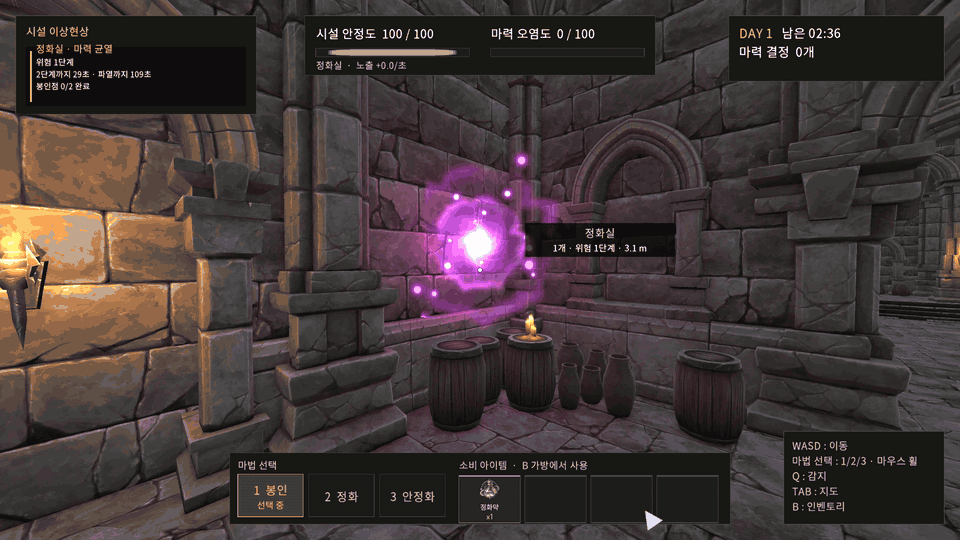

### 5.4 누르고 있는 두 마법: 쓸어 담는 정화, 피하며 버티는 안정화

정화와 안정화는 둘 다 버튼을 누르고 있어야 하는 마법이지만, 플레이에서 요구하는 움직임은 다릅니다. 정화는 **움직이며 여러 개를 빠르게 치우는** 마법이고, 안정화는 **한 대상에 오래 붙어 있되 공격이 올 때는 물러나야 하는** 마법입니다.

| | 정화 (저주 오염) | 안정화 (마력 장치 폭주) |
|---|---|---|
| 대상 | 바닥에 퍼지는 패치 여러 개 | 시설의 장치 하나 |
| 시전 | 패치당 0.5초, 사거리 2.25m | 10초, 장치에서 2.75m 안 |
| 놓으면 | 그 패치의 진행도가 사라짐 | 진행도가 그대로 남음 |
| 방해 | 패치 위에 서 있으면 오염도가 오름 | 9.5초마다 원형 방출(반경 4.75m), DAY 4부터는 추적 마력탄과 번갈아 공격 |
| 플레이 모습 | 누른 채 조준을 옮기며 쓸어 담기 | 다가가 누르기 → 경고가 뜨면 물러나기 → 다시 붙기 |

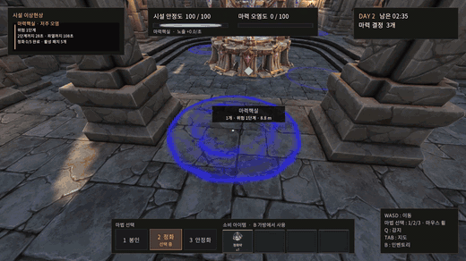

**정화는 누른 채 이어 갑니다.** 저주 패치는 여러 개가 바닥에 퍼지므로, 패치마다 클릭을 새로 하면 번거롭습니다. 그래서 버튼을 누른 채 다음 패치로 조준을 옮기면 이어서 정화됩니다(`MagicTarget.allowHeldPurifyChain`). 이동하다 조준선이 패치에서 잠깐 벗어나도 사거리와 시야 안이면 정화가 끊기지 않습니다(`MagicCaster.CanContinuePurifying`). 패치는 오염 범위이기도 해서, 위에 오래 서 있지 않고 가장자리에서부터 쓸어 나가는 것이 요령입니다.

**안정화는 놓아도 진행도가 남습니다.** 장치를 안정화할 수 있는 거리(2.75m)는 원형 방출 범위(4.75m) 안에 있습니다. 그래서 안정화하는 도중에 방출 경고가 뜨면, 맞지 않으려면 손을 떼고 범위 밖으로 물러나야 합니다. 이때 진행도가 사라지면 10초를 처음부터 다시 채워야 해서, 공격을 피할수록 손해를 보는 구조가 됩니다. 그래서 장치 쪽 대상은 시전을 멈춰도 진행도를 유지하게 했습니다(`MagicTarget.preserveProgressOnCancel`). 플레이어는 공격 주기를 보며 붙었다 빠지기를 되풀이하고, 그사이 진행도는 조금씩 쌓입니다. DAY 4부터는 원형 방출과 추적 마력탄을 번갈아 써서, 공격 패턴을 늘려 주었습니다.

### 5.5 봉인은 타이밍 시전일까, 연쇄 클릭일까

> **결정 대상** 봉인 마법을 "누르고 있다가 알맞은 순간에 놓는" 방식으로 할지, "여러 지점을 순서대로 빠르게 클릭하는" 방식으로 할지.

| | [A] 타이밍 시전 | [B] 연쇄 클릭 ✓ |
|---|---|---|
| 방식 | 게이지가 안정 구간(60~85%)에 있을 때 놓으면 성공 | Q로 찾은 첫 점부터 순서대로, 2초 안에 모두 클릭 |
| 장점 | 조작이 단순해 처음 하는 사람도 바로 익힘 | 봉인점의 위치와 순서를 보며 빠르게 손을 움직여야 함. 단계가 오르면 점이 늘어 난이도가 자연스럽게 오름 |
| 단점 | 몇 번 해 보면 게이지만 보고 놓으면 되어 **단조롭고 쉬움**. 균열이 성장해도 조작이 같음 | 순서를 한 번 틀리거나 2초가 지나면 처음부터 다시 해야 해서, 실패가 반복되면 답답할 수 있음 |

[B]를 골랐습니다. 타이밍 시전으로 플레이해 보니 조작이 너무 단조롭고 쉬웠습니다. 게이지가 안정 구간에 오면 놓기만 하면 되니, 몇 번 하고 나면 봉인이 긴장감 없는 반복 작업이 됐습니다. 그래서 봉인점 여러 개를 순서대로 빠르게 클릭하는 방식으로 바꿨습니다. 여기에 봉인점 수를 단계와 연결해(2 · 3 · 4개), "방치할수록 처리하기 어려워진다"는 규칙이 조작으로 바로 느껴지게 했습니다. 연쇄 봉인을 만든 뒤 타이밍 판정은 모든 대상에서 껐습니다.

---

## 6. AI와 일한 방식

### 6.1 맡긴 것과 직접 판단한 것

| | 내용 |
|---|---|
| 직접 판단한 것 | 게임 방향(마법 시설 · 이상현상 · 7일 생존), 하루 단위 진행, 이상현상과 대응 마법의 짝, 보상과 강화의 큰 구조. 특히 플레이 경험을 바꾸는 결정 — 정리 단계(3.5), 보상 고정(4.5), 연쇄 봉인(5.5), 범람 조건 · 안전 구역 제거 |
| AI와 논의해 구체화한 것 | 이상현상별 성장 · 파열 규칙, 강화 항목과 단계별 수치, 연쇄 봉인 같은 세부 규칙 |
| 맡긴 것 | C# 코드 대부분. 클래스 구조(상태 분리, 공통 추상 클래스 등)도 Codex의 구현을 받아들인 것 |
| 확인한 방법 | 직접 플레이하고 테스터에게 플레이를 맡겨 수치(생성 간격 · 이동 속도 · 판정 범위 · 보상)를 확인하고 수정을 요청.  |


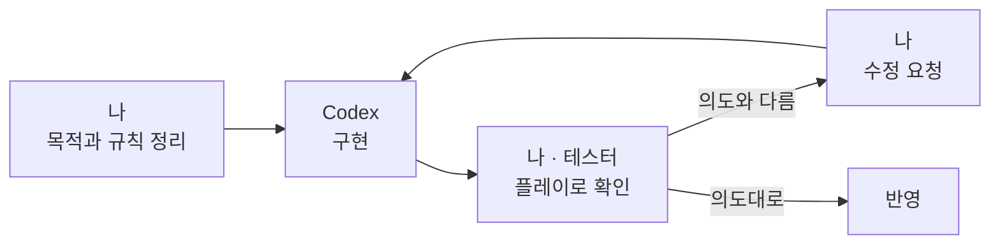

> 이 문서의 코드 설명은 **제가 코드를 읽고 이해한 내용**입니다. 코드를 처음부터 직접 작성했다는 뜻은 아닙니다.

### 6.2 AI가 만든 구조를 읽으며 본 것

코드를 Codex로 만들었기 때문에, "내가 설계한 구조"가 아니라 **완성된 구조를 읽고 평가한 것**입니다.

`DaySession`(상태)과 `DayFlowManager`(명령), `MagicCaster`(입력)와 `MagicTarget`(판정)처럼 **역할이 나뉜 곳은 한 파일만 읽어도 규칙을 이해할 수 있었습니다.** 공통 계약 `AnomalyBehaviour` 덕분에 `WardStatus`는 이상현상이 몇 종류든 같은 코드로 위험을 합산합니다.

반대로 일이 몰린 곳도 있었습니다.

| 문제 | 근거 | 영향 |
|---|---|---|
| `DayFlowManager`에 책임 집중 | 보조 컨트롤러 8개를 직접 만들고 연결, 공개 API 30개 이상. "생성 끄기 + 생성 창 닫기" 두 줄이 6곳 이상 반복 | 하루 흐름을 고칠 때 이 파일을 거의 항상 고쳐야 함 |
| 공통 계약 밖의 종류 검사 | 세 이상현상의 성장 · 파열 계산이 거의 같은 코드로 복사됨. `is ManaRift` 같은 검사가 스포너 · 오염 계산 · `MagicCaster`에 있음 | 새 이상현상을 추가하면 공통 계약 밖의 여러 곳도 고쳐야 함 |
| 활성 이상현상 목록이 두 개 | `AnomalyBehaviour.ActiveAnomalies`(static), `AnomalySpawner.activeAnomalies` | 위험 계산과 "남은 개수"가 서로 다른 목록을 봄 |

공통 계약이 있어도 **계약 밖에서 종류를 직접 검사하면 확장성의 이점이 줄어든다**는 것을 이 구조에서 확인했습니다.

### 6.3 잘 된 것과 안 된 것

기획 판단을 규칙으로 분명하게 정했을 때는 구현이 빨랐습니다. 보상을 1개로 고정하거나(4.5), 시간이 끝나도 남은 현상을 처리하게 한 것(3.5)은 "무엇을, 왜"가 분명해서 요청 한 번으로 반영됐습니다. 

반대로 잘 되지 않은 것은 **코드 정리**였습니다. 기능을 하나씩 붙이는 동안에는 "일단 동작하게" 요청하는 일이 많았고, 그때마다 코드는 이미 있는 클래스에 덧붙여졌습니다. 구조가 커진 뒤에야 나누기 시작했는데, 그때는 이미 여러 기능이 한곳에 얽혀 있어 분리하고 정리하는 일이 훨씬 복잡해졌습니다. 후반에 나눠 놓은 곳은 그나마 정리됐지만, 그 뒤에 쌓인 코드는 아직 내용이 뭉쳐 있는 곳이 많습니다.

---

## 7. 회고

### 7.1 목표한 경험은 전달됐나

2주 안에 **브리핑 → 근무 → 정산 → 강화 · 보급 → 다음 날**로 이어지는 하루를 DAY 7 엔딩까지 완성했습니다. 이상현상 3종과 마법 3종이 짝을 이루고, DAY가 지날수록 나오는 종류 · 동시 개수 · 생성 속도가 늘어납니다. 실패하면 같은 날을 같은 조건으로 다시 할 수 있습니다.

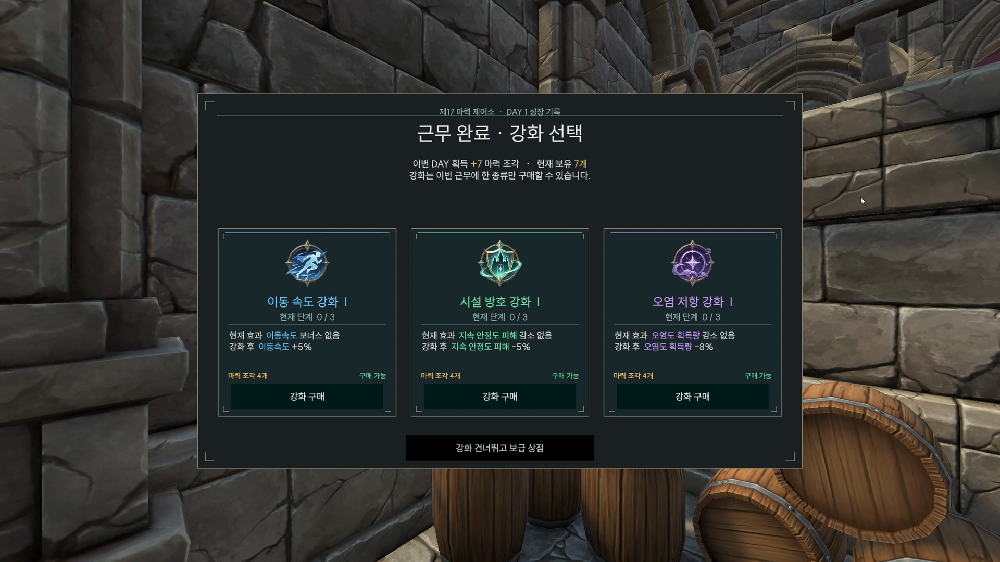

목표했던 "무엇부터 막을지 판단하며 버티는 긴장감"은 **절반만 전달됐습니다.** 이상현상이 몰려 있을 때는 "직관적인 시스템으로 긴장감 있는 플레이를 즐길 수 있었다", "방법을 알고 나니 청소하는 게임처럼 재밌었다"는 반응이 나왔습니다. "으스스하면서도 혼자 연구소를 관리하는 분위기가 잘 살아 있다"는 말도 있었습니다. 반대로 현상이 없거나 이동하는 동안에는 "아무 이상현상이 없으면 대기하는 시간이 생긴다", "퍼즐이 다소 단조롭고 위기감이 별로 느껴지지 않는다"는 반응이 나왔습니다. 긴장감은 현상을 처리하는 순간에는 있었지만, 그 사이사이에 끊겼습니다.

끊긴 이유로 가장 많이 나온 피드백은 "맵이 넓어 방과 방 사이를 오가는 시간이 루즈하다"였습니다. 저는 시설 하나라는 한정된 공간을 매번 다르게 만드는 것을 목표로 했지만(1장), 테스터들에게 그 공간은 **이상현상과 이상현상 사이를 걸어가야 하는 거리**로 느껴졌습니다. 벽에 끼이는 문제도 그 답답함을 더 키웠습니다. 

화면 표시에 대한 피드백도 같은 문제를 다른 쪽에서 보여 줬습니다. 시야에 이상현상 위치가 표시되니, 플레이어는 직접 찾기보다 그 표시가 뜨기를 기다리게 됐고, 표시가 없으면 "멍때리는" 시간이 생겼습니다. "감지하고 해결하는 과정"을 원했는데, 감지를 화면 표시가 대신해 버린 셈입니다. 다음에는 맵 크기와 이동 동선을 처음부터 "이 공간에서 플레이어가 무엇을 하게 할 것인가"를 기준으로 정하고, 안내 UI가 플레이어가 해야 할 일을 대신하지 않는지도 함께 보겠습니다.

### 7.2 배운 점

**규칙이 기획 의도와 반대 행동을 이득으로 만들 수 있다**

근무 종료 처리(3.5)와 단계별 보상(4.5) 두 경우 모두 버그가 아니라, 규칙 자체가 "방치"를 이득으로 만들고 있었습니다. 코드가 의도대로 동작해도 **그 규칙 아래에서 플레이어가 실제로 어떻게 움직이는지**는 직접 플레이하고, 다른 사람에게 플레이를 맡겨 봐야 보였습니다. 특히 단계별 보상은 기획서에서 의도한 전략 선택이 180초 · 좁은 시설에서는 생기지 않는다는 것을 테스트로 알게 되어, 게임의 방향 자체를 생존 중심으로 바꾼 경우입니다.

**7일 다음을 남겨 두지 못했다**

랜덤 생성과 강화로 같은 시설을 매번 다르게 만드는 데까지는 했지만, 7일을 마친 뒤 다시 하고 싶게 만드는 것은 남겨 두지 못했습니다. 엔딩에서 최고 DAY나 처리 수 같은 기록을 남기고, 다음 회차에 이어지는 보상을 붙이고 싶습니다. 저장은 재도전 기능이 이미 모으고 있는 "하루 시작 상태"를 파일로 남기는 방식으로 시작할 수 있습니다.
