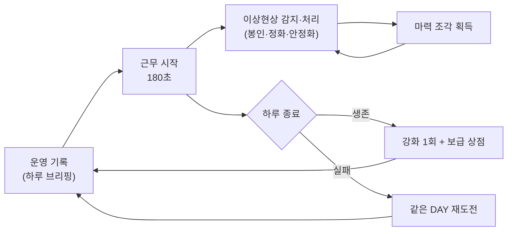
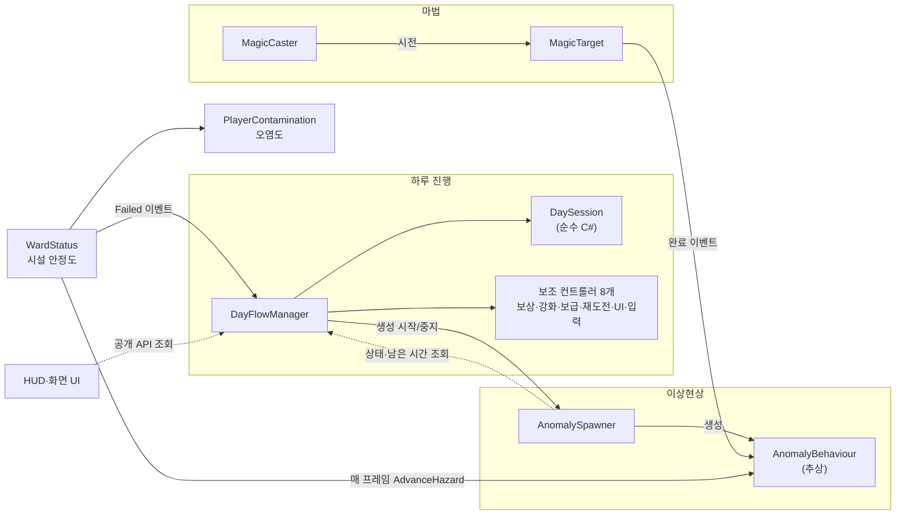
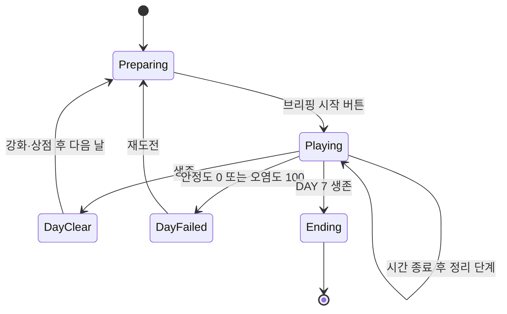
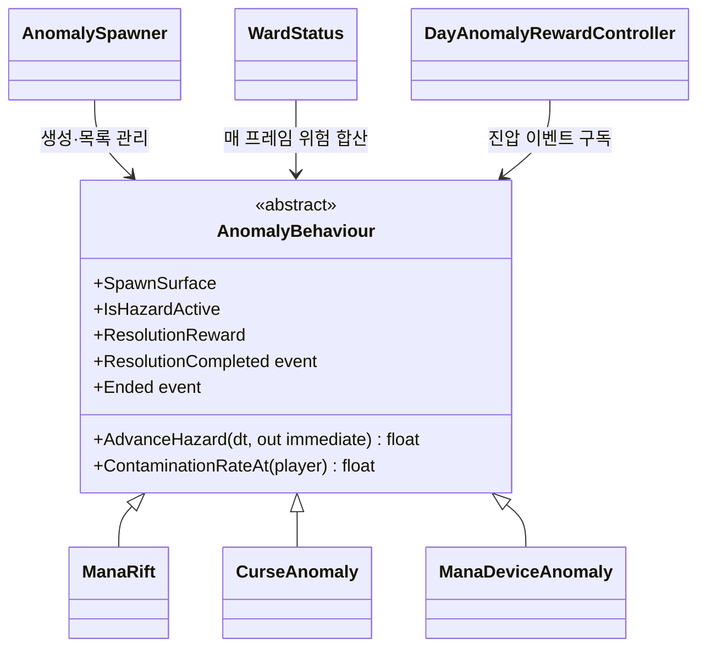
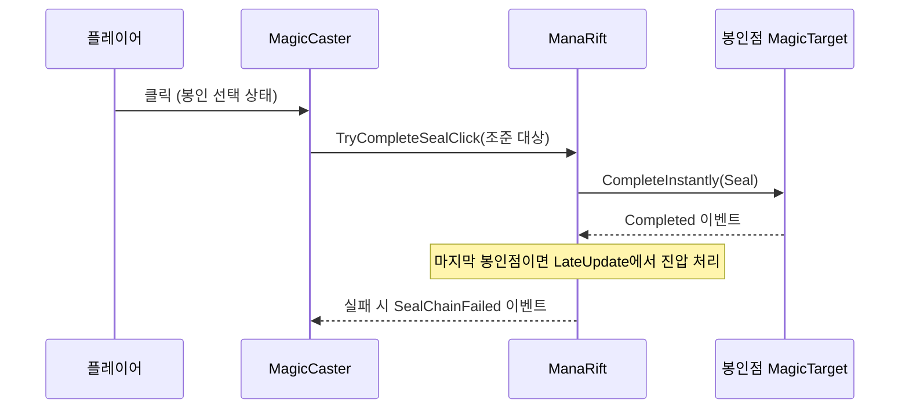

# WARD SHIFT 기술 문서

> **마법 시설에서 생기는 이상현상을 처리하며 7일을 버티는 1인칭 3D 판타지 생존 게임 (개인 프로젝트)**

<!--
작성 상태: 1차 초안 (2026-11-09)
- 이 초안은 Claude가 Unity 프로젝트의 C# 코드·씬 설정·git 기록을 읽고 쓴 것입니다. 문장 대부분이 Claude의 요약이므로 직접 읽고 고쳐 주세요.
- 코드에서 확인한 사실에는 근거 파일과 메서드를 적었습니다.
- [본인 확인 필요]는 코드만으로 알 수 없는 내용(의도·판단·경험·수치)입니다. 직접 채우거나 지워 주세요.
- 다 확인하면 이 주석은 지워 주세요.
-->

| 항목 | 내용 |
|---|---|
| 장르 | 1인칭 3D 판타지 생존 게임 |
| 개발 기간 | 2026.10.15 ~ 2026.11.03 (git 커밋 기록 기준, 커밋 70개) [본인 확인 필요: 기획 기간 포함 여부] |
| 개발 인원 | 1인 (개인 프로젝트) |
| 개발 환경 | Unity 6 (6000.3.15f1), URP 17.3.0, C#, Input System 1.19.0, Cinemachine 3.1.7 (Starter Assets 1인칭 컨트롤러) |
| IDE | [본인 확인 필요: Rider / Visual Studio — 두 패키지가 모두 설치되어 있음] |
| AI 활용 | 기획: 방향은 본인이 정하고 AI와 논의하며 구체화 · 코드: **C# 코드 작성에 Codex를 적극 활용** (1.4 참고) |
| 링크 | GitHub: [본인 확인 필요] · 시연 영상: [본인 확인 필요] |

<!-- 대표 이미지: images/에 넣은 뒤 아래 줄의 주석을 풀고 파일 이름을 맞춰 주세요. -->
<!--  -->

---

## 1. 프로젝트 개요

### 1.1 무엇을 만들었나 (What)

**WARD SHIFT**(작업명, 최종 제목 [본인 확인 필요])는 플레이어가 마법 시설의 근무자가 되어,
하루(DAY) 동안 시설 곳곳에 생기는 **이상현상**을 마법으로 처리하며 **7일**을 버티는 1인칭 3D 게임입니다.

- 하루는 **근무 시간 180초**입니다. (`MainGame` 씬의 `DayFlowManager.dayDurationSeconds` 값)
- 이상현상을 방치하면 단계가 올라가며 **시설 안정도**가 떨어지고, 가까이 있으면 플레이어의 **마력 오염도**가 오릅니다.
- 시설 안정도가 0이 되거나 오염도가 100이 되면 그날은 **실패**하고, 그날 시작 상태로 **재도전**합니다.
- 처리한 이상현상마다 **마력 조각**을 받아, 하루가 끝나면 **강화**와 **보급품**을 삽니다.

### 1.2 왜, 무엇에 집중했나 (Why)

[본인 확인 필요: 이 프로젝트로 보여 주고 싶었던 것, 해결하려던 문제를 직접 적어 주세요.]

<!-- 작성 힌트(Claude): 코드에서 공들인 부분은 ① 하루 진행 상태와 재도전, ② 여러 종류의 이상현상을 하나의 규칙으로 다루는 구조, ③ 마법 시전 판정입니다.
이 중 무엇을 목표로 했는지는 본인만 알 수 있습니다. "측정 가능한 목표"(예: 이상현상 종류를 추가할 때 고치는 파일 수)가 있으면 더 좋습니다. -->

### 1.3 핵심 플레이 루프

코드의 상태 흐름(`DayState`) 기준으로 정리하면 다음과 같습니다.



- DAY 7을 마치면 엔딩 화면으로 넘어갑니다(`DaySession.CompleteDay`에서 `DayState.Ending`).

### 1.4 AI 활용 범위와 본인 역할

이 프로젝트는 AI를 많이 활용했습니다. 읽는 분이 오해하지 않도록 구분해 적습니다.

| 구분 | 내용 |
|---|---|
| 본인이 정한 것 | 게임의 방향(마법 시설·이상현상·7일 생존), 핵심 구상(하루 단위 진행·이상현상 대응·마법 상호작용·보상과 강화) [본인 확인 필요: 세부 규칙 중 직접 정한 것 — 예) 이상현상 3종과 대응 마법, 강화 3종, 연쇄 봉인 규칙] |
| AI와 논의해 구체화한 것 | [본인 확인 필요: 수치·규칙·UI 흐름 중 AI와 함께 다듬은 것] |
| Codex가 작성한 것 | 이 문서에 실린 C# 코드 대부분 [본인 확인 필요: 직접 작성·수정한 부분이 있으면 파일·메서드 단위로 적어 주세요] |
| 본인이 한 검증·판단 | [본인 확인 필요: 플레이 테스트, 수치 조정, 기능 제거 결정(예: 범람 조건·안전 구역 제거) 등 실제로 한 일] |

> 이 문서의 코드 설명은 **제가 코드를 읽고 이해한 내용**입니다. 코드를 처음부터 직접 작성했다는 뜻이 아닙니다.

### 1.5 조작법

코드의 입력 바인딩 기준입니다.

| 입력 | 동작 | 근거 |
|---|---|---|
| WASD · 마우스 | 이동 · 시점 (Starter Assets 1인칭 컨트롤러) | `StarterAssetsInputs` |
| 1 / 2 / 3, 마우스 휠 | 마법 선택: 봉인 / 정화 / 안정화 | `MagicCaster`, `MagicCasterInput` |
| 마우스 왼쪽 | 시전 (봉인은 클릭, 정화·안정화는 누르고 있다가 놓기) | `MagicCaster.UpdateCastingInput` |
| Q (누르고 있기) | 주변 마법 대상 감지 | `MagicDetector.senseAction` |
| E | 아이템 줍기 | `PlayerPickupInteractor` |
| B / Tab / Esc | 인벤토리 / 시설 지도 / 일시정지 | `DayInputController` |
| F8 | DAY 건너뛰기 (디버그용, **현재 씬에서 켜져 있음**) | `DayFlowManager.CheatAdvanceDay` |

### 1.6 기획 목표와 현재 구현 상태

| 기획 구상 | 현재 상태 | 근거 |
|---|---|---|
| 7일 생존, 하루 단위 진행 | **구현됨** | `DayFlowManager`, `DaySession` (`finalDay = 7`) |
| 이상현상 발생 | **구현됨** — 3종: 마력 균열 · 저주 오염 · 마력 장치 폭주 | `ManaRift`, `CurseAnomaly`, `ManaDeviceAnomaly` |
| DAY별 난이도 변화 | **구현됨** — DAY마다 허용 종류·동시 개수·생성 간격이 다름, DAY 5~7 특별 마력 균열 | `AnomalySpawner.CreateDefaultDayProfiles`, `SpecialManaRiftSchedule` |
| 마법 상호작용 | **구현됨** — 봉인(연쇄 클릭) · 정화(타이밍/누르고 있기) · 안정화, Q 감지 | `MagicCaster`, `MagicTarget`, `MagicDetector` |
| 보상 | **구현됨** — 정상 처리 1건당 마력 조각 1개 | `AnomalyBehaviour.ResolutionReward`, `DayAnomalyRewardController` |
| 강화 | **구현됨** — 기동력·시설 방호·오염 저항 각 3단계, 하루 1회 구매 | `DayUpgradeController` |
| 보급·아이템 | **구현됨** — 정화약·비상 수리 키트, 4칸 인벤토리, 상점당 2회 구매 | `PlayerInventory`, `DaySupplyController` |
| 실패 시 재도전 | **구현됨** — 그날 시작 상태로 복원 | `DayRetryCheckpoint` |
| **반복 플레이** | **부분 구현** — 엔딩 뒤 게임 씬을 다시 불러오는 "처음부터 다시"만 있음. 회차 간에 남는 진행(해금·기록 등)은 **없음** | `Day5HUD.RestartGameplay` |
| 저장·불러오기 | **없음** — 게임을 끄면 진행이 사라짐. `PlayerPrefs`는 튜토리얼 표시 여부에만 사용 | `DayTutorialController` |
| 범람 조건(DAY 4~7 특수 규칙), 안전 구역 | **제거됨** — 한때 구현했다가 뺐음 | `Docs/Flood-Conditions.md`, 커밋 "안전 구역 관련 시스템 제거" |
| 다른 종류의 이상현상 | **없음** — 스포너에 "기타" 칸만 있고 실제 클래스는 없음 | `AnomalySpawner.SpawnKind.Other` |

[본인 확인 필요: 기획 문서상 "반복 플레이"가 뜻하는 것(회차 보상? 랜덤성?)과, 위 표에 없는 기획 기능이 있으면 추가해 주세요.]

### 1.7 이 문서에서 다루는 내용

1. **하루 진행 루프** — 상태 관리, 근무 종료 후 정리 단계, 재도전 (3장)
2. **이상현상 공통 구조와 생성** — 공통 계약, 가중치 생성, 위험 합산 (4장)
3. **마법 시전 판정** — 시전자와 대상의 책임 분리, 연쇄 봉인 (5장)

---

## 2. 전체 구조

### 2.1 아키텍처

이 그림에서 볼 것: **`DayFlowManager`가 거의 모든 시스템을 직접 호출**하고, 이상현상의 위험은 **`WardStatus`가 매 프레임 모아서** 계산합니다.



### 2.2 클래스 역할

| 클래스 | 책임 | 파일 |
|---|---|---|
| `DayFlowManager` | 하루 시작·종료·실패·다음 날 전환을 지휘. 보조 컨트롤러를 만들고 연결 | `Day/DayFlowManager.cs`, `Day/DayFlowManager.Api.cs` |
| `DaySession` | 현재 DAY·상태·남은 시간·난수 시드만 보관하는 **MonoBehaviour가 아닌** 클래스 | `Day/DaySession.cs` |
| `DayAnomalyRewardController` | 이상현상 1건당 보상을 **한 번만** 지급 | `Day/DayAnomalyRewardController.cs` |
| `DayUpgradeController` | 강화 단계·가격·효과 적용 | `Day/DayUpgradeController.cs` |
| `DayRetryCheckpoint` | 하루 시작 상태를 저장하고 재도전 때 복원 | `Day/DayRetryCheckpoint.cs` |
| `AnomalySpawner` | DAY 규칙에 따라 이상현상 종류·위치를 골라 생성 | `Anomalies/Common/AnomalySpawner.cs` |
| `AnomalyBehaviour` | 모든 이상현상의 공통 계약(위험 진행, 오염, 종료 이벤트) | `Anomalies/Common/AnomalyBehaviour.cs` |
| `WardStatus` | 이상현상 위험을 합산해 시설 안정도를 깎고 실패를 판정. **게임 일시정지·커서·입력 차단도 함께 담당** | `Facility/WardStatus.cs` |
| `MagicCaster` | 입력과 조준을 읽어 시전을 시작·유지·종료 | `Magic/MagicCaster.cs` |
| `MagicTarget` | 대상별 시전 진행도와 성공·실패 판정 | `Magic/MagicTarget.cs` |

**왜 이렇게 나눴나:** [본인 확인 필요]
<!-- 참고(Claude): git 기록에 "dayflowmanager 스크립트 기능 임시 분리"(10/27), "인벤토리/상점/강화 UI 기능 분리"(11/01), "MagicCaster 입력 책임 분리"(11/02) 커밋이 있습니다.
처음에는 한 클래스에 있던 기능을 나중에 나눈 흔적입니다. 이 분리를 직접 요청·판단했다면 그 이유를 적으면 좋습니다. -->

### 2.3 구조상 문제점 (객관적 점검)

좋은 점만 적지 않고, 코드에서 확인되는 문제를 그대로 적습니다.

| # | 문제 | 근거 | 영향 |
|---|---|---|---|
| 1 | **`DayFlowManager`에 책임이 몰려 있음.** 보조 컨트롤러 8개를 `AddComponent`로 직접 만들고, 스포너·마법·오디오·커서·UI까지 직접 호출. 공개 API가 30개가 넘음 | `DayFlowManager.Awake`, `DayFlowManager.Api.cs` | 하루 흐름을 바꾸려면 이 클래스를 거의 항상 고쳐야 함. `Day5HUD` 한 파일에서 `DayFlowManager`를 참조하는 줄이 38줄 |
| 2 | **같은 명령이 여러 곳에 반복됨.** "생성 끄기 + 생성 창 닫기" 두 줄이 6곳 이상 | `CompleteDay`, `OnDayFailed`, `RetryCurrentDay`, `CheatAdvanceDay`, `PrepareDayAndShowBriefing`, `LateUpdate` | 한 곳을 빠뜨리면 하루가 끝난 뒤에도 이상현상이 생길 수 있음 |
| 3 | **`DayFlowManager` ↔ `AnomalySpawner` 양방향 의존.** 매니저가 생성 창을 열고 닫는데, 스포너도 매니저를 찾아 남은 시간을 다시 검사 | `AnomalySpawner.CanSpawnNow`, `ExpireSpecialEventIfSpawnWindowClosed` | "언제 생성을 멈추나"의 판단이 두 곳에 있음 |
| 4 | **활성 이상현상 목록이 두 개.** `AnomalyBehaviour`의 static 목록(`WardStatus`가 사용)과 스포너의 목록(`DayFlowManager`가 사용) | `AnomalyBehaviour.ActiveAnomalies`, `AnomalySpawner.activeAnomalies` | 두 목록이 어긋나면 "위험 계산"과 "남은 개수"가 다른 값을 볼 수 있음 |
| 5 | **`WardStatus`가 두 가지 일을 함.** 위험 계산과 전역 일시정지(`Time.timeScale`·커서·입력 비활성화) | `WardStatus.PauseGameForUI`, `ResumeGameFromUI` | 상점·브리핑 등 UI가 일시정지를 위해 "시설 상태" 클래스에 의존 |
| 6 | **성장·파열 계산 코드가 3곳에 복사됨.** 단계 경계 적분 로직이 거의 같음 | `ManaRift.AdvanceHazard`, `CurseAnomaly.AdvanceHazard`, `ManaDeviceAnomaly.AdvanceHazard` | 규칙을 바꾸면 3곳을 모두 고쳐야 함 |
| 7 | **구체 타입 검사(`is ManaRift` 등)가 여러 클래스에 흩어짐** | `DaySpawnProfile.Allows`, `PlayerContamination.Advance`, `MagicCaster.AimedTarget` | 새 이상현상을 추가하면 스포너·오염·시전자까지 고쳐야 함. 공통 계약의 장점이 줄어듦 |
| 8 | **실행 중 씬 전체 검색이 잦음.** 생성 시도마다 `FindObjectsByType<AnomalySpawnPoint>`, 재도전 저장 때 `FindObjectsByType<MonoBehaviour>` 전체 검색 | `AnomalySpawner.GetAllSpawnPoints`, `DayRetryCheckpoint.Capture` | 성능 영향은 **측정하지 않았음** [본인 확인 필요: 프로파일러 확인 여부] |
| 9 | **쓰이지 않는 코드·호환용 이름이 남아 있음** | `DayFlowManager.OnAnomalyResolved`(호출 없음), `demoMode`(사용 안 함), `RestartFromDayOne`(실제로는 현재 DAY 재도전) | 읽는 사람이 헷갈림 |
| 10 | **출시 설정 문제.** F8 DAY 건너뛰기가 씬에서 켜져 있음 | `MainGame.unity`의 `enableDaySkipCheat: 1` | 빌드에서 누구나 날을 건너뛸 수 있음 |
| 11 | **UI 클래스가 큼.** 화면을 코드로 직접 만드는 클래스가 600~900줄. 이름도 개발 단계(DAY 5) 이름이 남음 | `Day5HUD`(625줄), `FacilityMapHUD`(893줄), `ThreatWarningHUD`(711줄) | 화면 수정이 어려움 |
| 12 | **자동 테스트 없음.** Test Framework 패키지는 있지만 테스트 코드는 없음. 대신 에디터 메뉴로 돌리는 Play Mode 점검 스크립트가 있음 | `Assets/Editor/WardShift*PlayModeCheck.cs` | [본인 확인 필요: 이 점검 스크립트를 실제로 돌려 봤는지] |

> 참고: `UniTask`, `Newtonsoft.Json`, `AI Navigation` 패키지가 설치되어 있지만 `Assets/Scripts`에서는 쓰지 않습니다. [본인 확인 필요: 쓸 계획이 없다면 개발 환경 표에서 빼 주세요.]

---

## 3. 시스템 ① 하루 진행 루프

### 3.1 개요

하루는 **준비 → 근무 → (정리) → 성공/실패** 순서로 진행됩니다.
근무 시간이 끝나도 남은 이상현상이 있으면 바로 끝내지 않고, **남은 것을 다 처리하거나 파열될 때까지 기다리는 정리 단계**가 있습니다.



### 3.2 구조

- **`DaySession`**(순수 C#): 상태·DAY·남은 시간·시드만 바꿉니다. Unity 오브젝트를 몰라서 상태 전이 규칙만 따로 읽을 수 있습니다.
- **`DayFlowManager`**(MonoBehaviour): `DaySession`의 상태를 보고 스포너·마법·UI·오디오에 명령을 내립니다.
- **재도전**: 하루 준비가 끝난 순간 `DayRetryCheckpoint.Capture`가 인벤토리·필드 아이템·`IDayRetryCheckpointParticipant` 구현체의 상태를 저장하고, 실패 후 `Restore`로 되돌립니다.
- **같은 날은 같은 난수**: 하루마다 시드를 만들어 `AnomalySpawner.ConfigureForDay`에 넘기고, 스포너는 `System.Random(seed)`로 종류와 위치를 뽑습니다. 재도전 때는 시드를 바꾸지 않습니다(`DaySession.EnsureDaySeed`는 시드가 0일 때만 새로 정함).

### 3.3 핵심 기능 — 근무 종료와 정리 단계

외부에서 쓰는 방법: UI는 `BeginNextDay()`, `RetryCurrentDay()`, `TryPurchaseUpgrade(type)`를 호출하고, `State`·`RemainingSeconds`·`IsCleaningUp`을 읽어 화면을 그립니다.

```csharp
// Day/DayFlowManager.cs — LateUpdate (Codex 작성 코드)
private void LateUpdate()
{
    if (dayInput != null && dayInput.SuppressDayTickThisFrame) return;
    if (state != DayState.Playing || Time.timeScale <= 0f) return;
    if (wardStatus != null && wardStatus.HasFailed)
    {
        OnDayFailed(wardStatus.FailureReason);
        return;
    }

    if (remainingSeconds > 0f)
    {
        session.AdvanceTime(Time.deltaTime);
        if (anomalySpawner != null)
            anomalySpawner.SetSpawnWindowOpen(remainingSeconds > Mathf.Max(0f, spawnStopBeforeEndSeconds));
    }

    if (remainingSeconds <= 0f)
    {
        if (anomalySpawner != null)
        {
            anomalySpawner.SetSpawningEnabled(false);
            anomalySpawner.SetSpawnWindowOpen(false);
        }
        int activeCount = anomalySpawner != null ? anomalySpawner.ActiveAnomalyCount : 0;

        if (activeCount > 0)
        {
            if (!session.IsCleaningUp)
            {
                anomalyRewards.FreezeRewardsForCleanup(anomalySpawner.ActiveAnomalies);
                session.BeginCleanup();
            }
            return;
        }

        if (HasSurvivedDay()) CompleteDay();
        else if (wardStatus == null || !wardStatus.HasFailed)
            OnDayFailed("근무 종료 시 생존 조건을 만족하지 못했습니다.");
    }
}
```

**코드 설명 (제가 이해한 내용):**

- 종료 20초 전(`spawnStopBeforeEndSeconds`, 씬 값 20)부터 새 이상현상이 생기지 않습니다. 끝나기 직전에 생긴 현상 때문에 억울하게 실패하지 않게 하려는 것으로 보입니다. [본인 확인 필요: 의도가 맞는지]
- 시간이 0이 되어도 이상현상이 남아 있으면 `BeginCleanup()`으로 **정리 단계**에 들어가고 `return`합니다. 그동안에도 `WardStatus`는 위험을 계속 계산하므로 방치하면 실패할 수 있습니다.
- 정리 단계에 들어갈 때 `FreezeRewardsForCleanup`으로 남은 현상의 보상을 그 시점 값으로 고정합니다.
- 이 기능은 git 기록상 10/28 커밋 "DAY 종료 시 잔여 이상현상 정리"에서 추가되었습니다. [본인 확인 필요: 이 규칙을 넣게 된 이유 — 플레이 테스트에서 겪은 문제였다면 6장 트러블슈팅 후보입니다]

**보상 중복 방지** (`DayAnomalyRewardController.RewardResolution`): 이상현상의 `GetInstanceID()`를 `HashSet`에 넣고, 이미 들어 있으면 지급하지 않습니다. 진압 이벤트가 두 번 와도 보상은 한 번입니다.

### 3.4 고민과 선택

[본인 확인 필요: 아래는 코드에서 보이는 선택과, 비교해 볼 만한 대안입니다. 이 선택을 직접 판단했는지, 어떤 이유였는지 본인 말로 고쳐 주세요. 직접 판단하지 않았다면 "Codex가 제안한 구조를 받아들였고, 지금 보면 이런 장단점이 있다"고 솔직하게 쓰는 편이 낫습니다.]

| 선택지 | 장점 | 단점 |
|---|---|---|
| **A. 매니저 하나 + 상태 클래스 분리 (현재)** | 흐름이 한 파일에 모여 따라 읽기 쉬움. `DaySession`은 Unity 없이 규칙만 확인 가능 | 매니저가 계속 커짐(2.3의 1·2번) |
| B. 상태마다 클래스를 나누는 State 패턴 | 상태별 진입·종료 처리가 분리됨 | 클래스 수가 늘고, 상태 간 공유 데이터 전달이 필요 |
| C. 이벤트로 알리고 각 시스템이 스스로 반응 | 매니저가 스포너·마법·UI를 몰라도 됨 | 흐름이 여러 파일에 흩어져 순서 파악이 어려움 |

---

## 4. 시스템 ② 이상현상 공통 구조와 생성

### 4.1 개요

| 이상현상 | 생성 위치 | 대응 마법 | 처리 방법 | 방치하면 |
|---|---|---|---|---|
| 마력 균열 `ManaRift` | 벽 | 봉인 | 단계에 따라 봉인점 2·3·4개를 정해진 순서로 제한 시간 안에 클릭 | 20초·40초에 단계 상승, 60초에 파열(안정도 −20) |
| 저주 오염 `CurseAnomaly` | 바닥 | 정화 | 바닥 패치를 하나씩 누르고 있어 정화 | 패치 확산, 단계 상승, 파열 |
| 마력 장치 폭주 `ManaDeviceAnomaly` | 시설의 장치 | 안정화 | 장치를 누르고 있어 안정화. 원형 방출·추적 마력탄을 피해야 함 | 단계 상승, 파열 |

- 2·3단계에서는 초당 0.5·1의 시설 안정도가 떨어집니다(`ManaRift` 기본값).
- DAY 1은 마력 균열만, DAY 2부터 저주 오염, DAY 3부터 장치 폭주가 나옵니다(`AnomalySpawner.CreateDefaultDayProfiles`). [본인 확인 필요: 씬 Inspector에서 값을 바꿨다면 씬 값 기준으로 고쳐 주세요]

### 4.2 구조

이 그림에서 볼 것: 세 이상현상은 `AnomalyBehaviour`라는 **같은 계약**을 따르고, 스포너와 `WardStatus`는 이 계약만 보고 다룹니다.



### 4.3 핵심 기능 ① — 위험 합산 (지속 피해와 즉시 피해 분리)

```csharp
// Facility/WardStatus.cs — LateUpdate 일부 (Codex 작성 코드)
float persistentStabilityLoss = 0f;
float immediateStabilityLoss = 0f;
foreach (AnomalyBehaviour anomaly in anomalies)
{
    persistentStabilityLoss += anomaly.AdvanceHazard(Time.deltaTime,
        out float anomalyImmediateStabilityLoss);
    immediateStabilityLoss += anomalyImmediateStabilityLoss;
    if (!anomaly.IsHazardActive) continue;
    HighestStage = Mathf.Max(HighestStage, anomaly.DangerStage);
    HasOverloadedAnomaly |= anomaly.HasOverloaded;
}
stability = Mathf.Clamp(stability
    - persistentStabilityLoss * persistentStabilityDamageMultiplier
    - immediateStabilityLoss, 0f, 100f);
// ...
if (player.isActiveAndEnabled)
    player.Advance(Time.deltaTime, anomalies);
if (stability <= 0f || player.Value >= 100f)
    Fail(stability <= 0f ? "시설 안정도 0" : "마력 오염도 100");
```

**코드 설명 (제가 이해한 내용):**

- 각 이상현상은 `AdvanceHazard`에서 **지속 피해**(단계별 초당 손실)를 반환하고, 파열 피해는 `out` 매개변수로 **따로** 돌려줍니다.
- 이렇게 나눈 이유는 **시설 방호 강화**가 지속 피해에만 배수(`persistentStabilityDamageMultiplier`)를 곱하고 파열 피해는 줄이지 않기 때문입니다(`DayUpgradeController.ApplyEffects`, `AnomalyBehaviour.AdvanceHazard` 주석).
- 각 이상현상의 `AdvanceHazard`는 이전 나이와 다음 나이 사이에서 **단계 경계를 넘은 시간만큼** 손실을 나눠 계산합니다. 프레임이 길어도 단계가 바뀌는 순간을 넘겨 계산하지 않습니다(`ManaRift.AdvanceHazard`).

### 4.4 핵심 기능 ② — 가중치로 종류를 먼저 뽑고, 위치는 나중에

```csharp
// Anomalies/Common/AnomalySpawner.cs — TrySpawnNextAnomaly 일부 (Codex 작성 코드)
// 가능한 지점 수와 무관하게 종류를 먼저 뽑고, 그 종류의 지점을 나중에 뽑습니다.
var groups = new List<SpawnGroup>();
foreach (AnomalyBehaviour prefab in prefabs)
{
    if (!IsValidPrefab(prefab)) continue;
    int weight = activeDayProfile != null ? activeDayProfile.GetSpawnWeight(prefab) : 1;
    if (weight <= 0) continue;

    List<AnomalySpawnPoint> points = GetUsableSpawnPoints(availableSpawnPoints, prefab);
    if (points.Count == 0) continue;

    SpawnKind kind = GetSpawnKind(prefab);
    SpawnGroup group = groups.Find(candidate => candidate.Kind == kind);
    if (group == null)
    {
        group = new SpawnGroup(kind, weight);
        groups.Add(group);
    }
    group.Options.Add(new SpawnOption(prefab, points));
}
// ... (빈 지점이 없으면 경고 후 종료)
int totalWeight = 0;
foreach (SpawnGroup group in groups) totalWeight += group.Weight;
int draw = NextRandom(totalWeight);
SpawnGroup selectedGroup = groups[0];
foreach (SpawnGroup group in groups)
{
    if (draw < group.Weight) { selectedGroup = group; break; }
    draw -= group.Weight;
}

SpawnOption selectedOption = selectedGroup.Options[NextRandom(selectedGroup.Options.Count)];
AnomalySpawnPoint selectedPoint = SelectPoint(selectedOption.Points, availableSpawnPoints);
return TrySpawnAt(selectedPoint, selectedOption.Prefab);
```

**코드 설명 (제가 이해한 내용):**

- 위치를 먼저 뽑으면 **생성 지점이 많은 종류가 더 자주 나오는** 치우침이 생깁니다. 그래서 종류를 가중치로 먼저 뽑고, 그 종류가 쓸 수 있는 빈 지점 중에서 위치를 고릅니다.
- 쓸 수 있는 빈 지점이 없는 종류는 후보에서 빠지므로, 뽑은 뒤 "자리가 없어 실패"하는 경우가 줄어듭니다.
- `NextRandom`은 하루 시드로 만든 `System.Random`을 쓰므로 재도전 때 같은 순서가 나옵니다(난수를 쓰는 횟수가 같을 때).
- 지점 표면(`SpawnSurface`)이 맞지 않거나 이미 점유된 지점은 `AnomalySpawnPoint.CanSpawnPrefab`에서 걸러집니다.
- DAY 5~7에는 정해진 시간 뒤에 2·3단계로 시작하는 **특별 마력 균열**이 일반 생성보다 먼저 시도됩니다(`TrySpawnDueSpecialRift`). 자리가 없으면 기존 현상을 지우지 않고 기다립니다.

### 4.5 고민과 선택

[본인 확인 필요: 직접 판단한 부분과 이유를 본인 말로 고쳐 주세요.]

| 선택지 | 장점 | 단점 |
|---|---|---|
| **A. 추상 클래스 `AnomalyBehaviour` 상속 (현재)** | 공통 이벤트·목록 관리를 한 곳에 둠. 스포너·`WardStatus`가 종류를 몰라도 위험을 계산 | 성장·파열 코드가 하위 클래스마다 복사됨(2.3의 6번). 타입 검사가 남아 있어(7번) 새 종류 추가가 생각보다 어려움 |
| B. 인터페이스(`IAnomaly`) + 공통 성장 컴포넌트 조합 | 성장 규칙을 한 번만 작성. 종류별 차이는 처리 방식만 | 컴포넌트 연결 설정이 늘어남 |
| C. ScriptableObject로 단계·수치 데이터 분리 | 기획 수치를 코드 수정 없이 조정 | 데이터 에셋 관리가 필요 |

---

## 5. 시스템 ③ 마법 시전 판정

### 5.1 개요

| 마법 | 방식 | 판정 |
|---|---|---|
| 봉인 | 클릭. Q로 감지한 **첫 봉인점**부터 시작해, 정해진 순서대로 제한 시간(기본 2초) 안에 클릭 | 순서가 틀리거나 시간 초과면 연쇄 전체 실패 |
| 정화 | 누르고 있기. 저주 패치는 누른 채 다음 패치로 옮겨 이어서 정화 가능 | 대상 설정에 따라 다름 |
| 안정화 | 누르고 있기. 방출을 피한 직후에는 안정화 속도 보너스(1.5배) | 진행도가 누적됨(취소해도 유지) |

`MagicTarget`에는 **타이밍 판정**도 있습니다. 버튼을 놓은 순간의 진행도가 안정 구간(기본 60~85%) 안이면 성공, 모자라면 `Undercharged`, 넘치면 `Overcharged`입니다. [본인 확인 필요: 현재 어떤 대상에 타이밍 판정이 켜져 있는지 — 프리팹 설정에 따라 다릅니다]

### 5.2 구조

- **`MagicCaster`**: 입력·조준·마법 선택만 맡습니다. 입력 읽기는 11/02 커밋에서 `MagicCasterInput`으로 분리되었습니다.
- **`MagicTarget`**: 진행도·완료·결과 판정을 맡습니다. 결과가 정해지면 `CastResolved`, 성공이면 `Completed` 이벤트를 보냅니다.
- **`ManaRift`**: 자기 봉인점들의 순서와 제한 시간을 관리하고, 모두 완료되면 `NotifyResolved()`로 공통 진압 이벤트를 보냅니다.



### 5.3 핵심 기능 — 연쇄 봉인 판정

```csharp
// Anomalies/ManaRift/ManaRift.cs — TryCompleteSealClick (Codex 작성 코드)
public bool TryCompleteSealClick(MagicTarget target)
{
    if (!IsHazardActive) return false;
    if (sealStep == 0)
    {
        MagicTarget first = ExpectedSealPoint;
        // Q 홀드 감지로 발견한 첫 번째 점만 봉인을 시작할 수 있습니다.
        if (target != first || first == null || !first.IsDetected) return false;
        if (!first.CompleteInstantly(MagicType.Seal)) return false;
        if (this == null || isResolved || hasRuptured) return true;
        sealStep = 1;
        sealChainDeadline = Time.time + SealChainTimeout;
        showingSealFailure = false;
        RefreshSealPointVisuals();
        return true;
    }

    if (!IsSealChainInProgress) return false;
    MagicTarget expected = ExpectedSealPoint;
    if (Time.time > sealChainDeadline || target != expected || expected == null
        || !expected.CompleteInstantly(MagicType.Seal))
    {
        FailSealChain();
        return false;
    }

    sealStep++;
    if (sealStep >= SealPointCount) sealChainDeadline = 0f;
    RefreshSealPointVisuals();
    return true;
}
```

**코드 설명 (제가 이해한 내용):**

- 첫 클릭은 **Q로 감지된 첫 봉인점**에만 받습니다. 감지 없이 아무 데나 누르는 것을 막아 "감지 → 봉인" 순서를 강제합니다.
- 첫 성공부터 **전체 연쇄에 하나의 마감 시간**을 둡니다. 클릭마다 시간이 다시 채워지지 않습니다.
- 틀린 대상을 누르거나 시간이 지나면 `FailSealChain()`이 봉인점을 모두 되돌립니다. 시간 초과는 클릭이 없어도 `Update`에서 검사합니다.
- `Time.time`(게임 시간)을 쓰므로 일시정지 중에는 연쇄 시간도 멈춥니다(`ManaRift.Update` 주석).
- 균열이 성장해 단계가 바뀌면 필요한 봉인점 수가 바뀌므로 진행 중인 연쇄를 초기화합니다(`ResetSealChainForStageChange`).
- 마지막 봉인점이 완료되어도 바로 지우지 않고 `LateUpdate`에서 처리합니다. 마지막 봉인점의 완료 효과·다른 구독자가 먼저 실행되게 하려는 것입니다(코드 주석).

### 5.4 고민과 선택

[본인 확인 필요: 연쇄 봉인·Q 감지·타이밍 판정은 게임 규칙(기획)에 해당합니다. 이 규칙을 직접 정했다면 왜 이렇게 정했는지(예: 단순 클릭보다 긴장감) 본인 말로 적어 주세요.]

| 선택지 | 장점 | 단점 |
|---|---|---|
| **A. 시전자(입력)와 대상(판정) 분리 (현재)** | 대상마다 시전 시간·타이밍 구간을 Inspector에서 다르게 설정 | `MagicCaster`가 여전히 `CursePatch`·`ManaDeviceVisuals`·`ManaRift`를 직접 검사함(2.3의 7번). 마법이 늘면 `MagicCaster`가 커짐 |
| B. 마법 종류마다 전략 클래스(봉인·정화·안정화) | 마법별 입력 방식이 분리되어 `MagicCaster`가 단순해짐 | 클래스 수 증가 |

---

## 6. 트러블슈팅

> 실제로 겪은 문제만 적습니다. 아래는 git 기록에서 보이는 **후보**일 뿐이며, 실제 경험이 아니면 지워 주세요.
> 문제 → 원인 → 해결 → 결과 순서로 씁니다.

[본인 확인 필요]

<!-- 후보(Claude, git 기록 기준 — 실제로 겪었는지·어떻게 해결했는지는 본인만 압니다):
1. 근무 종료 시 남은 이상현상 처리 (10/28 "DAY 종료 시 잔여 이상현상 정리") → 3.3의 정리 단계
2. 범람 조건·안전 구역 제거 (10/31, 11/01) → 왜 뺐는지 (재미? 복잡도? 일정?)
3. 기능 분리 리팩터링 (10/27 DayFlowManager, 11/01 UI 4종, 11/02 MagicCaster 입력) → 무엇이 불편해서 나눴는지
4. 커밋 "범위 판정 수정"(11/02) → 어떤 범위 판정이 어떻게 틀렸는지
AI가 만든 코드에서 생긴 문제를 직접 발견하고 고친 경험이 있다면, 그것이 가장 좋은 트러블슈팅 사례입니다. -->

---

## 7. 결과 및 회고

### 7.1 결과

- 구현 범위: 1.6 표의 "구현됨" 항목 (7일 진행, 이상현상 3종, 마법 3종, 보상·강화·보급, 재도전, 타이틀·엔딩)
- 코드 규모: `Assets/Scripts` C# 파일 68개, 약 16,600줄 (에디터 도구 약 6,700줄 별도)
- 측정값: [본인 확인 필요: 플레이 테스트 결과, 1회 클리어 시간, 프레임 등 측정한 것이 있으면]
- 1.2의 목표 달성 여부: [본인 확인 필요]

### 7.2 아쉬운 점(기술 부채)과 개선 계획

2.3의 문제 중 영향이 큰 것부터 정리했습니다. [본인 확인 필요: 실제로 개선할 계획인지, 우선순위가 맞는지]

| 문제 | 지금 (As-Is) | 개선 방향 (To-Be) |
|---|---|---|
| `DayFlowManager` 책임 집중 | 보조 컨트롤러 생성·연결·명령을 모두 직접 | 상태 변경을 이벤트로 알리고, 스포너·마법·UI가 각자 반응. "생성 중지" 같은 반복 명령은 메서드 하나로 |
| 활성 목록 2개 | static 목록 + 스포너 목록 | 스포너(또는 별도 레지스트리) 한 곳만 기준으로 |
| 성장·파열 코드 복사 | 3개 클래스에 거의 같은 코드 | 공통 성장 계산을 기반 클래스나 별도 클래스로 |
| 구체 타입 검사 | `is ManaRift` 등이 4곳 이상 | 이상현상·대상이 스스로 "어떤 마법으로, 어느 거리에서" 처리되는지 알려 주게 |
| `WardStatus` 일시정지 담당 | 시설 상태 클래스가 `Time.timeScale`·커서 관리 | 일시정지 전용 클래스로 분리 |
| 출시 설정 | F8 건너뛰기 켜짐 | `UNITY_EDITOR` 또는 개발 빌드에서만 허용 |
| 저장 없음 | 게임을 끄면 진행 소실 | DAY 시작 체크포인트(`DayRetryCheckpoint`가 이미 모으는 상태)를 파일로 저장 |
| 테스트 | 에디터 메뉴 점검 스크립트만 | `DaySession`처럼 순수 C#인 부분부터 Test Framework 단위 테스트 |

### 7.3 배운 점

[본인 확인 필요: AI로 코드를 만들면서 배운 것, 코드를 읽고 이해하며 알게 된 것, 기획을 구현으로 옮기며 느낀 것 등을 본인 말로 적어 주세요.]
