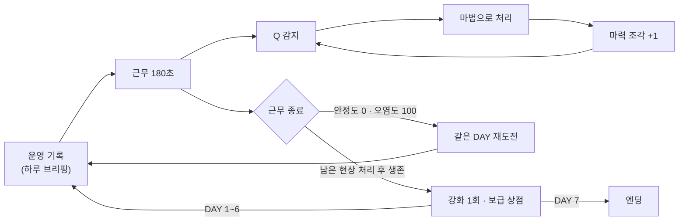
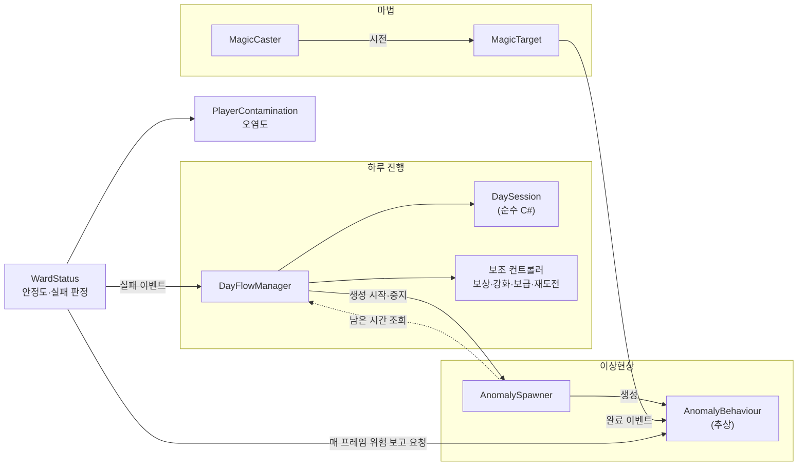
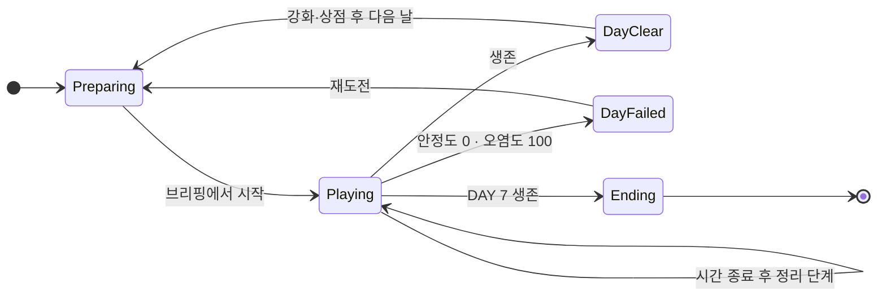
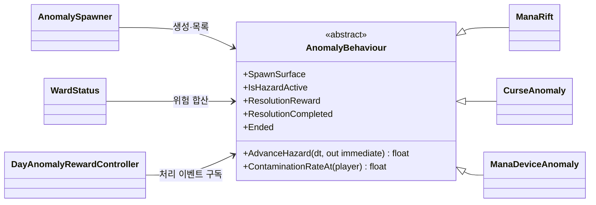
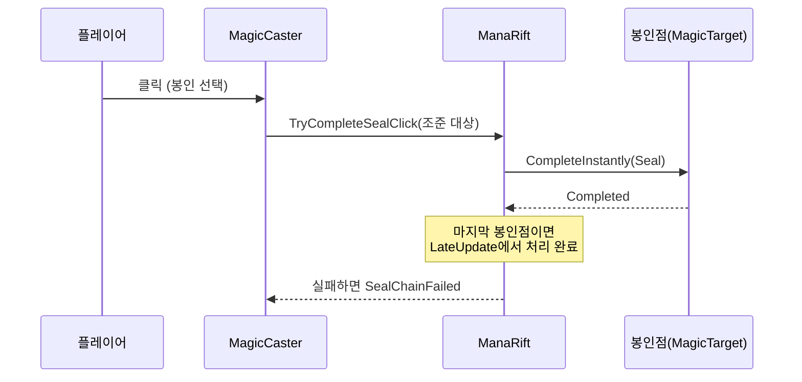

# ARCANE SHIFT 기술 문서

> **마법 시설에서 생기는 이상현상을 처리하며 7일을 버티는 1인칭 3D 판타지 생존 게임**

<!--
작성 상태: 2차 초안 (2026-11-12)
- Claude가 Unity 원본 프로젝트(3rd_3D_1-3D-Project-ebsongg1)의 코드·씬·프리팹 값과 git 커밋 변경 내용을 직접 읽고 썼습니다.
- 수치는 코드 기본값이 아니라 실제 씬·프리팹에 저장된 값 기준입니다.
- "(확인 필요)"가 붙은 문장은 코드만으로는 알 수 없는 내용(의도·판단·경험)이라 Claude가 추정해 쓴 것입니다. 맞으면 표시만 지우고, 틀리면 고쳐 주세요.
-->

> 📷 **이미지 자리** `images/cover.png` — 시설 복도에서 이상현상과 마법 HUD가 함께 보이는 대표 화면

| 항목 | 내용 |
|---|---|
| 장르 | 1인칭 3D 판타지 생존 · 이상현상 대응 |
| 개발 기간 | 2주 (2026.10.21 ~ 2026.11.03) |
| 개발 인원 | 1인 (개인 프로젝트) |
| 담당 | 기획, AI(Codex)를 활용한 구현, 플레이 테스트와 수치 조정 (확인 필요) |
| 개발 환경 | Unity 6 (6000.3.15f1) · URP 17.3 · C# · Input System · Cinemachine(Starter Assets 1인칭 컨트롤러) · Rider |
| 주요 기술 | 하루 상태 분리(`DaySession`) · 이상현상 공통 계약(`AnomalyBehaviour`) · DAY별 가중치 생성 · 시드 기반 재도전 · 시전자/대상 분리 마법 판정 |
| 링크 | GitHub: (확인 필요) · 시연 영상: (확인 필요) |

---

## 목차

1. [프로젝트 개요](#1-프로젝트-개요)
2. [전체 시스템 구조](#2-전체-시스템-구조)
3. [하루 진행 루프](#3-하루-진행-루프)
4. [이상현상 · 공통 구조와 생성](#4-이상현상--공통-구조와-생성)
5. [마법 시전 판정](#5-마법-시전-판정)
6. [트러블슈팅](#6-트러블슈팅)
7. [결과 및 회고](#7-결과-및-회고)

---

## 1. 프로젝트 개요

### 1.1 프로젝트 소개

**What — 무엇을 만들었나**

ARCANE SHIFT는 플레이어가 마법 시설의 근무자가 되어 **7일 동안** 시설을 지키는 1인칭 3D 게임입니다. 하루 근무 시간은 **180초**이고, 그동안 시설 곳곳에 **이상현상**(마력 균열·저주 오염·마력 장치 폭주)이 생깁니다. 플레이어는 Q로 이상현상을 감지하고, 종류에 맞는 마법(봉인·정화·안정화)으로 처리합니다. 방치하면 이상현상이 성장하며 **시설 안정도**를 깎고, 가까이 있으면 플레이어의 **마력 오염도**가 오릅니다. 안정도가 0이 되거나 오염도가 100이 되면 그날은 실패하고, 같은 날을 처음부터 다시 합니다. 처리한 이상현상마다 **마력 조각**을 받고, 하루를 버티면 그 조각으로 **강화**와 **보급품**을 삽니다.

**Why — 게임 기획 의도**

한정된 공간인 시설 하나를 7일 동안 반복해서 지키는 게임입니다. 그래서 **같은 공간에서도 플레이할 때마다 다른 경험이 나오게 하는 것**이 가장 중요했습니다. 이를 위해 이상현상이 나오는 종류와 위치를 매번 무작위로 정하고, 날이 지날수록 나오는 종류·동시 개수·생성 속도가 늘어나도록 했습니다. 난이도가 올라가는 동안 플레이어가 **이상현상별 처리 요령을 익혀 가는 것**도 의도했습니다. 예를 들어 어떤 현상을 먼저 처리할지, 오염 범위를 어떻게 피할지 같은 판단입니다. 

또 이상현상을 발견한 뒤 클릭 한 번으로 바로 없애는 방식은 원하지 않았습니다. 그보다 **감지하고, 종류에 맞는 조작으로 해결하는 과정**이 있기를 바랐습니다. Q 감지, 순서와 제한 시간이 있는 연쇄 봉인, 누르고 있어야 하는 정화·안정화가 이 의도를 옮긴 규칙입니다.

**Why — 개발자로서의 목표**

지난 프로젝트에서 써 보지 않은 **랜덤 요소와 강화 시스템**을 넣어 보고 싶었습니다. 하루 단위로 결과를 정산하고, 그 결과로 다음 날을 준비하는 성장 구조를 만드는 것이 목표였습니다. 이 프로젝트에서는 C# 코드 대부분을 Codex로 작성했습니다. 그래서 **기획을 AI가 구현할 수 있는 규칙으로 정리하고, 결과를 플레이로 검증해 수정 요청하는 과정**도 함께 경험하는 것이 목표였습니다. 

이 문서는 **하루 진행 루프, 이상현상 공통 구조와 생성, 마법 시전 판정** 세 가지를 중심으로 다룹니다.

### 1.2 핵심 플레이 루프



_하루 안에서는 감지 → 처리 → 보상이 반복되고, 하루가 끝나면 강화·보급으로 다음 날을 준비합니다. 근무 시간이 끝나도 남은 이상현상을 모두 처리해야 그날이 끝납니다.

> 📷 **이미지 자리** `images/loop_day.gif` — 브리핑 → 이상현상 처리 → 근무 종료 → 강화 화면까지 짧게 편집

### 1.3 콘텐츠 구성

**이상현상 3종** 

| 이상현상 | 생기는 곳 | 대응 마법 | 처리 방법 | 방치하면 |
|---|---|---|---|---|
| 마력 균열 | 벽 | 봉인 (1) | 봉인점 2~4개를 정해진 순서로 2초 안에 클릭 | 40초·80초에 단계 상승, 120초에 파열 |
| 저주 오염 | 바닥 | 정화 (2) | 바닥 패치를 0.5초씩 누르고 있어 정화. 누른 채로 다음 패치로 이어 갈 수 있음 | 패치가 퍼지고 단계 상승, 120초에 파열 |
| 마력 장치 폭주 | 시설의 장치 | 안정화 (3) | 장치를 10초 동안 누르고 있어 안정화(중간에 놓아도 진행도 유지) | 원형 방출·추적 마력탄으로 공격, 120초에 파열 |

- 2단계·3단계에서는 시설 안정도가 초당 0.5·1씩 줄고, 파열하면 한 번에 20이 줄어듭니다.
- 마력 균열과 저주 오염은 2단계부터 주변에 있으면 오염도가 오릅니다(초당 3, 3단계 6).

**DAY별 구성** (`MainGame` 씬의 `AnomalySpawner` 값)

| DAY | 나오는 이상현상 | 동시 최대 | 생성 간격 | 특별 마력 균열 |
|---|---|---|---|---|
| 1 | 균열 | 1 | 14초 | — |
| 2 | 균열 · 오염 | 2 | 13초 | — |
| 3 | 균열 · 오염 · 장치 | 2 | 12초 | — |
| 4 | 〃 | 2 | 11초 | — |
| 5 | 〃 | 2 | 10초 | 75초에 2단계로 등장 |
| 6 | 〃 | 3 | 9초 | 90초에 2단계로 등장 |
| 7 | 〃 | 3 | 8초 | 100초에 3단계로 등장 |

_DAY 1은 균열 하나만 나오는 튜토리얼에 가깝고, DAY 3부터 세 종류가 모두 나옵니다. DAY 5부터는 처음부터 단계가 높은 균열이 정해진 시간에 나옵니다._

### 1.4 조작법

| 입력 | 동작 |
|---|---|
| `W` `A` `S` `D` · 마우스 | 이동 · 시점 |
| `1` `2` `3` · 마우스 휠 | 마법 선택: 봉인 / 정화 / 안정화 |
| 마우스 왼쪽 | 시전 (봉인은 클릭, 정화·안정화는 누르고 있기) |
| `Q` (누르고 있기) | 주변 마법 대상 감지. 봉인은 감지한 봉인점에서만 시작됨 |
| `E` | 아이템 줍기 |
| `B` / `Tab` / `Esc` | 인벤토리 / 시설 지도 / 일시정지 |

### 1.5 기술 핵심 요약

| 핵심 | 무엇을 했나 | 자세히 |
|---|---|---|
| 하루 상태 분리 | 상태·남은 시간·시드는 순수 C# 클래스 `DaySession`이 갖고, `DayFlowManager`는 그 상태를 보고 다른 시스템에 명령 | [§3](#3-하루-진행-루프) |
| 근무 종료 후 정리 단계 | 시간이 끝나도 남은 이상현상이 있으면 끝날 때까지 기다리고, 그동안 보상을 고정 | [§3.6](#36-고민과-선택--근무가-끝났을-때-남은-이상현상을-어떻게-할-것인가) |
| 시드 기반 재도전 | 하루 시작 상태를 저장하고, 같은 시드로 같은 생성 순서를 재현 | [§3.5](#35-재도전과-같은-날-같은-난수) |
| 이상현상 공통 계약 | 세 종류가 `AnomalyBehaviour`의 같은 메서드로 위험을 보고하고, `WardStatus`가 모아서 계산 | [§4.3](#43-위험-합산--지속-피해와-파열-피해-나누기) |
| 종류 먼저, 위치 나중 생성 | DAY별 가중치로 종류를 먼저 뽑아, 생성 지점 수에 따라 확률이 치우치지 않게 함 | [§4.4](#44-생성--종류를-먼저-뽑고-위치는-나중에) |
| 연쇄 봉인 판정 | 감지한 첫 봉인점부터 순서대로, 연쇄 전체에 하나의 제한 시간 | [§5.3](#53-연쇄-봉인-판정) |

### 1.6 구현 범위

| 기획 항목 | 구현 | 비고 |
|---|---|---|
| 7일 진행 · 하루 180초 근무 | ✅ | DAY 7을 마치면 엔딩 |
| 이상현상 3종 · 성장 · 파열 | ✅ | 균열 · 오염 · 장치 폭주 |
| DAY별 난이도 상승 | ✅ | 종류 · 동시 개수 · 생성 간격 · 특별 균열 |
| 마법 3종 · Q 감지 | ✅ | |
| 처리 보상 · 강화 · 보급 상점 | ✅ | 강화 3종 × 3단계, 하루 1회 구매 / 정화약 · 수리 키트 |
| 실패 시 같은 DAY 재도전 | ✅ | 하루 시작 상태 복원 |
| 타이틀 · 튜토리얼 · 시설 지도 · 사운드 | ✅ | |
| 타이밍 판정 시전 (안정 구간에서 놓기) | ➖ 사용 안 함 | 코드에는 있지만 모든 대상에서 꺼져 있음 (§5.5) |
| 범람 조건 · 안전 구역 | ➖ 제외 | 만들었다가 10/31·11/01에 제거 (§6 표) |
| 반복 플레이 (회차 사이에 남는 진행) | ❌ | 엔딩 뒤 처음부터 다시 시작만 가능 |
| 진행 저장 · 불러오기 | ❌ | 게임을 끄면 진행이 사라짐 |

### 1.7 AI 활용 범위와 내 역할

| 구분 | 내용                                                                                                                                |
|---|-------------------------------------------------------------------------------------------------------------------------------------|
| 내가 정한 것 | 게임 방향(마법 시설 · 이상현상 · 7일 생존), 하루 단위 진행, 이상현상과 대응 마법의 짝, 보상과 강화의 큰 구조                        |
| AI와 논의해 구체화한 것 | 이상현상별 성장 · 파열 규칙, 강화 항목과 단계별 수치, 연쇄 봉인 같은 세부 규칙                                                      |
| Codex가 작성한 것 | 이 문서에 나오는 C# 코드 대부분. 클래스 구조(상태 분리, 공통 추상 클래스 등)도 Codex의 구현을 받아들인 것                           |
| 내가 확인하고 요청한 것 | 직접 플레이하며 수치(생성 간격 · 이동 속도 · 판정 범위 · 보상)를 확인하고 수정을 요청함. 기능 제거(범람 조건 · 안전 구역)를 결정함  |

> 이 문서의 코드 설명은 **제가 코드를 읽고 이해한 내용**입니다. 코드를 처음부터 직접 작성했다는 뜻은 아닙니다.

---

## 2. 전체 시스템 구조

### 2.1 시스템 관계

이 그림에서 볼 것은 **`DayFlowManager`가 대부분의 시스템에 직접 명령하고**, 이상현상의 위험은 **`WardStatus`가 매 프레임 모아서 계산한다**는 점입니다.



_실선은 명령·호출, 점선은 상태 조회입니다. 스포너가 다시 `DayFlowManager`를 조회하는 점선은 §7.2에서 개선할 점으로 다룹니다._

### 2.2 클래스 역할

| 클래스 | 하는 일 | 하지 않는 일 |
|---|---|---|
| `DaySession` | 현재 DAY · 상태 · 남은 시간 · 난수 시드 보관과 상태 전이 | Unity 오브젝트를 모름 (MonoBehaviour가 아님) |
| `DayFlowManager` | 하루 준비 · 시작 · 종료 · 실패 · 다음 날 전환을 지휘 | 시간을 직접 세지 않음 (`DaySession`에 맡김) |
| `DayAnomalyRewardController` | 이상현상 1건당 보상을 한 번만 지급 | 이상현상의 처리 여부를 판단하지 않음 (이벤트를 받기만 함) |
| `DayUpgradeController` | 강화 단계 · 가격 · 효과 적용 | 상점 UI를 그리지 않음 |
| `DayRetryCheckpoint` | 하루 시작 상태 저장 · 재도전 때 복원 | 무엇을 저장할지 정하지 않음 (참여 컴포넌트가 정함) |
| `AnomalySpawner` | DAY 규칙에 따라 종류와 위치를 골라 생성 | 위험 계산을 하지 않음 |
| `AnomalyBehaviour` | 모든 이상현상의 공통 계약 (위험 보고 · 오염 · 종료 이벤트) | 안정도를 직접 깎지 않음 (`WardStatus`에 보고만 함) |
| `WardStatus` | 위험을 합산해 안정도를 깎고, 안정도 0 · 오염도 100이면 실패 처리 | — (일시정지 · 커서 관리까지 맡고 있음 → §7.2) |
| `MagicCaster` | 입력 · 조준 · 마법 선택, 시전 시작과 종료 | 성공 · 실패를 판정하지 않음 |
| `MagicTarget` | 대상별 진행도와 성공 · 실패 판정, 완료 이벤트 | 입력을 읽지 않음 |

---

## 3. 하루 진행 루프

### 3.1 개요

하루는 **준비 → 근무 → (정리) → 성공 · 실패** 순서로 진행됩니다. 하루의 흐름을 바꾸는 것은 시간 종료, 시설 실패, UI 버튼 세 가지입니다.



_정리 단계는 별도 상태가 아니라 `Playing` 안의 `IsCleaningUp` 표시입니다. 정리 중에도 위험 계산은 계속되므로 실패할 수 있습니다._

### 3.2 상태와 명령을 나눈 구조

| 클래스 | 맡은 것 | 예 |
|---|---|---|
| `DaySession` | **무엇이 참인가** (상태 데이터와 전이 규칙) | `BeginDay`, `AdvanceTime`, `BeginCleanup`, `CompleteDay`, `MoveToNextDay` |
| `DayFlowManager` | **그래서 무엇을 시킬까** (다른 시스템에 명령) | 스포너 켜기·끄기, 마법 입력 막기, 일시정지, 사운드 재생 |

`DaySession`은 Unity 오브젝트를 몰라서, 상태가 어떻게 바뀌는지만 따로 읽을 수 있습니다. 예를 들어 DAY 7에서 `CompleteDay`를 부르면 `DayClear`가 아니라 `Ending`이 되는 규칙이 이 클래스 한 곳에 있습니다.

```csharp
// Day/DaySession.cs — 상태 전이 일부 
public void CompleteDay(int finalDay)
{
    State = CurrentDay >= finalDay ? DayState.Ending : DayState.DayClear;
    IsCleaningUp = false;
    RemainingSeconds = 0f;
}

public void MoveToNextDay(int finalDay, Func<int> createFallbackSeed)
{
    CurrentDay = Math.Min(CurrentDay + 1, finalDay);
    DayRandomSeed = plannedNextDayNumber == CurrentDay
        ? plannedNextDayRandomSeed : createFallbackSeed();
    ClearNextDayPlan();
    State = DayState.Preparing;
}
```

### 3.3 사용법

UI는 `DayFlowManager`의 공개 API만 사용합니다(`DayFlowManager.Api.cs`).

| 호출 · 조회 | 언제 | 결과 |
|---|---|---|
| `State`, `CurrentDay`, `RemainingSeconds`, `IsCleaningUp` | HUD가 매 프레임 | 화면에 DAY · 남은 시간 · 정리 중 표시 |
| `TryPurchaseUpgrade(type)` | 하루 종료 화면 | 조각을 내고 강화 1단계 상승. 하루 1회만 성공 |
| `TryPurchaseDaySupply(item, out reason)` | 보급 상점 | 실패하면 이유(조각 부족 · 횟수 초과 · 인벤토리 가득 등)를 돌려줌 |
| `CompleteSupplyShopAndBeginNextDay()` | 상점 닫기 | 다음 DAY 준비 → 브리핑 표시 |
| `RetryCurrentDay()` | 실패 화면 | 하루 시작 상태로 되돌리고 같은 DAY 재시작 |

### 3.4 핵심 코드 · 근무 시간과 종료 판정

```csharp
// Day/DayFlowManager.cs — LateUpdate 
private void LateUpdate()
{
    if (dayInput != null && dayInput.SuppressDayTickThisFrame) return;
    if (state != DayState.Playing || Time.timeScale <= 0f) return;
    if (wardStatus != null && wardStatus.HasFailed)
    {
        OnDayFailed(wardStatus.FailureReason);
        return;
    }

    if (remainingSeconds > 0f)
    {
        session.AdvanceTime(Time.deltaTime);
        if (anomalySpawner != null)
            anomalySpawner.SetSpawnWindowOpen(remainingSeconds > Mathf.Max(0f, spawnStopBeforeEndSeconds));
    }

    if (remainingSeconds <= 0f)
    {
        if (anomalySpawner != null)
        {
            anomalySpawner.SetSpawningEnabled(false);
            anomalySpawner.SetSpawnWindowOpen(false);
        }
        int activeCount = anomalySpawner != null ? anomalySpawner.ActiveAnomalyCount : 0;

        if (activeCount > 0)
        {
            if (!session.IsCleaningUp)
            {
                anomalyRewards.FreezeRewardsForCleanup(anomalySpawner.ActiveAnomalies);
                session.BeginCleanup();
            }
            return;
        }

        if (HasSurvivedDay()) CompleteDay();
        else if (wardStatus == null || !wardStatus.HasFailed)
            OnDayFailed("근무 종료 시 생존 조건을 만족하지 못했습니다.");
    }
}
```

1. **일시정지 중에는 시간이 흐르지 않습니다.** `Time.timeScale`이 0이면(상점 · 브리핑 · 메뉴) 바로 빠져나갑니다.
2. **끝나기 20초 전부터 새 이상현상이 생기지 않습니다.** `spawnStopBeforeEndSeconds`(씬 값 20)보다 남은 시간이 적으면 생성 창을 닫습니다. 끝나기 직전에 생긴 현상 때문에 처리할 시간 없이 정리 단계로 넘어가는 것을 막기 위해서입니다. 
3. **시간이 끝나도 남은 이상현상이 있으면 기다립니다.** 정리 단계에 들어가며 남은 현상의 보상을 그 시점 값으로 고정합니다(§3.6).
4. **남은 현상이 없으면 생존 여부를 판정합니다.** 안정도가 0보다 크고 오염도가 100 미만이면 성공입니다.

### 3.5 재도전과 같은 날 같은 난수

실패하면 그날 **시작 상태**로 돌아갑니다. 하루 준비가 끝나는 순간 `DayRetryCheckpoint.Capture`가 다음을 저장합니다.

| 저장 대상 | 방법 |
|---|---|
| 인벤토리 (아이템 · 조각) | `PlayerInventory.CaptureDayState` |
| 바닥에 놓인 아이템 | 씬의 `ItemPickup`마다 주웠는지 · 켜져 있는지 |
| 강화 단계 · 상점 상태 | `IDayRetryCheckpointParticipant`를 구현한 컴포넌트가 스스로 저장 (`DayFlowManager`도 구현) |

재도전 때는 **하루 시드를 바꾸지 않습니다.** 스포너는 이 시드로 만든 `System.Random`으로 종류와 위치를 뽑기 때문에, 같은 날을 다시 하면 같은 순서로 이상현상이 나옵니다(난수를 쓰는 횟수가 같을 때). 실패한 날을 다시 할 때 운이 아니라 **대처 방법을 바꿔서** 넘을 수 있게 하려는 것입니다. 

```csharp
// Day/DayRetryCheckpoint.cs — 참여 컴포넌트가 무엇을 저장할지 스스로 정함 
public interface IDayRetryCheckpointParticipant
{
    object CaptureDayRetryState();
    void RestoreDayRetryState(object state);
}
```

### 3.6 고민과 선택 ① 근무가 끝났을 때 남은 이상현상을 어떻게 할 것인가

> **결정 대상** 180초가 끝나는 순간 아직 처리하지 않은 이상현상이 남아 있다면, 그대로 하루를 끝낼지, 남은 것을 처리하게 할지.

| | [A] 시간이 끝나면 모두 제거                                   | [B] 정리 단계에서 남은 것을 처리 ✓ |
|---|---------------------------------------------------------------|---|
| 방식 | `dayScene.ClearAllAnomalies()`로 남은 현상을 지우고 바로 판정 | 남은 현상이 0이 될 때까지 대기. 그동안 위험 계산은 계속됨 |
| 장점 | 하루 길이가 항상 같음                                         | 끝까지 처리해야 하므로 마지막 순간에도 긴장이 유지됨 |
| 단점 | 끝나기 직전에는 방치해도 손해가 없음                          | 하루 길이가 늘어날 수 있음. 정리 중 보상 처리 규칙이 따로 필요 |

```csharp
// Before — 시간이 끝나면 남은 이상현상을 그냥 지움
dayScene.ClearAllAnomalies();

// After — 남은 이상현상이 있으면 정리 단계로 들어가 기다림
int activeCount = anomalySpawner != null ? anomalySpawner.ActiveAnomalyCount : 0;
if (activeCount > 0)
{
    if (!session.IsCleaningUp)
    {
        anomalyRewards.FreezeRewardsForCleanup(anomalySpawner.ActiveAnomalies);
        session.BeginCleanup();
    }
    return;
}
```

**[최종 결정]** [B]. [A]에서는 근무 시간이 끝나 가면 이상현상을 처리할 이유가 없었습니다. 끝나기 직전에 생긴 현상은 방치해도 사라졌기 때문입니다. "시설을 지킨다"는 기획에 맞게, 시간이 끝나도 남은 위험은 끝까지 책임지도록 바꿨습니다.

**[감수한 대가]** 정리 단계가 생기면서 "정리 중에도 보상을 줄 것인가", "정리 중 실패하면 어떻게 할 것인가" 같은 규칙이 추가로 필요해졌습니다. 보상은 정리 단계에 들어가는 순간의 값으로 고정했습니다(`FreezeRewardsForCleanup`). 생성 중지(20초 전)와 함께 쓰면 정리 단계가 너무 길어지지 않습니다.

> 📷 **이미지 자리** `images/cleanup.png` — 남은 시간 0에서 "남은 이상현상 N개"가 HUD에 표시된 화면

---

## 4. 이상현상 · 공통 구조와 생성

### 4.1 개요

세 이상현상은 처리 방법이 모두 다르지만, **시설 입장에서 보면 같은 일**을 합니다. 시간이 지나면 성장하고, 성장하면 안정도를 깎고, 결국 처리되거나 파열합니다. 그래서 이 공통 동작을 하나의 계약(`AnomalyBehaviour`)으로 묶고, 처리 방법만 종류마다 다르게 만들었습니다.

### 4.2 구조

이 그림에서 볼 것은 **스포너 · `WardStatus` · 보상 컨트롤러가 세 종류를 구분하지 않고 `AnomalyBehaviour`만 본다**는 점입니다.



| 계약 | 의미 | 쓰는 쪽 |
|---|---|---|
| `SpawnSurface` | 생길 수 있는 곳 (벽 · 바닥 · 장치) | `AnomalySpawner` |
| `AdvanceHazard(dt, out immediate)` | 이번 프레임의 지속 피해를 돌려주고, 파열 피해는 `out`으로 따로 | `WardStatus` |
| `ContaminationRateAt(player)` | 플레이어 위치에서의 초당 오염량 | `PlayerContamination` |
| `ResolutionCompleted` | 정상 처리됨 (보상 지급용) | `DayAnomalyRewardController` |
| `Ended` (처리 · 파열 · 제거) | 어떤 이유로든 끝남 (목록 · 생성 지점 반환용) | `AnomalySpawner`, `AnomalySpawnPoint` |

### 4.3 위험 합산 · 지속 피해와 파열 피해 나누기

```csharp
// Facility/WardStatus.cs — LateUpdate 일부 
float persistentStabilityLoss = 0f;
float immediateStabilityLoss = 0f;
foreach (AnomalyBehaviour anomaly in anomalies)
{
    persistentStabilityLoss += anomaly.AdvanceHazard(Time.deltaTime,
        out float anomalyImmediateStabilityLoss);
    immediateStabilityLoss += anomalyImmediateStabilityLoss;
    if (!anomaly.IsHazardActive) continue;
    HighestStage = Mathf.Max(HighestStage, anomaly.DangerStage);
    HasOverloadedAnomaly |= anomaly.HasOverloaded;
}
stability = Mathf.Clamp(stability
    - persistentStabilityLoss * persistentStabilityDamageMultiplier
    - immediateStabilityLoss, 0f, 100f);
// ...
if (player.isActiveAndEnabled)
    player.Advance(Time.deltaTime, anomalies);
if (stability <= 0f || player.Value >= 100f)
    Fail(stability <= 0f ? "시설 안정도 0" : "마력 오염도 100");
```

1. **모든 이상현상에 이번 프레임의 피해를 물어봅니다.** 반환값은 지속 피해(단계별 초당 손실), `out` 값은 파열 피해입니다.
2. **두 피해를 나눈 이유는 강화 때문입니다.** "시설 방호" 강화는 지속 피해만 5·10·15% 줄이고, 파열 피해는 줄이지 않습니다(`persistentStabilityDamageMultiplier`). 파열은 방치한 결과라 강화로 막을 수 없게 한 것입니다.
3. **안정도를 깎은 뒤 오염도도 같은 목록으로 계산하고**, 둘 중 하나가 한계에 닿으면 실패합니다.

각 이상현상의 `AdvanceHazard`는 **단계 경계를 넘은 시간만큼만** 손실을 나눠 계산합니다. 예를 들어 한 프레임 사이에 1단계에서 2단계로 넘어가면, 2단계에 들어선 이후의 시간에만 2단계 손실을 적용합니다(`ManaRift.AdvanceHazard`).

### 4.4 생성 · 종류를 먼저 뽑고 위치는 나중에

```csharp
// Anomalies/Common/AnomalySpawner.cs — TrySpawnNextAnomaly 일부 
// 가능한 지점 수와 무관하게 종류를 먼저 뽑고, 그 종류의 지점을 나중에 뽑습니다.
var groups = new List<SpawnGroup>();
foreach (AnomalyBehaviour prefab in prefabs)
{
    if (!IsValidPrefab(prefab)) continue;
    int weight = activeDayProfile != null ? activeDayProfile.GetSpawnWeight(prefab) : 1;
    if (weight <= 0) continue;

    List<AnomalySpawnPoint> points = GetUsableSpawnPoints(availableSpawnPoints, prefab);
    if (points.Count == 0) continue;

    SpawnKind kind = GetSpawnKind(prefab);
    SpawnGroup group = groups.Find(candidate => candidate.Kind == kind);
    if (group == null)
    {
        group = new SpawnGroup(kind, weight);
        groups.Add(group);
    }
    group.Options.Add(new SpawnOption(prefab, points));
}
// ... (쓸 수 있는 지점이 하나도 없으면 경고 후 종료)
int totalWeight = 0;
foreach (SpawnGroup group in groups) totalWeight += group.Weight;
int draw = NextRandom(totalWeight);
SpawnGroup selectedGroup = groups[0];
foreach (SpawnGroup group in groups)
{
    if (draw < group.Weight) { selectedGroup = group; break; }
    draw -= group.Weight;
}

SpawnOption selectedOption = selectedGroup.Options[NextRandom(selectedGroup.Options.Count)];
AnomalySpawnPoint selectedPoint = SelectPoint(selectedOption.Points, availableSpawnPoints);
return TrySpawnAt(selectedPoint, selectedOption.Prefab);
```

1. **지금 생길 수 있는 종류만 후보에 넣습니다.** 그날 허용되지 않았거나(가중치 0), 비어 있는 맞는 지점이 없는 종류는 뺍니다.
2. **가중치로 종류를 먼저 뽑습니다.** 위치를 먼저 뽑으면 벽 지점이 많을 때 균열만 자주 나오는 식으로 치우칩니다. 종류를 먼저 뽑으면 지점 수와 상관없이 가중치대로 나옵니다.
3. **그 종류가 쓸 수 있는 지점 중에서 위치를 고릅니다.** 이미 다른 현상이 있는 지점은 `AnomalySpawnPoint`가 걸러 줍니다.
4. **난수는 하루 시드로 만든 `System.Random`을 씁니다**(`NextRandom`). 그래서 재도전 때 같은 순서가 나옵니다(§3.5).

**특별 마력 균열 (DAY 5~7)** 은 정해진 시간이 되면 일반 생성보다 먼저 시도됩니다(`TrySpawnDueSpecialRift`). 이미 동시 최대 개수가 차 있으면 **기존 현상을 지우지 않고 자리가 날 때까지 기다립니다.** 생성 창이 닫힐 때까지 자리가 나지 않으면 그날은 나오지 않습니다.

> 📷 **이미지 자리** `images/facility_map.png` — 시설 지도(`Tab`)에 이상현상 위치가 표시된 화면

### 4.5 고민과 선택 ② 처리 보상을 단계별로 줄 것인가

> **결정 대상** 이상현상을 처리했을 때, 성장한 정도(단계)에 따라 보상을 더 줄지, 항상 같은 보상을 줄지.

| | [A] 단계만큼 보상                                       | [B] 항상 1개 ✓ |
|---|---------------------------------------------------------|---|
| 장점 | 위험한 현상을 처리한 보상이 큼                          | 빨리 처리할수록 손해가 없음. 강화 가격(4·7·10)을 계획하기 쉬움 |
| 단점 | **일부러 키운 뒤 처리하면 보상이 커짐** → 방치를 부추김 | 높은 단계를 처리해도 보상이 같아 성취감이 줄 수 있음 |

**[최종 결정]** [B]. 이 게임의 목표는 이상현상을 빨리 처리해 시설을 지키는 것입니다. 그런데 [A]에서는 방치할수록 보상이 커져서 목표와 반대 행동이 이득이었습니다. 그래서 11/03에 보상을 1개로 고정했습니다(`AnomalyBehaviour.ResolutionReward`).

**[감수한 대가]** 고정 보상에서는 "어려운 현상을 처리했다"는 보상이 따로 없습니다. 이 부분은 강화 효과(오염 저항 · 시설 방호)로 높은 단계를 버티기 쉬워지는 것으로 대신하고 있습니다.

---

## 5. 마법 시전 판정

### 5.1 개요

| 마법 | 대상 | 조작 | 실제 설정 |
|---|---|---|---|
| 봉인 | 균열의 봉인점 | 클릭. Q로 감지한 **첫 봉인점**부터 순서대로 | 단계에 따라 2·3·4개, 연쇄 전체 2초 |
| 정화 | 저주 패치 | 누르고 있기. 누른 채 다음 패치로 이어 갈 수 있음 | 패치당 0.5초, 사거리 2.25m |
| 안정화 | 폭주한 장치 | 누르고 있기. 놓아도 진행도 유지 | 10초. 방출을 피한 직후 2초간 1.5배 속도 |

마법마다 조작을 다르게 한 이유는 **이상현상마다 대처 방식이 다르게 느껴지게 하기 위해서**입니다. 봉인은 빠르고 정확한 클릭, 정화는 이동하며 쓸어 담기, 안정화는 공격을 피하며 버티기입니다.

> 📷 **이미지 자리** `images/magic_three.gif` — 봉인 · 정화 · 안정화를 차례로 쓰는 장면

### 5.2 구조 · 입력과 판정 나누기

| 클래스 | 맡은 것 |
|---|---|
| `MagicCaster` | 지금 어떤 마법을 골랐는지, 무엇을 조준하는지, 버튼을 눌렀는지 · 놓았는지 |
| `MagicCasterInput` | 키 입력 읽기  |
| `MagicTarget` | 대상마다 필요한 마법 · 시전 시간 · 진행도, 성공 · 실패 판정과 완료 이벤트 |
| `ManaRift` | 자기 봉인점의 순서와 제한 시간, 모두 완료되면 처리 완료 알림 |

`MagicTarget`이 판정을 맡기 때문에 **같은 정화 마법이라도 대상마다 시전 시간과 규칙을 Inspector에서 다르게** 줄 수 있습니다. 저주 패치는 0.5초에 이어서 정화가 가능하고, 장치는 10초에 진행도를 유지하는 식입니다.



### 5.3 연쇄 봉인 판정

```csharp
// Anomalies/ManaRift/ManaRift.cs — TryCompleteSealClick 
public bool TryCompleteSealClick(MagicTarget target)
{
    if (!IsHazardActive) return false;
    if (sealStep == 0)
    {
        MagicTarget first = ExpectedSealPoint;
        // Q 홀드 감지로 발견한 첫 번째 점만 봉인을 시작할 수 있습니다.
        if (target != first || first == null || !first.IsDetected) return false;
        if (!first.CompleteInstantly(MagicType.Seal)) return false;
        if (this == null || isResolved || hasRuptured) return true;
        sealStep = 1;
        sealChainDeadline = Time.time + SealChainTimeout;
        showingSealFailure = false;
        RefreshSealPointVisuals();
        return true;
    }

    if (!IsSealChainInProgress) return false;
    MagicTarget expected = ExpectedSealPoint;
    if (Time.time > sealChainDeadline || target != expected || expected == null
        || !expected.CompleteInstantly(MagicType.Seal))
    {
        FailSealChain();
        return false;
    }

    sealStep++;
    if (sealStep >= SealPointCount) sealChainDeadline = 0f;
    RefreshSealPointVisuals();
    return true;
}
```

1. **첫 클릭은 Q로 감지한 첫 봉인점만 받습니다.** 감지하지 않고 아무 데나 누르는 것을 막아 "감지 → 봉인" 순서를 지키게 합니다.
2. **첫 성공부터 연쇄 전체에 하나의 마감 시간(2초)을 둡니다.** 클릭할 때마다 시간이 다시 채워지지 않습니다.
3. **순서가 틀리거나 시간이 지나면 처음부터 다시 해야 합니다**(`FailSealChain`). 클릭하지 않아도 시간이 지나면 `Update`에서 실패 처리합니다.
4. **게임 시간(`Time.time`)을 씁니다.** 일시정지 중에는 연쇄 시간도 멈춥니다.
5. **균열이 성장하면 진행 중인 연쇄를 초기화합니다.** 단계가 오르면 필요한 봉인점 수가 바뀌기 때문입니다(`ResetSealChainForStageChange`). 그래서 방치할수록 봉인이 어려워집니다.

봉인 순서는 균열이 생길 때마다 무작위로 섞입니다(`RandomizeSealOrder`). 같은 균열이라도 매번 순서를 확인해야 합니다.

> 📷 **이미지 자리** `images/seal_chain.gif` — Q로 감지한 뒤 봉인점을 순서대로 클릭해 균열을 닫는 장면

### 5.4 정화 · 누른 채 이어 가기

저주 패치는 여러 개가 바닥에 퍼지므로, 패치마다 클릭을 새로 하면 번거롭습니다. 그래서 정화는 **버튼을 누른 채 다음 패치로 조준을 옮기면 이어서 정화**됩니다(`MagicTarget.allowHeldPurifyChain`). 이동하다 조준선이 패치에서 잠깐 벗어나도 사거리와 시야 안이면 정화가 끊기지 않습니다(`MagicCaster.CanContinuePurifying`).

### 5.5 고민과 선택 ③ 봉인을 "타이밍 시전"으로 할 것인가, "연쇄 클릭"으로 할 것인가

> **결정 대상** 봉인 마법을 "누르고 있다가 알맞은 순간에 놓는" 방식으로 할지, "여러 지점을 순서대로 빠르게 클릭하는" 방식으로 할지.

| | [A] 타이밍 시전                                                     | [B] 연쇄 클릭 ✓                                                                       |
|---|---------------------------------------------------------------------|----------------------------------------------------------------------------------------|
| 방식 | 게이지가 안정 구간(60~85%)에 있을 때 놓으면 성공                    | Q로 찾은 첫 점부터 순서대로, 2초 안에 모두 클릭                                        |
| 장점 | 한 지점에서 집중하는 긴장감                                         | 균열 주변을 살피고 움직이는 플레이. 단계가 오르면 점이 늘어나 난이도가 자연스럽게 오름 |
| 단점 | 균열이 성장해도 조작이 같음. 다른 마법(누르고 있기)과 조작이 비슷함 | 봉인점이 잘 안 보이면 Q 감지에 의존하게 됨                                             |

**[최종 결정]** [B]. 봉인점 수를 단계와 연결하면 "방치할수록 처리하기 어려워진다"는 규칙이 조작으로 바로 느껴집니다. 그래서 10/26에 연쇄 봉인을 만들고, 그 뒤 타이밍 판정은 모든 대상에서 껐습니다. (확인 필요)

**[감수한 대가]** 타이밍 판정 코드(`MagicTarget.ReleaseCast`의 `Undercharged`·`Overcharged`)는 지금 쓰이지 않는데 그대로 남아 있습니다. 코드를 읽는 사람이 실제로 쓰이는 기능으로 오해할 수 있어 정리가 필요합니다.

---

## 6. 트러블슈팅

| # | 문제                                                 | 원인 | 해결 |
|---|------------------------------------------------------|---|---|
| 1 | 기동력 강화 후 `Shift`를 누르면 강화가 적용되지 않음 | 강화가 `MoveSpeed`에만 배수를 곱하고 `SprintSpeed`는 그대로 둠 | 달리기 속도도 같은 배수로 바꾸고 원래 값을 따로 저장 |
| 2 | 근무 종료 직전에는 이상현상을 방치해도 손해가 없음   | 시간이 끝나면 남은 현상을 모두 지움 | 정리 단계 추가 (§3.6) |
| 3 | 방치할수록 보상이 커짐                               | 보상 = 단계 수 | 보상 1개로 고정 (§4.5) |
| 4 | 보이는 범위와 피해 범위가 맞지 않음                  | 판정 반경이 작음 (균열 오염 3m, 장치 방출 4.25m) | 3.75m · 4.75m로 늘림 |

### 6.1 기동력 강화가 달리기 속도에 적용되지 않던 문제

**증상** 기동력 강화를 사면 걷는 속도는 빨라지는데, `Shift`를 눌러 달리면 강화 전 속도로 돌아갔습니다. 강화를 샀는데 달리면 오히려 느려지는 상황이었습니다. 

**원인** 강화 효과를 적용하는 `DayPlayerUpgradeEffects`가 1인칭 컨트롤러의 `MoveSpeed`에만 배수를 곱했습니다. Starter Assets 컨트롤러는 달릴 때 `SprintSpeed`를 따로 쓰는데, 이 값은 건드리지 않았습니다. 플레이어 프리팹에서 두 값이 모두 5였기 때문에, 강화 후에는 걷기(5 × 1.12)가 달리기(5)보다 빨라졌습니다.

**해결** 달리기 속도의 원래 값도 따로 저장하고, 같은 배수를 곱하도록 바꿨습니다.

```csharp
// Day/DayPlayerUpgradeEffects.cs — 추가된 부분 
firstPersonController.MoveSpeed = firstPersonBaseMoveSpeed * Mathf.Max(0f, movementMultiplier);
firstPersonController.SprintSpeed = firstPersonBaseSprintSpeed * Mathf.Max(0f, movementMultiplier); // 추가
```

같은 커밋에서 기본 이동 속도도 5에서 5.4로 올렸습니다. 시설이 넓어 이동이 답답했기 때문입니다. 

**결과** 강화 단계(5 · 8 · 12%)가 걷기와 달리기에 똑같이 적용됩니다. 

**배운 점** 엔진이나 에셋이 제공하는 컴포넌트는 내가 아는 값 하나만 쓰지 않을 수 있습니다. 값을 바꿀 때는 그 컴포넌트가 **같은 역할의 값을 몇 개 갖고 있는지** 먼저 확인해야 합니다. (확인 필요)

### 6.2 근무 종료 직전 방치 · 6.3 단계별 보상

두 문제 모두 버그가 아니라 **규칙이 기획 의도와 반대 행동을 이득으로 만든 경우**입니다. 자세한 비교는 [§3.6](#36-고민과-선택--근무가-끝났을-때-남은-이상현상을-어떻게-할-것인가)과 [§4.5](#45-고민과-선택--처리-보상을-단계별로-줄-것인가)에 있습니다. 플레이 테스트에서 이 문제를 어떻게 알아챘는지 한 줄씩 추가하면 좋습니다. (확인 필요)

### 6.4 판정 범위 조정

마력 균열의 오염 반경을 3m에서 3.75m로, 장치 방출 반경을 4.25m에서 4.75m로 늘렸습니다. 장치 방출 반경 계산도 "기본 반경과 안정화 거리 + 1.25m 중 큰 값"에서 고정 값 하나로 단순화했습니다. 이펙트로 보이는 범위보다 실제 피해 범위가 작아서, 맞은 것처럼 보이는데 피해가 없거나 그 반대인 경우가 있었던 것으로 보입니다. (확인 필요)

---

## 7. 결과 및 회고

### 7.1 구현 결과

2주 안에 **브리핑 → 근무 → 정산 → 강화 · 보급 → 다음 날**로 이어지는 하루 루프를 DAY 7 엔딩까지 완성했습니다. 이상현상 3종과 마법 3종이 짝을 이루고, DAY가 지날수록 종류 · 동시 개수 · 생성 속도가 늘어납니다. 실패하면 같은 날을 같은 조건으로 다시 할 수 있습니다.

> 📷 **이미지 자리** `images/upgrade_shop.png` — 하루 종료 후 강화 선택 화면

#### 목표 vs 구현

| 목표 (§1.1) | 구현 결과 | 어디서 |
|---|---|---|
| 같은 공간에서 매번 다른 경험 | 종류 · 위치 무작위 생성, 봉인 순서 무작위 | §4.4, §5.3 |
| 날마다 오르는 난이도 | DAY별 종류 · 동시 개수 · 간격, 특별 균열 | §1.3 |
| 감지하고 조작으로 해결 | Q 감지, 연쇄 봉인, 누르고 있는 정화 · 안정화 | §5 |
| 랜덤 · 강화 시스템 경험 | 시드 기반 생성, 강화 3종 × 3단계, 보급 상점 | §3.5, §4.4 |
| 장기적인 반복 플레이 | **미완성** — 회차 사이에 남는 진행이 없음 | §1.6 |

#### 플레이 테스트와 수치 조정

| 항목 | 변경 전 | 변경 후 | 근거 |
|---|---|---|---|
| 처리 보상 | 단계만큼 1 · 2 · 3개 | 항상 1개 | 방치를 유도하지 않도록 (§4.5) (확인 필요) |
| DAY 1~7 생성 간격 | 8 → 4초 (코드 기본값) | 17 → 9.5초 (10/28) → **14 → 8초** (10/30) | 처음 값은 너무 빨라 처리가 불가능, 두 번째는 너무 느슨함 (확인 필요) |
| 이동 속도 (걷기 · 달리기) | 5 | 5.4 | 시설이 넓어 이동이 답답함 (확인 필요) |
| 균열 오염 반경 | 3m | 3.75m | 이펙트와 판정 범위 맞추기 (확인 필요) |
| 장치 방출 반경 | 4.25m | 4.75m | 〃 (확인 필요) |

### 7.2 설계 회고 · AI가 만든 구조를 읽으며 본 장단점

코드를 Codex로 만들었기 때문에, 이 회고는 "내가 설계한 구조"가 아니라 **완성된 구조를 읽고 평가한 것**입니다.

#### 잘 된 점 · 상태와 계약을 나눈 곳은 읽기 쉽다

`DaySession`(상태)과 `DayFlowManager`(명령), `MagicCaster`(입력)와 `MagicTarget`(판정)처럼 **역할이 나뉜 곳은 한 파일만 읽어도 규칙을 이해할 수 있었습니다.** 공통 계약 `AnomalyBehaviour` 덕분에 `WardStatus`는 이상현상이 몇 종류든 같은 코드로 위험을 합산합니다.

#### 아쉬운 점 · 한 클래스에 일이 몰린 곳

| 문제 | 근거 | 영향 |
|---|---|---|
| `DayFlowManager`에 책임 집중 | 보조 컨트롤러 8개를 직접 만들고 연결, 공개 API 30개 이상. "생성 끄기 + 생성 창 닫기" 두 줄이 6곳 이상 반복 | 하루 흐름을 고칠 때 이 파일을 거의 항상 고쳐야 함. 한 곳만 빠뜨려도 하루가 끝난 뒤 이상현상이 생길 수 있음 |
| 스포너와 매니저의 양방향 참조 | 매니저가 생성 창을 닫는데, 스포너도 매니저를 찾아 남은 시간을 다시 검사 | "언제 생성을 멈추나"의 판단이 두 곳에 있음 |
| 활성 이상현상 목록이 두 개 | `AnomalyBehaviour.ActiveAnomalies`(static), `AnomalySpawner.activeAnomalies` | 위험 계산과 "남은 개수"가 서로 다른 목록을 봄 |
| 성장 · 파열 계산 복사 | 세 이상현상의 `AdvanceHazard`가 거의 같은 코드 | 규칙을 바꾸면 세 곳을 모두 고쳐야 함 |
| 구체 타입 검사 | `is ManaRift` 등이 스포너 · 오염 계산 · `MagicCaster`에 있음 | 새 이상현상을 추가하면 공통 계약 밖의 여러 곳도 고쳐야 함 |
| `WardStatus`가 일시정지도 담당 | `PauseGameForUI`가 `Time.timeScale` · 커서 · 입력을 관리 | 상점 · 브리핑 UI가 일시정지를 위해 "시설 상태"에 의존 |

공통 계약이 있어도 **계약 밖에서 종류를 직접 검사하면 확장성의 이점이 줄어든다**는 것을 이 구조에서 확인했습니다. (확인 필요)

### 7.3 아쉬운 점과 개선 계획

| # | 아쉬운 점 | 원인 구분 | 개선 계획 |
|---|---|---|---|
| 1 | 회차 사이에 남는 진행이 없음 | 기획 · 일정 | 엔딩 기록(최고 DAY · 처리 수)과 다음 회차 시작 보너스 (확인 필요) |
| 2 | 진행 저장이 없음 | 구현 | 재도전 체크포인트가 이미 모으는 "하루 시작 상태"를 파일로 저장 |
| 3 | 개발용 `F8` 건너뛰기가 빌드에서도 켜져 있음 | 구현 | 에디터 · 개발 빌드에서만 허용 |
| 4 | `DayFlowManager` 책임 집중 | 구조 | 반복되는 생성 중지 명령을 메서드 하나로 묶고, 상태 변경을 이벤트로 알려 각 시스템이 반응하게 |
| 5 | 새 이상현상 추가가 어려움 | 구조 | 성장 계산을 공통 클래스로 옮기고, 대상이 "어떤 마법 · 어느 거리로 처리되는지" 스스로 알려 주게 |
| 6 | 쓰이지 않는 코드 | 구조 | 타이밍 판정 · 호환용 이름(`RestartFromDayOne` 등) 정리 |
| 7 | 자동 테스트 없음 | 검증 | 순수 C#인 `DaySession` 상태 전이부터 단위 테스트. 지금은 에디터 메뉴로 돌리는 Play Mode 점검 스크립트만 있음 |

### 7.4 배운 점

**1. 규칙이 기획 의도와 반대 행동을 이득으로 만들 수 있다**

> 반복된 기록: 10/28 근무 종료 시 남은 현상 제거 → 정리 단계(§3.6) · 11/03 단계별 보상 → 고정 보상(§4.5)

두 번 모두 버그가 아니라, 규칙 자체가 "방치"를 이득으로 만들고 있었습니다. 코드가 의도대로 동작해도 **그 규칙 아래에서 플레이어에게 무엇이 이득인지**는 직접 플레이해 봐야 보였습니다. (확인 필요)

**2. AI가 만든 코드도 결국 내가 설명할 수 있어야 한다**

Codex가 만든 코드는 기능이 동작했지만, 수정을 요청하려면 어디가 무엇을 하는지 알아야 했습니다. 이 문서를 쓰며 실제 씬 · 프리팹 값이 코드 기본값과 다르다는 것(단계 상승 20 · 40 · 60초 → 실제 40 · 80 · 120초, 생성 간격 8 → 4초 → 실제 14 → 8초)도 알게 됐습니다. **실제로 동작하는 값은 코드가 아니라 씬과 프리팹에 있을 수 있다**는 것을 배웠습니다. (확인 필요)

**3. 수치는 기획 의도를 기준으로 조정했다**

생성 간격 · 이동 속도 · 판정 범위는 마지막 날까지 바뀌었습니다. (확인 필요: 바꿀 때마다 무엇을 기준으로 판단했는지 — 예) "처리할 시간이 있는가", "이펙트와 맞는가")
