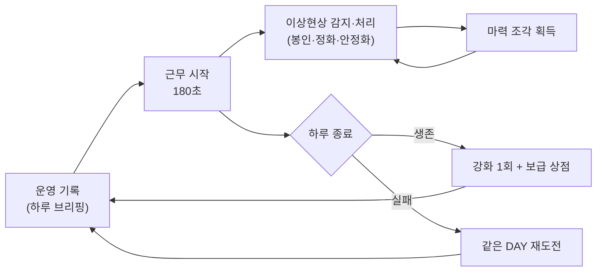
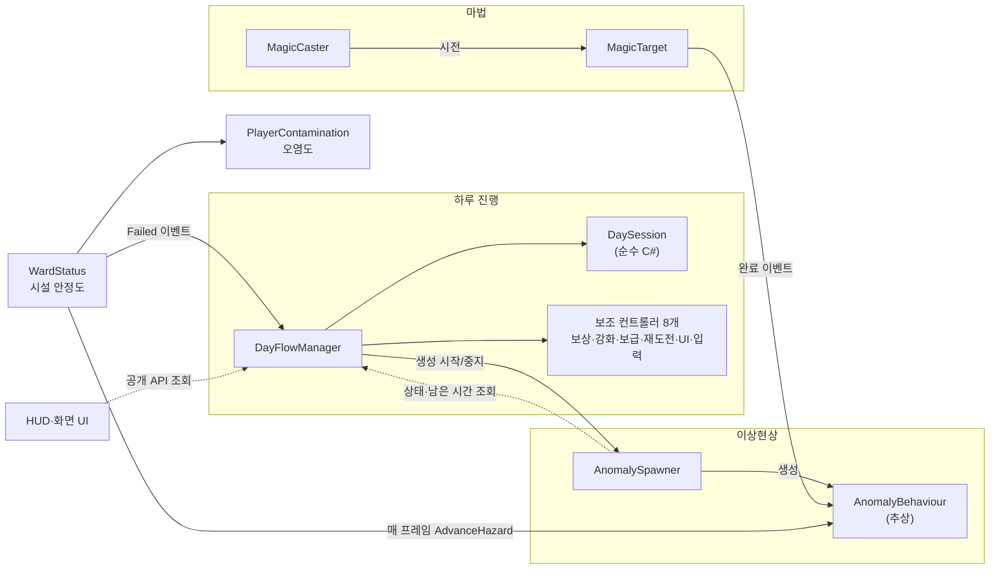
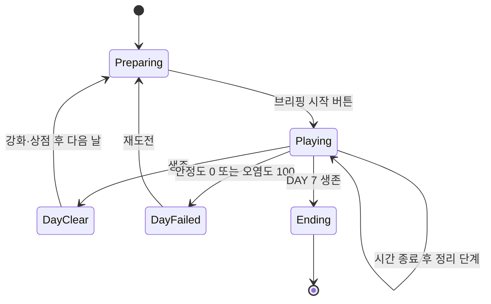
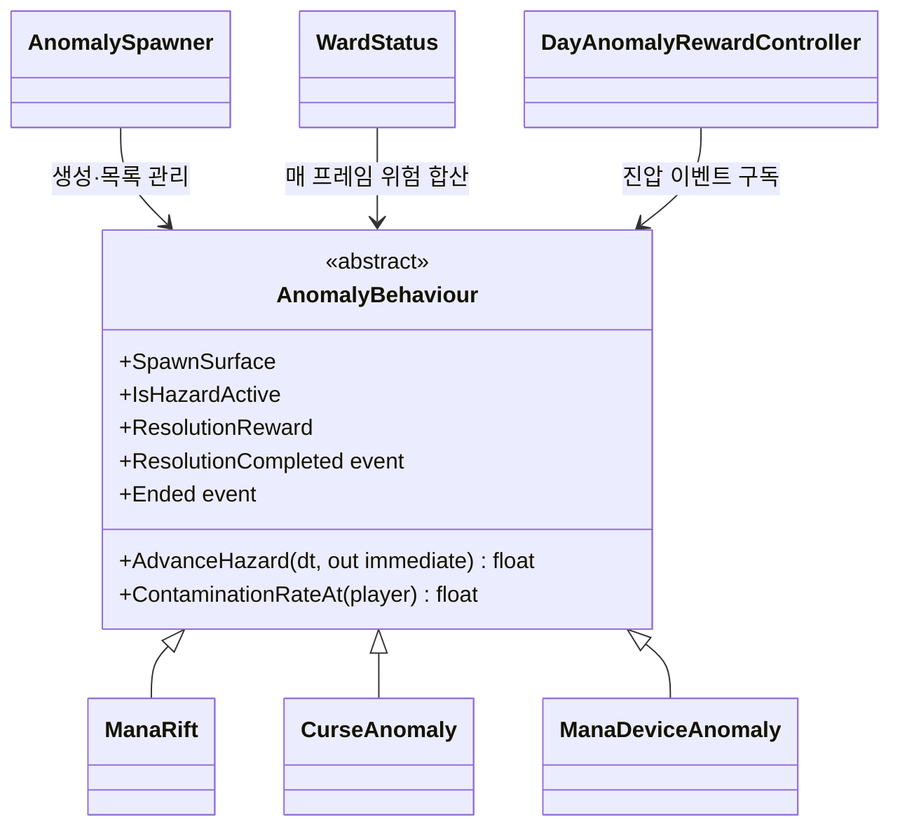
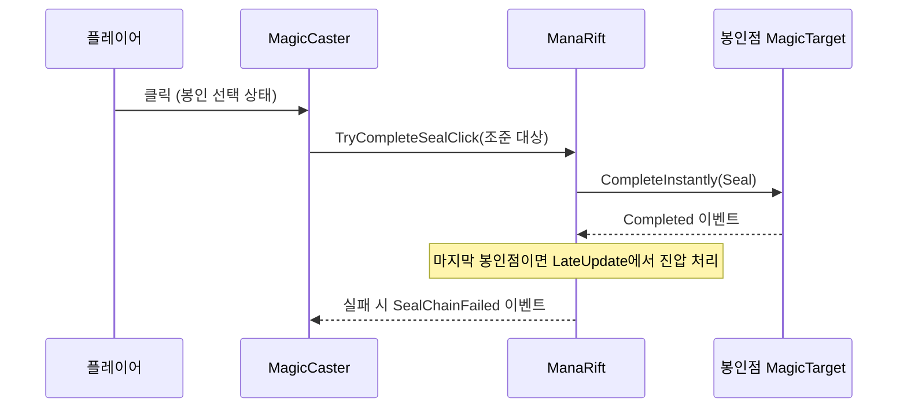

# ARCANE SHIFT 기술 문서

> **마법 시설에서 생기는 이상현상을 처리하며 7일을 버티는 1인칭 3D 판타지 생존 게임**

| 항목      | 내용                                                                |
|-----------|---------------------------------------------------------------------|
| 장르      | 1인칭 3D 판타지 생존 게임                                           |
| 개발 기간 | 2주 (2026.10.21 ~ 2026.11.03)                                       |
| 개발 인원 | 1인 (개인 프로젝트)                                                 |
| 개발 환경 | Unity 6 (6000.3.15f1), C#, Rider                                    |
| 주요 기술 | |
| 링크      | GitHub: - · 시연 영상: -   |                                         |

<!-- 이미지 배치 제안: 제목 아래에는 시설과 플레이어 시점이 함께 보이는 대표 이미지, 1.3에는 게임 화면을 배치. 실제 파일을 확보한 뒤 경로를 연결하세요. -->

---

## 목차

1. [프로젝트 개요](#1-프로젝트-개요)
2. [전체 구조](#2-전체-구조)
3. [시스템 ① 하루 진행 루프](#3-시스템-①-하루-진행-루프)
4. [시스템 ② 이상현상 공통 구조와 생성](#4-시스템-②-이상현상-공통-구조와-생성)
5. [시스템 ③ 마법 시전 판정](#5-시스템-③-마법-시전-판정)
6. [트러블슈팅](#6-트러블슈팅)
7. [결과 및 회고](#7-결과-및-회고)

---

## 1. 프로젝트 개요

### 1.1 무엇을 만들었나 (What)

**ARCANE SHIFT**는 플레이어가 마법 시설의 근무자가 되어,
하루(DAY) 동안 시설 곳곳에 생기는 **이상현상**을 마법으로 처리하며 **7일**을 버티는 1인칭 3D 게임입니다.

- 하루는 **근무 시간 180초**입니다. (`MainGame` 씬의 `DayFlowManager.dayDurationSeconds` 값)
- 이상현상을 방치하면 단계가 올라가며 **시설 안정도**가 떨어지고, 가까이 있으면 플레이어의 **마력 오염도**가 오릅니다.
- 시설 안정도가 0이 되거나 오염도가 100이 되면 그날은 **실패**하고, 그날 시작 상태로 **재도전**합니다.
- 처리한 이상현상마다 **마력 조각**을 받아, 하루가 끝나면 **강화**와 **보급품**을 삽니다.

### 1.2 왜, 무엇에 집중했나 (Why)

2주간 진행한 개인 프로젝트에서 하나의 마법 시설을 반복해서 플레이하되, 매일 같은 일을 되풀이한다는 느낌은 줄이고 싶었습니다. 그래서 **7일 생존**을 큰 목표로 두고, DAY에 따라 등장하는 이상현상과 위험도, 처리 보상과 강화를 바꾸는 시스템 중심의 플레이를 구상했습니다. 현재 구현에는 DAY별 생성 규칙과 보상·강화가 들어가 있습니다. 다만 엔딩 뒤 새 회차에 이어지는 해금이나 기록은 없어, 장기적인 반복 플레이까지 완성한 것은 아닙니다(1.6 참고).

이상현상을 발견한 뒤 마법을 한 번 클릭하면 바로 사라지는 방식보다, **감지하고 알맞은 조작으로 해결하는 과정**을 만들고 싶었습니다. Q 감지, 순서와 시간 제한이 있는 봉인, 누르고 진행하는 정화·안정화가 이 방향을 구현한 규칙입니다. 아래 장에서는 이 플레이가 하루 진행, 이상현상, 마법 시전 구조에 어떻게 연결되는지 설명합니다. [본인 확인 필요: 실제 플레이에서 이 의도가 느껴졌는지]

한정된 공간에서 플레이 할 때 마다 다른 경험이 나올 수 있게 하는 것, 점점 난이도가 올라가면서 요령이 생기는 것
지난 프로젝트에 사용하지 않았던 랜덤,강화 시스템 등을 넣어보고 싶었음

### 1.3 핵심 플레이 루프

코드의 상태 흐름(`DayState`) 기준으로 정리하면 다음과 같습니다.



- DAY 7을 마치면 엔딩 화면으로 넘어갑니다(`DaySession.CompleteDay`에서 `DayState.Ending`).

### 1.4 AI 활용 범위와 본인 역할

게임의 핵심 방향은 제가 정했고, 세부 기획은 AI와 논의하며 구체화했습니다. C# 코드 대부분은 Codex를 활용해 작성했습니다. 제가 직접 코드를 작성하거나 아래 기술 구조를 독자적으로 설계한 것으로 읽히지 않도록 역할을 구분했습니다.

| 구분 | 내용 |
|---|---|
| 본인이 정한 기획 방향 | 마법 시설에서 이상현상을 처리하며 7일 생존하고, DAY별 변화와 보상·강화로 반복 플레이를 만드는 방향. 단순 클릭 해결보다 감지·조작 과정이 있는 상호작용을 원했음 |
| AI와 함께 구체화한 기획 | 위 방향을 구체적인 규칙과 흐름으로 다듬는 데 AI와 논의함. [본인 확인 필요: 함께 정한 세부 규칙과 수치, 직접 결정한 범위] |
| Codex가 구현한 코드 | C# 코드 대부분을 Codex를 활용해 작성함. 이 문서의 구조·코드 설명은 기존 기술문서에 담긴 구현 내용을 정리한 것임. [본인 확인 필요: 직접 작성·수정한 코드가 있다면 범위] |
| 본인이 한 확인과 수정 요청 | 실제 플레이로 기능과 수치를 확인하고 수정 요청을 함. [본인 확인 필요: 어떤 장면에서 무엇을 확인했고 어떤 수치를 바꾸도록 요청했는지, 변경 후 다시 확인한 결과] |

> 이 포트폴리오 저장소에는 Unity 원본 프로젝트가 포함되어 있지 않습니다. 아래 구현 설명과 파일명은 기존 기술문서를 바탕으로 정리했으며, 최종 제출 전 원본 프로젝트와 대조해야 합니다.

### 1.5 조작법

코드의 입력 바인딩 기준입니다.

| 입력 | 동작 | 근거 |
|---|---|---|
| WASD · 마우스 | 이동 · 시점 (Starter Assets 1인칭 컨트롤러) | `StarterAssetsInputs` |
| 1 / 2 / 3, 마우스 휠 | 마법 선택: 봉인 / 정화 / 안정화 | `MagicCaster`, `MagicCasterInput` |
| 마우스 왼쪽 | 시전 (봉인은 클릭, 정화·안정화는 누르고 있다가 놓기) | `MagicCaster.UpdateCastingInput` |
| Q (누르고 있기) | 주변 마법 대상 감지 | `MagicDetector.senseAction` |
| E | 아이템 줍기 | `PlayerPickupInteractor` |
| B / Tab / Esc | 인벤토리 / 시설 지도 / 일시정지 | `DayInputController` |
| F8 | DAY 건너뛰기 (디버그용, **현재 씬에서 켜져 있음**) | `DayFlowManager.CheatAdvanceDay` |

### 1.6 기획 목표와 현재 구현 상태

| 기획 구상 | 현재 상태 | 근거 |
|---|---|---|
| 7일 생존, 하루 단위 진행 | **구현됨** | `DayFlowManager`, `DaySession` (`finalDay = 7`) |
| 이상현상 발생 | **구현됨** — 3종: 마력 균열 · 저주 오염 · 마력 장치 폭주 | `ManaRift`, `CurseAnomaly`, `ManaDeviceAnomaly` |
| DAY별 난이도 변화 | **구현됨** — DAY마다 허용 종류·동시 개수·생성 간격이 다름, DAY 5~7 특별 마력 균열 | `AnomalySpawner.CreateDefaultDayProfiles`, `SpecialManaRiftSchedule` |
| 마법 상호작용 | **구현됨** — 봉인(연쇄 클릭) · 정화(타이밍/누르고 있기) · 안정화, Q 감지 | `MagicCaster`, `MagicTarget`, `MagicDetector` |
| 보상 | **구현됨** — 정상 처리 1건당 마력 조각 1개 | `AnomalyBehaviour.ResolutionReward`, `DayAnomalyRewardController` |
| 강화 | **구현됨** — 기동력·시설 방호·오염 저항 각 3단계, 하루 1회 구매 | `DayUpgradeController` |
| 보급·아이템 | **구현됨** — 정화약·비상 수리 키트, 4칸 인벤토리, 상점당 2회 구매 | `PlayerInventory`, `DaySupplyController` |
| 실패 시 재도전 | **구현됨** — 그날 시작 상태로 복원 | `DayRetryCheckpoint` |
| **반복 플레이** | **부분 구현** — 엔딩 뒤 게임 씬을 다시 불러오는 "처음부터 다시"만 있음. 회차 간에 남는 진행(해금·기록 등)은 **없음** | `Day5HUD.RestartGameplay` |
| 저장·불러오기 | **없음** — 게임을 끄면 진행이 사라짐. `PlayerPrefs`는 튜토리얼 표시 여부에만 사용 | `DayTutorialController` |
| 범람 조건(DAY 4~7 특수 규칙), 안전 구역 | **제거된 것으로 기록됨** — 원본 프로젝트에서 확인 필요 | 기존 문서에 적힌 `Docs/Flood-Conditions.md`와 "안전 구역 관련 시스템 제거" 커밋 |
| 다른 종류의 이상현상 | **없음** — 스포너에 "기타" 칸만 있고 실제 클래스는 없음 | `AnomalySpawner.SpawnKind.Other` |

[본인 확인 필요: 기획 문서상 "반복 플레이"가 뜻하는 것(회차 보상? 랜덤성?)과, 위 표에 없는 기획 기능이 있으면 추가해 주세요.]

### 1.7 이 문서에서 다루는 내용

1. **하루 진행 루프** — 상태 관리, 근무 종료 후 정리 단계, 재도전 (3장)
2. **이상현상 공통 구조와 생성** — 공통 계약, 가중치 생성, 위험 합산 (4장)
3. **마법 시전 판정** — 시전자와 대상의 책임 분리, 연쇄 봉인 (5장)

---

## 2. 전체 구조

### 2.1 아키텍처

이 그림에서 볼 것: **`DayFlowManager`가 거의 모든 시스템을 직접 호출**하고, 이상현상의 위험은 **`WardStatus`가 매 프레임 모아서** 계산합니다.



### 2.2 클래스 역할

| 클래스 | 책임 | 파일 |
|---|---|---|
| `DayFlowManager` | 하루 시작·종료·실패·다음 날 전환을 지휘. 보조 컨트롤러를 만들고 연결 | `Day/DayFlowManager.cs`, `Day/DayFlowManager.Api.cs` |
| `DaySession` | 현재 DAY·상태·남은 시간·난수 시드만 보관하는 **MonoBehaviour가 아닌** 클래스 | `Day/DaySession.cs` |
| `DayAnomalyRewardController` | 이상현상 1건당 보상을 **한 번만** 지급 | `Day/DayAnomalyRewardController.cs` |
| `DayUpgradeController` | 강화 단계·가격·효과 적용 | `Day/DayUpgradeController.cs` |
| `DayRetryCheckpoint` | 하루 시작 상태를 저장하고 재도전 때 복원 | `Day/DayRetryCheckpoint.cs` |
| `AnomalySpawner` | DAY 규칙에 따라 이상현상 종류·위치를 골라 생성 | `Anomalies/Common/AnomalySpawner.cs` |
| `AnomalyBehaviour` | 모든 이상현상의 공통 계약(위험 진행, 오염, 종료 이벤트) | `Anomalies/Common/AnomalyBehaviour.cs` |
| `WardStatus` | 이상현상 위험을 합산해 시설 안정도를 깎고 실패를 판정. **게임 일시정지·커서·입력 차단도 함께 담당** | `Facility/WardStatus.cs` |
| `MagicCaster` | 입력과 조준을 읽어 시전을 시작·유지·종료 | `Magic/MagicCaster.cs` |
| `MagicTarget` | 대상별 시전 진행도와 성공·실패 판정 | `Magic/MagicTarget.cs` |

현재 구현은 하루의 상태(`DaySession`)와 Unity 오브젝트를 조정하는 흐름(`DayFlowManager`)을 나누고, 보상·강화·재도전 등의 처리를 보조 컨트롤러에 맡깁니다. 다만 컨트롤러를 만들고 연결하는 책임은 여전히 `DayFlowManager`에 모여 있습니다. 이 분리의 실제 제안·수정 과정은 [본인 확인 필요]입니다.

### 2.3 현재 구조의 주요 개선 지점

기존 문서의 코드 설명을 바탕으로 영향이 큰 네 가지를 추렸습니다. 실제 코드와 실행 결과는 원본 Unity 프로젝트에서 다시 확인해야 합니다.

| # | 문제 | 근거 | 영향 |
|---|---|---|---|
| 1 | **`DayFlowManager`의 책임 집중**: 상태 전환뿐 아니라 보조 컨트롤러 연결과 스포너·마법·UI 조정을 맡음 | `DayFlowManager`, `DayFlowManager.Api.cs` | 하루 흐름을 고칠 때 여러 시스템의 호출 순서를 함께 살펴야 함 |
| 2 | **생성 종료 판단의 분산**: 매니저가 생성 창을 제어하고 스포너도 남은 시간을 확인하며, 생성 중지 명령이 여러 전환 경로에 반복됨 | `DayFlowManager.LateUpdate`, `AnomalySpawner.CanSpawnNow` | 종료·실패·재도전 경로 중 하나를 고칠 때 다른 경로를 놓치기 쉬움 |
| 3 | **새 이상현상 추가 시 수정 범위가 넓음**: 공통 추상 클래스가 있지만 성장·파열 계산이 종류별로 반복되고 구체 타입 검사도 남아 있음 | 각 이상현상의 `AdvanceHazard`, `DaySpawnProfile.Allows`, `MagicCaster.AimedTarget` | 종류가 늘면 공통 처리뿐 아니라 생성·오염·마법 판정도 점검해야 함 |
| 4 | **활성 이상현상 목록의 이중 관리** | `AnomalyBehaviour.ActiveAnomalies`, `AnomalySpawner.activeAnomalies` | 위험 계산과 남은 개수 판단이 서로 다른 목록을 볼 가능성이 있음 |

---

## 3. 시스템 ① 하루 진행 루프

### 3.1 개요

하루는 **준비 → 근무 → (정리) → 성공/실패** 순서로 진행됩니다.
근무 시간이 끝나도 남은 이상현상이 있으면 바로 끝내지 않고, **남은 것을 다 처리하거나 파열될 때까지 기다리는 정리 단계**가 있습니다.



### 3.2 구조

- **`DaySession`**(순수 C#): 상태·DAY·남은 시간·시드만 바꿉니다. Unity 오브젝트를 몰라서 상태 전이 규칙만 따로 읽을 수 있습니다.
- **`DayFlowManager`**(MonoBehaviour): `DaySession`의 상태를 보고 스포너·마법·UI·오디오에 명령을 내립니다.
- **재도전**: 하루 준비가 끝난 순간 `DayRetryCheckpoint.Capture`가 인벤토리·필드 아이템·`IDayRetryCheckpointParticipant` 구현체의 상태를 저장하고, 실패 후 `Restore`로 되돌립니다.
- **같은 날은 같은 난수**: 하루마다 시드를 만들어 `AnomalySpawner.ConfigureForDay`에 넘기고, 스포너는 `System.Random(seed)`로 종류와 위치를 뽑습니다. 재도전 때는 시드를 바꾸지 않습니다(`DaySession.EnsureDaySeed`는 시드가 0일 때만 새로 정함).

### 3.3 핵심 기능 — 근무 종료와 정리 단계

외부에서 쓰는 방법: UI는 `BeginNextDay()`, `RetryCurrentDay()`, `TryPurchaseUpgrade(type)`를 호출하고, `State`·`RemainingSeconds`·`IsCleaningUp`을 읽어 화면을 그립니다.

```csharp
// Day/DayFlowManager.cs — LateUpdate (Codex 작성 코드)
private void LateUpdate()
{
    if (dayInput != null && dayInput.SuppressDayTickThisFrame) return;
    if (state != DayState.Playing || Time.timeScale <= 0f) return;
    if (wardStatus != null && wardStatus.HasFailed)
    {
        OnDayFailed(wardStatus.FailureReason);
        return;
    }

    if (remainingSeconds > 0f)
    {
        session.AdvanceTime(Time.deltaTime);
        if (anomalySpawner != null)
            anomalySpawner.SetSpawnWindowOpen(remainingSeconds > Mathf.Max(0f, spawnStopBeforeEndSeconds));
    }

    if (remainingSeconds <= 0f)
    {
        if (anomalySpawner != null)
        {
            anomalySpawner.SetSpawningEnabled(false);
            anomalySpawner.SetSpawnWindowOpen(false);
        }
        int activeCount = anomalySpawner != null ? anomalySpawner.ActiveAnomalyCount : 0;

        if (activeCount > 0)
        {
            if (!session.IsCleaningUp)
            {
                anomalyRewards.FreezeRewardsForCleanup(anomalySpawner.ActiveAnomalies);
                session.BeginCleanup();
            }
            return;
        }

        if (HasSurvivedDay()) CompleteDay();
        else if (wardStatus == null || !wardStatus.HasFailed)
            OnDayFailed("근무 종료 시 생존 조건을 만족하지 못했습니다.");
    }
}
```

**코드 설명 (기존 문서를 바탕으로 정리):**

- 종료 20초 전(`spawnStopBeforeEndSeconds`, 기존 문서에 적힌 씬 값 20)부터 새 이상현상 생성을 멈춥니다. 이 간격을 둔 기획 이유는 [본인 확인 필요]입니다.
- 시간이 0이 되어도 이상현상이 남아 있으면 `BeginCleanup()`으로 **정리 단계**에 들어가고 `return`합니다. 그동안에도 `WardStatus`는 위험을 계속 계산하므로 방치하면 실패할 수 있습니다.
- 정리 단계에 들어갈 때 `FreezeRewardsForCleanup`으로 남은 현상의 보상을 그 시점 값으로 고정합니다.
- 기존 문서에는 이 기능과 관련된 10/28 수정 기록이 언급됩니다. 원본 프로젝트의 Git 기록과 도입 이유는 6장에서 확인 항목으로 남겼습니다.

**보상 중복 방지** (`DayAnomalyRewardController.RewardResolution`): 이상현상의 `GetInstanceID()`를 `HashSet`에 넣고, 이미 들어 있으면 지급하지 않습니다. 진압 이벤트가 두 번 와도 보상은 한 번입니다.

### 3.4 현재 구현에 대한 사후 분석

**기획 방향**은 하루 근무, 결과 정산, 강화, 실패 시 같은 DAY 재도전으로 이어지는 흐름이었습니다. 아래는 Codex가 구현한 상태 관리 구조를 현재 시점에서 비교한 것으로, 개발 당시 제가 대안을 직접 검토해 선택했다는 기록은 아닙니다.

| 구조 | 장점 | 한계 |
|---|---|---|
| **현재: `DaySession` + `DayFlowManager`** | 상태 데이터와 Unity 오브젝트 조정을 나눠 하루 흐름을 따라가기 쉬움 | 매니저에 호출과 전환 처리가 집중됨 |
| 향후 검토: 상태별 처리 또는 이벤트 분리 | 상태 전환에 따른 시스템별 처리를 나눌 수 있음 | 호출 순서와 공유 데이터의 흐름을 별도로 관리해야 함 |

[본인 확인 필요: 정리 단계와 같은 DAY 재도전을 요청한 계기, 플레이에서 확인한 결과]

---

## 4. 시스템 ② 이상현상 공통 구조와 생성

### 4.1 개요

| 이상현상 | 생성 위치 | 대응 마법 | 처리 방법 | 방치하면 |
|---|---|---|---|---|
| 마력 균열 `ManaRift` | 벽 | 봉인 | 단계에 따라 봉인점 2·3·4개를 정해진 순서로 제한 시간 안에 클릭 | 20초·40초에 단계 상승, 60초에 파열(안정도 −20) |
| 저주 오염 `CurseAnomaly` | 바닥 | 정화 | 바닥 패치를 하나씩 누르고 있어 정화 | 패치 확산, 단계 상승, 파열 |
| 마력 장치 폭주 `ManaDeviceAnomaly` | 시설의 장치 | 안정화 | 장치를 누르고 있어 안정화. 원형 방출·추적 마력탄을 피해야 함 | 단계 상승, 파열 |

- 2·3단계에서는 초당 0.5·1의 시설 안정도가 떨어집니다(`ManaRift` 기본값).
- DAY 1은 마력 균열만, DAY 2부터 저주 오염, DAY 3부터 장치 폭주가 나옵니다(`AnomalySpawner.CreateDefaultDayProfiles`). [본인 확인 필요: 씬 Inspector에서 값을 바꿨다면 씬 값 기준으로 고쳐 주세요]

### 4.2 구조

이 그림에서 볼 것: 세 이상현상은 `AnomalyBehaviour`라는 **같은 계약**을 따르고, 스포너와 `WardStatus`는 이 계약만 보고 다룹니다.



### 4.3 핵심 기능 ① — 위험 합산 (지속 피해와 즉시 피해 분리)

```csharp
// Facility/WardStatus.cs — LateUpdate 일부 (Codex 작성 코드)
float persistentStabilityLoss = 0f;
float immediateStabilityLoss = 0f;
foreach (AnomalyBehaviour anomaly in anomalies)
{
    persistentStabilityLoss += anomaly.AdvanceHazard(Time.deltaTime,
        out float anomalyImmediateStabilityLoss);
    immediateStabilityLoss += anomalyImmediateStabilityLoss;
    if (!anomaly.IsHazardActive) continue;
    HighestStage = Mathf.Max(HighestStage, anomaly.DangerStage);
    HasOverloadedAnomaly |= anomaly.HasOverloaded;
}
stability = Mathf.Clamp(stability
    - persistentStabilityLoss * persistentStabilityDamageMultiplier
    - immediateStabilityLoss, 0f, 100f);
// ...
if (player.isActiveAndEnabled)
    player.Advance(Time.deltaTime, anomalies);
if (stability <= 0f || player.Value >= 100f)
    Fail(stability <= 0f ? "시설 안정도 0" : "마력 오염도 100");
```

**코드 설명 (기존 문서를 바탕으로 정리):**

- 각 이상현상은 `AdvanceHazard`에서 **지속 피해**(단계별 초당 손실)를 반환하고, 파열 피해는 `out` 매개변수로 **따로** 돌려줍니다.
- 이렇게 나눈 이유는 **시설 방호 강화**가 지속 피해에만 배수(`persistentStabilityDamageMultiplier`)를 곱하고 파열 피해는 줄이지 않기 때문입니다(`DayUpgradeController.ApplyEffects`, `AnomalyBehaviour.AdvanceHazard` 주석).
- 각 이상현상의 `AdvanceHazard`는 이전 나이와 다음 나이 사이에서 **단계 경계를 넘은 시간만큼** 손실을 나눠 계산합니다. 프레임이 길어도 단계가 바뀌는 순간을 넘겨 계산하지 않습니다(`ManaRift.AdvanceHazard`).

### 4.4 핵심 기능 ② — 가중치로 종류를 먼저 뽑고, 위치는 나중에

```csharp
// Anomalies/Common/AnomalySpawner.cs — TrySpawnNextAnomaly 일부 (Codex 작성 코드)
// 가능한 지점 수와 무관하게 종류를 먼저 뽑고, 그 종류의 지점을 나중에 뽑습니다.
var groups = new List<SpawnGroup>();
foreach (AnomalyBehaviour prefab in prefabs)
{
    if (!IsValidPrefab(prefab)) continue;
    int weight = activeDayProfile != null ? activeDayProfile.GetSpawnWeight(prefab) : 1;
    if (weight <= 0) continue;

    List<AnomalySpawnPoint> points = GetUsableSpawnPoints(availableSpawnPoints, prefab);
    if (points.Count == 0) continue;

    SpawnKind kind = GetSpawnKind(prefab);
    SpawnGroup group = groups.Find(candidate => candidate.Kind == kind);
    if (group == null)
    {
        group = new SpawnGroup(kind, weight);
        groups.Add(group);
    }
    group.Options.Add(new SpawnOption(prefab, points));
}
// ... (빈 지점이 없으면 경고 후 종료)
int totalWeight = 0;
foreach (SpawnGroup group in groups) totalWeight += group.Weight;
int draw = NextRandom(totalWeight);
SpawnGroup selectedGroup = groups[0];
foreach (SpawnGroup group in groups)
{
    if (draw < group.Weight) { selectedGroup = group; break; }
    draw -= group.Weight;
}

SpawnOption selectedOption = selectedGroup.Options[NextRandom(selectedGroup.Options.Count)];
AnomalySpawnPoint selectedPoint = SelectPoint(selectedOption.Points, availableSpawnPoints);
return TrySpawnAt(selectedPoint, selectedOption.Prefab);
```

**코드 설명 (기존 문서를 바탕으로 정리):**

- 위치를 먼저 뽑으면 **생성 지점이 많은 종류가 더 자주 나오는** 치우침이 생깁니다. 그래서 종류를 가중치로 먼저 뽑고, 그 종류가 쓸 수 있는 빈 지점 중에서 위치를 고릅니다.
- 쓸 수 있는 빈 지점이 없는 종류는 후보에서 빠지므로, 뽑은 뒤 "자리가 없어 실패"하는 경우가 줄어듭니다.
- `NextRandom`은 하루 시드로 만든 `System.Random`을 쓰므로 재도전 때 같은 순서가 나옵니다(난수를 쓰는 횟수가 같을 때).
- 지점 표면(`SpawnSurface`)이 맞지 않거나 이미 점유된 지점은 `AnomalySpawnPoint.CanSpawnPrefab`에서 걸러집니다.
- DAY 5~7에는 정해진 시간 뒤에 2·3단계로 시작하는 **특별 마력 균열**이 일반 생성보다 먼저 시도됩니다(`TrySpawnDueSpecialRift`). 자리가 없으면 기존 현상을 지우지 않고 기다립니다.

### 4.5 현재 구현에 대한 사후 분석

**기획 방향**은 DAY가 지날수록 다른 이상현상과 위험을 마주하고, 종류에 맞는 마법으로 처리하도록 만드는 것이었습니다. 아래는 Codex가 구현한 공통 구조의 장단점을 지금 살펴본 내용입니다.

| 구조 | 장점 | 한계 |
|---|---|---|
| **현재: `AnomalyBehaviour` 상속** | 위험 계산과 종료 이벤트를 공통 방식으로 다룰 수 있음 | 성장 계산의 반복과 구체 타입 검사 때문에 새 종류를 추가할 때 여러 곳을 고쳐야 함 |
| 향후 검토: 공통 성장 계산·종류별 데이터 분리 | 같은 계산을 재사용하고 DAY별 수치를 조정하기 쉬워질 수 있음 | 기존 세 종류의 개별 규칙을 분리해 옮기는 작업이 필요함 |

[본인 확인 필요: 이상현상 종류와 DAY별 등장 순서를 정할 때 직접 판단한 기준]

---

## 5. 시스템 ③ 마법 시전 판정

### 5.1 개요

단순 클릭만으로 위험을 없애지 않고, **Q로 대상을 찾은 다음 마법별 조작을 수행하는 과정**을 만들고자 했습니다. 특히 봉인은 감지한 첫 봉인점에서 시작해 순서대로 이어 가야 하므로, 균열을 관찰하고 제한 시간 안에 움직이는 플레이가 됩니다. 실제로 이 경험이 충분히 전달됐는지는 [본인 확인 필요]입니다.

| 마법 | 방식 | 판정 |
|---|---|---|
| 봉인 | 클릭. Q로 감지한 **첫 봉인점**부터 시작해, 정해진 순서대로 제한 시간(기본 2초) 안에 클릭 | 순서가 틀리거나 시간 초과면 연쇄 전체 실패 |
| 정화 | 누르고 있기. 저주 패치는 누른 채 다음 패치로 옮겨 이어서 정화 가능 | 대상 설정에 따라 다름 |
| 안정화 | 누르고 있기. 방출을 피한 직후에는 안정화 속도 보너스(1.5배) | 진행도가 누적됨(취소해도 유지) |

`MagicTarget`에는 **타이밍 판정**도 있습니다. 버튼을 놓은 순간의 진행도가 안정 구간(기본 60~85%) 안이면 성공, 모자라면 `Undercharged`, 넘치면 `Overcharged`입니다. [본인 확인 필요: 현재 어떤 대상에 타이밍 판정이 켜져 있는지 — 프리팹 설정에 따라 다릅니다]

### 5.2 구조

- **`MagicCaster`**: 입력·조준·마법 선택을 맡습니다. 기존 문서에는 입력 읽기를 `MagicCasterInput`으로 분리한 11/02 수정이 언급되어 있습니다. [본인 확인 필요: 원본 Git 기록]
- **`MagicTarget`**: 진행도·완료·결과 판정을 맡습니다. 결과가 정해지면 `CastResolved`, 성공이면 `Completed` 이벤트를 보냅니다.
- **`ManaRift`**: 자기 봉인점들의 순서와 제한 시간을 관리하고, 모두 완료되면 `NotifyResolved()`로 공통 진압 이벤트를 보냅니다.



### 5.3 핵심 기능 — 연쇄 봉인 판정

```csharp
// Anomalies/ManaRift/ManaRift.cs — TryCompleteSealClick (Codex 작성 코드)
public bool TryCompleteSealClick(MagicTarget target)
{
    if (!IsHazardActive) return false;
    if (sealStep == 0)
    {
        MagicTarget first = ExpectedSealPoint;
        // Q 홀드 감지로 발견한 첫 번째 점만 봉인을 시작할 수 있습니다.
        if (target != first || first == null || !first.IsDetected) return false;
        if (!first.CompleteInstantly(MagicType.Seal)) return false;
        if (this == null || isResolved || hasRuptured) return true;
        sealStep = 1;
        sealChainDeadline = Time.time + SealChainTimeout;
        showingSealFailure = false;
        RefreshSealPointVisuals();
        return true;
    }

    if (!IsSealChainInProgress) return false;
    MagicTarget expected = ExpectedSealPoint;
    if (Time.time > sealChainDeadline || target != expected || expected == null
        || !expected.CompleteInstantly(MagicType.Seal))
    {
        FailSealChain();
        return false;
    }

    sealStep++;
    if (sealStep >= SealPointCount) sealChainDeadline = 0f;
    RefreshSealPointVisuals();
    return true;
}
```

**코드 설명 (기존 문서를 바탕으로 정리):**

- 첫 클릭은 **Q로 감지된 첫 봉인점**에만 받습니다. 감지 없이 아무 데나 누르는 것을 막아 "감지 → 봉인" 순서를 강제합니다.
- 첫 성공부터 **전체 연쇄에 하나의 마감 시간**을 둡니다. 클릭마다 시간이 다시 채워지지 않습니다.
- 틀린 대상을 누르거나 시간이 지나면 `FailSealChain()`이 봉인점을 모두 되돌립니다. 시간 초과는 클릭이 없어도 `Update`에서 검사합니다.
- `Time.time`(게임 시간)을 쓰므로 일시정지 중에는 연쇄 시간도 멈춥니다(`ManaRift.Update` 주석).
- 균열이 성장해 단계가 바뀌면 필요한 봉인점 수가 바뀌므로 진행 중인 연쇄를 초기화합니다(`ResetSealChainForStageChange`).
- 마지막 봉인점이 완료되어도 바로 지우지 않고 `LateUpdate`에서 처리합니다. 마지막 봉인점의 완료 효과·다른 구독자가 먼저 실행되게 하려는 것입니다(코드 주석).

### 5.4 현재 구현에 대한 사후 분석

**기획 방향**은 감지 후 조작하여 이상현상을 해결하는 경험입니다. Q 감지는 발견 단계를, 연쇄 봉인은 순서와 시간 압박을 맡습니다. 두 규칙을 누가 어떤 과정에서 구체화했는지는 [본인 확인 필요]입니다. 아래는 Codex가 구현한 시전 구조를 현재 시점에서 살펴본 내용입니다.

| 구조 | 장점 | 한계 |
|---|---|---|
| **현재: `MagicCaster` 입력·조준 / `MagicTarget` 판정** | 대상별 시전 조건과 완료 판정을 나눠 관리할 수 있음 | 시전자가 일부 구체 이상현상 타입을 직접 알아야 함 |
| 향후 검토: 마법별 입력 처리 분리 | 새 마법의 입력 규칙을 독립적으로 추가하기 쉬워질 수 있음 | 마법 간 공통 조준·취소 흐름을 다시 정리해야 함 |

<!-- 이미지 배치 제안: 5.1 뒤에는 Q 감지 전후 화면, 5.3 뒤에는 봉인점 순서와 남은 시간이 보이는 화면을 배치. 실제 파일을 확보한 뒤 연결하세요. -->

---

## 6. 트러블슈팅

현재 포트폴리오 저장소의 Git 기록으로 확인되는 것은 **기술문서의 추가·수정**뿐입니다. Unity 원본 코드와 그 커밋 기록은 이 저장소에 없으므로, 아래 항목을 실제로 겪은 문제나 검증된 해결 결과로 단정할 수 없습니다.

| 기존 문서에 언급된 수정 후보 | 원본 Git에서 확인할 것 | 본인이 확인할 경험 |
|---|---|---|
| 근무 종료 시 잔여 이상현상 정리(기존 문서의 10/28 기록) | 정리 단계가 추가된 변경 내용과 날짜 | 어떤 플레이 상황에서 문제가 드러났고, 변경 뒤 어떻게 확인했나요? |
| 범람 조건·안전 구역 제거(기존 문서의 10/31·11/01 기록) | 실제 제거 범위와 관련 커밋 | 제거를 요청한 이유와 플레이에 미친 영향은 무엇인가요? |
| `DayFlowManager`·UI·`MagicCaster` 기능 분리(기존 문서의 10/27·11/01·11/02 기록) | 분리 전후 코드와 커밋 | 무엇이 불편했고, 본인이 어떤 수정 요청을 했나요? |
| 범위 판정 수정(기존 문서의 11/02 기록) | 수정된 판정과 변경 코드 | 어떤 상황에서 잘못됐고, 수정 후 무엇을 다시 확인했나요? |

실제로 겪은 사례가 확인되면 **문제 상황 → 원인 확인 → 수정 요청과 변경 내용 → 다시 플레이해 본 결과** 순서로 완성합니다. [본인 확인 필요: 원본 Git 기록, 직접 겪은 문제, 실제 재확인 결과]

---

## 7. 결과 및 회고

### 7.1 결과

기존 문서에 정리된 구현 범위를 기준으로, 하루를 보내고 다음 DAY를 준비하는 흐름과 이상현상 대응 플레이를 만들었습니다. 아래 상태는 최종 제출 전 Unity 원본 프로젝트에서 다시 확인해야 합니다.

| 구분 | 현재 문서에 기록된 결과 |
|---|---|
| 구현된 기능 | 7일 진행과 엔딩, 이상현상 3종과 마법 3종, Q 감지·연쇄 봉인, DAY별 생성 규칙, 위험도·오염도에 따른 실패, 처리 보상·강화·보급, 같은 DAY 재도전 |
| 부분 구현 | 엔딩 뒤 처음부터 다시 시작할 수 있지만, 회차 간 해금·기록이 이어지는 반복 플레이는 없음 |
| 현재 미구현 | 진행 저장·불러오기, 스포너의 "기타"에 대응하는 실제 이상현상 |
| 제외된 규칙 | 기존 문서에 따르면 범람 조건·안전 구역은 구현 후 제거됨 [본인 확인 필요: 원본 기록의 제거 범위와 이유] |

실제 플레이에서 기능과 수치를 확인하고 수정 요청을 했습니다. 어느 DAY까지 직접 플레이했는지, 어떤 수치를 어떻게 바꿨고 다시 확인했는지, 목표한 감지·조작 경험이 전달됐는지는 [본인 확인 필요]입니다. 확인하지 않은 클리어 시간이나 성능 수치는 결과로 적지 않았습니다.

<!-- 이미지 배치 제안: 결과 표 다음에는 강화 선택 화면과 DAY 진행이 보이는 게임 화면을 배치. 실제 파일을 확보한 뒤 연결하세요. -->

### 7.2 아쉬운 점(기술 부채)과 개선 계획

현재 구조와 미구현 기능을 기준으로 우선 검토할 네 가지입니다. 실제 후속 작업의 순서는 [본인 확인 필요]입니다.

| 문제 | 지금 (As-Is) | 개선 방향 (To-Be) |
|---|---|---|
| 하루 흐름의 책임 집중 | `DayFlowManager`가 여러 시스템을 직접 연결·호출 | 생성 중지 등 반복 전환 처리를 묶고, 상태 변화에 따른 시스템별 반응을 분리 검토 |
| 이상현상 확장성 | 성장 계산과 구체 타입 검사가 반복되고 활성 목록도 두 곳에서 관리됨 | 공통 계산과 활성 목록의 기준을 정리해 새 종류 추가 시 수정 범위를 줄이기 |
| 진행 저장 | 종료하면 DAY 진행이 사라짐 | 재도전 체크포인트가 다루는 상태를 검토한 뒤 DAY 시작 상태의 저장·불러오기 설계 |
| 배포·검증 | 기존 문서상 F8 DAY 건너뛰기가 씬에서 켜져 있고, 자동 테스트 실행 여부는 미확인 | 배포 빌드에서 디버그 입력을 제한하고, 하루 상태 전이 등 핵심 규칙의 검증 방법 정리 |

### 7.3 배운 점

[본인 확인 필요: 아래 질문에 실제 경험을 바탕으로 답해 주세요.]

- 감지 후 조작이라는 기획 의도가 실제 플레이에서 드러났나요? 그렇다고 판단한 장면이나, 부족하다고 느낀 장면은 무엇이었나요?
- Codex가 작성한 코드를 읽거나 수정 요청을 하면서 이해하게 된 상태 전이·이벤트·판정 규칙은 무엇인가요?
- 기능 또는 수치를 확인할 때 어떤 상황을 직접 플레이했고, 그 결과 어떤 수정 요청을 했나요? 변경 후 무엇을 다시 확인했나요?
- 2주 안에 기능을 정리하면서 남긴 것과 뺀 것은 무엇이었고, 다음 프로젝트에서는 어떤 순서로 판단하겠나요?
